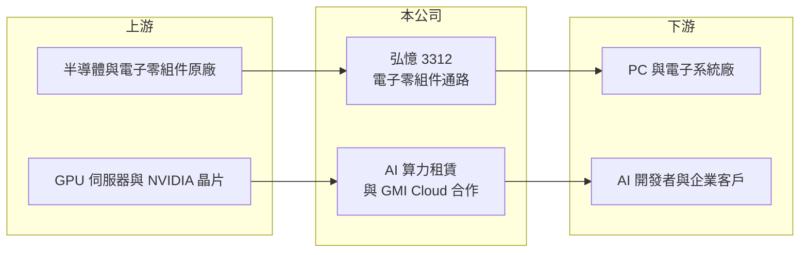

# 3312 弘憶股

> 上市｜[[產業索引-電子通路業|電子通路業]]｜上市（櫃）日期 2010/12/29

# 第一章：企業模式與商業藍圖

> [!info] 撰寫說明
> 精簡版，由 Claude 依公開資料整理，架構比照 [[2330台積電]]，資料截至 2026-10-08。來源：證交所開放資料（基本資料、2026 年第二季財報、股利）、Goodinfo 經營績效與基本資料頁、科技新報與 INSIDE 新聞標題（2026 年 4 月 GMI Cloud 合作）。代理品牌與營收比重未查得。#待校對

弘憶國際是一家年營收約 200 億元的中型電子零組件通路商，2026 年起把觸角延伸到 AI 算力租賃。它的長期故事因此有兩條主線：傳統通路本業的穩定現金流，以及新事業能否提高整體資本報酬。

- **核心業務：** 弘憶成立於 1995 年，2010 年上市，營業項目涵蓋電子零組件買賣、電腦系統設備與主機板週邊的加工買賣，以及租賃業。本業是[[電子通路]]，替半導體原廠向系統廠鋪貨並提供技術支援。
- **營收結構：** 代理品牌與產品比重未查得。毛利率長期約 5% 至 6%，屬於出貨量大、以 PC 與電子系統為主要應用的通路商型態（推估）。
- **新事業：** 依 2026 年 4 月的新聞，弘憶與美國 AI 雲端業者 GMI Cloud 合作布局 [[GPU算力租賃]]，規劃於 2026 年第三季起提供 [[NVDA輝達]] Blackwell 世代的算力服務。同年 4 月董事會也通過認購 GMI Computing Holding (Cayman) 發行的特別股，並為相關公司提供背書保證（後於 8 月撤銷其中一筆）。
- **長期方向：** 算力租賃屬於資本密集、靠設備使用率賺錢的事業，與通路「輕資產、高週轉」的邏輯完全不同。這項轉型若成功，可提高利潤率；若算力價格下滑或使用率不足，則會帶來折舊與減損壓力。

# 第二章：護城河深度與競爭優勢

中型通路商要在大型通路商與原廠直銷之間找到位置，弘憶的策略是本業穩守、新事業求突破。

- **競爭優勢：** 弘憶經營通路三十年，累積原廠代理權與系統廠客戶關係，並具備支撐上百億元營收的[[營運資金]]調度能力。這些是新進者難以短期複製的基礎。
- **主要對手：** 國內大型通路商 [[3702大聯大]]、[[3036文曄]]，以及中型同業 [[3209全科]]、[[6189豐藝]]、3048益登。在算力租賃領域，則面對國際雲端業者與台灣其他跨入 AI 雲端的伺服器與通路業者。
- **觀察重點：** 2025 年 ROE 降到 6.5%，是近 6 年最低，本業獲利力有所下滑。未來幾年的重點在於：通路本業能否回到 10% 以上的 ROE，以及算力租賃的投資金額、使用率與回收年限。

# 第三章：財務體質與盈利規模

資料日期：2026-10-08，表格是撰寫當時的快照；最新月營收、毛利率、累計 EPS 由自動排程寫在本筆記的屬性欄位（月營收、毛利率、累計EPS 等）。#待校對

弘憶的財務數字呈現典型通路商的特徵：毛利率低而穩定，獲利靠營收規模與週轉。

| 年度 | 營收（億元） | [[毛利率]] | [[營業利益率]] | EPS（元） | [[ROE]] |
|---|---|---|---|---|---|
| 2020 | 137 | 4.94% | 2.01% | 1.58 | 13.7% |
| 2021 | 189 | 5.79% | 2.90% | 3.24 | 26.3% |
| 2022 | 193 | 5.43% | 2.93% | 3.08 | 19.9% |
| 2023 | 153 | 5.67% | 2.68% | 1.98 | 11.7% |
| 2024 | 177 | 5.34% | 1.97% | 2.38 | 12.2% |
| 2025 | 210 | 5.28% | 2.39% | 1.74 | 6.5% |
| 2026 上半年 | 122.2 | 5.24% | 2.82% | 1.84 | 未查得 |

- **營收規模：** 2020 至 2025 年營收年複合成長率約 8.9%（推算），2025 年達 210 億元的新高；2026 年前 8 個月營收約 171 億元，年增約 18%（證交所月營收）。
- **獲利：** 近 5 年平均 ROE 約 15.3%（推算），2021 年缺貨潮時一度達 26.3%。2025 年營收創高但 EPS 反而下滑，代表利潤率與業外收益不如前幾年；2026 年上半年 EPS 1.84 元已超過 2025 年全年。
- **財務特色：** 2026 年第二季總資產 129.2 億元、負債 89.0 億元、權益 40.2 億元，負債比約 69%。2025 年度配發現金股利 1.3 元，配發率約 75%；公司章程採股利平衡政策，盈餘分配不低於可分配盈餘的 30%。

**[[ROIC]] 與 [[WACC]]：** 有息負債未查得，以負債總額 40% 估約 35.6 億元（推算假設）。2025 年營業利益約 5.0 億元，稅後約 4.0 億元，除以權益 40.2 億元加有息負債 35.6 億元，ROIC 約 5.3%；2026 年上半年營業利益 3.44 億元年化，ROIC 約 7.3%（推算）。WACC 以 CAPM 推估：無風險利率 1.75%、市場風險溢酬 6%、β 取 1.0（同業常見值），股權成本 7.75%；稅後負債成本 2%，股權占比約 53%，WACC 約 5.1%（推算）。ROIC 僅略高於 WACC，價值創造空間薄；算力租賃若能提高資本報酬，利差才有機會擴大。

# 第四章：總體風險與地緣政治

弘憶的風險同時來自通路本業的週期性，以及新事業的資本密集特性。

- **產業週期：** PC 與電子零組件需求有明顯的庫存循環，2023 年營收從 193 億元降到 153 億元，就是庫存調整的結果。通路商在缺貨期會拉高庫存，需求反轉時面臨跌價與資金積壓。
- **營運風險：** 算力租賃需要大量 GPU 設備投資，GPU 世代更替快、租賃價格可能隨供給增加而下滑，設備折舊與減損會直接影響獲利。此外對特定合作夥伴的投資與背書保證，也增加了關係人風險。
- **其他風險：** 美國對高階 AI 晶片的出口管制會影響算力服務可服務的地區與客戶；營收以美元計價，匯率波動影響換算後營收與業外損益。

# 專有名詞解析

## 應用

- **[[GPU算力租賃]]**：業者購置 GPU 伺服器，按時數或合約把運算能力出租給 AI 開發者，收入取決於設備使用率與租價。

## 金融

- **[[營運資金]]**：存貨加應收帳款減應付帳款，是企業營運需要先墊付的資金，通路商營收成長時需求會同步增加。
- **[[背書保證]]**：公司為他人借款提供擔保，若被保證人無法還款，公司須代為清償，是潛在負債。

## 產業

- **[[電子通路]]**：替半導體原廠向系統廠銷售零組件、備庫存並提供技術支援的中間商，賺取買賣價差與服務價值。

# 核心供應鏈

- 上游：半導體與電子零組件原廠（代理品牌未查得）；算力事業的 GPU 來自 [[NVDA輝達]] 生態系。
- 下游／客戶：PC 與電子系統廠；AI 算力租賃面向 AI 開發者與企業。
- 同業：[[3702大聯大]]、[[3036文曄]]、[[3209全科]]、[[6189豐藝]]、3048益登。

## 最新新聞
<!-- news:start -->
<!-- news:end -->

## 相關連結
- [公開資訊觀測站](https://mopsov.twse.com.tw/mops/web/t05st03?step=1&firstin=1&co_id=3312)
- [Goodinfo](https://goodinfo.tw/tw/StockDetail.asp?STOCK_ID=3312)
- [Yahoo 股市](https://tw.stock.yahoo.com/quote/3312)
- [鉅亨網新聞](https://www.cnyes.com/twstock/3312/news)
