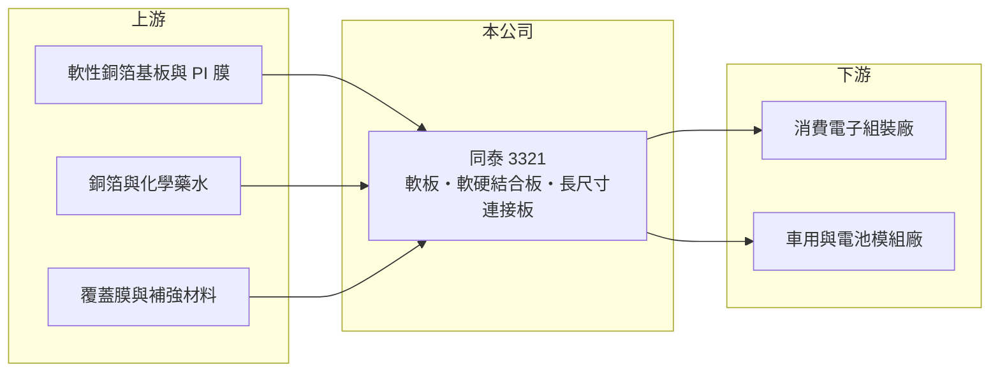

# 3321 同泰

> 上市｜[[產業索引-電子零組件業|電子零組件業]]｜上市（櫃）日期 2015/12/15

# 第一章：企業模式與商業藍圖

> [!info] 撰寫說明
> 精簡版，由 Claude 依公開資料整理，架構比照 [[2330台積電]]，資料截至 2026-10-08。來源：證交所開放資料快照（基本資料、2026 年第二季資產負債與損益、營益分析、股利、每月營收）、Goodinfo 經營績效頁、nStock 公司簡介（含 2023 年新聞標題）。公開資料有限，產品別營收比重、客戶與生產據點未查得；軟板產品定位以 Claude 既有認知整理。#待校對

同泰電子（以下簡稱同泰）是一家位於台中大甲的印刷電路板製造商，以[[軟板]]與[[軟硬結合板]]為主（#待校對），並與 [[3037欣興]] 有集團關係。理解同泰的關鍵在於：公司過去六年持續虧損，2021 至 2025 年平均 ROE 約 -31%，是一家仍在尋找獲利模式的轉型中電路板廠。

- **核心業務：** 同泰成立於 1990 年，歷經 1999、2006 與 2014 年三次合併，2015 年在證交所上市。依公司登記，主要業務是各式印刷電路板及電子零組件的製造、加工與買賣。軟板可以彎折，適合用在空間狹小或需要活動的位置，例如手機、穿戴裝置、車用電子與電池模組的連接。
- **營收結構：** 產品別、應用別與客戶別的營收比重公開資料未查得。依 2023 年新聞標題，同泰當時以欣興集團成員身分，搶攻電動車廠的電源長連接板（#待校對），代表公司嘗試把應用由消費電子轉向車用與能源。
- **營運據點：** 總部與工廠位於台中大甲，其他生產據點公開資料未查得。2026 年第二季總資產約 20.5 億元，其中非流動資產約 4.3 億元，以 PCB 廠而言固定資產比重偏低，推估生產設備多已折舊或規模不大（#待校對）。
- **長期方向：** 同泰的長期課題是讓毛利率回到一成以上並穩定獲利。2026 年前九月營收約 18.3 億元，持續成長，但毛利率仍在一成上下；若車用與能源相關的長板產品能放量，並藉集團資源取得穩定訂單，才有機會擺脫長期虧損。

# 第二章：護城河深度與競爭優勢

同泰目前的競爭地位偏弱，可能的優勢主要來自集團資源與特定利基產品，而非成本或技術領先。

- **競爭優勢：** 軟板產業的優勢通常來自規模、良率與與大客戶的長期認證。同泰規模約 20 億元，遠小於台灣主要軟板廠，2020 至 2025 年毛利率多在 0% 到 12% 之間，顯示定價能力有限。可能的利基在於長尺寸軟板等特殊規格，這類產品需要特殊設備與製程經驗，競爭者較少；與欣興的集團關係也可能帶來客戶介紹與技術支援（推估）。
- **主要對手：** 台灣軟板同業包括 [[4958臻鼎-KY]]、[[6269台郡]]、[[6153嘉聯益]]、8213志超，日本有日本旗勝（Mektec）、住友電工，中國大陸則有東山精密等大量產能。這些對手多數營收規模是同泰的十倍以上。
- **觀察重點：** 長期最該追蹤的是毛利率能否穩定站上一成五，以及營業利益能否轉正。2026 年上半年毛利率約 8.5%、營業利益率約 -5.0%，雖然比 2022 至 2023 年接近零的毛利率改善，但距離獲利仍有距離。

# 第三章：財務體質與盈利規模

資料日期：2026-10-08，表格是撰寫當時的快照；最新月營收、毛利率、累計 EPS 由自動排程寫在本筆記的屬性欄位（月營收、毛利率、累計EPS 等）。#待校對

同泰的財務呈現「營收約 20 億元、毛利率極低、連年虧損」的樣貌：2020 至 2025 年每一年 EPS 都是負數。

| 年度 | 營收（億元） | [[毛利率]] | [[營業利益率]] | EPS（元） | [[ROE]] |
|---|---|---|---|---|---|
| 2021 | 22.4 | 11.6% | -2.4% | -0.54 | -9.5% |
| 2022 | 16.7 | 0.2% | -16.4% | -1.71 | -36.9% |
| 2023 | 15.4 | -0.8% | -18.5% | -4.01 | -43.5% |
| 2024 | 19.7 | 2.3% | -11.9% | -2.15 | -37.3% |
| 2025 | 21.5 | 6.1% | -6.8% | -3.36（待校對） | -30.4% |

（來源：Goodinfo 經營績效頁；2020 年營收 18.6 億元、EPS -2.15 元。證交所股利資料顯示 2025 年本期淨損約 1.80 億元，以目前約 8,611 萬股計算 EPS 約 -2.09 元，與表中 -3.36 元不一致，可能因年度內股數變動，待校對。）

- **營收規模：** 2020 至 2025 年營收由 18.6 億元增至 21.5 億元，年複合成長率約 2.9%（推算）。2022 至 2023 年營收跌到 15 億元上下，2024 年起回升；2026 年前九月累計營收約 18.3 億元，年增約 15%（依前八月官方資料推估）。
- **獲利：** 近五年（2021 至 2025）平均 ROE 約 -31.5%（推算），代表每年虧掉約三成淨值，長期需要靠增資補充資本。2026 年上半年營收約 11.3 億元、毛利率約 8.5%、營業損失約 0.57 億元，歸屬母公司淨損約 0.68 億元、EPS -0.78 元，虧損幅度比 2025 年縮小。
- **財務特色：** 2026 年第二季總資產約 20.5 億元、權益約 6.7 億元、負債約 13.8 億元，負債比約 67%，其中流動負債約 12.0 億元。股本 8.61 億元、每股淨值約 7.80 元，低於面額，代表存在[[累積虧損]]。2023 年新聞標題提到公司將辦理[[現金增資]]，連年虧損的公司通常需要反覆向股東籌資。近年未配發現金股利，Goodinfo 統計歷年平均現金股利約 0.21 元。
- **[[ROIC]] 與 [[WACC]]：** 2025 年營業損失約 1.46 億元（21.5 億元 × -6.8%），虧損年度不計稅盾，以權益 6.7 億元到「權益加全部負債」20.5 億元為投入資本區間，ROIC 約 -7.1% 至 -21.8%（推算）。WACC 以 [[CAPM]] 推估：無風險利率 1.75%、市場風險溢酬 6%、β 假設 1.2（連年虧損股風險較高），權益成本約 9.0%；稅後負債成本假設 2%、負債占五成五，WACC 約 5.1%（推算）。ROIC 遠低於 WACC，代表同泰長期在消耗股東資本；在毛利率回到兩位數以前，任何擴產都可能擴大價值毀損。

# 第四章：總體風險與地緣政治

同泰的風險集中在連年虧損、資本結構弱化，以及大型對手的規模壓力。

- **產業週期：** 軟板需求高度依賴手機、穿戴裝置等消費電子，終端需求波動會透過[[長鞭效應]]放大成訂單起伏。2022 至 2023 年營收與毛利率同步崩落，顯示小型廠在下行週期中受傷最重。
- **營運風險：** 淨值低於股本且負債比約 67%，若虧損持續，可能需要再度增資或面臨借款條件惡化。毛利率接近零時，任何良率問題、原料上漲或價格讓步都會直接擴大虧損。對特定集團或少數客戶的依賴程度未查得，若訂單集中，轉單風險也高。
- **其他風險：** 軟板主要材料為銅箔與聚醯亞胺（PI）基材，價格波動影響成本；PCB 製程涉及電鍍與化學藥水，環保法規趨嚴會增加處理成本。中國大陸軟板產能龐大，長期壓低市場價格。

# 專有名詞解析

## 金融

- **[[累積虧損]]**：公司歷年虧損累積超過盈餘的部分，會使淨值低於股本。
- **[[現金增資]]**：公司發行新股向股東或投資人募集現金，常用於擴產或補充虧損後的資本。
- **[[長鞭效應]]**：終端需求的小幅變動，沿供應鏈往上游傳遞時被逐級放大，造成上游庫存與訂單劇烈波動。

## 產業

- **[[軟板]]**：以可彎折的聚醯亞胺等薄膜為基材的電路板，用於手機、穿戴裝置與電池模組等狹小或活動空間。
- **[[軟硬結合板]]**：把軟板與硬板壓合在一起的電路板，兼具可彎折與承載零件的特性。

# 核心供應鏈

- 上游：軟性銅箔基板、聚醯亞胺膜（具體供應商未查得）、銅箔（例如 8358金居）、覆蓋膜與化學藥水。
- 下游／客戶：消費電子組裝廠、車用與電池模組製造商（具體客戶公開資料未查得，#待校對）；集團關係企業 [[3037欣興]]。
- 同業：[[4958臻鼎-KY]]、[[6269台郡]]、[[6153嘉聯益]]、8213志超，以及日本旗勝、住友電工與中國大陸軟板廠。

## 最新新聞
<!-- news:start（自動產生，請勿手動編輯此範圍） -->
- 2026-10-14 🏛️ 重訊 14:59｜本公司終止與欣興電子科技股份有限公司 簽訂之租賃契約｜[觀測站](https://mops.twse.com.tw/mops/#/web/t05st01)

完整紀錄：[[3321同泰 新聞]]
<!-- news:end -->

## 相關連結
- [公開資訊觀測站](https://mopsov.twse.com.tw/mops/web/t05st03?step=1&firstin=1&co_id=3321)
- [Goodinfo](https://goodinfo.tw/tw/StockDetail.asp?STOCK_ID=3321)
- [Yahoo 股市](https://tw.stock.yahoo.com/quote/3321)
- [鉅亨網新聞](https://www.cnyes.com/twstock/3321/news)
