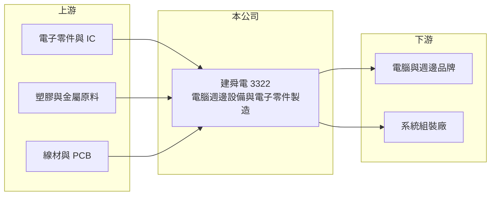

# 3322 建舜電

> 上櫃｜[[產業索引-電子零組件業|電子零組件業]]｜上市（櫃）日期 2009/05/20

# 第一章：企業模式與商業藍圖

> [!info] 撰寫說明
> 精簡版，由 Claude 依公開資料整理，架構比照 [[2330台積電]]，資料截至 2026-10-08。來源：櫃買中心開放資料快照（基本資料、2026 年第二季資產負債與損益、本益比殖利率、每月營收）、Goodinfo 經營績效頁、nStock 公司簡介。公開資料有限，具體產品、營收比重、客戶與生產據點均未查得，本文以財務結構與產業特性為主。#待校對

建舜電子（以下簡稱建舜電）是一家成立近五十年的電腦週邊設備與電子零件製造商。理解建舜電的關鍵在於：它的營收規模約 30 億元，但毛利率在一到兩成之間，屬於典型的代工型製造業，2024 年起本業轉為虧損，獲利能力明顯弱化。

- **核心業務：** 建舜電於 1977 年經經濟部核准設立，總部位於新北汐止，2009 年在櫃買中心掛牌。依公司登記，主要營業項目為電腦週邊設備及電子零件的產銷。這類產品多以 [[OEM]]／ODM 方式替品牌客戶生產，競爭重點在成本、交期與品質穩定度，而非自有技術。
- **營收結構：** 產品別、應用別與客戶別的營收比重公開資料未查得。從毛利率長期落在 14% 至 20% 推斷，產品偏向成熟的電腦週邊與電子零件，附加價值有限（推估）。營收在 2021 年曾達 40.3 億元，之後回到 27 億到 30 億元之間。
- **營運據點：** 總部位於新北汐止，生產據點公開資料未查得。2026 年第二季總資產約 35.6 億元，其中非流動資產約 18.2 億元、占一半以上，顯示公司擁有相當規模的廠房、設備或長期投資。
- **長期方向：** 公開資料未查得公司的轉型或擴張計畫。電腦週邊產業的長期趨勢是終端市場成熟、品牌集中、生產基地從中國移往東南亞；建舜電能否把握客戶的產能移轉需求、或轉向較高毛利的應用，是決定長期前景的關鍵。

# 第二章：護城河深度與競爭優勢

建舜電目前看不出明顯的護城河，競爭地位以長期客戶關係與製造經驗為主。

- **競爭優勢：** 近五十年的經營歷史代表公司累積了一定的製造經驗與客戶關係，電腦週邊品牌客戶在更換代工廠時需要重新驗證品質與交期，因此既有供應商有一定的黏著度。不過，2024 與 2025 年毛利率降到 14% 左右、營業利益率轉負，顯示這種黏著度不足以支撐定價，客戶仍可以壓價或分散訂單。
- **主要對手：** 具體產品未查得，因此無法精確列出直接競爭者。一般而言，電腦週邊與電子零件代工領域的競爭者包括台灣大量的中小型代工廠，以及成本更低的中國大陸與東南亞製造商；大型品牌客戶也常同時使用多家供應商以分散風險。
- **觀察重點：** 長期最該追蹤的是毛利率能否回到 2020 至 2023 年約 18% 至 20% 的水準，以及營業利益能否轉正。2026 年上半年毛利率約 9.9%、營業利益率約 -7.5%，比 2025 年更差，本業壓力仍在加重。

# 第三章：財務體質與盈利規模

資料日期：2026-10-08，表格是撰寫當時的快照；最新月營收、毛利率、累計 EPS 由自動排程寫在本筆記的屬性欄位（月營收、毛利率、累計EPS 等）。#待校對

建舜電的財務呈現「營收持平、毛利率下滑、由盈轉虧」的樣貌：2021 年 ROE 曾達 17.4%，2024 年起轉為負值。

| 年度 | 營收（億元） | [[毛利率]] | [[營業利益率]] | EPS（元） | [[ROE]] |
|---|---|---|---|---|---|
| 2021 | 40.3 | 17.4% | 4.3% | 1.85 | 17.4% |
| 2022 | 27.7 | 18.6% | 4.8% | 1.45 | 11.8% |
| 2023 | 27.3 | 19.5% | 2.2% | 0.58 | 4.3% |
| 2024 | 28.3 | 14.8% | -5.5% | -0.87 | -6.1% |
| 2025 | 30.0 | 13.8% | -3.6% | -0.96 | -7.3% |

（來源：Goodinfo 經營績效頁；2020 年營收 29.4 億元、EPS -0.41 元，2020 年 ROE 欄位與 EPS 不一致，未列入。）

- **營收規模：** 2020 至 2025 年營收由 29.4 億元到 30.0 億元，年複合成長率約 0.4%（推算），實質上沒有成長。2021 年的 40.3 億元高峰推估與疫情期間的遠距辦公與電腦週邊需求暴增有關（#待校對）。2026 年前九月累計營收約 23.6 億元，年增約 3%。
- **獲利：** 近五年（2021 至 2025）平均 ROE 約 3.8%（推算），但趨勢明顯向下。2026 年上半年營收約 16.1 億元、營業損失約 1.20 億元、業外損失約 0.26 億元，歸屬母公司淨損約 1.46 億元、EPS -1.13 元，半年虧損已超過 2025 年全年。
- **財務特色：** 2026 年第二季總資產約 35.6 億元，歸屬母公司權益約 15.8 億元、負債約 19.8 億元，負債比約 56%，其中流動負債約 16.3 億元，而流動資產約 17.5 億元，流動比率約 1.07 倍，短期資金調度空間不大。每股淨值約 11.49 元，近年未配發現金股利，Goodinfo 統計歷年平均現金股利約 0.24 元。
- **[[ROIC]] 與 [[WACC]]：** 2025 年營業損失約 1.07 億元（30.0 億元 × -3.55%），虧損年度不計稅盾，以權益 15.8 億元到「權益加全部負債」35.6 億元為投入資本區間，ROIC 約 -3.0% 至 -6.8%（推算）。WACC 以 [[CAPM]] 推估：無風險利率 1.75%、市場風險溢酬 6%、β 假設 1.0（電腦週邊代工股常見值），權益成本約 7.8%；稅後負債成本假設 2%、負債占五成，WACC 約 4.9%（推算）。ROIC 為負、低於 WACC，代表近兩年本業在侵蝕股東價值；2021 至 2022 年 ROE 一成以上時曾經創造價值，但目前的獲利結構已無法維持。

# 第四章：總體風險與地緣政治

建舜電的風險集中在本業虧損擴大、流動性偏緊，以及電腦週邊市場的成熟化。

- **產業週期：** 電腦週邊需求跟隨 PC 換機週期起伏，疫情後的需求透支讓 2022 年起營收明顯回落，終端需求波動也會透過[[長鞭效應]]放大成代工廠的訂單起伏。
- **營運風險：** 毛利率降到一成以下時，營業費用與折舊無法攤提，虧損會快速擴大。流動比率僅約 1.07 倍，若虧損持續或銀行緊縮授信，短期資金壓力會升高。客戶集中度未查得，若少數客戶占比高，轉單風險也大。
- **其他風險：** 生產據點若集中在中國，需面對美國關稅與客戶要求移出中國的壓力，海外設廠又需要額外資本支出。原物料與工資上漲會壓縮毛利；營收以美元計價為主時，新台幣升值也會影響獲利（#待校對）。

# 專有名詞解析

## 金融

- **[[長鞭效應]]**：終端需求的小幅變動，沿供應鏈往上游傳遞時被逐級放大，造成上游庫存與訂單劇烈波動。
- **[[CAPM]]**：資本資產定價模型，以無風險利率加上 β 乘以市場風險溢酬，估計股東要求的報酬率。

## 產業

- **[[OEM]]**：原廠委託製造，代工廠依品牌客戶的設計生產產品，品牌由客戶掌握。

# 核心供應鏈

- 上游：電子零件與 IC、塑膠與金屬原料、線材與印刷電路板（具體供應商未查得）。
- 下游／客戶：電腦與週邊品牌、系統組裝廠（具體客戶公開資料未查得，#待校對）。
- 同業：台灣、中國大陸與東南亞的電腦週邊與電子零件代工廠（具體對手因產品未查得而無法列出）。

## 最新新聞
<!-- news:start -->
<!-- news:end -->

## 相關連結
- [公開資訊觀測站](https://mopsov.twse.com.tw/mops/web/t05st03?step=1&firstin=1&co_id=3322)
- [Goodinfo](https://goodinfo.tw/tw/StockDetail.asp?STOCK_ID=3322)
- [Yahoo 股市](https://tw.stock.yahoo.com/quote/3322)
- [鉅亨網新聞](https://www.cnyes.com/twstock/3322/news)
