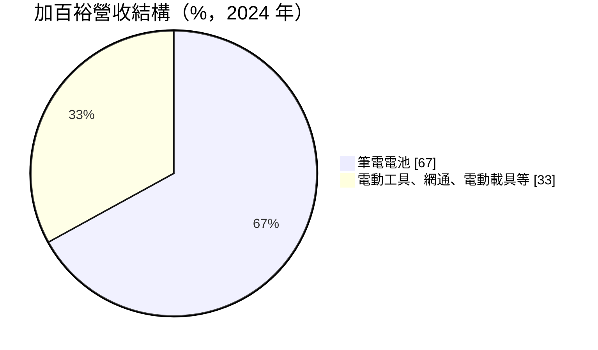
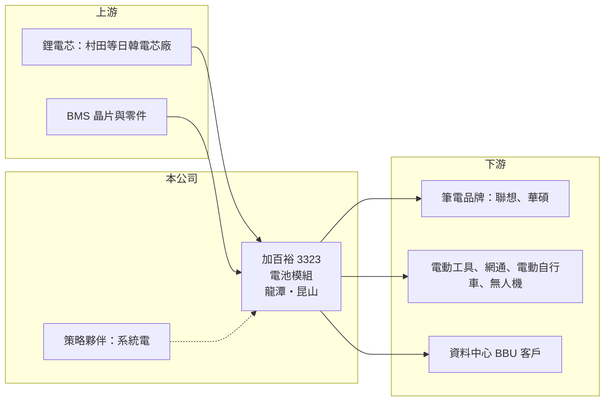

# 3323 加百裕

> 上櫃｜[[產業索引-電腦及週邊設備業|電腦及週邊設備業]]｜上市（櫃）日期 2007/06/25

# 第一章：企業模式與商業藍圖

> [!info] 撰寫說明
> 精簡版，由 Claude 依公開資料整理，架構比照 [[2330台積電]]，資料截至 2026-10-08。來源：櫃買中心開放資料快照（基本資料、2026 年上半年財報、本益比殖利率）、Goodinfo 經營績效年度表、富果 2025 年 12 月 30 日法說會整理。#待校對

加百裕是台灣前三大筆電電池模組廠之一，正在從筆電電池轉向 BBU、無人機與電動載具電池，本章說明這段轉型。

- **核心業務：** 加百裕成立於 1997 年，2007 年上櫃，專做[[鋰電池模組]]，累積約二十年的電池模組設計經驗，核心能力是電池管理系統（[[BMS]]）。產品涵蓋筆電電池、電動工具與網通設備電池、電動自行車與電動機車等電動載具電池，2025 年起加入無人機電池，並開發資料中心用的 [[BBU]]。
- **營收結構：** 依 2025 年 12 月法說會，筆電電池 2024 年約占營收 67%，公司刻意縮減低毛利的筆電訂單，目標 2027 年降到 35% 至 40%；BBU 目標 2027 年量產並占營收 30% 至 35%。筆電客戶以聯想、華碩為主，2025 年營收衰退的主因是聯想出貨減少。
- **營運據點：** 生產基地在台灣龍潭與中國昆山，南通為規劃中的擴充據點。法說會指出，網通、BBU、無人機與電動自行車等高毛利產品需要在台灣生產，龍潭產能嚴重不足，公司正在桃園尋找新廠，並推動產線自動化。
- **長期方向：** 2025 年 7 月與 BMS 專業廠 [[5309系統電]] 策略結盟，雙方研發人力合計約 110 人。BBU 以 12kWh 產品切入資料中心，2025 年底完成內部燃燒測試，客戶以二線雲端業者為主；美國電動自行車大廠下了至少兩年的訂單，2026 年 5 月開始出貨。

# 第二章：護城河深度與競爭優勢

電池模組廠的差異在於設計能力與認證，本章分析加百裕轉型的勝算。

- **競爭優勢：** 加百裕的 BMS 設計經驗可以移植到不同應用，從筆電延伸到電動載具、無人機與 BBU。無人機與 BBU 都需要長時間的安全與可靠度認證，且美國與歐洲客戶偏好非中國供應鏈，台灣廠在這些市場有地緣優勢。法說會估計 BBU 毛利率可達 30% 以上，遠高於筆電電池。
- **主要對手：** 筆電電池的主要對手是 [[6121新普]]、[[3211順達]]，兩者規模都比加百裕大；BBU 領域還有 [[2308台達電]]、[[2301光寶科]] 等電源大廠，以及順達、新普等先行者。加百裕在 BBU 屬於後進者，鎖定二線雲端客戶以避開與大廠正面競爭。
- **觀察重點：** 長期要看 BBU 能否如期在 2027 年量產並達到營收三成以上，以及無人機與電動自行車新客戶能否穩定放量。轉型期營收下滑、虧損擴大，公司需要在財務撐得住的期間內讓新產品接棒。

# 第三章：財務體質與盈利規模

資料日期：2026-10-08，表格是撰寫當時的快照；最新月營收、毛利率、累計 EPS 由自動排程寫在本筆記的屬性欄位（月營收、毛利率、累計EPS 等）。#待校對

加百裕營收在 2021 年 140 億元達到高峰，之後隨筆電需求下滑與主動縮減訂單，2023 年起連續虧損。

| 年度 | 營收（億元） | [[毛利率]] | [[營業利益率]] | EPS（元） | [[ROE]] |
|---|---|---|---|---|---|
| 2019 | 91.9 | 9.76% | 2.13% | 1.85 | 6.68% |
| 2020 | 122 | 9.99% | 3.61% | 4.14 | 14.1% |
| 2021 | 140 | 8.24% | 2.48% | 3.16 | 10.2% |
| 2022 | 111 | 8.98% | 1.69% | 2.75 | 8.64% |
| 2023 | 72.0 | 6.47% | -2.75% | -3.27 | -10.6% |
| 2024 | 54.5 | 8.72% | -1.97% | -1.11 | -3.46% |
| 2025 | 49.5 | 8.60% | -4.02% | -1.92 | -6.78% |

- **營收規模：** 營收從 2020 年 122 億元降到 2025 年 49.5 億元，五年年複合成長率約 -16.5%（推算）。2026 年上半年營收 21.7 億元、毛利率 8.5%、營業利益率約 -5.4%、EPS -0.97 元。
- **獲利：** 近五年（2021 至 2025 年）平均 ROE 約 -0.4%（推算）。毛利率長期在 6% 至 10%，屬於典型的低毛利代工型態，營收規模一縮小，固定費用就讓公司轉為虧損。
- **財務特色：** 2026 年第二季末總資產 45.6 億元、總負債 21.0 億元，負債比約 46%，股東權益 24.6 億元，每股淨值 24.01 元。近年虧損未配發股利。
- **[[ROIC]] 與 [[WACC]]：** 2026 年上半年營業損失 1.18 億元，年化約 -2.4 億元；以股東權益 24.6 億元計 ROIC 約 -9.6%，含全部負債 45.6 億元計約 -5.2%（推算，虧損不計稅盾）。2020 至 2022 年獲利期間，以權益計的 ROIC 約在 5% 至 12%（依當年營業利益與 ROE 回推權益推算）。WACC 以 CAPM 推估：無風險利率 1.75%、市場風險溢酬 6%、β 取 1.1，股東權益成本約 8.35%；有息負債假設比重 20%、成本 2.5%、稅後 2%，WACC 約 7.1%（推算）。即使在獲利年度，ROIC 也只在 WACC 上下徘徊，筆電電池難以創造價值；轉型的意義正是要靠 BBU 等高毛利產品讓 ROIC 長期站上 WACC。

# 第四章：總體風險與地緣政治

加百裕處於轉型期，本章整理新舊業務交替的風險。

- **產業週期：** 筆電電池跟著 PC 出貨起伏，且客戶集中在少數品牌；電動自行車在 2023 至 2025 年經歷庫存調整，電動工具受歐洲需求影響。BBU 需求則取決於雲端業者資本支出，景氣反轉時新業務也會受衝擊。
- **營運風險：** BBU 認證與量產時程若延後，虧損期會拉長；台灣產能不足、新廠與自動化投資需要資金，財務壓力會上升。BBU 市場已有多家大廠與先行者，價格競爭可能比預期更快出現。
- **其他風險：** 電芯向日本與韓國廠商採購，供應與價格影響成本。無人機涉及各國國防與出口法規，電池產品有起火安全風險；營收以美元計價，匯率波動影響毛利。

# 專有名詞解析

## 金融

- **[[ROIC]]**：投入資本報酬率，稅後營業利益除以股東權益加有息負債，衡量本業運用資本的效率。
- **[[WACC]]**：加權平均資金成本，股東權益成本與負債成本依資本結構加權，是 ROIC 必須超越的門檻。

## 產業

- **[[鋰電池模組]]**：把多顆鋰電芯加上保護電路、電池管理系統與外殼組成的電池包，供筆電、工具機或伺服器使用。
- **[[BMS]]**：電池管理系統，監控每顆電芯的電壓、溫度與電量，避免過充過放並延長壽命。
- **[[BBU]]**：備援電池單元，AI 伺服器機櫃在市電中斷時的短時供電裝置，可避免運算中斷。

# 核心供應鏈

- 上游：鋰電芯廠（BBU 採用村田 VC27A 電芯，依 2025 年法說會），BMS 晶片與電子零件；策略夥伴 [[5309系統電]]。
- 下游／客戶：筆電品牌聯想、[[2357華碩]]，美國電動自行車大廠，美國與歐洲無人機廠，二線雲端業者的 BBU 需求。
- 同業：[[6121新普]]、[[3211順達]]、[[4931新盛力]]；BBU 另有 [[2308台達電]]、[[2301光寶科]]。

## 最新新聞
<!-- news:start -->
<!-- news:end -->

## 相關連結
- [公開資訊觀測站](https://mopsov.twse.com.tw/mops/web/t05st03?step=1&firstin=1&co_id=3323)
- [Goodinfo](https://goodinfo.tw/tw/StockDetail.asp?STOCK_ID=3323)
- [Yahoo 股市](https://tw.stock.yahoo.com/quote/3323)
- [鉅亨網新聞](https://www.cnyes.com/twstock/3323/news)
