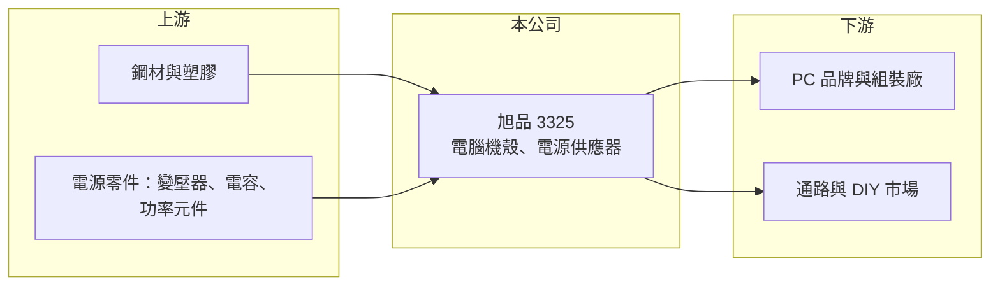

# 3325 旭品

> 上櫃｜[[產業索引-電腦及週邊設備業|電腦及週邊設備業]]｜上市（櫃）日期 2005/08/15

# 第一章：企業模式與商業藍圖

> [!info] 撰寫說明
> 精簡版，由 Claude 依公開資料整理，架構比照 [[2330台積電]]，資料截至 2026-10-08。來源：櫃買中心開放資料快照（基本資料、2026 年上半年財報、每月營收、本益比殖利率）、Goodinfo 經營績效年度表、nStock 公司簡介。公開資料有限，產品別營收比重、客戶與生產據點未查得。#待校對

旭品是規模不大的電腦機殼與電源供應器廠，近五年持續虧損，本章說明它的業務輪廓。

- **核心業務：** 旭品科技成立於 1996 年，2005 年上櫃，主要銷售電腦機殼、[[電源供應器]]，以及電子周邊產品與零組件。電腦機殼是容納主機板、電源與散熱元件的外殼，電源供應器則把市電轉換成電腦需要的直流電，兩者都是 PC 與伺服器的基本構件。
- **營收結構：** 產品別比重未查得。依產品性質推估，客戶涵蓋 PC 品牌、通路組裝市場與系統整合商（推估，待校對）。一般桌上型電腦機殼與電源技術門檻不高，價格競爭激烈。
- **營運據點：** 生產據點未查得。2026 年第二季末合併報表有約 0.5 億元非控制權益，代表旗下有非全資子公司。
- **長期方向：** 公司營收從 2020 年 22 億元降到 2025 年 12.7 億元，2026 年 1 至 8 月營收約 4.4 億元，較前一年同期 8.5 億元減少約一半。現有業務持續萎縮，能否找到新的產品或客戶是公司存續的關鍵，具體轉型計畫未查得。

# 第二章：護城河深度與競爭優勢

機殼與電源是高度競爭的產業，本章分析旭品在其中的處境。

- **競爭優勢：** 從財務表現看，旭品目前缺乏明顯的護城河。毛利率在 2020 年曾達 21.7%，之後多數年度落在 4% 至 9%，2026 年上半年甚至為負，代表產品定價能力薄弱，接單價格無法涵蓋成本。
- **主要對手：** 機殼領域有 [[3013晟銘電]]、[[8210勤誠]]、[[6117迎廣]] 等，電源供應器有 [[2308台達電]]、[[2301光寶科]]、[[3015全漢]]、[[6282康舒]]，以及大量中國廠商。這些對手已轉向伺服器機殼、高瓦數伺服器電源等高附加價值產品，旭品規模小，難以投入相同的研發與產能。
- **觀察重點：** 長期要看公司是否有新的產品方向、能否止住營收下滑，以及虧損何時收斂。若持續虧損，增資、減資或轉型的公司行動將是影響股東權益的主要事件。

# 第三章：財務體質與盈利規模

資料日期：2026-10-08，表格是撰寫當時的快照；最新月營收、毛利率、累計 EPS 由自動排程寫在本筆記的屬性欄位（月營收、毛利率、累計EPS 等）。#待校對

旭品 2021 年起連續五年虧損，2026 年上半年營收再大減、毛利轉負。

| 年度 | 營收（億元） | [[毛利率]] | [[營業利益率]] | EPS（元） | [[ROE]] |
|---|---|---|---|---|---|
| 2019 | 16.9 | 15.7% | 4.88% | 0.86 | 7.72% |
| 2020 | 22.0 | 21.7% | 12.5% | 2.06 | 14.9% |
| 2021 | 15.3 | 8.38% | -4.20% | -0.70 | -5.35% |
| 2022 | 10.7 | 3.69% | -15.1% | -0.90 | -9.28% |
| 2023 | 16.8 | 9.34% | -3.38% | -0.28 | -3.74% |
| 2024 | 13.8 | 4.93% | -9.39% | -0.89 | -7.95% |
| 2025 | 12.7 | 5.19% | -10.6% | -1.64 | -16.9% |

- **營收規模：** 營收從 2020 年 22 億元降到 2025 年 12.7 億元，五年年複合成長率約 -10.4%（推算）。2026 年上半年營收 3.68 億元、毛利率 -10.8%、營業利益率約 -35.8%、EPS -1.35 元。
- **獲利：** 近五年（2021 至 2025 年）平均 ROE 約 -8.6%（推算）。毛利率偏低加上營收縮減，固定費用無法被攤平，虧損逐年擴大。2020 年是近年唯一明顯獲利的年度。
- **財務特色：** 2026 年第二季末總資產 17.5 億元、總負債 7.2 億元，負債比約 41%，股東權益 10.3 億元（歸屬母公司 9.7 億元），每股淨值 8.84 元，已低於面額。近五年沒有配發股利。
- **[[ROIC]] 與 [[WACC]]：** 2026 年上半年營業損失 1.32 億元，年化約 -2.64 億元；以股東權益 10.3 億元計 ROIC 約 -25.8%，含全部負債 17.5 億元計約 -15.1%（推算，虧損不計稅盾）。2025 年營業損失約 1.35 億元，ROIC 約 -8% 至 -12%（推算）。WACC 以 CAPM 推估：無風險利率 1.75%、市場風險溢酬 6%、β 取 1.0，股東權益成本約 7.75%；有息負債假設比重 15%、成本 2.5%、稅後 2%，WACC 約 6.9%（推算）。ROIC 連續多年為負、遠低於 WACC，公司正在消耗股東資本。

# 第四章：總體風險與地緣政治

旭品的風險已從景氣循環轉為經營存續，本章整理相關風險。

- **產業週期：** 桌上型電腦與 DIY 組裝市場長期萎縮，機殼與電源需求成長主要在伺服器與高階電競產品，傳統產品的市場本身就在縮小。PC 換機週期能帶來短期回升，但難以扭轉結構趨勢。
- **營運風險：** 毛利為負代表接單價格低於成本，若無法提高售價或縮減成本，虧損會持續侵蝕淨值。每股淨值已低於面額，未來可能需要減資彌補虧損或增資籌措資金。
- **其他風險：** 鋼材、銅與電子零件價格波動會影響成本；營收以外銷為主時有匯率風險。公開資訊有限，投資人應以年報與重大訊息確認公司的轉型與資金計畫。

# 專有名詞解析

## 金融

- **[[ROIC]]**：投入資本報酬率，稅後營業利益除以股東權益加有息負債，衡量本業運用資本的效率。
- **[[WACC]]**：加權平均資金成本，股東權益成本與負債成本依資本結構加權，是 ROIC 必須超越的門檻。

## 產業

- **[[電源供應器]]**：把市電轉換成設備所需電壓與電流的裝置，伺服器、網通設備與工業設備都需要。
- **[[電腦機殼]]**：容納主機板、電源、儲存與散熱元件的外殼，伺服器機殼另需考量散熱與維修設計。

# 核心供應鏈

- 上游：鋼材、塑膠、變壓器、電容與功率元件等零件。
- 下游／客戶：PC 品牌與組裝廠、通路與 DIY 組裝市場（推估，實際客戶未查得）。
- 同業：機殼有 [[3013晟銘電]]、[[8210勤誠]]、[[6117迎廣]]；電源有 [[2308台達電]]、[[2301光寶科]]、[[3015全漢]]、[[6282康舒]]。

## 最新新聞
<!-- news:start -->
<!-- news:end -->

## 相關連結
- [公開資訊觀測站](https://mopsov.twse.com.tw/mops/web/t05st03?step=1&firstin=1&co_id=3325)
- [Goodinfo](https://goodinfo.tw/tw/StockDetail.asp?STOCK_ID=3325)
- [Yahoo 股市](https://tw.stock.yahoo.com/quote/3325)
- [鉅亨網新聞](https://www.cnyes.com/twstock/3325/news)
