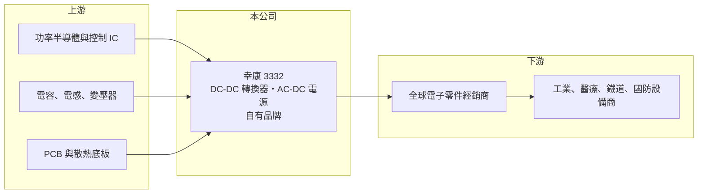

# 3332 幸康

> 上櫃｜[[產業索引-電子零組件業|電子零組件業]]｜上市（櫃）日期 2008/01/24

# 第一章：企業模式與商業藍圖

> [!info] 撰寫說明
> 精簡版，由 Claude 依公開資料整理，架構比照 [[2330台積電]]，資料截至 2026-10-08。來源：櫃買中心開放資料快照（基本資料、2026 年第二季資產負債與損益、本益比殖利率、每月營收）、Goodinfo 經營績效頁、富果整理之 2025 年 11 月法說會摘要。生產據點與主要客戶未查得。#待校對

幸康電子（以下簡稱幸康）是一家以自有品牌經營工業、醫療與鐵道等高可靠度市場的電源廠，定位為「高端應用方案電源專家」。理解幸康的關鍵在於：它不做消費性電源的大量代工，而是以少量多樣的標準品透過全球經銷商銷售，因此毛利率長期維持在 30% 以上，遠高於一般電源代工廠。

- **核心業務：** 幸康成立於 1991 年，總部位於台北信義，2008 年在櫃買中心掛牌。主力產品有兩大類：一是 1W 至 1500W 的 [[DC-DC轉換器]]，其中磚型產品是公司的技術利基，另有符合 EN 50155 鐵道規範的系列；二是 4W 至 1000W 的 AC-DC [[電源供應器]]，包括工業與資通訊用的基板型、灌膠型與底板散熱型，以及符合 IEC/EN 60601-1 [[醫療安規]]的醫療電源，其中無風扇底板散熱型產品在市場上評價良好。
- **營收結構：** 公司未揭露產品線或應用別的營收占比。依法說會說明，產品應用分布在約 10 個領域，包括工業設備、醫療儀器、鐵道、自動化、國防、網通與[[工業電腦]]，各領域比重約在 7% 至 10% 以上，分布相當平均。這種分散的結構讓單一產業的景氣波動對幸康的影響有限。
- **營運據點：** 總部位於台北，生產據點公開資料未查得。公司透過全球在地經銷商服務終端客戶並提供技術支援，銷售市場持續拓展到美國、日本、韓國、中國大陸與印度。
- **長期方向：** 幸康的成長策略是持續推出高功率密度、高可靠度的新產品，2025 年預計推出 15 個新系列，並開拓國防、航太、海事等要求更嚴格的市場。成長動能包括機器人、無人搬運車與無人機等自動化設備、醫療、國防，以及憑藉工業電腦經驗切入的 AI 邊緣運算市場。

# 第二章：護城河深度與競爭優勢

幸康的護城河來自品牌、安規認證與少量多樣的產品組合，屬於利基型的窄護城河，但相當穩固。

- **競爭優勢：** 工業、醫療與鐵道電源一旦被設計進客戶的設備，通常會在設備生命週期內持續採購，而這類設備的生命週期往往長達 5 到 10 年以上，客戶轉換供應商需要重新驗證安規與可靠度，成本很高。幸康經營自有品牌、提供大量標準品，讓中小型設備商不需自行開發電源即可快速導入，這種「型錄式」商業模式累積的產品數量與認證就是門檻。2020 至 2025 年毛利率維持在 31.6% 至 37.1%，證明了定價能力。
- **主要對手：** 國際上的主要對手包括明緯（未上市）、TDK-Lambda、Vicor、XP Power、RECOM 等工業電源品牌；台灣上市櫃同業中，[[2308台達電]] 也提供工業電源，[[6409旭隼]]、[[3015全漢]] 則在其他電源領域競爭。明緯在標準型工業電源市場的規模與通路遠大於幸康，幸康以 DC-DC 磚型與醫療、鐵道等更專業的規格區隔。
- **觀察重點：** 長期最該追蹤的是新產品能否持續帶動營收成長，以及營業利益率能否維持在一成以上。2025 年上半年營收年增約 20%、毛利率升到 38.5%，公司歸因於近兩年推出的高功率密度新產品與品牌能見度提升；2026 年上半年毛利率約 35.4%、營業利益率約 10.7%。

# 第三章：財務體質與盈利規模

資料日期：2026-10-08，表格是撰寫當時的快照；最新月營收、毛利率、累計 EPS 由自動排程寫在本筆記的屬性欄位（月營收、毛利率、累計EPS 等）。#待校對

幸康的財務呈現「高毛利、低負債、穩定配息」的樣貌：毛利率長年在三成以上，近六年每年都獲利。

| 年度 | 營收（億元） | [[毛利率]] | [[營業利益率]] | EPS（元） | [[ROE]] |
|---|---|---|---|---|---|
| 2021 | 12.1 | 31.6% | 8.2% | 2.20 | 7.7% |
| 2022 | 17.1 | 34.7% | 14.7% | 4.56 | 14.5% |
| 2023 | 14.0 | 37.1% | 10.5% | 2.98 | 8.7% |
| 2024 | 13.4 | 34.0% | 5.3% | 2.18 | 6.1% |
| 2025 | 16.0 | 36.5% | 10.2% | 3.53 | 9.5% |

（來源：Goodinfo 經營績效頁；2020 年營收 10.5 億元、毛利率 35.5%、EPS 2.54 元。）

- **營收規模：** 2020 至 2025 年營收由 10.5 億元增至 16.0 億元，年複合成長率約 8.8%（推算），在電源產業中屬於穩健成長。2022 年因工業設備需求強勁與缺料拉貨，營收衝上 17.1 億元，2023 至 2024 年回落後，2025 年重回成長。2026 年前八月累計營收約 13.2 億元，年增約 19%。
- **獲利：** 近五年（2021 至 2025）平均 ROE 約 9.3%（推算）。ROE 不算高，主要原因是帳上權益規模大、負債少，而不是本業獲利差。2026 年上半年歸屬母公司淨利約 1.22 億元、EPS 2.53 元，已接近 2024 年全年 EPS 2.18 元的水準。
- **財務特色：** 2026 年第二季總資產約 26.2 億元、權益約 18.9 億元、負債約 7.3 億元，負債比約 28%，非流動負債僅約 0.34 億元，幾乎沒有長期借款。流動資產約 19.2 億元，占總資產七成以上。每股淨值約 39.29 元。最近一次每股現金股利 2.0 元，以 2025 年 EPS 3.53 元計算配發率約 57%（推算）；Goodinfo 統計歷年平均現金股利約 2.15 元，配息長期穩定。
- **[[ROIC]] 與 [[WACC]]：** 以 2025 年營業利益約 1.63 億元（16.0 億元 × 10.2%）、稅率 20% 計算，稅後營業利益約 1.31 億元。有息負債應很少，投入資本以權益 18.9 億元到「權益加全部負債」26.2 億元為區間，ROIC 約 5.0% 至 6.9%（推算）；若扣除帳上現金（金額未查得），實際營運資本的報酬會明顯更高。WACC 以 [[CAPM]] 推估：無風險利率 1.75%、市場風險溢酬 6%、β 假設 0.9（工業電源股波動較低），權益成本約 7.2%；負債占一成、稅後負債成本 2%，WACC 約 6.6%（推算）。以帳面投入資本計算，ROIC 與 WACC 大致相當；但因為大量資本以現金形式存在，本業的實際資本報酬應高於資金成本，屬於「本業創造價值、資本配置保守」的類型。

# 第四章：總體風險與地緣政治

幸康的風險主要來自工業景氣循環、大型同業的競爭，以及新市場的開拓速度。

- **產業週期：** 工業、自動化與網通設備的投資具有週期性，景氣下行時設備商會減少採購並消化庫存。2023 至 2024 年營收與營業利益率雙雙回落，營業利益率從 14.7% 降到 5.3%，就是工業電源去庫存的典型影響。
- **營運風險：** 少量多樣的模式需要龐大的產品線與庫存管理能力，若需求預測失準，容易累積呆滯庫存。新產品開發需要持續投入研發，若新系列推出速度放緩，產品組合老化會壓縮毛利。經銷商模式也意味著公司與終端客戶的距離較遠，掌握需求變化的速度可能較慢。
- **其他風險：** 半導體功率元件與電容等料件曾在 2021 至 2022 年嚴重缺貨，未來若再發生，會影響交期與成本。國防與醫療市場受各國法規與採購政策影響；營收以外幣計價為主時，新台幣升值會壓縮毛利（#待校對）。

# 專有名詞解析

## 應用

- **[[醫療安規]]**：醫療電子設備的電氣安全標準（如 IEC 60601-1），對漏電流與絕緣要求比一般設備嚴格。

## 金融

- **[[CAPM]]**：資本資產定價模型，以無風險利率加上 β 乘以市場風險溢酬，估計股東要求的報酬率。

## 產業

- **[[DC-DC轉換器]]**：把一種直流電壓轉換成另一種直流電壓的電源模組，廣泛用於通訊、工業與鐵道設備。
- **[[電源供應器]]**：把交流電轉換成電子設備所需直流電的裝置，品質影響整台設備的安全與穩定。
- **[[工業電腦]]**：用於工廠自動化、交通、醫療等場域的強固型電腦，強調長期供貨與耐用性。

# 核心供應鏈

- 上游：功率半導體與電源控制 IC、被動元件（例如 [[2327國巨]]、[[2472立隆電]]）、變壓器、PCB 與散熱底板。
- 下游／客戶：全球電子零件經銷商，以及工業自動化、醫療儀器、鐵道、國防、網通與工業電腦設備商（具體客戶公開資料未查得，#待校對）。
- 同業：明緯、TDK-Lambda、Vicor、XP Power、RECOM，以及 [[2308台達電]]、[[6409旭隼]]、[[3015全漢]]。

## 最新新聞
<!-- news:start -->
<!-- news:end -->

## 相關連結
- [公開資訊觀測站](https://mopsov.twse.com.tw/mops/web/t05st03?step=1&firstin=1&co_id=3332)
- [Goodinfo](https://goodinfo.tw/tw/StockDetail.asp?STOCK_ID=3332)
- [Yahoo 股市](https://tw.stock.yahoo.com/quote/3332)
- [鉅亨網新聞](https://www.cnyes.com/twstock/3332/news)
