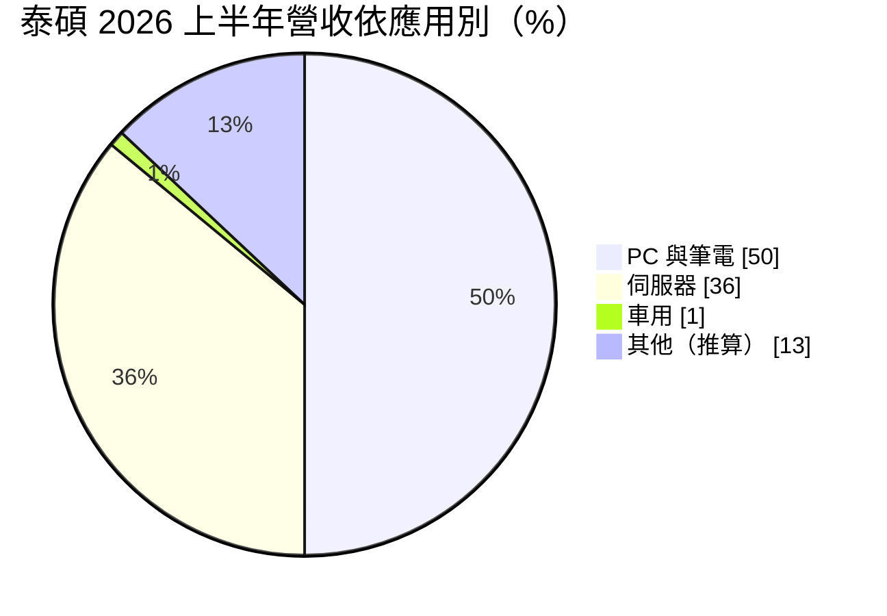
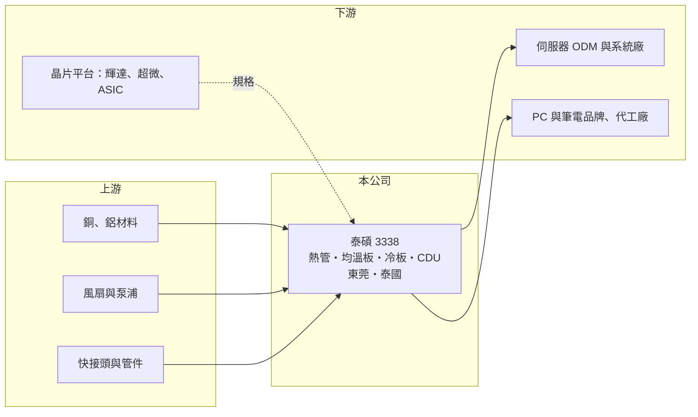

# 3338 泰碩

> 上市｜[[產業索引-電子零組件業|電子零組件業]]｜上市（櫃）日期 2013/12/13

# 第一章：企業模式與商業藍圖

> [!info] 撰寫說明
> 精簡版，由 Claude 依公開資料整理，架構比照 [[2330台積電]]，資料截至 2026-10-08。來源：證交所開放資料快照（基本資料、2026 年第二季資產負債與損益、營益分析、股利、每月營收）、Goodinfo 經營績效頁、富果整理之 2026 年 7 月法說會摘要。#待校對

泰碩電子（以下簡稱泰碩）是一家散熱模組製造商，過去以筆電與個人電腦的風冷散熱為主，近年積極轉向 AI 伺服器的[[液冷散熱]]。理解泰碩的關鍵在於：公司正處於從「PC 散熱零組件供應商」轉型為「伺服器散熱系統方案商」的過程，產品組合的變化會決定未來十年的獲利水準。

- **核心業務：** 泰碩成立於 1994 年，總部位於台北內湖，2013 年在證交所上市。傳統產品是[[熱管]]、[[均溫板]]等風冷散熱零組件與模組，用來把 CPU、GPU 產生的熱導出並散掉。液冷產品線則涵蓋[[冷板]]（Cold Plate）、分流管（Manifold），以及冷卻液分配單元（[[CDU]]）的整合服務。
- **營收結構：** 依 2026 年 7 月法說資料，伺服器營收占比由 2024 年約 22% 提升到 2026 年上半年的 36%，成為最大單一來源；PC 與筆電合計約 50%，維持基本盤；車用由 2024 年約 12% 降到 1%，因毛利偏低而策略性縮減。液冷占營收比重由 2026 年第一季約 5%，預估第二季提升到 16%。

- **營運據點：** 中國東莞是液冷產品的主要生產基地，2026 年初新設水冷二廠；泰國廠主要服務非中國客戶，初期以風冷等成熟產品為主，待品質與供應鏈穩定後才導入液冷。公司表示目前沒有美國設廠規劃。冷板產線月產能計畫由 8 萬套提升到 12 萬套。
- **長期方向：** 泰碩的目標是從散熱零組件供應商轉型為系統級解決方案商，以 800VDC 架構的 CDU 為主力，帶動冷板等零組件銷售。依法說資料，公司參與 [[NVDA輝達]] 平台的散熱模組開發，也看好 [[AMD超微]] 與 ASIC 晶片的散熱商機（#待校對）；解熱能力 2.6MW 的 800VDC CDU 樣機預計 2027 年下半年開始有客戶導入。

# 第二章：護城河深度與競爭優勢

泰碩在 PC 散熱市場有長期累積的製造能力，但在 AI 液冷這個新戰場上屬於追趕者，護城河仍在建立中。

- **競爭優勢：** 散熱模組需要針對每一款晶片與機構客製設計，必須在客戶產品開發初期就參與，一旦被選用，在該產品生命週期內很少更換。泰碩經營 PC 散熱三十年，熱管與均溫板的量產經驗與良率是基礎；2020 至 2025 年毛利率穩定在 17.7% 至 20.7%，ROE 多數年度在 11% 以上，顯示本業具一定的獲利能力。液冷產品中部分毛利率可達 30% 以上，若比重提升，可望拉高整體獲利水準。
- **主要對手：** 散熱產業的台灣同業包括 [[3017奇鋐]]、[[3324雙鴻]]、[[3653健策]]、[[6230尼得科超眾]]、[[2421建準]]、[[3483力致]] 與 8996高力。其中奇鋐與雙鴻在 AI 伺服器液冷的規模與客戶覆蓋遠大於泰碩，建準在風扇、高力在熱交換器與 CDU 各有專長。泰碩必須在冷板與 CDU 上做出差異，才能在大廠環伺下取得份額。
- **觀察重點：** 長期最該追蹤的是伺服器與液冷占比能否如公司預期在 2026 年下半年分別超過 50% 與 35%，以及毛利率能否隨之突破 20%。2026 年第一季營業費用率升到約 16%，反映液冷研發投入增加；轉型初期研發費用先行，獲利回收要等產品放量。

# 第三章：財務體質與盈利規模

資料日期：2026-10-08，表格是撰寫當時的快照；最新月營收、毛利率、累計 EPS 由自動排程寫在本筆記的屬性欄位（月營收、毛利率、累計EPS 等）。#待校對

泰碩的財務呈現「營收逐年下滑但獲利穩定、配息穩定」的樣貌，2025 年起因轉型投入與放棄低毛利訂單，獲利暫時下降。

| 年度 | 營收（億元） | [[毛利率]] | [[營業利益率]] | EPS（元） | [[ROE]] |
|---|---|---|---|---|---|
| 2021 | 49.8 | 17.7% | 5.7% | 2.13 | 11.0% |
| 2022 | 45.7 | 19.1% | 6.0% | 3.05 | 15.0% |
| 2023 | 38.1 | 20.7% | 7.0% | 2.78 | 13.0% |
| 2024 | 37.5 | 20.1% | 6.0% | 3.00 | 13.4% |
| 2025 | 36.2 | 19.5% | 4.6% | 1.80 | 7.8% |

（來源：Goodinfo 經營績效頁；2020 年營收 52.6 億元、EPS 2.58 元。）

- **營收規模：** 2020 至 2025 年營收由 52.6 億元降到 36.2 億元，年複合成長率約 -7.2%（推算），主因是 PC 與筆電需求在疫情後回落，以及公司主動縮減低毛利的車用訂單。2026 年前八月累計營收約 27.6 億元，年增約 10.7%，伺服器與液冷產品開始抵銷 PC 的衰退。
- **獲利：** 近五年（2021 至 2025）平均 ROE 約 12.0%（推算），在營收下滑的情況下仍維持一成以上，代表成本控制與產品組合調整有效。2026 年上半年毛利率約 17.9%、營業利益率約 2.7%，歸屬母公司淨利約 0.40 億元、EPS 0.46 元，處於轉型投入期的低點。
- **財務特色：** 2026 年第二季總資產約 37.5 億元、權益約 19.6 億元、負債約 17.9 億元，負債比約 48%，其中非流動負債僅約 1.4 億元，負債以應付帳款等營運負債為主。2025 年每股現金股利 1.30 元，以 EPS 1.80 元計算配發率約 72%（推算）；Goodinfo 統計歷年平均現金股利約 1.1 元，配息穩定。
- **[[ROIC]] 與 [[WACC]]：** 以 2025 年營業利益約 1.68 億元（36.2 億元 × 4.64%）、稅率 20% 計算，稅後營業利益約 1.34 億元。有息負債未查得，投入資本以權益 19.6 億元到「權益加全部負債」37.5 億元為區間，ROIC 約 3.6% 至 6.9%（推算）。WACC 以 [[CAPM]] 推估：無風險利率 1.75%、市場風險溢酬 6%、β 假設 1.1（AI 散熱族群波動較大），權益成本約 8.4%；稅後負債成本假設 2%、負債占三成，WACC 約 6.4%（推算）。2025 年 ROIC 接近或略低於 WACC，而 2022 至 2024 年 ROE 在 13% 至 15%，當時 ROIC 應高於 WACC；液冷轉型能否把營業利益率拉回 7% 以上，是恢復創造價值的關鍵。

# 第四章：總體風險與地緣政治

泰碩的風險主要來自轉型執行、AI 伺服器需求的集中度，以及大型同業的競爭。

- **產業週期：** PC 與筆電散熱需求成熟，跟隨換機週期起伏；AI 伺服器需求成長快，但受雲端業者資本支出、GPU 與記憶體供應影響，公司也表示液冷占比的實際表現取決於晶片與記憶體供應。新平台世代交替時，散熱規格會改變，若未能取得新平台設計案，出貨可能中斷。
- **營運風險：** 液冷產品對漏液防護與可靠度要求極高，品質問題可能造成客戶伺服器損壞與高額賠償。冷板產能擴充與 CDU 研發需要資本與費用先行投入，若放量時程延後，獲利會在一段時間內承壓。奇鋐、雙鴻等大廠規模優勢明顯，可能在價格與產能上壓縮泰碩的空間。
- **其他風險：** 液冷主力產能在中國東莞，美中貿易摩擦與美國關稅可能影響出貨到美國資料中心；泰國廠導入液冷需要時間。銅、鋁等金屬價格波動直接影響熱管、均溫板與冷板成本；營收以美元計價為主，新台幣升值會壓縮毛利，2026 年第一季匯兌收益減少也拖累了獲利。

# 專有名詞解析

## 金融

- **[[CAPM]]**：資本資產定價模型，以無風險利率加上 β 乘以市場風險溢酬，估計股東要求的報酬率。

## 產業

- **[[液冷散熱]]**：以液體帶走晶片熱量的散熱方式，解熱能力遠高於風冷，用於高功耗 AI 伺服器。
- **[[熱管]]**：內含工作液體的密封金屬管，藉液體蒸發與凝結快速傳遞熱量，是風冷散熱模組的核心零件。
- **[[均溫板]]**：扁平版的熱管，可把晶片熱量均勻擴散到較大面積，常見於高階 GPU 與筆電散熱。
- **[[冷板]]**：貼附在晶片上、內部有流道讓冷卻液通過的金屬板，是液冷系統直接接觸熱源的零件。
- **[[CDU]]**：冷卻液分配單元，負責液冷系統中冷卻液的循環、熱交換與流量控制。

# 核心供應鏈

- 上游：銅、鋁材料，散熱風扇（例如 [[2421建準]]）、泵浦、快接頭與管件。
- 下游／客戶：伺服器 ODM 與系統廠、PC 與筆電品牌與代工廠；散熱規格由 [[NVDA輝達]]、[[AMD超微]] 等晶片平台決定（具體客戶公開資料未查得，#待校對）。
- 同業：[[3017奇鋐]]、[[3324雙鴻]]、[[3653健策]]、[[6230尼得科超眾]]、[[3483力致]]、8996高力。

## 最新新聞
<!-- news:start -->
<!-- news:end -->

## 相關連結
- [公開資訊觀測站](https://mopsov.twse.com.tw/mops/web/t05st03?step=1&firstin=1&co_id=3338)
- [Goodinfo](https://goodinfo.tw/tw/StockDetail.asp?STOCK_ID=3338)
- [Yahoo 股市](https://tw.stock.yahoo.com/quote/3338)
- [鉅亨網新聞](https://www.cnyes.com/twstock/3338/news)
