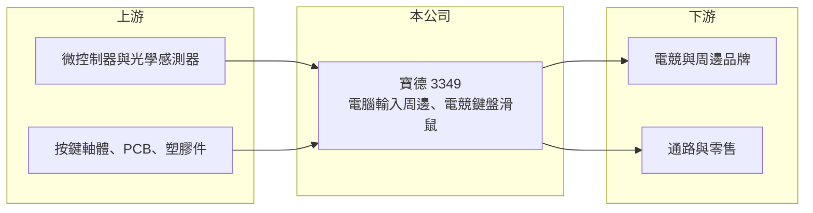

# 3349 寶德

> 上櫃｜[[產業索引-電腦及週邊設備業|電腦及週邊設備業]]｜上市（櫃）日期 2022/03/23

# 第一章：企業模式與商業藍圖

> [!info] 撰寫說明
> 精簡版，由 Claude 依公開資料整理，架構比照 [[2330台積電]]，資料截至 2026-10-08。來源：櫃買中心開放資料快照（基本資料、2026 年上半年財報、每月營收、本益比殖利率）、Goodinfo 經營績效年度表、nStock 公司簡介、ETtoday 2022 年上櫃報導標題。公開資料有限，產品別營收比重、客戶與生產據點未查得。#待校對

寶德是以電腦輸入周邊為主的小型廠商，2022 年上櫃時被媒體稱為電競周邊廠，本章說明它的業務輪廓。

- **核心業務：** 寶德科技成立於 1997 年，2022 年 3 月上櫃，營業項目為電腦輸入周邊、電子器材零件與電腦周邊設備的研發、製造與買賣。輸入周邊指鍵盤、滑鼠等使用者直接操作的裝置，[[電競周邊]]則是針對遊戲玩家、強調反應速度、耐用度與燈效的高階版本（產品細節待校對）。
- **營收結構：** 產品別與客戶別比重未查得。電競周邊市場的主要買家是國際電競品牌，周邊廠多以 [[ODM]] 方式替品牌設計生產，也有部分廠商經營自有品牌（寶德的模式待校對）。
- **營運據點：** 生產據點未查得。股本約 4.6 億元，屬於電腦周邊產業中規模很小的公司。
- **長期方向：** 2021 年在疫情帶動的電競與居家需求下，營收衝上 12.3 億元並獲利，之後需求回落，2022 至 2025 年營收在 3.9 億至 5.5 億元之間、連年虧損，2026 年 1 至 8 月營收約 2.2 億元，較前一年同期 3.5 億元再減少約 35%。公司需要新客戶或新產品才能恢復成長，具體策略未查得。

# 第二章：護城河深度與競爭優勢

電競周邊市場品牌多、代工競爭激烈，本章分析寶德的處境。

- **競爭優勢：** 電競鍵盤滑鼠需要在按鍵手感、感測器精準度與耐用度上做出差異，周邊廠若能長期配合品牌開發新機種，就能建立一定的合作黏著度。但從財務表現看，寶德毛利率長期約 10% 至 20%，2026 年上半年更降到約 6%，議價能力有限。
- **主要對手：** 台灣輸入周邊大廠有 [[2385群光]]、[[4915致伸]]、[[2387精元]]、[[8163達方]]，中國也有大量鍵盤滑鼠代工廠。這些對手規模遠大於寶德，可以用更低的成本接下大量訂單，寶德只能在少量、客製化的訂單中競爭。
- **觀察重點：** 長期要看營收能否止跌回升、毛利率能否回到 20% 左右，以及虧損收斂的速度。每股淨值已低於面額，若虧損持續，資本結構調整將成為重要事件。

# 第三章：財務體質與盈利規模

資料日期：2026-10-08，表格是撰寫當時的快照；最新月營收、毛利率、累計 EPS 由自動排程寫在本筆記的屬性欄位（月營收、毛利率、累計EPS 等）。#待校對

寶德只有 2020 至 2021 年獲利，其餘年度多為虧損，營收規模也持續縮小。

| 年度 | 營收（億元） | [[毛利率]] | [[營業利益率]] | EPS（元） | [[ROE]] |
|---|---|---|---|---|---|
| 2019 | 5.28 | 18.7% | -7.24% | -0.91 | -8.07% |
| 2020 | 8.13 | 19.1% | 2.24% | 0.65 | 5.91% |
| 2021 | 12.3 | 19.1% | 5.67% | 1.77 | 15.1% |
| 2022 | 5.52 | 14.0% | -11.7% | -1.30 | -11.8% |
| 2023 | 3.87 | 10.8% | -29.3% | -2.37 | -24.3% |
| 2024 | 4.54 | 19.1% | -14.9% | -1.05 | -13.0% |
| 2025 | 4.79 | 20.1% | -5.40% | -1.02 | -13.5% |

- **營收規模：** 營收從 2020 年 8.13 億元降到 2025 年 4.79 億元，五年年複合成長率約 -10.0%（推算）。2026 年上半年營收 1.91 億元、毛利率 6.4%、營業利益率約 -23.4%、EPS -0.77 元。
- **獲利：** 近五年（2021 至 2025 年）平均 ROE 約 -9.5%（推算）。2024 至 2025 年毛利率回升到 19% 至 20%、虧損縮小，但 2026 年上半年毛利率再度下滑，獲利改善沒有延續。
- **財務特色：** 2026 年第二季末總資產 5.4 億元、總負債 2.3 億元，負債比約 43%，股東權益 3.1 億元，每股淨值 6.65 元，低於面額。近五年平均現金股利約 0.16 元，主要是 2021 年獲利後發放，2025 年度未配息。
- **[[ROIC]] 與 [[WACC]]：** 2026 年上半年營業損失 0.45 億元，年化約 -0.9 億元；以股東權益 3.1 億元計 ROIC 約 -29%，含全部負債 5.4 億元計約 -16.6%（推算，虧損不計稅盾）。2021 年獲利高峰時，營業利益約 0.70 億元、稅後約 0.56 億元，以權益計 ROIC 約 12%（推算）。WACC 以 CAPM 推估：無風險利率 1.75%、市場風險溢酬 6%、β 取 1.0，股東權益成本約 7.75%；有息負債假設比重 15%、成本 2.5%、稅後 2%，WACC 約 6.9%（推算）。除了 2021 年，ROIC 長期低於 WACC，公司尚未證明能持續創造價值。

# 第四章：總體風險與地緣政治

寶德的風險集中在規模不足與需求波動，本章整理相關風險。

- **產業週期：** 電競周邊需求在疫情期間暴增後大幅回落，品牌客戶的庫存調整直接反映在寶德的營收。電競市場長期仍在成長，但需求集中在少數大品牌，小型代工廠容易在景氣下行時先被砍單。
- **營運風險：** 營收規模小，費用難以攤平，毛利率稍有下滑就擴大虧損。淨值低於面額，若虧損持續可能需要減資或增資。客戶集中度高時，單一品牌換供應商的影響會很大。
- **其他風險：** 感測器、微控制器、按鍵軸體等零件價格與供應影響成本；外銷以美元計價時有匯率風險。中國同業的價格競爭與美國關稅政策也會影響接單。

# 專有名詞解析

## 金融

- **[[ROIC]]**：投入資本報酬率，稅後營業利益除以股東權益加有息負債，衡量本業運用資本的效率。
- **[[WACC]]**：加權平均資金成本，股東權益成本與負債成本依資本結構加權，是 ROIC 必須超越的門檻。

## 產業

- **[[電競周邊]]**：為電玩遊戲設計的鍵盤、滑鼠、耳機等配件，強調反應速度、精準度與耐用度。
- **[[ODM]]**：原廠委託設計製造，代工廠負責產品設計與生產，品牌商負責銷售。

# 核心供應鏈

- 上游：微控制器、光學感測器、按鍵軸體、PCB 與塑膠機構件。
- 下游／客戶：電競與電腦周邊品牌、通路與零售（推估，實際客戶未查得）。
- 同業：[[2385群光]]、[[4915致伸]]、[[2387精元]]、[[8163達方]]。

## 最新新聞
<!-- news:start -->
<!-- news:end -->

## 相關連結
- [公開資訊觀測站](https://mopsov.twse.com.tw/mops/web/t05st03?step=1&firstin=1&co_id=3349)
- [Goodinfo](https://goodinfo.tw/tw/StockDetail.asp?STOCK_ID=3349)
- [Yahoo 股市](https://tw.stock.yahoo.com/quote/3349)
- [鉅亨網新聞](https://www.cnyes.com/twstock/3349/news)
