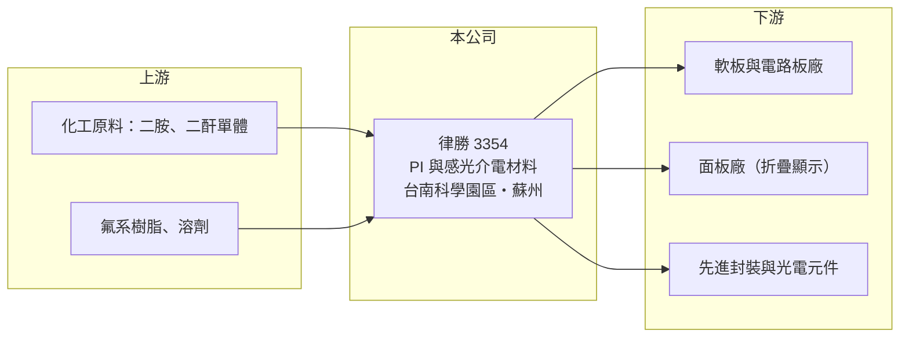

# 3354 律勝

> 上櫃｜[[產業索引-電子零組件業|電子零組件業]]｜上市（櫃）日期 2005/12/08

# 第一章：企業模式與商業藍圖

> [!info] 撰寫說明
> 精簡版，由 Claude 依公開資料整理，架構比照 [[2330台積電]]，資料截至 2026-10-08。來源：櫃買中心開放資料快照（基本資料、2026 年第二季資產負債與綜合損益、每月營收）、Goodinfo 經營績效頁（2019 至 2025 年度數據）、富果研究 2026/10/08 法說會摘要。公開資料有限，營收比重、客戶與產能皆未查得；早期產品描述依記憶整理，標註「待校對」。#待校對

律勝科技（以下簡稱律勝）是一家位於台南科學園區的小型電子材料公司，核心技術是[[聚醯亞胺]]（PI）的配方與塗佈。公司營收規模不到新台幣 2 億元，且連續多年虧損，目前處於從舊產品轉向新材料的轉型期。

- **核心業務：** 律勝成立於 1996 年，2005 年在櫃買中心掛牌，實收資本額約 7.0 億元，董事長與總經理均由黃堂傑擔任。公司早期以 PI 樹脂為基礎，生產軟性電路板用的無膠型[[FCCL]]（軟性銅箔基板）等材料（待校對）。PI 耐高溫、絕緣、可彎折，是軟板、顯示器與半導體封裝都會用到的關鍵高分子材料，掌握 PI 配方的公司可以把同一套技術延伸到多個應用。
- **產品方向：** 依 2026 年 10 月法說會內容，目前推廣的產品分三大領域。電路板領域有製程後可剝除的耐高溫 [[PSPI]]（感光性聚醯亞胺）、可取代傳統保護層的液態感光 PSPI，以及用於 AI 伺服器背板與高速網通的 [[PTFE]] 超低損耗材料。顯示器領域是品牌名 Mpior 的[[透明PI]]，可用於折疊或捲曲螢幕的保護蓋板與柔性基板。半導體領域是品牌名 BRINA 的無氟感光介電材料，用於[[先進封裝]]的 [[RDL]]（重布線層）與 [[VCSEL]] 鈍化層。
- **營運據點：** 總部與工廠位於台南科學園區，中國大陸江蘇蘇州工業園區設有分廠，法說會表示蘇州的透明 PI 產線已逐步放量。台灣廠負責研發與高階材料，蘇州廠則貼近中國大陸的軟板廠與面板廠，提供在地供應。
- **長期方向：** 律勝的策略是從營收萎縮的舊產品，轉向 AI、高速通訊、矽光子、折疊裝置與先進封裝等成長市場，並以「材料設計、製程技術、應用導入、量產能力」的整合提供客製化方案。新材料大多仍在客戶認證階段：可剝 PSPI 已有部分中國大陸板廠採用，透明 PI 與中國大陸主要面板廠進行測試，半導體材料則以台灣市場推廣為主。轉型能否成功，取決於這些認證能否在幾年內轉成穩定量產訂單。

# 第二章：護城河深度與競爭優勢

律勝的護城河目前仍在建立中。材料業的護城河通常來自配方技術與客戶認證，本章說明律勝在這兩點上的位置。

- **競爭優勢：** 第一是 PI 配方與塗佈技術的累積，公司投入 PI 材料近三十年，能依客戶需求調整感光性、耐熱性與透明度，這類材料技術需要長時間試錯才能建立。第二是認證的轉換成本，電子材料一旦通過軟板廠、面板廠或封裝廠的驗證並寫進製程規格，客戶很少為了小幅降價而更換，因為重新驗證的時間與良率風險很高。第三是中國大陸在地供應，法說會強調在中國大陸透明 PI 市場的地緣優勢，在供應鏈在地化的趨勢下，有蘇州工廠的台資供應商較容易被當地客戶接受。
- **主要對手：** PI 與電子材料市場由日本、韓國與美國大廠主導，律勝的規模遠小於這些對手。透明 PI 主要對手是韓國廠商，以及快速追趕的中國大陸本土材料廠；PSPI 與半導體介電材料則面對日本大廠的長期優勢。台灣同業中，[[3645達邁]] 生產 PI 薄膜，[[8039台虹]] 生產軟板基材，[[1711永光]]、[[1717長興]] 則在感光材料與電子化學品領域與律勝部分重疊。
- **觀察重點：** 由於公司規模小，最關鍵的是新材料能否真正放量。2026 年 1 至 8 月營收 8,643 萬元，年增約 31%，2026 年上半年[[毛利率]]回升到約 33%，顯示新產品開始有貢獻；但營業費用仍明顯高於毛利，離損益兩平還有距離。投資人應追蹤透明 PI、PSPI 是否從「認證中」變成「量產出貨」，以及單一客戶集中度。

# 第三章：財務體質與盈利規模

資料日期：2026-10-08，表格是撰寫當時的快照；最新月營收、毛利率、累計 EPS 由自動排程寫在本筆記的屬性欄位（月營收、毛利率、累計EPS 等）。#待校對

律勝的財務數字清楚呈現一家材料公司在舊產品衰退、新產品尚未接棒時的樣貌：營收縮小、連年虧損，但資產負債表幾乎沒有負債。

| 年度 | 營收（億元） | [[毛利率]] | [[營業利益率]] | EPS（元） | [[ROE]] |
|---|---|---|---|---|---|
| 2019 | 4.40 | 35.9% | 8.1% | 0.50 | 3.0% |
| 2020 | 2.90 | 27.3% | -14.1% | -0.74 | -4.5% |
| 2021 | 2.00 | 19.3% | -40.7% | -0.74 | -4.8% |
| 2022 | 1.55 | 7.3% | -63.7% | -0.30 | -2.1% |
| 2023 | 1.10 | -13.4% | -121% | -1.19 | -8.9% |
| 2024 | 1.28 | 10.4% | -80.9% | -0.34 | -2.7% |
| 2025 | 0.99 | 12.3% | -92.0% | -0.84 | -7.1% |
| 2026 上半年 | 0.65 | 32.6% | -42.9% | -0.29 | 未查得 |

資料來源：2019 至 2025 年為 Goodinfo，2026 上半年為櫃買中心開放資料（營業利益率為推算）。

- **營收規模：** 營收從 2019 年的 4.4 億元一路下滑到 2025 年的 0.99 億元，2019 至 2025 年年複合成長率約 −22%（推算），代表原有產品的市場大幅流失。2026 年前 8 個月營收年增約 31%，是多年來首次明顯回升，但規模仍只有 2019 年的一小部分。
- **獲利：** 公司自 2020 年起連續虧損，2021 至 2025 年平均 ROE 約 −5.1%（推算）。虧損的主要原因是營收規模太小，無法攤提研發、人事與兩地工廠的固定費用：2026 年上半年毛利 0.21 億元，營業費用卻有 0.49 億元。毛利率從 2023 年的負值回升到 2026 年上半年的 33%，是產品組合改善的正面訊號。
- **財務特色：** 2026 年第二季資產 8.76 億元、負債僅 0.99 億元，股東權益 7.77 億元，負債比約 11%，流動資產 3.52 億元，短期沒有償債壓力。但每年虧損會持續消耗淨值，每股淨值約 11.1 元。公司近年未發放現金股利，股價淨值比約 2.9 倍，市場價格反映的是對新材料的期待，而非目前的獲利。

**[[ROIC]] 與 [[WACC]]**

ROIC（推算）：2025 年營收 0.99 億元、營業利益率 −92%，營業損失約 0.91 億元，虧損不計稅盾。投入資本以股東權益約 7.8 億元計算（有息負債極少，視為零），ROIC 約 −11.7%；以 2026 年上半年年化計算約為 −7%，仍為負值。

WACC（推算）：台灣 10 年期公債殖利率取 1.75%、市場風險溢酬 6%、β 取小型電子材料股常見值 1.2（非官方數字），股東權益成本約 9%；由於幾乎沒有有息負債，WACC 約等於股東權益成本，約 8.5% 至 9%。

ROIC 為負、低於 WACC 約 15 至 20 個百分點，代表律勝目前在消耗股東資本，而不是創造價值。這是轉型期材料公司常見的狀態，判斷重點是新產品放量後營收能否回到 2 億元以上的規模，讓毛利足以覆蓋固定費用；在此之前，充足的現金與低負債是公司能撐過轉型期的主要依靠。

# 第四章：總體風險與地緣政治

律勝的風險主要集中在轉型執行。公司規模小、產品仍在認證期，任何一個環節不順都會直接反映在虧損上。

- **產業週期：** 公司的新材料分別對應 AI 伺服器、折疊螢幕、先進封裝等市場，這些市場長期成長性高，但也有各自的景氣循環。折疊手機普及速度、AI 伺服器投資節奏，都會影響客戶導入新材料的時程。材料公司位在供應鏈最上游，下游庫存調整時，訂單往往最先被砍。
- **營運風險：** 最大的風險是認證失敗或量產延遲，電子材料從送樣到量產常需要一至三年，期間仍要負擔研發與工廠費用。其次是規模劣勢，面對日、韓大廠與中國大陸本土廠，律勝在價格與產能上都難以正面競爭，只能靠利基與客製化。連續虧損若持續，最終可能需要增資或縮減營運。
- **其他風險：** 新材料的主要客戶與產能都在中國大陸，面臨兩岸關係、中國大陸本土材料替代政策與匯率風險。2026 年 10 月公司發言人與財務主管異動，經營團隊的穩定性也值得留意。小型股成交量低，股價易受題材影響大幅波動。

# 專有名詞解析

## 半導體

- **[[聚醯亞胺]]**：簡稱 PI，耐高溫、絕緣且可彎折的高分子材料，廣泛用於軟板、顯示器與半導體封裝。
- **[[PSPI]]**：感光性聚醯亞胺，可直接用曝光顯影做出圖形的 PI 材料，用於封裝保護層與電路板防焊。
- **[[RDL]]**：重布線層，在晶片表面重新佈置線路，把接點拉到適合封裝的位置，是先進封裝的關鍵製程。

## 產業

- **[[FCCL]]**：軟性銅箔基板，由銅箔與 PI 等絕緣膜結合，是製作軟性電路板的基本原料。
- **[[透明PI]]**：無色透明的聚醯亞胺薄膜，可取代玻璃作為折疊螢幕的保護蓋板與柔性基板。
- **[[PTFE]]**：聚四氟乙烯，介電損耗極低的材料，用於高頻高速電路板與毫米波通訊。

# 核心供應鏈

- 上游：PI 單體（二胺、二酐）與溶劑等化工原料，多由日本與中國大陸化學廠供應（推估）。
- 下游／客戶：公司未具名揭露客戶。應用端包括軟板廠（台灣同業如 [[4958臻鼎-KY]]、[[6269台郡]]、[[6153嘉聯益]] 屬此類客戶群，非公司揭露）、中國大陸面板廠、先進封裝與 VCSEL 元件廠。
- 同業：[[3645達邁]]、[[8039台虹]]、[[1711永光]]、[[1717長興]]；國外為日本、韓國的 PI 與感光材料大廠。

## 最新新聞
<!-- news:start（自動產生，請勿手動編輯此範圍） -->
- 2026-10-12 🏛️ 重訊 18:13｜公告本公司獨立董事辭任功能性委員會職務｜[觀測站](https://mops.twse.com.tw/mops/#/web/t05st01)
- 2026-10-12 🏛️ 重訊 18:09｜公告本公司獨立董事辭任｜[觀測站](https://mops.twse.com.tw/mops/#/web/t05st01)
- 2026-10-08 🏛️ 重訊 18:48｜公告本公司解除總經理競業禁止案｜[觀測站](https://mops.twse.com.tw/mops/#/web/t05st01)
- 2026-10-08 🏛️ 重訊 18:47｜公告本公司發言人、財務及會計主管異動｜[觀測站](https://mops.twse.com.tw/mops/#/web/t05st01)
- 2026-10-08 🏛️ 重訊 18:46｜公告本公司總經理異動｜[觀測站](https://mops.twse.com.tw/mops/#/web/t05st01)

完整紀錄：[[3354律勝 新聞]]
<!-- news:end -->

## 相關連結
- [公開資訊觀測站](https://mopsov.twse.com.tw/mops/web/t05st03?step=1&firstin=1&co_id=3354)
- [Goodinfo](https://goodinfo.tw/tw/StockDetail.asp?STOCK_ID=3354)
- [Yahoo 股市](https://tw.stock.yahoo.com/quote/3354)
- [鉅亨網新聞](https://www.cnyes.com/twstock/3354/news)
