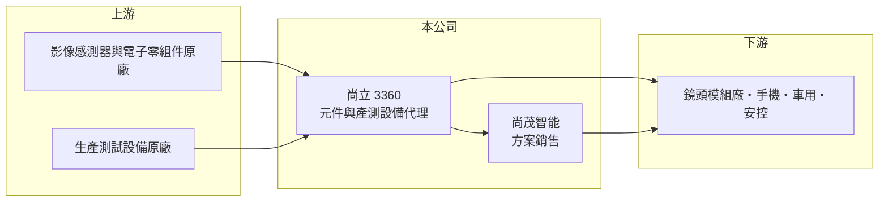

# 3360 尚立

> 上櫃｜[[產業索引-電子通路業|電子通路業]]｜上市（櫃）日期 2006/06/06

# 第一章：企業模式與商業藍圖

> [!info] 撰寫說明
> 精簡版，由 Claude 依公開資料整理，架構比照 [[2330台積電]]，資料截至 2026-10-08。來源：櫃買中心開放資料（基本資料、2026 年第二季財報、月營收）、Goodinfo 經營績效與基本資料頁、CMoney 等財經網站對公司定位的描述（影像產測元件與 CIS 代理）。代理品牌與營收比重未查得。#待校對

尚立是一家以影像相關元件與生產測試設備為主的電子通路商，營收規模在 60 億到 140 億元之間大幅起伏。它的特點是營收大、毛利率極薄、財務槓桿高，獲利對景氣與產品組合非常敏感。

- **核心業務：** 尚立成立於 1985 年，2006 年上櫃，營業項目為電子零組件與生產設備的代理銷售，並提供技術解決方案整合、產品製造技術輔導與售後服務。財經媒體多將其定位為影像產測元件代理商，代理產品包括 [[CIS]] 影像感測器（待校對）。
- **營收結構：** 產品比重未查得。依營業項目，收入應以影像相關零組件的轉售為主，搭配生產測試設備與技術服務（推估）。
- **營運據點：** 2016 年設立香港子公司尚立（香港）經營電子零件進出口，2022 年設立尚茂智能科技，銷售半導體、電子零組件與解決方案。尚茂智能屬於延伸到方案銷售的新事業，2026 年上半年非控制權益分攤虧損約 984 萬元，顯示子公司仍在投入期（推估）。
- **長期方向：** CIS 主要用於手機、車用與安控鏡頭，車用與 AI 視覺應用的鏡頭數量增加，是影像元件需求的長期動能。尚立若能從單純轉售延伸到方案設計與產測服務，才有機會提高長期偏低的毛利率。

# 第二章：護城河深度與競爭優勢

尚立的競爭力來自影像元件領域的專業分工，但以財務數字看，護城河相當有限。

- **競爭優勢：** 影像感測器的導入需要調校鏡頭模組、影像處理與產線測試，通路商若能提供產測設備與[[FAE]]支援，就能比純轉售型通路商更貼近客戶。這是尚立結合「元件加設備」業務的價值所在。
- **主要對手：** 大型通路商 [[3702大聯大]]、[[3036文曄]] 也代理影像相關元件；影像感測器 IC 設計公司如 [[3530晶相光]] 則是同產業鏈的上游參與者。在中小型通路中，尚立與 [[3232昱捷]]、[[6118建達]] 等同屬低毛利型態。
- **觀察重點：** 毛利率長期只有 2.7% 至 4.1%，代表尚立對原廠與客戶的議價力都弱。觀察重點在於尚茂智能的方案業務能否拉高毛利，以及營收大幅成長時是否真的轉為獲利。

# 第三章：財務體質與盈利規模

資料日期：2026-10-08，表格是撰寫當時的快照；最新月營收、毛利率、累計 EPS 由自動排程寫在本筆記的屬性欄位（月營收、毛利率、累計EPS 等）。#待校對

尚立的財務呈現「營收波動大、利潤率接近零」的特徵，2023 至 2025 年連續三年虧損。

| 年度 | 營收（億元） | [[毛利率]] | [[營業利益率]] | EPS（元） | [[ROE]] |
|---|---|---|---|---|---|
| 2020 | 143 | 2.72% | 1.08% | 1.01 | 6.96% |
| 2021 | 93.9 | 3.81% | 1.45% | 1.45 | 9.81% |
| 2022 | 101 | 3.25% | 1.16% | 0.32 | 2.30% |
| 2023 | 72.7 | 2.80% | -0.30% | -1.47 | -11.4% |
| 2024 | 62.6 | 3.86% | -0.36% | -0.48 | -5.74% |
| 2025 | 73.4 | 4.08% | -0.12% | -0.48 | -7.34% |
| 2026 上半年 | 52.5 | 3.14% | 0.45% | 0.02 | 未查得 |

- **營收規模：** 2020 至 2025 年營收年複合成長率約 -12.5%（推算），規模從 143 億元縮到 73 億元。2026 年前 8 個月營收約 71 億元，年增約 62%（櫃買中心月營收），月營收備註說明係客戶需求增加。
- **獲利：** 近 5 年平均 ROE 約 -2.5%（推算）。2026 年上半年營業利益轉正至 2,337 萬元，但業外損失 2,525 萬元抵銷後仍小幅虧損，業外多半與利息與匯兌有關（推估）。
- **財務特色：** 2026 年第二季總資產 50.0 億元、負債 41.8 億元、權益僅 8.2 億元，負債比約 84%，是本批通路商中槓桿最高者之一。保留盈餘僅約 196 萬元，近年未配發現金股利。

**[[ROIC]] 與 [[WACC]]：** 2025 年營業損失約 900 萬元，ROIC 為負，約 -0.3%；2026 年上半年營業利益年化後，以權益 8.2 億元加有息負債（以負債總額 40% 估約 16.7 億元）計算，ROIC 約 1.5%（推算）。WACC 以 CAPM 推估：無風險利率 1.75%、市場風險溢酬 6%、β 取 1.0（同業常見值），股權成本 7.75%；稅後負債成本 2%，股權占比約 33%，WACC 約 3.9%（推算）。ROIC 明顯低於 WACC，代表目前並未創造價值；高槓桿雖壓低帳面 WACC，但也放大了虧損時的財務風險。

# 第四章：總體風險與地緣政治

尚立的風險集中在薄利多銷模式下的財務槓桿，以及影像元件市場的景氣起伏。

- **產業週期：** CIS 需求與手機出貨高度相關，手機市場的庫存調整會沿供應鏈放大，[[長鞭效應]]讓通路商的營收波動遠大於終端市場，2020 至 2024 年營收腰斬即為一例。
- **營運風險：** 毛利率僅 3% 至 4%，只要存貨跌價或客戶帳款延遲，就可能吃掉全年營業利益。負債比超過八成，利率上升或銀行緊縮額度時，資金調度壓力會明顯增加。
- **其他風險：** 影像元件供應鏈橫跨日本、台灣與中國，美中科技管制可能影響中國客戶的出貨；營收以美元計價，匯率波動直接影響業外損益。

# 專有名詞解析

## 半導體

- **[[CIS]]**：CMOS 影像感測器，把光訊號轉為電子訊號的晶片，用於手機、車用、安控與工業鏡頭。

## 金融

- **[[長鞭效應]]**：終端需求的小幅變動，沿供應鏈往上游傳遞時被逐級放大，造成上游庫存與訂單劇烈波動。

## 產業

- **[[FAE]]**：現場應用工程師，協助客戶把原廠晶片設計進產品，是通路商技術附加價值的核心。
- **[[電子通路]]**：替半導體原廠向系統廠銷售零組件、備庫存並提供技術支援的中間商，賺取買賣價差與服務價值。

# 核心供應鏈

- 上游：影像感測器與電子零組件原廠、生產測試設備原廠（品牌未查得）。
- 下游／客戶：鏡頭模組廠，以及手機、車用、安控產品製造商（推估）。
- 同業：[[3702大聯大]]、[[3036文曄]]、[[3232昱捷]]、[[6118建達]]；影像 IC 設計：[[3530晶相光]]。

## 最新新聞
<!-- news:start -->
<!-- news:end -->

## 相關連結
- [公開資訊觀測站](https://mopsov.twse.com.tw/mops/web/t05st03?step=1&firstin=1&co_id=3360)
- [Goodinfo](https://goodinfo.tw/tw/StockDetail.asp?STOCK_ID=3360)
- [Yahoo 股市](https://tw.stock.yahoo.com/quote/3360)
- [鉅亨網新聞](https://www.cnyes.com/twstock/3360/news)
