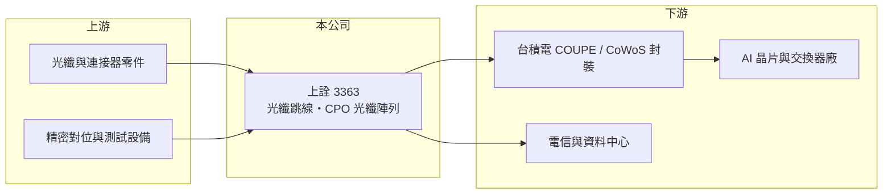

# 3363 上詮

> 上櫃｜[[產業索引-通信網路業|通信網路業]]｜上市（櫃）日期 2011/02/25

# 第一章：企業模式與商業藍圖

> [!info] 撰寫說明
> 本文由 Claude 依公開資料整理，架構比照 [[2330台積電]] 的四章研究，資料截至 2026-10-08。財務數字來源：Goodinfo 年度經營績效頁、櫃買中心開放資料（基本資料、2026 年第二季資產負債與損益、本益比殖利率）、優分析 2026 年上詮 CPO 分析文章；產業描述為整理性內容，尚未逐條比對原始文件。#待校對

評估上詮科技（股票代號：3363，以下簡稱上詮）時，要分清楚「現在賺錢的事業」與「正在投資的未來事業」。本章說明它從光纖跳線起家，如何把自己定位為 [[CPO]] 時代的光纖連接關鍵供應商。

## 一、核心定位：光纖連接元件廠

上詮成立於 1995 年，2011 年在櫃買中心掛牌，實收資本額約 11.4 億元。公司的傳統主力是光纖跳線，也就是兩端裝好連接器、用來連接設備與設備的光纖線，應用在電信機房與資料中心。光纖跳線技術成熟，比的是品質穩定、交期與成本，目前仍是上詮營收的主幹。

## 二、產品世代：從光纖跳線到 CPO 光纖陣列

資料中心的光連接正從可插拔[[光收發模組]]走向 CPO。在 CPO 架構中，光學引擎與交換晶片封裝在一起，光纖必須以極高精度對準晶片上的光波導，而且要承受封裝製程的高溫。負責這個工作的零件就是[[光纖陣列]]（FAU）。上詮以自有專利平台 ReLFACon 解決矽光子高溫封裝下的光損耗問題，並已完成 1.6T 至 6.4T 世代的技術布局。

依 2026 年報導，上詮與 [[2330台積電]] 的 [[COUPE]] 矽光子封裝平台緊密合作，產品可對接 CoWoS 產線，並與奇景進行技術合作。公司把 2026 年第三季視為 1.6T 模組系統廠認證的關鍵觀察點，CPO 產品預計在 2026 年下半年配合 NVIDIA 新平台開始出貨。這些時程屬於媒體與公司規劃，實際進度仍需追蹤。

## 三、資本配置：一次性的大幅擴產

上詮過去每年資本支出約在數千萬元到 2 億元之間，2026 年規劃約 15.8 億元，其中逾 10 億元用於 CPO 光纖陣列的自動化生產與測試機台。股本也從 2022 年的約 8.8 億元增加到目前的約 11.4 億元，股東權益擴大到約 57 億元，推估透過增資籌措 CPO 擴產資金（推估）。這是一次押注在 CPO 普及的大型資本配置，成敗將決定公司未來十年的規模。

# 第二章：護城河深度與競爭優勢

在長期價值投資中，「護城河」指企業抵禦競爭、維持超額利潤的保護機制。本章分析上詮在 CPO 光纖連接領域可能建立的優勢。

## 一、潛在護城河

* **製程平台綁定：** 與台積電 COUPE 平台共同開發，代表上詮的光纖陣列設計被納入封裝製程規格。一旦客戶的 CPO 產品以此平台量產，更換光纖陣列供應商需要重新驗證整個封裝流程，轉換成本很高。
* **專利與耐高溫設計：** ReLFACon 平台針對高溫封裝下的損耗問題，若成為業界標準做法，能形成技術門檻。
* **自動化產能：** 大量投資自動化對準與測試設備，有機會在量產時取得成本與良率優勢。

需要強調的是，這些優勢目前仍是「潛在」的，要等 CPO 真正量產並帶來穩定獲利，才能證明護城河存在。

## 二、主要競爭對手

| 對手 | 定位 | 對上詮的威脅 |
|---|---|---|
| [[3163波若威]] | 光纖陣列與光纖配線 | 已打入 NVIDIA 交換器供應鏈，直接競爭 |
| [[6442光聖]] | 光纖跳線與資料中心光纖連接 | 在傳統跳線與高密度連接重疊 |
| 美日光纖連接大廠（如康寧等） | 光纖材料與連接方案 | 材料與客戶基礎雄厚，可提供整合方案 |

## 三、守得住／守不住／觀察重點

守得住的是與台積電平台的先行合作關係。守不住的是傳統光纖跳線的價格，這類產品技術門檻低，2021 年後毛利率從 22.9% 降到 13% 至 19%。長期觀察重點是 2026 年下半年 CPO 出貨能否如期、第二供應商出現的時間，以及 15.8 億元擴產的利用率。

# 第三章：財務體質與盈利規模

資料日期：2026-10-08，表格是撰寫當時的快照；最新月營收、毛利率、累計 EPS 由自動排程寫在本筆記的屬性欄位（月營收、毛利率、累計EPS 等）。#待校對

財務報表是檢驗護城河是否真實存在的最終標準。本章用五年的三率、ROE 與資本報酬，檢視上詮的獲利品質。

## 一、多年度經營績效

| 年度 | 營收（新台幣） | [[毛利率]] | [[營業利益率]] | EPS（元） | [[ROE]] |
|---|---|---|---|---|---|
| 2021 | 19.9 億 | 22.9% | 12.1% | 2.31 | 11.8% |
| 2022 | 16.2 億 | 18.3% | 5.99% | 0.53 | 2.76% |
| 2023 | 12.7 億 | 14.0% | -4.58% | 0.13 | 0.63% |
| 2024 | 13.6 億 | 13.1% | -6.85% | -0.48 | -2.07% |
| 2025 | 18.9 億 | 18.8% | 0.03% | 0.16 | 0.64% |
| 2026 上半年 | 8.11 億 | 1.0% | -30.6% | -1.18 | 未查得 |

上詮在 2021 年之後獲利持續下滑，2023 至 2025 年本業接近或低於損益兩平。2021 至 2025 年平均 ROE 約 2.8%（推算），營收年複合成長率約 -1.3%（推算）。2026 年上半年營收約 8.1 億元，毛利率僅約 1%、營業利益率約 -31%，推估與 CPO 產線的人力、折舊與試產成本先行投入、而相關營收尚未放量有關（推估）。近年沒有發放現金股利。

## 二、[[ROIC]] 與 [[WACC]]：價值創造利差

**ROIC 推算：** 2025 年營業利益幾乎為零（18.9 億 × 0.03%），ROIC 約 0%（推算）。以 2026 年上半年營業虧損約 2.5 億元年化，約 -5.0 億元；2026 年第二季股東權益約 57.2 億元，負債約 7.1 億元，假設有息負債約 2 億元（推估），投入資本約 59 億元，ROIC 約 -8%（推算）。

**WACC 推算：** 台灣 10 年期公債 1.75%、市場風險溢酬 6%、β 取 1.4（考量 CPO 題材使股價波動大，推估），股東權益成本約 10.2%；負債成本 2.5%、稅後 2.0%；權益占投入資本約 97%，WACC 約 9.9%（推算）。

**結論：** 上詮目前的 ROIC 為負，與 WACC 差距接近 18 個百分點，代表新募集的資本尚未產生報酬。這是大型擴產期間常見的現象，但也代表投資人承擔的是「CPO 能否如期量產」的單一賭注：若 CPO 放量並帶來 20% 以上的營業利益率，ROIC 可以超越 WACC；若時程延後，資本報酬會長期低落。

# 第四章：總體風險與地緣政治

任何企業都無法脫離宏觀環境獨立存在。本章分析上詮長期必須面對的風險。

## 一、技術與時程風險

CPO 是仍在發展中的技術，交換器業者與雲端業者何時大規模採用、採用哪一種封裝架構，都還有變數。若 CPO 量產延後，或主流方案改用其他光纖耦合方式，上詮的擴產可能面臨低利用率。

## 二、客戶集中與議價風險

上詮的 CPO 機會高度依賴台積電平台與少數 AI 晶片客戶。綁定大平台能取得先機，但也意味著議價權偏向客戶，未來若平台引入第二供應商，價格與份額都可能受壓。

## 三、財務與營運風險

2026 年資本支出約為過去的數倍，折舊會在未來幾年持續增加。若傳統光纖跳線業務同時轉弱，公司可能出現連續虧損。營收以美元計價為主，新台幣升值也會影響毛利。

# 專有名詞解析

## 半導體

- **[[CPO]]**：共同封裝光學，把光學收發元件與交換晶片封裝在一起，縮短電訊號距離以降低功耗。
- **[[COUPE]]**：台積電的緊湊型通用光子引擎平台，把電子晶片與光子晶片以 3D 堆疊整合，是其矽光子與 CPO 方案的核心。

## 應用

- **[[光纖陣列]]**：FA，把多條光纖精準排列固定的元件，是 CPO 與光模組中光纖對準晶片的關鍵零件。

## 金融

- **[[ROIC]]**：投入資本報酬率，稅後營業利益除以股東權益與有息負債的合計，衡量本業對所有資金提供者的報酬。
- **[[WACC]]**：加權平均資金成本，依股東權益與負債的比重加權計算的資金成本，ROIC 高於它才代表創造價值。

## 產業

- **[[光收發模組]]**：把電訊號轉成光訊號傳輸、再轉回電訊號的模組，資料中心以 800G、1.6T 速率區分世代。

# 核心供應鏈

## 1. 上游：材料與設備
- 光纖、陶瓷插芯、連接器零件與自動化對位測試設備供應商

## 2. 中游：上詮與同業
- 同業：[[3163波若威]]、[[6442光聖]]

## 3. 下游：平台與客戶
- 封裝平台：[[2330台積電]]（COUPE、CoWoS）
- AI 晶片與交換器：[[NVDA輝達]]、美系雲端業者（文章所述受惠方向，未證實為直接客戶）
- 技術合作：奇景

## 最新新聞
<!-- news:start（自動產生，請勿手動編輯此範圍） -->
- 2026-10-12 📰 媒體 11:02｜CPO量產帶動FAU需求升溫上詮產能效率受考驗，大摩降評示警｜[鉅亨網](https://news.cnyes.com/news/id/6627945)

完整紀錄：[[3363上詮 新聞]]
<!-- news:end -->

## 相關連結
- [公開資訊觀測站](https://mopsov.twse.com.tw/mops/web/t05st03?step=1&firstin=1&co_id=3363)
- [Goodinfo](https://goodinfo.tw/tw/StockDetail.asp?STOCK_ID=3363)
- [Yahoo 股市](https://tw.stock.yahoo.com/quote/3363)
- [鉅亨網新聞](https://www.cnyes.com/twstock/3363/news)
