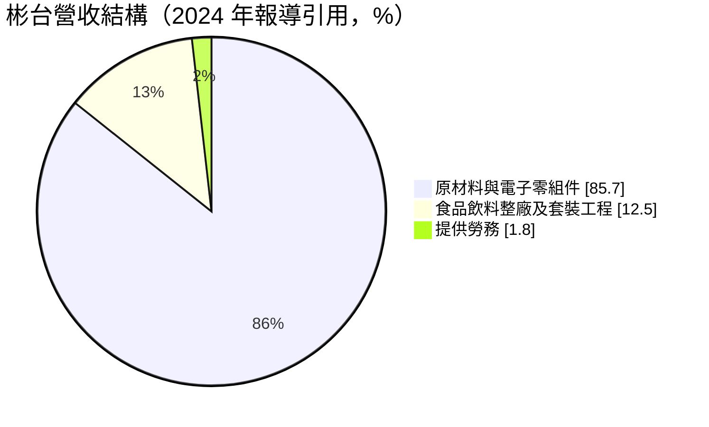
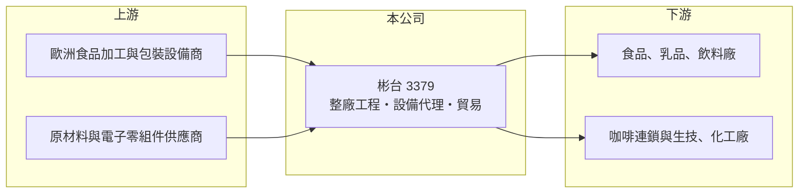

# 3379 彬台

> 上櫃｜[[產業索引-電機機械|電機機械]]｜上市（櫃）日期 2011/10/20

# 第一章：企業模式與商業藍圖

> [!info] 撰寫說明
> 精簡版，由 Claude 依公開資料整理，架構比照 [[2330台積電]]，資料截至 2026-10-08。來源：櫃買中心開放資料快照（基本資料、2026 年第二季資產負債與損益、本益比殖利率）、Goodinfo 經營績效頁、理財周刊 2024 年 6 月報導。公開資料有限。#待校對

彬台科技（以下簡稱彬台）是一家以食品與飲料產業為主要客群的工程與貿易公司，業務橫跨設備代理、原物料貿易與整廠工程。理解它的關鍵在於：它的營收大部分來自毛利較低的貿易，真正有技術含量的整廠工程比重不高，因此營收可以大幅跳動，但獲利率偏薄。

- **核心業務：** 彬台成立於 1981 年，2011 年在櫃買中心掛牌，總部位於台北內湖。業務分三類：[[整廠工程]]系統整合、單機設備的研發製造，以及代理國外食品加工、包裝設備與原材料的貿易。應用領域涵蓋食品、乳品、飲料、生物科技與化工。
- **營收結構：** 依 2024 年 6 月報導引用的資料，原材料與電子零組件占營收 85.7%、食品飲料廠整廠與套裝工程占 12.5%、勞務占 1.8%。換句話說，彬台的營收主體是貿易，整廠工程雖是品牌形象所在，但金額占比不高。2024 至 2025 年營收大增，推估主要來自貿易業務放量（推估，待校對）。
- **營運據點：** 總部在台北，市場由台灣延伸到中國，再拓展東南亞與日本。2024 年前後執行的案子包括中國咖啡連鎖品牌的烘焙整合與包裝系統、福建的咖啡濃縮液[[無菌充填]]系統，以及歐洲客戶的噴霧乾燥設備。生產據點細節未查得。
- **長期方向：** 公司的策略是整合「貿易代理＋設備研發＋整廠工程」，目標成為以技術整合工程服務為主體的跨區域企業。近年重點是中國的咖啡相關工程、東南亞的食品自動化需求，以及替歐洲設備商在亞洲提供在地整合服務。

# 第二章：護城河深度與競爭優勢

彬台的護城河很窄，主要來自代理權、工程整合經驗與客戶關係，而不是自有技術。

- **競爭優勢：** 食品飲料的整廠工程需要把殺菌、充填、包裝等不同廠商的設備整合成一條穩定運作的產線，並符合食品安全規範，這種整合經驗需要多年累積。彬台長期代理國外設備，熟悉歐洲設備的規格與服務，可在亞洲替客戶做在地整合。
- **主要對手：** 國際食品機械大廠（例如利樂、克朗斯等）本身就提供整廠方案，中國也有大量本土設備與工程商；貿易業務則面對眾多代理商與通路商。彬台在規模與技術上都不是領導者，具體對手名單未查得。
- **觀察重點：** 長期要看整廠工程這類高附加價值業務的比重能否提升。2015 至 2023 年公司多數年度營業虧損，2024 至 2025 年才轉為獲利，但 2026 年上半年營收僅約 3.0 億元並再度虧損，代表貿易業務的波動很大，不易形成穩定獲利基礎。

# 第三章：財務體質與盈利規模

資料日期：2026-10-08，表格是撰寫當時的快照；最新月營收、毛利率、累計 EPS 由自動排程寫在本筆記的屬性欄位（月營收、毛利率、累計EPS 等）。#待校對

彬台的財務特色是營收波動大、毛利率低、長期獲利能力薄弱，工程案的驗收時點與貿易接單決定每年的成績。

| 年度 | 營收（億元） | [[毛利率]] | [[營業利益率]] | EPS（元） | [[ROE]] |
|---|---|---|---|---|---|
| 2021 | 7.15 | 20.7% | 0.22% | 0.27 | 2.17% |
| 2022 | 5.82 | 19.7% | −6.58% | −0.55 | −4.47% |
| 2023 | 6.01 | 22.3% | −3.66% | −0.12 | −0.86% |
| 2024 | 10.9 | 18.0% | 1.79% | 1.09 | 6.78% |
| 2025 | 19.8 | 13.2% | 3.35% | 2.12 | 12.4% |

（來源：Goodinfo 經營績效頁。2026 年上半年依櫃買中心資料，營收 2.99 億元、毛利率約 21.8%、營業損失 0.24 億元、EPS −0.93 元。）

- **營收規模：** 2020 至 2025 年營收由 5.07 億元增至 19.8 億元，年複合成長率約 31.3%（推算），但 2015 年曾有 11.4 億元，之後一路降到 5 億元左右，2024 年後才反彈。營收大起大落，說明公司缺乏持續穩定的成長引擎。
- **獲利：** 2021 至 2025 年平均 ROE 約 3.2%（推算），2015 至 2019 年連續營業虧損。2025 年 ROE 12.4% 是近十年最好，但毛利率降到 13.2%，獲利主要靠營收規模放大。2020 年營業虧損卻有正 EPS，推估來自業外收益（推估）。
- **財務特色：** 依 2026 年第二季資料，總資產約 11.8 億元、負債約 5.7 億元、股東權益約 6.1 億元，負債比約 49%，每股淨值 15.92 元。Goodinfo 統計的歷年平均現金股利約 0.50 元，近期每股股利 1.20 元，配息隨獲利變動。自由現金流是否長期為正未查得。
- **[[ROIC]] 與 [[WACC]]：** 以 2025 年營業利益約 0.66 億元（19.8 億元 × 3.35%）、稅率 20% 計算，稅後營業利益約 0.53 億元；有息負債未查得，投入資本以股東權益 6.1 億元到總資產 11.8 億元為區間，ROIC 約 4.5% 至 8.8%（推算），2024 年同法約 1.3% 至 2.6%（推算），2015 至 2023 年多數年度為負。WACC 以 CAPM 推估：無風險利率 1.75%、市場風險溢酬 6%、β 假設 0.9，權益成本約 7.2%；稅後負債成本 2%、負債占三成，WACC 約 5.6%（推算）。只有 2025 年 ROIC 可能高於 WACC，長期平均明顯低於資金成本，代表公司過去十年整體上沒有創造經濟價值。

# 第四章：總體風險與地緣政治

彬台的風險來自客戶產業投資週期、專案執行與中國市場。

- **產業週期：** 食品飲料業的設備投資隨消費景氣與新品牌擴張而變化，中國咖啡連鎖的快速展店曾帶來一波工程需求，但展店放緩後訂單可能迅速減少。貿易業務則受下游需求與價格波動影響。
- **營運風險：** 整廠工程以專案認列，驗收延宕會讓營收與獲利延後，報導中歐洲噴霧乾燥案就曾因客觀因素延宕。貿易業務毛利低，若遇到價格下跌或庫存跌價，很容易吃掉全年獲利。
- **其他風險：** 中國市場比重高，受美中對抗與兩岸政策影響；代理國外設備以外幣計價，匯率波動影響成本與報價。公司規模小，關鍵代理權或大客戶流失的影響很大。

# 專有名詞解析

## 應用

- **[[無菌充填]]**：在無菌環境下把飲料或乳品充填進容器並密封，讓產品不需冷藏即可長時間保存。

## 產業

- **[[整廠工程]]**：替客戶規劃並建置整條生產線或整座工廠，包含設備採購、安裝、配管、試車與驗收。

# 核心供應鏈

- 上游：歐洲等地的食品加工、殺菌、充填與包裝設備製造商，以及原材料與電子零組件供應商。
- 下游／客戶：台灣、中國與東南亞的食品、乳品、飲料廠，咖啡連鎖品牌，以及生技與化工業者（具體客戶以報導為準，#待校對）。
- 同業：食品機械與整廠工程業者，以及工業設備代理商；台灣上市櫃中業務完全相同的公司未查得。

## 最新新聞
<!-- news:start -->
<!-- news:end -->

## 相關連結
- [公開資訊觀測站](https://mopsov.twse.com.tw/mops/web/t05st03?step=1&firstin=1&co_id=3379)
- [Goodinfo](https://goodinfo.tw/tw/StockDetail.asp?STOCK_ID=3379)
- [Yahoo 股市](https://tw.stock.yahoo.com/quote/3379)
- [鉅亨網新聞](https://www.cnyes.com/twstock/3379/news)
