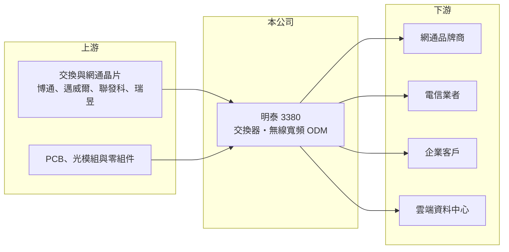

# 3380 明泰

> 上市｜[[產業索引-通信網路業|通信網路業]]｜上市（櫃）日期 2004/12/20

# 第一章：企業模式與商業藍圖

> [!info] 撰寫說明
> 本文由 Claude 依公開資料整理，架構比照 [[2330台積電]] 的四章研究，資料截至 2026-10-08。財務數字來源：Goodinfo 年度經營績效頁、證交所開放資料（基本資料、2026 年第二季資產負債與損益、營益分析、股利）、自由時報 2026 年 5 月股東會報導；公司沿革部分憑記憶整理，已標「待校對」。#待校對

評估一家大型網通代工廠，要看它能否在產品世代交替中，把營收重心移到附加價值較高的領域。本章說明明泰科技（股票代號：3380，以下簡稱明泰）的產品線，以及它從企業與家用網通走向 AI 資料中心交換器的轉型。

## 一、核心定位：營收兩百億級的網通 ODM

明泰成立於 2003 年，前身是 [[2332友訊]] 的設計製造部門分割獨立（待校對），2004 年上市，實收資本額約 54.2 億元。公司以 [[ODM]] 模式替網通品牌、電信業者與企業客戶設計與生產網路設備，年營收在 210 億至 340 億元之間，是台灣主要的網通代工廠之一。

和多數網通代工廠一樣，明泰的毛利率長期在 16% 至 19% 之間，獲利取決於產品組合、規模與費用控制。營收雖大，但每一個百分點的毛利率變化，都會對獲利造成明顯影響。

## 二、產品線

公司未公布精確營收比重，依 2026 年股東會報告，產品線包括：

* **交換器：** 涵蓋 AI 資料中心、電信級與企業級三類。資料中心方面開發 800G 與 [[1.6T交換器]]，整合水冷散熱與 ORV3 開放式機櫃平台，並深化 [[SONiC]] 網路作業系統的應用；電信級交換器強化高精度時間同步與資安；企業級則推出全 10G PoE 交換器。
* **無線寬頻：** Wi-Fi、5G 固定無線接取（FWA）、XGS-PON 與 DOCSIS 4.0 等家用與電信寬頻設備。
* **數位多媒體與行動方案：** 智慧影像與車用雷達技術開發。

## 三、長期方向：提高資料中心交換器比重

明泰採取「核心事業深耕」與「新事業拓展」雙軌策略，目標是提高 AI 資料中心交換器與高階寬頻產品的比重，並審慎評估策略性投資與併購。資料中心交換器的意義在於，雲端業者大量採用[[白牌交換器]]，由 ODM 廠依規格設計製造，單價與技術門檻都高於家用網通；若明泰能取得具規模的雲端客戶，將改變長期毛利結構。目前這個市場由 [[2345智邦]] 等廠商領先，明泰屬於追趕者。

# 第二章：護城河深度與競爭優勢

在長期價值投資中，「護城河」指企業抵禦競爭、維持超額利潤的保護機制。本章分析明泰的競爭位置。

## 一、相對優勢

* **產品線完整：** 從家用 Wi-Fi、電信寬頻到企業與資料中心交換器都有，能服務多種客戶，並在電信與企業市場累積長期認證。
* **規模：** 營收兩百億元以上，在零組件採購與製造成本上比中小型同業具優勢。
* **交換器設計經驗：** 長期做企業與電信交換器，具備往資料中心高速交換器延伸的軟硬體基礎。

## 二、主要競爭對手

| 對手 | 定位 | 對明泰的威脅 |
|---|---|---|
| [[2345智邦]] | 資料中心白牌交換器龍頭 | 已綁定大型雲端客戶，規模與技術領先 |
| [[5388中磊]]、[[3596智易]] | 寬頻與電信設備 | 在 PON、DOCSIS 與 Wi-Fi 直接競爭 |
| [[6285啟碁]] | 無線網通與衛星 | 在 Wi-Fi 與企業無線產品重疊 |
| 國際 EMS 廠（如 Celestica） | 資料中心網通代工 | 爭取雲端交換器訂單 |

## 三、守得住／守不住／觀察重點

守得住的是電信與企業客戶的長期合作關係。守不住的是家用網通的價格與營收規模，2022 年營收 336 億元後一路下滑到 2024 年的 214 億元，營業利益率從 5.1% 降到接近零，2025 年轉為虧損。長期觀察重點是資料中心交換器能否取得大型雲端客戶並放量，以及毛利率能否明顯高於過去的 18% 水準。

# 第三章：財務體質與盈利規模

資料日期：2026-10-08，表格是撰寫當時的快照；最新月營收、毛利率、累計 EPS 由自動排程寫在本筆記的屬性欄位（月營收、毛利率、累計EPS 等）。#待校對

財務報表是檢驗護城河是否真實存在的最終標準。本章用五年的三率、ROE 與資本報酬，檢視明泰的獲利品質。

## 一、多年度經營績效

| 年度 | 營收（新台幣） | [[毛利率]] | [[營業利益率]] | EPS（元） | [[ROE]] |
|---|---|---|---|---|---|
| 2021 | 279 億 | 16.5% | 2.55% | 0.80 | 4.27% |
| 2022 | 336 億 | 18.6% | 5.10% | 1.69 | 8.87% |
| 2023 | 283 億 | 18.4% | 2.93% | 1.01 | 4.76% |
| 2024 | 214 億 | 18.3% | 0.50% | 0.40 | 2.50% |
| 2025 | 225 億 | 17.4% | -0.61% | -0.36 | -1.09% |
| 2026 上半年 | 105 億 | 18.0% | -0.58% | 0.11 | 未查得 |

2022 年的缺料與漲價潮讓明泰營收與獲利達到高峰，之後庫存調整與家用網通需求轉弱，營收縮水三成以上。2021 至 2025 年平均 ROE 約 3.9%（推算），營收年複合成長率約 -5.2%（推算）。毛利率相對穩定，問題在於營收下滑後營業費用無法同步縮減。2025 年度虧損，公司以資本公積每股發放 0.5 元現金，代表配息來源不是當年盈餘。

## 二、[[ROIC]] 與 [[WACC]]：價值創造利差

**ROIC 推算：** 2025 年營業利益約 -1.4 億元（225 億 × -0.61%），稅後約 -1.1 億元。2026 年第二季股東權益約 91.8 億元，負債約 129 億元，其中多為應付帳款等營運負債，假設有息負債約 40 億元（推估），投入資本約 132 億元，ROIC 約 -0.8%（推算）。對照 2022 年營業利益約 17 億元，當年 ROIC 約 10% 上下（推算，以相近資本規模估計）。

**WACC 推算：** 台灣 10 年期公債 1.75%、市場風險溢酬 6%、β 取網通代工同業常見值 1.0，股東權益成本約 7.8%；負債成本 2.5%、稅後 2.0%；權益占投入資本約 70%，WACC 約 6.0%（推算）。

**結論：** 明泰只有在 2022 年的景氣高峰時 ROIC 高於 WACC，其餘年度都低於資金成本，近兩年更為負數。長期而言公司尚未證明能穩定創造價值，資料中心交換器的轉型能否把營業利益率拉到 3% 以上，是 ROIC 回到 WACC 之上的門檻。

# 第四章：總體風險與地緣政治

任何企業都無法脫離宏觀環境獨立存在。本章分析明泰長期必須面對的風險。

## 一、產業週期與客戶風險

網通設備需求跟隨電信商與企業的資本支出週期，2022 至 2024 年的營收下滑說明[[長鞭效應]]的影響。資料中心交換器市場雖然成長快，但客戶集中在少數雲端業者，訂單取得與流失都會造成營收大幅變動。

## 二、轉型執行風險

資料中心交換器需要高速 SerDes 設計、散熱與軟體整合能力，研發投入大，且領先者已建立客戶關係。若明泰無法取得具規模的客戶，研發費用會持續壓縮獲利。公司也提到審慎評估併購，併購若溢價過高，可能增加資本卻未帶來報酬。

## 三、地緣政治、關稅與匯率

美國關稅與對中國製網通設備的限制，要求代工廠調整生產地點，產能移轉期間會增加成本。營收以美元計價為主，新台幣升值會壓縮本來就不高的毛利。

# 專有名詞解析

## 應用

- **[[白牌交換器]]**：由 ODM 廠依雲端業者規格設計製造、不掛品牌的網路交換器，客戶自行搭配網路作業系統。
- **[[1.6T交換器]]**：單一連接埠傳輸速率達每秒 1.6 Tb 的資料中心交換器，是 800G 之後的新世代規格。
- **[[SONiC]]**：由微軟發起的開源網路作業系統，讓雲端業者能在白牌交換器上執行自己的網路軟體。

## 金融

- **[[長鞭效應]]**：終端需求的小幅變動，沿供應鏈往上游傳遞時被逐級放大，造成上游庫存與訂單劇烈波動。
- **[[ROIC]]**：投入資本報酬率，稅後營業利益除以股東權益與有息負債的合計，衡量本業對所有資金提供者的報酬。

## 產業

- **[[ODM]]**：原廠委託設計製造，代工廠可提出設計方案並負責生產，與客戶綁定較深，議價能力較高。

# 核心供應鏈

## 1. 上游：晶片與零組件
- 交換與網通晶片：[[AVGO博通]]、[[MRVL邁威爾]]、[[2454聯發科]]、[[2379瑞昱]]
- PCB、光模組與機構件供應商

## 2. 中游：網通代工同業
- [[2345智邦]]、[[5388中磊]]、[[3596智易]]、[[6285啟碁]]、[[3062建漢]]

## 3. 下游：客戶
- 網通品牌（含 [[2332友訊]]，待校對）、電信業者、企業與雲端資料中心客戶（公司未揭露具名比重）

## 供應鏈關係
- [[2454聯發科]] 的客戶：台灣網通交換器代工（聯發科供應鏈 › 下游：網通、智慧顯示與終端設備客戶）

## 最新新聞
<!-- news:start（自動產生，請勿手動編輯此範圍） -->
- 2026-10-15 📰 媒體 08:46｜個股：OCP全球峰會登場！明泰(3380)、建漢(3062)秀1.6T交換器液冷方案｜[富聯網](https://news.google.com/rss/articles/CBMiiAFBVV95cUxQNkQxS1lzOVFVOVNQVEZJdGFGV1gxc0Z5amRFcE4tMXpJSHFfVTJHUW1jQmwxakpFSW12c3YteXlYMlp1ejNOT05JQ2FwVllXeUdqV0tqdXFFY3lPVWRTZnYtUGthNWwxcUV1bDEwbjBOOEUtVElfb0p6SzdhUUp1NHE5c08xNGY2?oc=5)
- 2026-10-13 📰 媒體 19:07｜明泰(3380) 個股概覽 ／ 個股 - 股市｜[CMoney](https://news.google.com/rss/articles/CBMiSkFVX3lxTE11VzZ6RTFwaTlvdGdLZlZZQ2k3Q25vbUdQQTdCU1Y1UnhiYzhNaTZwQmpfYWp5cDJkSTFJRHRBRG9DWDJVOVh6VzdR?oc=5)
- 2026-10-12 📰 媒體 17:41｜明泰亮相2026 OCP峰會 展出1.6T水冷交換機強化AI資料中心布局｜[鉅亨網](https://news.google.com/rss/articles/CBMiT0FVX3lxTE9ULWhOdUp3ZkhVMUNDakxXdVYtZ01wd0ROZ2Y4TEhRTnJnZTZIMDZMbjhtcXRXZWJ1aFdwTWFpcmpQT2pnX2dfbDl6clB1MWc?oc=5)
- 2026-10-12 📰 媒體 15:24｜佳世達集團、明泰進軍2026 OCP 展1.6T 水冷交換機｜[UDN](https://news.google.com/rss/articles/CBMiVkFVX3lxTE1GbGlTZVpDRDF1Rk9iQS1fSVFQbXgyWmxhT1I4ZWxYVktSeUtIeTFhZEYtVmRaWm90RUZNNG5EZDQ4MUVlZkd5TVVmeE1vOGZ4UEhya0lB0gFWQVVfeXFMTUZsaVNlWkNEMXVGT2JBLV9JUVBteDJabGFPUjhlbFhWS1J5S0h5MWFkRi1WZFpab3RFRk00bkRkNDgxRWVmR3lNVWZ4TW84ZnhQSHJrSUE?oc=5)
- 2026-10-12 📰 媒體 15:00｜《通網股》AI資料中心升級戰開打！明泰祭1.6T交換機、液冷技術搶市- 上市櫃｜[旺得富理財網](https://news.google.com/rss/articles/CBMiakFVX3lxTE5SWHZyTjdhaklNYktMVFFEaUppZ0d1b1dydGJqS0NtWEQ5SWRfc3IwTGZIc3JyTXVHa3E2MEFWUlQ0LVFlOS1Dd2hLeVVjNTRla1lzZmthYlFOVDUwTGg5aFZZZC1VVGZrZXc?oc=5)

完整紀錄：[[3380明泰 新聞]]
<!-- news:end -->

## 相關連結
- [公開資訊觀測站](https://mopsov.twse.com.tw/mops/web/t05st03?step=1&firstin=1&co_id=3380)
- [Goodinfo](https://goodinfo.tw/tw/StockDetail.asp?STOCK_ID=3380)
- [Yahoo 股市](https://tw.stock.yahoo.com/quote/3380)
- [鉅亨網新聞](https://www.cnyes.com/twstock/3380/news)
