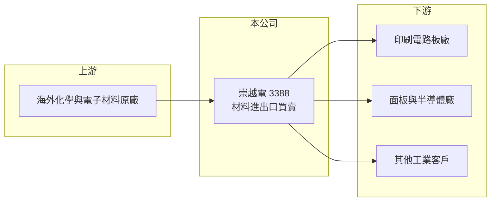

# 3388 崇越電

> 上櫃｜[[產業索引-電子零組件業|電子零組件業]]｜上市（櫃）日期 2006/02/22

# 第一章：企業模式與商業藍圖

> [!info] 撰寫說明
> 精簡版，由 Claude 依公開資料整理，架構比照 [[2330台積電]] 的四章研究，資料截至 2026-10-08。來源：Goodinfo 經營績效頁、nStock 公司簡介、櫃買中心開放資料快照（基本資料、2026 年第二季損益與資產負債、本益比殖利率）。公開資料有限，產品別營收比重、代理品牌與客戶名單未查得；與崇越集團的關係為整理性描述。#待校對

崇越電通是一家以化學與電子材料買賣為主的貿易公司，本身不設大型製造廠，靠代理、備貨與服務賺取價差。本章說明它的業務型態與長期方向。

- **核心業務：** 崇越電成立於 1994 年，2006 年上櫃，依公司登記的營業項目，主要從事化學材料相關商品的進出口買賣與一般貿易。這類材料通路商替國外原廠在台灣與亞洲銷售材料，並負責進口、倉儲、分裝與交期管理，客戶不必直接面對海外原廠。由於材料一旦被客戶產線認證後很少更換，通路商的營收具有一定的延續性。
- **營收結構：** 產品別比重在本次查到的資料中沒有揭露。以公司名稱與所屬崇越集團（[[5434崇越]] 為半導體與光電材料通路龍頭）推估，產品以印刷電路板、面板與半導體產業使用的[[電子材料]]與化學品為主（推估，待校對）。
- **營運據點：** 總公司在台北。2023 年美國子公司 TOPCO AMERICA INC. 更名為 TOPCO INVESTMENT HOLDING INC.，顯示海外子公司多以投資控股形式持有。2026 年第二季末總資產約 76.6 億元，其中股東權益約 49.6 億元，資產規模相對營收偏大，推估有相當比例的長期投資（推估）。
- **長期方向：** 材料通路的長期成長來自兩件事：一是取得更多原廠的[[代理權]]，二是跟著台灣電子產業往高階製程與 AI 相關應用移動。2025 年營收 73.6 億元仍低於 2021 年的 94.3 億元，但 2026 年上半年營收與獲利明顯回升，顯示公司仍與電子產業景氣高度連動。

# 第二章：護城河深度與競爭優勢

通路商的護城河不在技術，而在原廠關係、客戶認證與服務能力。本章分析崇越電的競爭條件。

- **競爭優勢：** 第一，材料一旦通過客戶產線認證，更換供應來源需要重新驗證，這讓代理商與客戶之間的關係相對穩固。第二，背靠崇越集團，在原廠談判、物流與客戶開發上可以共享資源（推估）。第三，公司長期維持低負債與穩定配息，財務體質讓它在景氣低谷時仍能維持備貨與服務。
- **主要對手：** 同類型的材料通路商包括 [[5434崇越]]、[[3010華立]]，以及外商原廠直營的業務團隊。原廠若決定自建通路或更換代理商，是材料通路業者共同面對的結構性威脅。
- **觀察重點：** 第一，毛利率能否維持在 2026 年上半年的 20% 左右，而不是回到 2023 年的 16% 低點。第二，代理產品是否切入 AI 伺服器相關的高階電路板與半導體材料。第三，營收規模能否重回 2021 年的高點。

# 第三章：財務體質與盈利規模

資料日期：2026-10-08，表格是撰寫當時的快照；最新月營收、毛利率、累計 EPS 由自動排程寫在本筆記的屬性欄位（月營收、毛利率、累計EPS 等）。#待校對

崇越電的財報呈現典型貿易商的特性：毛利率不高但穩定、資本支出輕、配息率高。本章用多年度數據檢視其獲利品質。

| 年度 | 營收（億元） | [[毛利率]] | [[營業利益率]] | EPS（元） | [[ROE]] |
|---|---|---|---|---|---|
| 2021 | 94.3 | 19.7% | 8.13% | 8.04 | 14.3% |
| 2022 | 87.0 | 17.8% | 6.73% | 6.30 | 10.4% |
| 2023 | 70.0 | 16.4% | 4.67% | 3.52 | 5.98% |
| 2024 | 75.7 | 16.8% | 5.60% | 4.09 | 6.82% |
| 2025 | 73.6 | 17.6% | 6.20% | 4.15 | 6.58% |
| 2026 上半年 | 43.9 | 20.3% | 8.2% | 3.41 | 未查得 |

- **營收規模：** 2021 至 2025 年營收從 94.3 億元降到 73.6 億元，年複合成長率約 -6.0%（推算），主要反映 2022 年後電子產業的庫存調整。2026 年上半年營收約 43.9 億元，已超過 2025 年全年的一半，景氣回升跡象明顯。
- **獲利：** 營業利益率在 4.7% 至 8.1% 之間，隨景氣波動但從未虧損，符合材料通路的穩定特性。近 5 年平均 ROE 約 8.8%（推算），偏低的原因是股東權益規模大，每股淨值約 63.7 元，資本運用效率不算高。
- **財務特色：** 2026 年第二季末負債總額約 25.5 億元，負債比約 33%，財務保守。2024 年發放現金股利 3.5 元、2025 年度配發約 3.34 元，以 2025 年 EPS 4.15 元計，配息率約八成（推算），股利政策穩定。

**[[ROIC]] 與 [[WACC]]：** 有息負債明細未查得，假設約 8 億元（推估）。2025 年營業利益約 4.56 億元（73.6 億 × 6.2%），稅後約 3.65 億元；投入資本以 2026 年第二季母公司權益 49.6 億元加有息負債 8 億元，約 57.6 億元，ROIC 約 6.3%（推算）。WACC 以 CAPM 推估：無風險利率 1.75%、市場風險溢酬 6%、β 取 0.8（通路股常見值，假設），股東權益成本約 6.6%；負債成本 2.5%、稅率 20%，以權益 86%、負債 14% 加權，WACC 約 5.9%（推算）。結論是 ROIC 與 WACC 大致相當，公司在景氣普通的年度只能勉強創造價值；2021 年或 2026 年這類景氣好的年度，利差才明顯為正。

# 第四章：總體風險與地緣政治

材料通路商的風險主要來自景氣循環、原廠關係與資訊透明度。本章整理需要長期留意的風險。

- **產業週期：** 電子材料的需求跟著電路板、面板與半導體產能利用率走，2023 年營收比 2021 年少約四分之一，就是庫存調整的結果。這類[[長鞭效應]]會讓通路商的營收波動大於終端需求。
- **營運風險：** 通路商最大的風險是[[代理權]]被收回，或原廠改為直營。由於產品別與原廠名單未公開，外部投資人很難判斷單一原廠的集中度，這是資訊面的風險。
- **其他風險：** 進口材料多以美元或日圓計價，匯率變動會影響進貨成本與毛利。化學品運輸與儲存涉及環保與安全法規，法規趨嚴會增加管理成本。

# 專有名詞解析

## 金融

- **[[長鞭效應]]**：終端需求的小幅變動，沿供應鏈往上游傳遞時被逐級放大，造成上游庫存與訂單劇烈波動。
- **[[ROIC]]**：投入資本報酬率，稅後營業利益除以股東權益加有息負債，衡量本業運用資本的效率。
- **[[WACC]]**：加權平均資金成本，股東權益成本與負債成本依資本結構加權，是 ROIC 必須超越的門檻。

## 產業

- **[[電子材料]]**：電子產品製造所需的化學品、薄膜、銅箔、光阻等材料，需經客戶產線長期認證。
- **[[代理權]]**：原廠授權通路商在特定地區或客戶銷售其產品的權利，是通路商最核心的資產，但可被收回。

# 核心供應鏈

- 上游：海外化學與電子材料原廠（名單未查得）。
- 下游／客戶：印刷電路板、面板、半導體與其他工業客戶（推估）。
- 同業：[[5434崇越]]、[[3010華立]]。

## 最新新聞
<!-- news:start -->
<!-- news:end -->

## 相關連結
- [公開資訊觀測站](https://mopsov.twse.com.tw/mops/web/t05st03?step=1&firstin=1&co_id=3388)
- [Goodinfo](https://goodinfo.tw/tw/StockDetail.asp?STOCK_ID=3388)
- [Yahoo 股市](https://tw.stock.yahoo.com/quote/3388)
- [鉅亨網新聞](https://www.cnyes.com/twstock/3388/news)
