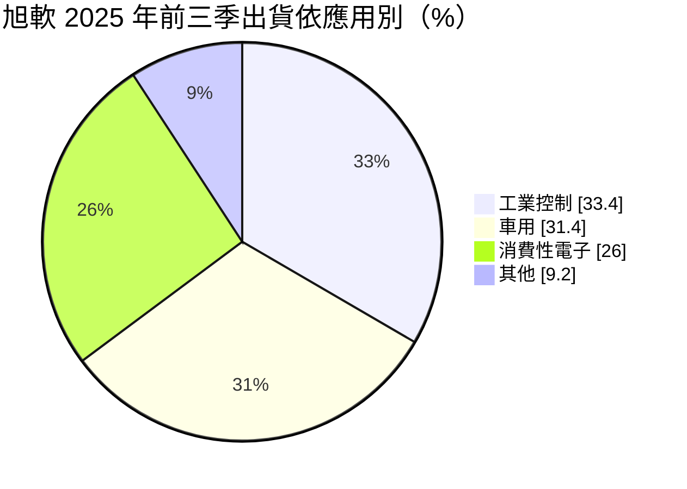
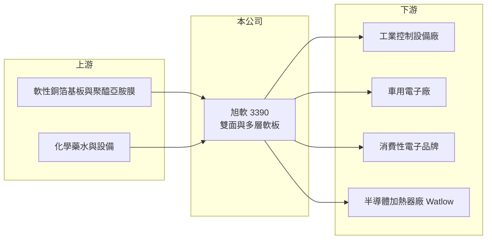

# 3390 旭軟

> 上櫃｜[[產業索引-電子零組件業|電子零組件業]]｜上市（櫃）日期 2006/02/22

# 第一章：企業模式與商業藍圖

> [!info] 撰寫說明
> 精簡版，由 Claude 依公開資料整理，架構比照 [[2330台積電]] 的四章研究，資料截至 2026-10-08。來源：Goodinfo 經營績效頁、優分析 2025 年 12 月法說會報導、櫃買中心開放資料快照（基本資料、2026 年第二季損益與資產負債、本益比殖利率）。工廠所在地與主要客戶名單未查得。#待校對

旭軟是專做[[軟板]]的中小型電路板廠，與手機軟板大廠不同，它把重心放在工業控制與車用這類少量多樣的市場。本章說明它的產品、應用與長期方向。

- **核心業務：** 旭軟成立於 1998 年，2006 年上櫃，生產軟性印刷電路板。依 2025 年前三季的出貨結構，雙面板約占 75%、多層板約占 12%，其餘為單面板等產品（推估）。多層板的製程難度與單價較高，公司預期 2026 年多層板比重可提升到 15% 至 20%。
- **營收結構：** 依 2025 年前三季的應用別，工業控制約占 33.4%、車用約 31.4%、消費性電子約 26%，其餘約 9.2%。工控在 2025 年超越車用成為最大應用，來自製造業添購自動化設備的需求。這種結構讓旭軟避開了手機軟板的價格戰，但也讓營收規模受限。
- **營運據點：** 2025 年資本支出約 4 億元，主要用於購置新廠房、土地與設施，2026 年資本支出降到約 2 億元，轉為採購設備。股東結構上，2476鉅祥 持有約 14.41%，是主要法人股東。
- **長期方向：** 公司與全球半導體加熱器大廠 Watlow 合作，軟板感測產品已通過驗證，規劃 2026 年下半年量產、2027 年全面量產，這是切入半導體設備供應鏈的新應用。搭配新廠的自動化產能與多層板技術，公司的目標是從低價雙面板轉向較高附加價值的產品。

# 第二章：護城河深度與競爭優勢

軟板產業由日本、中國與台灣大廠主導，旭軟的規模很小，必須靠利基應用生存。本章分析它的競爭條件。

- **競爭優勢：** 工控與車用客戶的訂單量小、規格多，大廠興趣不高，小廠可以靠彈性與服務取得訂單。車用軟板需通過[[IATF 16949]] 等認證，一旦導入通常可供貨多年，轉換成本較高。半導體設備用的感測軟板若順利量產，將是技術門檻更高的新利基。
- **主要對手：** 國內軟板同業包括 [[6269台郡]]、[[6153嘉聯益]]、[[4958臻鼎-KY]]，這些公司以手機與筆電為主、規模遠大於旭軟。中國軟板廠在一般雙面板市場的價格競爭，是 2025 年旭軟虧損的主因之一。
- **觀察重點：** 第一，新廠產能開出後的利用率，若訂單不足，折舊會壓低毛利率。第二，多層板比重能否如期提升。第三，Watlow 感測軟板能否在 2027 年貢獻穩定營收。

# 第三章：財務體質與盈利規模

資料日期：2026-10-08，表格是撰寫當時的快照；最新月營收、毛利率、累計 EPS 由自動排程寫在本筆記的屬性欄位（月營收、毛利率、累計EPS 等）。#待校對

旭軟的營收規模多年停在 8 至 10 億元，獲利微薄且波動大。本章用多年度數據檢視它的獲利能力。

| 年度 | 營收（億元） | [[毛利率]] | [[營業利益率]] | EPS（元） | [[ROE]] |
|---|---|---|---|---|---|
| 2021 | 8.99 | 18.6% | 5.93% | 0.48 | 3.12% |
| 2022 | 9.93 | 13.0% | -1.09% | 1.13 | 6.95% |
| 2023 | 8.09 | 18.5% | 2.73% | 1.00 | 5.99% |
| 2024 | 8.56 | 19.2% | 3.17% | 1.41 | 8.03% |
| 2025 | 7.92 | 14.1% | -4.13% | -0.55 | -3.19% |
| 2026 上半年 | 4.87 | 13.1% | -2.7% | -0.50 | 未查得 |

- **營收規模：** 2021 至 2025 年營收從 8.99 億元降到 7.92 億元，年複合成長率約 -3.1%（推算）。2026 年上半年營收約 4.87 億元，略高於 2025 年同期水準（推估），但仍未擺脫小規模的限制。
- **獲利：** 本業獲利很薄，2022 年營業虧損但 EPS 仍有 1.13 元，代表當年靠匯兌或業外收益支撐。2025 年受價格競爭、美國關稅造成客戶觀望與匯損影響轉為虧損，2026 年上半年每股虧損 0.50 元，新廠折舊開始出現。近 5 年平均 ROE 約 4.2%（推算）。
- **財務特色：** 2026 年第二季末股東權益約 14.3 億元、負債約 7.3 億元，負債比約 34%，財務尚屬穩健。2025 年虧損後以資本公積配發 0.2 元現金，股利來源不再是本業獲利。

**[[ROIC]] 與 [[WACC]]：** 有息負債明細未查得，假設約 3 億元（推估）。2025 年營業損失約 0.33 億元，稅後約 -0.26 億元，投入資本以母公司權益 14.3 億元加有息負債 3 億元，約 17.3 億元，ROIC 約 -1.5%（推算）；2024 年營業利益率 3.17% 時，ROIC 也只有約 1.3%（推算）。WACC 用 CAPM 推估：無風險利率 1.75%、市場風險溢酬 6%、β 取 1.0（電路板小型股常見值，假設），股東權益成本約 7.8%；負債成本 3%、稅率 20%，以權益 85%、負債 15% 加權，WACC 約 7.0%（推算）。結論是旭軟長期 ROIC 低於 WACC，尚未創造經濟價值；新廠與多層板轉型必須把營業利益率拉到 8% 以上才可能扭轉。

# 第四章：總體風險與地緣政治

小型軟板廠的風險集中在價格競爭、產能投資與匯率。本章整理主要風險。

- **產業週期：** 工控與車用需求跟著製造業資本支出與汽車銷量起伏，景氣轉弱時客戶會延後下單。軟板產業的產能擴張以中國為主，供過於求時價格下跌會直接壓縮毛利率。
- **營運風險：** 新廠與設備投入後折舊固定增加，若訂單跟不上，會形成[[營業槓桿]]的反向效果。營收規模小，單一大客戶或新產品延後量產都會明顯影響全年獲利。
- **其他風險：** 外銷比重高，新台幣升值會產生匯損，2025 年第二季就是例子。美國關稅政策讓客戶觀望，銅箔與聚醯亞胺等原料價格上漲也會增加成本。

# 專有名詞解析

## 應用

- **[[IATF 16949]]**：汽車產業的品質管理系統標準，車用零件供應商通常必須取得此認證才能進入車廠供應鏈。

## 金融

- **[[營業槓桿]]**：固定成本占比高時，營收小幅變動會讓營業利益大幅變動的現象。
- **[[ROIC]]**：投入資本報酬率，稅後營業利益除以股東權益加有息負債，衡量本業運用資本的效率。
- **[[WACC]]**：加權平均資金成本，股東權益成本與負債成本依資本結構加權，是 ROIC 必須超越的門檻。

## 產業

- **[[軟板]]**：軟性印刷電路板（FPC），可彎折的電路板，用於手機、筆電、車用面板與光通訊模組的內部連接。

# 核心供應鏈

- 上游：軟性銅箔基板、聚醯亞胺膜、化學藥水與製程設備供應商（推估）。
- 下游／客戶：工業控制、車用電子與消費性電子客戶，半導體加熱器大廠 Watlow。
- 同業：[[6269台郡]]、[[6153嘉聯益]]、[[4958臻鼎-KY]]；主要法人股東 2476鉅祥。

## 最新新聞
<!-- news:start -->
<!-- news:end -->

## 相關連結
- [公開資訊觀測站](https://mopsov.twse.com.tw/mops/web/t05st03?step=1&firstin=1&co_id=3390)
- [Goodinfo](https://goodinfo.tw/tw/StockDetail.asp?STOCK_ID=3390)
- [Yahoo 股市](https://tw.stock.yahoo.com/quote/3390)
- [鉅亨網新聞](https://www.cnyes.com/twstock/3390/news)
