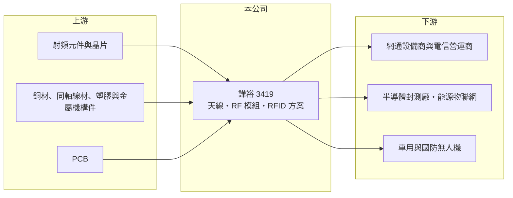

# 3419 譁裕

> 上市｜[[產業索引-通信網路業|通信網路業]]｜上市（櫃）日期 2008/01/21

# 第一章：企業模式與商業藍圖

> [!info] 撰寫說明
> 精簡版，由 Claude 依公開資料整理，架構比照 [[2330台積電]] 的四章研究，資料截至 2026-10-08。來源：證交所開放資料（基本資料、2026 年第二季資產負債與損益、股利）、Goodinfo 台灣股市資訊網年度經營績效（2020 至 2025 年）、富果研究 2025 年 12 月法說會整理。公司未揭露產品線營收比重，公開資料有限。#待校對

本章拆解譁裕實業（股票代號：3419，以下簡稱譁裕）的商業模式：它是一家有四十多年歷史的射頻天線廠，正嘗試從「賣天線零件」轉型為「賣無線通訊整合方案」。

- **核心業務：** 譁裕成立於 1981 年，2008 年上市，專注射頻（RF）與天線技術，以 [[JDM]] 與 [[EMS]] 模式服務網通品牌、系統整合商與設備商。產品包括基地台天線、室內分佈式天線系統（DAS）、[[FWA]] 裝置、O-RAN 天線與小型基站天線，也延伸到車用多合一鯊魚鰭天線，以及無人機與國防通訊用的 VHF／UHF 天線。天線是所有無線設備都需要的元件，但單價低、客製化程度高，因此譁裕的價值在於射頻設計與量產調校能力。
- **營收結構：** 公司未揭露各產品線比重。依法說會整理，業務可分成三塊：網通與電信基礎建設天線、物聯網與工業應用（包括用於半導體廠的 [[RFID]] 智慧貨架 E-Rack、智慧倉儲，以及 2025 年開始大量出貨的能源物聯網 AMI 產品），以及車用與特殊應用天線。公司表示服務超過 25 個國家、約 600 家客戶，客戶分散是優點，但也代表單一訂單規模小、難以形成規模經濟。
- **營運據點：** 總部與研發在新竹，生產據點包括中國東莞、蘇州與越南北寧。越南廠已投產，可協助客戶符合美國政府採購相關的 TAA 原產地要求，並分散地緣政治風險，這對爭取美國與國防相關訂單相當重要。
- **長期方向：** 管理層的目標是從傳統天線製造商轉型為整合解決方案供應商，延伸到物聯網通訊模組、[[毫米波雷達]]、工規 FWA 裝置與無人機反制系統，並與晶片、系統整合與衛星通訊夥伴結盟。轉型方向符合 5G、衛星非地面網路（NTN）與智慧電網的長期需求，但新產品要先完成客戶驗證，營收貢獻需要時間。

# 第二章：護城河深度與競爭優勢

天線廠的護城河通常不深，譁裕的優勢在射頻設計經驗與多據點製造，但這些優勢近年尚未轉化為獲利。

- **競爭優勢：** 第一是長年累積的射頻設計與測試能力：天線效能受機構、材質與周邊電路影響很大，每個案子都要重新調校，經驗豐富的團隊能縮短客戶開發時間。第二是越南與台灣產能，可以承接要求「非中國製造」的歐美與國防客戶。第三是 RFID 智慧貨架已在國內外封測大廠裝機，切入半導體廠自動化這個驗證門檻較高的市場。
- **主要對手：** 台灣天線與射頻同業包括 [[3138耀登]]、[[2444兆勁]]、[[2314台揚]]、[[3025星通]]，中國則有大量低價天線廠；在基地台天線與 DAS 領域，還要面對國際大廠的競爭。一般消費性天線的價格競爭非常激烈，這也是譁裕毛利率長期偏低的原因。
- **觀察重點：** 一是 AMI 能源物聯網、RFID 與國防無人機等新應用能否形成持續性的訂單；二是越南廠的稼動率能否拉高、攤平固定成本；三是毛利率能否回到 20% 以上，這是轉型成功與否最直接的指標。

# 第三章：財務體質與盈利規模

資料日期：2026-10-08，表格是撰寫當時的快照；最新月營收、毛利率、累計 EPS 由自動排程寫在本筆記的屬性欄位（月營收、毛利率、累計EPS 等）。#待校對

財務數字顯示，譁裕過去六年多數年度處於營業虧損，轉型尚未反映在獲利上。

| 年度 | 營收（億元） | [[毛利率]] | [[營業利益率]] | EPS（元） | [[ROE]] |
|---|---|---|---|---|---|
| 2020 | 14.3 | 20.4% | -3.30% | 0.61 | 4.86% |
| 2021 | 15.8 | 17.5% | -3.45% | -0.33 | -2.74% |
| 2022 | 19.8 | 19.2% | 0.38% | 0.28 | 2.07% |
| 2023 | 14.0 | 15.8% | -13.9% | -1.00 | -8.88% |
| 2024 | 14.8 | 17.2% | -13.3% | -1.21 | -11.6% |
| 2025 | 17.6 | 11.4% | -13.2% | -1.79 | -20.1% |
| 2026 上半年 | 8.98 | 12.41% | -10.44% | -0.74 | 未查得 |

註：2020 至 2025 年取自 Goodinfo，2026 年上半年取自證交所開放資料。

- **營收規模：** 營收在 14 億至 20 億元之間起伏，2020 至 2025 年年複合成長率約 4.2%（推算），規模偏小。2022 年營收衝上 19.8 億元，但隔年即回落，顯示需求跟著電信與網通建置週期波動。
- **獲利：** 毛利率從 2020 年的 20.4% 一路降到 2025 年的 11.4%，營業利益率自 2023 年起連續三年在 -13% 左右。毛利率不足以支撐研發、業務與多據點的管理費用，是虧損的主因；2025 年營收回升但毛利率反而下滑，推估與新產品導入初期成本與越南廠固定成本有關。
- **財務特色：** 2021 至 2025 年平均 ROE 約 -8.3%（推算），2025 年度未配發股利。2026 年第二季母公司股東權益約 8.93 億元、每股淨值 7.41 元，已低於面額 10 元，連續虧損持續侵蝕淨值，是需要留意的財務壓力。

## [[ROIC]] 與 [[WACC]]

**ROIC 推算：** 2025 年營業虧損約 2.32 億元（17.6 億元 × -13.2%），虧損年度不計稅負，稅後營業利益即為 -2.32 億元。投入資本以 2026 年第二季股東權益約 8.93 億元近似（有息負債未查得），ROIC 約 -26%（推算）。若加計有息負債，分母變大，ROIC 會略高但仍為明顯負值。

**WACC 推算：** 台灣 10 年期公債約 1.75%、市場風險溢酬約 6%、β 取網通中小型股常見的 1.0（假設），股東要求報酬率約 7.75%；考量部分銀行借款，WACC 約 7% 至 8%（推算）。

**解讀：** ROIC 為負且遠低於 WACC，代表譁裕目前處於價值毀損狀態：投入的資本不但沒有賺到資金成本，還在消耗股東權益。轉型能否成功，關鍵在毛利率能否回升到可以覆蓋費用的水準。

# 第四章：總體風險與地緣政治

本章說明譁裕長期面對的週期、轉型與財務風險。

- **產業週期：** 基地台與網通天線的需求跟著電信營運商的資本支出走，5G 建置高峰過後需求明顯放緩；消費性與物聯網天線則受終端景氣與客戶庫存影響。譁裕營收規模小，任何一個主要專案延後，就會使全年營收明顯波動。
- **營運風險：** 長期營業虧損是最大風險，若新產品無法放量，淨值會持續下降，可能需要增資或處分資產因應。客戶數多但單一訂單小，難以發揮規模效益；多個生產據點（東莞、蘇州、越南）的固定成本在低稼動率時特別沉重。
- **其他風險：** 中國廠區面臨地緣政治與美國關稅限制，越南廠雖可分散風險，但需要時間提高效率；國防與無人機反制產品涉及出口管制與政府採購規範。匯率方面，外銷比重高，新台幣升值會壓縮本已偏低的毛利率。

# 專有名詞解析

## 應用

- **[[FWA]]**：固定無線接取，以 4G 或 5G 行動網路取代光纖或銅線，為家庭與企業提供固定寬頻。
- **[[RFID]]**：無線射頻辨識，以無線電波讀取標籤資料、不需接觸即可辨識物品，常用於倉儲與物流管理。
- **[[毫米波雷達]]**：使用 30 至 300 GHz 頻段的雷達，可偵測物體距離與速度，用於車用、工業與安防感測。

## 產業

- **[[JDM]]**：共同設計製造，代工廠與客戶共同開發產品，設計參與度介於 OEM 與 ODM 之間。
- **[[EMS]]**：電子製造服務，替品牌客戶進行電子產品組裝與生產的代工模式。

# 核心供應鏈

- 上游：射頻晶片與元件、同軸線材、金屬與塑膠機構件、PCB 供應商。
- 下游／客戶：網通品牌與設備商、歐洲電信營運商、國內外封測大廠（RFID 智慧貨架）、歐美智慧電網客戶、車用與國防無人機客戶，公司未揭露具名客戶。
- 同業：[[3138耀登]]、[[2444兆勁]]、[[2314台揚]]、[[3025星通]]。

## 最新新聞
<!-- news:start -->
<!-- news:end -->

## 相關連結
- [公開資訊觀測站](https://mopsov.twse.com.tw/mops/web/t05st03?step=1&firstin=1&co_id=3419)
- [Goodinfo](https://goodinfo.tw/tw/StockDetail.asp?STOCK_ID=3419)
- [Yahoo 股市](https://tw.stock.yahoo.com/quote/3419)
- [鉅亨網新聞](https://www.cnyes.com/twstock/3419/news)
