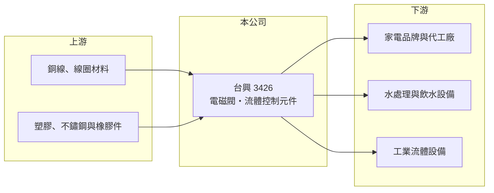

# 3426 台興

> 上櫃｜[[產業索引-電機機械|電機機械]]｜上市（櫃）日期 2016/12/21

# 第一章：企業模式與商業藍圖

> [!info] 撰寫說明
> 精簡版，由 Claude 依公開資料整理，架構比照 [[2330台積電]]，資料截至 2026-10-08。來源：Goodinfo 經營績效頁、網路公司簡介標題（「電磁閥大廠」）。repo 的證交所與櫃買中心開放資料快照中查無本代號紀錄，成立日期與最近一季資產負債未查得；產品與應用描述多為憑記憶整理，已標「待校對」。公開資料有限。#待校對

台興電子企業（以下簡稱台興）於 2016 年 12 月在櫃買中心掛牌，網路資料將它描述為[[電磁閥]]大廠。理解它的關鍵在於：電磁閥是家電、水處理與各種流體設備裡不起眼卻不可或缺的控制元件，台興的價值在於長期穩定的高毛利，而不是高成長。

- **核心業務：** 台興的主要產品是電磁閥，也就是用電磁線圈推動閥芯、控制水或氣體開關的元件（待校對）。這類元件廣泛用於洗衣機、淨水器、咖啡機、飲水機等家電，以及工業流體控制設備（應用範圍待校對）。一台家電可能只用一兩顆電磁閥，但它決定設備能否準確進水、止水，因此可靠度要求高。
- **營收結構：** 產品別與地區別營收比重在這次查到的公開資料中未查得。從 2015 至 2025 年毛利率維持在 30% 至 42% 之間來看，台興的產品並非低價大宗品，推估具有一定的客製化與認證門檻（推估）。
- **營運據點：** 公司登記地址、生產基地與海外據點在這次查到的資料中未查得（#待校對）。
- **長期方向：** 電磁閥的長期需求來自家電與水處理設備的普及、節水與智慧家電的規格升級，以及工業自動化。台興若能把產品延伸到更高單價的智慧控制與工業應用，可望突破目前 6 億至 8 億元的營收區間（推估）。

# 第二章：護城河深度與競爭優勢

台興的護城河屬於利基型的窄護城河，來自客戶的設計導入與長期品質紀錄。

- **競爭優勢：** 家電與設備品牌在新機種設計時就會指定電磁閥規格，並進行耐久與安全測試，一旦導入通常會用到機種停產，形成轉換成本。台興毛利率長期在三成以上，2016 至 2017 年更超過 41%，代表它在這個利基市場有一定的定價能力。
- **主要對手：** 電磁閥市場有歐洲、日本的工業閥件大廠，也有大量中國廠商以低價競爭家電用電磁閥。台興的直接競爭對手名單未查得。
- **觀察重點：** 長期最該追蹤的是毛利率的趨勢：由 2017 年的 41.7% 降到 2025 年的 32.2%，下滑幅度不小，推估反映中國同業競爭與成本上升（推估）。另一個重點是營收能否突破 2018 年的 8.32 億元高點，脫離長年持平的狀態。

# 第三章：財務體質與盈利規模

資料日期：2026-10-08，表格是撰寫當時的快照；最新月營收、毛利率、累計 EPS 由自動排程寫在本筆記的屬性欄位（月營收、毛利率、累計EPS 等）。#待校對

台興的財務特色是「營收持平、毛利率高、獲利穩定」，十年來沒有虧損年度，但也看不到明顯成長。

| 年度 | 營收（億元） | [[毛利率]] | [[營業利益率]] | EPS（元） | [[ROE]] |
|---|---|---|---|---|---|
| 2021 | 7.12 | 30.0% | 10.5% | 2.48 | 9.95% |
| 2022 | 7.17 | 30.5% | 9.50% | 2.83 | 11.0% |
| 2023 | 6.35 | 30.9% | 8.34% | 2.36 | 9.04% |
| 2024 | 7.81 | 34.4% | 13.1% | 3.44 | 12.5% |
| 2025 | 6.14 | 32.2% | 9.87% | 2.38 | 8.17% |

（來源：Goodinfo 經營績效頁，合併報表。2015 年營收 6.09 億元、EPS 3.12 元；2017 年 EPS 4.74 元為近十年高點。）

- **營收規模：** 2015 至 2025 年營收都在 5.9 億至 8.3 億元之間，2020 至 2025 年年複合成長率約 0.7%（推算）。營收長期持平，代表公司處在成熟的利基市場，主要靠維持既有客戶而非開拓新市場。
- **獲利：** 2021 至 2025 年平均 ROE 約 10.1%（推算），每年 EPS 都在 2 元以上，穩定度高。營業利益率由 2017 年的 18.7% 降到近年的 8% 至 13%，顯示費用或成本壓力上升，獲利能力比掛牌初期弱。
- **財務特色：** Goodinfo 統計的歷年平均現金股利約 1.92 元，以 EPS 2 至 3 元計算，配息率約六至八成（推算），屬於高配息的穩定型公司。最近一季的資產負債與有息負債在官方快照中未查得，自由現金流是否長期為正也未查得。
- **[[ROIC]] 與 [[WACC]]：** 因缺少資產負債資料，無法直接計算 ROIC。以 ROE 約 8% 至 12.5% 為參考，若公司有息負債不高，ROIC 推估落在 7% 至 12% 之間（推算，待以財報校對）。WACC 以 CAPM 推估：無風險利率 1.75%、市場風險溢酬 6%、β 假設 0.8（中小型零件股常見值），權益成本約 6.6%；若負債比重低，WACC 約 6% 至 6.5%（推算）。ROIC 推估略高於 WACC，代表台興長期能小幅創造價值，但利差不大，且隨毛利率下滑有縮小的趨勢。

# 第四章：總體風險與地緣政治

台興的風險主要來自價格競爭、客戶產業的景氣與資訊揭露有限。

- **產業週期：** 家電需求隨房市、消費景氣與換機週期變化，家電品牌在景氣轉弱時會調整庫存，零組件廠的訂單波動通常比終端更大。2025 年營收由 7.81 億元降到 6.14 億元，就反映了這種波動（原因未查得）。
- **營運風險：** 營收規模小，客戶若集中在少數家電品牌，一個大客戶的轉單就會明顯影響營收（客戶集中度未查得）。中國電磁閥廠商的低價競爭持續壓縮毛利率。
- **其他風險：** 銅線、塑膠與不鏽鋼等原料價格波動影響成本；外銷比重若高則受匯率影響。家電與飲水設備涉及安全與飲用水規範，各國認證要求提高時需要持續投入。研究這家公司時，建議以年報補足產品、客戶與據點資訊。

# 專有名詞解析

## 產業

- **[[電磁閥]]**：以電磁線圈帶動閥芯開關、控制液體或氣體流動的元件，常見於洗衣機、淨水器與工業設備。

# 核心供應鏈

- 上游：電磁線圈用銅線、塑膠、不鏽鋼與橡膠密封件供應商。
- 下游／客戶：家電品牌與代工廠、水處理與飲水設備業者、工業流體控制設備廠（具體客戶與應用比重未查得，#待校對）。
- 同業：國內外電磁閥與流體控制元件廠；台灣上市櫃中業務相同的公司未查得。

## 最新新聞
<!-- news:start -->
<!-- news:end -->

## 相關連結
- [公開資訊觀測站](https://mopsov.twse.com.tw/mops/web/t05st03?step=1&firstin=1&co_id=3426)
- [Goodinfo](https://goodinfo.tw/tw/StockDetail.asp?STOCK_ID=3426)
- [Yahoo 股市](https://tw.stock.yahoo.com/quote/3426)
- [鉅亨網新聞](https://www.cnyes.com/twstock/3426/news)
