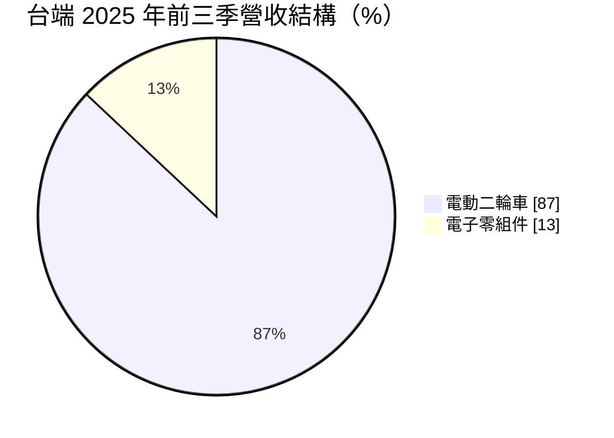
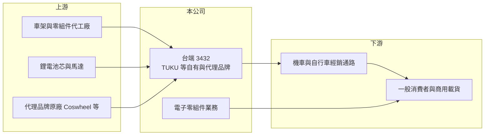

# 3432 台端

> 上市｜[[產業索引-電子零組件業|電子零組件業]]｜上市（櫃）日期 2010/12/30

# 第一章：企業模式與商業藍圖

> [!info] 撰寫說明
> 精簡版，由 Claude 依公開資料整理，架構比照 [[2330台積電]] 的四章研究，資料截至 2026-10-08。來源：Goodinfo 經營績效頁、富果研究 2025 年 12 月法說會摘要、證交所開放資料快照（基本資料、2026 年第二季營益分析、損益與資產負債、股利）。公開資料有限，各品牌銷量與通路數未查得。#待校對

台端原本是電子零組件公司，2024 年起轉型為電動二輪車品牌與通路商，營收結構已徹底改變。本章說明轉型後的業務組成。

- **核心業務：** 台端成立於 1988 年，2010 年上市，早年經營連接器、3C 配件與加熱模組。2024 年第二季起切入電動二輪車，目前經營自有品牌 TUKU（[[微型電動二輪車]]）、cybercycle 與 minica（三輪載貨與餐車），並代理 Coswheel、SOKER 等[[電動輔助自行車]]品牌。公司把策略稱為 TSCM，目標是短程「最後一哩」的移動工具。
- **營收結構：** 電動二輪車占營收比重從 2024 年的 61% 升到 2025 年前三季的 87%，電子零組件同期從 33% 降到 13%。這代表公司的營收來源已從工業零件轉為面對消費者的交通工具，商業模式、通路與風險都完全不同。
- **營運據點：** 總公司位於新北市中和區。2026 年規劃推出台灣自製鋰電池、搭載自製控制器的 TUKU 智慧車款與空中軟體更新（OTA），並擴大通路合作。
- **長期方向：** 公司希望從代理走向自有品牌與關鍵零件自製，包括電控系統與電池，藉此提高毛利率與產品差異化。轉型能否成功，取決於品牌能否在台灣與海外市場累積足夠銷量，攤平研發與行銷費用。

# 第二章：護城河深度與競爭優勢

台端在電動二輪車市場是新進者，規模與品牌知名度都還在建立中。本章分析它的競爭條件。

- **競爭優勢：** 公司保有電子零組件的設計經驗，可以把控制器、電池等關鍵電子零件自製，理論上比純組裝品牌更能掌握成本與軟體功能。微型電動二輪車屬於新興法規類別，市場尚未被大品牌完全占據，小品牌仍有切入空間。不過目前這些優勢仍停在規劃階段，尚未反映在獲利上。
- **主要對手：** 電動輔助自行車與自行車品牌有 [[9921巨大]]、[[9914美利達]]、[[8933愛地雅]]；電動機車有 Gogoro 與 [[1599宏佳騰]]。這些對手在品牌、通路與售後服務網路上都遠大於台端。
- **觀察重點：** 第一，2026 年推出的自製電池與控制器車款能否帶動毛利率。第二，營業虧損能否隨營收規模擴大而收斂。第三，是否需要再次增資或私募來支應轉型資金。

# 第三章：財務體質與盈利規模

資料日期：2026-10-08，表格是撰寫當時的快照；最新月營收、毛利率、累計 EPS 由自動排程寫在本筆記的屬性欄位（月營收、毛利率、累計EPS 等）。#待校對

台端的營收規模很小，轉型期間連年虧損。本章用多年度數據說明財務狀況。

| 年度 | 營收（億元） | [[毛利率]] | [[營業利益率]] | EPS（元） | [[ROE]] |
|---|---|---|---|---|---|
| 2021 | 0.37 | 32.4% | -54.8% | 0.86 | 3.65% |
| 2022 | 0.19 | 25.2% | -130% | -20.12 | -144% |
| 2023 | 0.17 | 32.0% | -171% | -0.60 | -8.06% |
| 2024 | 0.47 | 15.3% | -65.3% | -0.55 | -7.35% |
| 2025 | 1.55 | 15.9% | -21.6% | -0.87 | -11.2% |
| 2026 上半年 | 1.46 | 16.3% | -11.5% | -0.41 | 未查得 |

- **營收規模：** 2023 年營收只有約 1,700 萬元，轉型後 2025 年成長到 1.55 億元，2026 年上半年已達 1.46 億元，成長來自電動二輪車。不過以上市公司而言規模仍非常小。2022 年 EPS -20.12 元、ROE -144% 為 Goodinfo 數字，可能與當年股本變動或一次性損失有關，原因未查得。
- **獲利：** 營業利益率從 -171% 收斂到 2026 年上半年的 -11.5%，虧損隨營收放大而縮小，但毛利率從三成降到一成五左右，反映代理與組裝車輛的毛利低於過去的零件業務。2025 年稅後虧損約 3,664 萬元，未發放股利。
- **財務特色：** 2026 年第二季末股東權益約 2.94 億元，低於實收資本額 4.22 億元，每股淨值約 6.97 元，代表帳上已有[[累積虧損]]。公司有約 623 萬股私募股票，轉型資金部分來自私募。

**[[ROIC]] 與 [[WACC]]：** 有息負債明細未查得，假設約 0.5 億元（推估）。2025 年營業損失約 0.33 億元，投入資本以母公司權益 2.9 億元加有息負債 0.5 億元，約 3.4 億元，ROIC 約 -8%（推算），為負值。WACC 用 CAPM 推估：無風險利率 1.75%、市場風險溢酬 6%、β 取 1.2（轉型中小型股，假設），股東權益成本約 9.0%；負債成本 3%、稅率 20%，以權益 85%、負債 15% 加權，WACC 約 8.0%（推算）。結論是台端目前的 ROIC 遠低於 WACC，轉型尚未創造價值，關鍵在於營業利益能否在未來幾年轉正。

# 第四章：總體風險與地緣政治

轉型中的小公司，最大的風險是資金與執行力。本章整理主要風險。

- **產業週期：** 電動二輪車與電動輔助自行車的需求受消費景氣、油價與政府補助影響。歐美自行車市場在疫情後經歷嚴重的庫存調整，顯示這個產業也有明顯的庫存週期。
- **營運風險：** 營收規模小、持續虧損，權益已低於股本，若虧損延續，可能需要再增資，稀釋現有股東。新車款與自製電池的開發若延後，品牌建立會更慢。
- **其他風險：** 微型電動二輪車的法規仍在調整，牌照、保險與道路使用規定改變都會影響需求。鋰電池安全事件可能衝擊品牌信任，產品責任與召回成本對小公司負擔很重。

# 專有名詞解析

## 應用

- **[[微型電動二輪車]]**：最高時速與重量受法規限制的小型電動車，介於電動輔助自行車與電動機車之間，台灣需掛牌與投保。
- **[[電動輔助自行車]]**：騎乘者踩踏時由馬達提供助力的自行車，歐洲稱 e-bike，是自行車產業成長最快的品類。

## 金融

- **[[累積虧損]]**：歷年虧損累積後尚未彌補的金額，依公司法須先彌補完畢才能分配盈餘。
- **[[ROIC]]**：投入資本報酬率，稅後營業利益除以股東權益加有息負債，衡量本業運用資本的效率。
- **[[WACC]]**：加權平均資金成本，股東權益成本與負債成本依資本結構加權，是 ROIC 必須超越的門檻。

# 核心供應鏈

- 上游：車架與零組件代工廠、鋰電池芯與馬達供應商（推估）；代理品牌原廠 Coswheel、SOKER。
- 下游／客戶：機車與自行車經銷通路、一般消費者、餐車與載貨業者。
- 同業：[[9921巨大]]、[[9914美利達]]、[[8933愛地雅]]、[[1599宏佳騰]]、Gogoro。

## 最新新聞
<!-- news:start（自動產生，請勿手動編輯此範圍） -->
- 2026-10-12 📰 媒體 17:52｜營收速報 - 台端(3432)9月營收2,976萬元年增率高達103.43％｜[鉅亨網](https://news.cnyes.com/news/id/6628274)
- 2026-10-10 🏛️ 重訊 21:15｜依臺灣證券交易所股份有限公司臺證上一字第1121801204 號函辦理｜[觀測站](https://mops.twse.com.tw/mops/#/web/t05st01)

完整紀錄：[[3432台端 新聞]]
<!-- news:end -->

## 相關連結
- [公開資訊觀測站](https://mopsov.twse.com.tw/mops/web/t05st03?step=1&firstin=1&co_id=3432)
- [Goodinfo](https://goodinfo.tw/tw/StockDetail.asp?STOCK_ID=3432)
- [Yahoo 股市](https://tw.stock.yahoo.com/quote/3432)
- [鉅亨網新聞](https://www.cnyes.com/twstock/3432/news)
