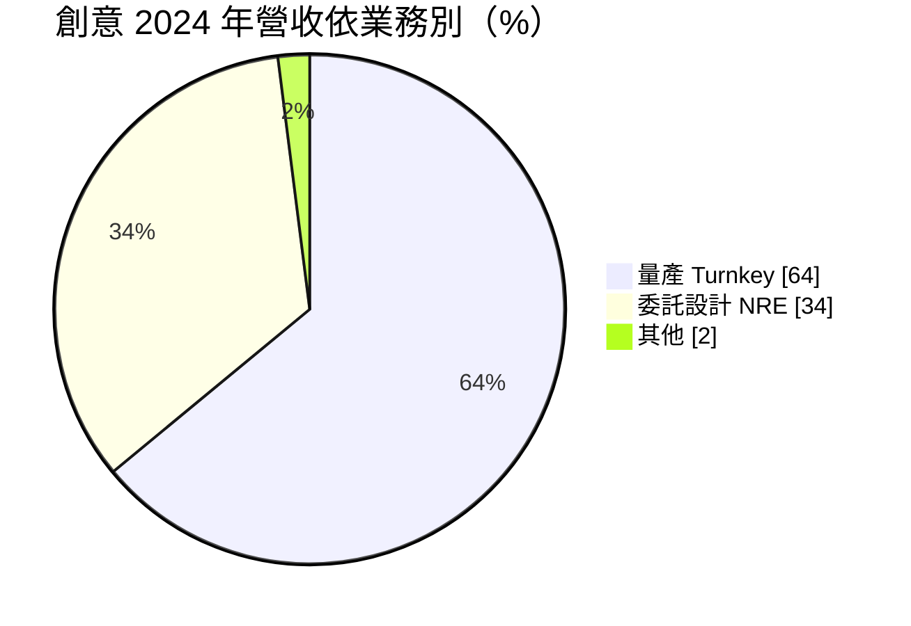
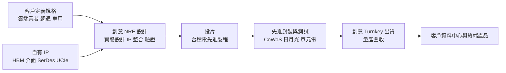
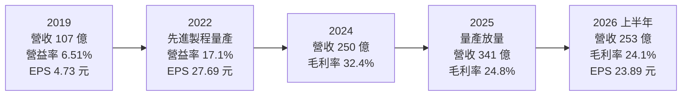
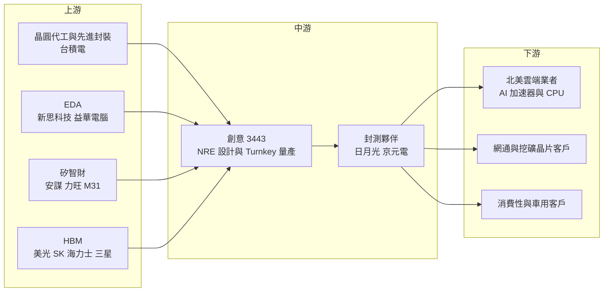

# 3443 創意

> 上市｜[[產業索引-半導體業|半導體業]]｜上市（櫃）日期 2006/11/03

# 第一章：企業模式與商業藍圖

> [!info] 撰寫說明
> 本文由 Claude 依公開資料整理，架構比照 [[2330台積電]] 的四章研究，資料截至 2026-10-08。財務數字來源：證交所開放資料快照（基本資料、2026 年第二季綜合損益與資產負債、2025 年度股利）、Goodinfo 經營績效頁與股利政策頁（2016 至 2025 年）、MoneyDJ 季資產負債表與年度現金流量表、優分析創意法說會與籌資報導（2025 年 3 月、2026 年 2 月、2026 年 8 月）、工商時報 2026 年 7 月財報報導、科技新報 2026 年 9 月報導；產業描述為整理性內容，尚未逐條比對原始文件。#待校對

在評估一家公司的長期投資價值時，第一步是看懂它靠什麼賺錢、為什麼能一直賺下去。本章針對創意電子（股票代號：3443，以下簡稱創意）的商業模式進行定性分析，說明這家台積電轉投資的設計服務公司，如何把雲端業者自研晶片的需求轉為營收，以及量產比重拉高之後，它的獲利結構為什麼會出現「營收暴增、毛利率下滑」的現象。

## 一、核心定位：台積電體系內的 ASIC 設計服務公司

創意成立於 1998 年 1 月 22 日，2006 年 11 月上市，總部位於新竹科學園區，董事長為張麗絲、總經理為戴尚義（證交所資料），最大股東為 [[2330台積電]]，持股約 35%（優分析 2025 年報導）。

創意做的是客製化晶片（[[ASIC]]）的[[設計服務]]。要理解這門生意，可以把晶片開發想成蓋房子：客戶是屋主，知道自己要什麼功能的房子，也可能自己畫好了設計草圖；但要把草圖變成能施工的詳細工程圖、協調建材與營造廠、確保房子蓋得起來，需要專業的建築師與營造管理。創意扮演的就是這個角色：客戶定義晶片的規格與功能，創意負責後段的實體設計、[[IP]] 整合、驗證與投片，並在量產階段代客戶向台積電下單、安排封裝測試，最後把成品晶片交給客戶。

這個定位有兩個長期意義：

- **台積電生態系的入口：** 想用最先進製程、又要搶時間上市的晶片客戶，透過創意可以更快取得台積電的設計資源、IP 與 [[CoWoS]] 等先進封裝產能。科技新報 2026 年 9 月報導提到，創意的優勢包括先進封裝 IP 組合、統包服務，以及與台積電設計技術平台部門的緊密合作。
- **從設計費轉向量產營收：** 設計階段只收一次性費用，一旦晶片量產，創意代客戶採購晶圓與封測，營收規模會跳升數倍，但毛利率會被稀釋。這個轉換是理解創意財報的關鍵。

## 二、產品板塊：委託設計與量產兩條收入線

依優分析 2025 年 3 月整理的法說會資料，2024 年營收結構如下：

- **委託設計（[[NRE]]）：** 收取設計服務、IP 授權與光罩相關的一次性費用。依同一報導，NRE 毛利率約 30% 至 40%，但金額隨專案進度起伏，屬於「播種」的收入：今天接下的設計案，決定一到兩年後的量產營收。
- **量產（[[Turnkey]]）：** 晶片進入量產後，由創意代為採購晶圓、封裝與測試並出貨，毛利率約 10% 至 20%（同一報導）。量產營收的金額通常是 NRE 的數倍，是營收規模的主要來源。依舊版整理，2026 年第二季量產營收占比提高到約 83%（待校對）。

客戶與地區結構在 2025 年出現明顯轉變。依優分析 2026 年 2 月整理，北美營收占比從 2024 年的約三分之一升到 2025 年的 68%，中國占比則從約三分之一降到 14%；2025 年前三大客戶中有兩家是加密貨幣挖礦晶片公司、一家是北美雲端服務業者（[[CSP]]）。公司預期 2026 年加密貨幣相關營收降到個位數百分比，由 CSP 晶片接手成為成長主力，並有第二家 CPU 客戶在爭取產能，中國與歐洲的車用客戶也已開始量產。

## 三、資本轉化邏輯：輕資產的設計與量產管理

創意的生意幾乎不需要廠房設備，但需要大量的人才與營運資金。這個模式有三個關鍵環節：

- **輕資產：** 創意沒有晶圓廠與封測廠，生產全部委由台積電與封測夥伴。2018 至 2025 年購置不動產廠房設備每年只有約 1 億至 8 億元（MoneyDJ 年度現金流量表），相對營收很小。
- **營運槓桿：** 量產營收雖然毛利率低，但幾乎不需要增加研發人力。營收放大時，營業費用占營收比例下降，營業利益仍能成長。2026 年上半年營業費用約 26.1 億元，占營收約 10.3%（證交所資料推算）。
- **營運資金是量產的門票：** 量產模式要先向台積電支付晶圓與封裝款項，等晶片出貨後才向客戶收款。量產規模愈大，需要墊付的資金愈多。2026 年 8 月董事會通過新台幣 400 億元的銀行聯貸，以及發行上限 8 億美元的海外無擔保[[可轉債]]，合計上限約 655 億元，用途是充實中長期營運資金與外幣購料（優分析）。這個金額遠大於創意當時約 135 億元的股東權益，顯示量產業務的資金需求已經改變了公司的財務結構。

## 四、企業長期藍圖：從 NRE 走向先進封裝與 CPO

- **先進製程 AI ASIC 與 CPU：** 以台積電最先進製程承接雲端業者的 AI 加速器與自研 CPU 專案。依科技新報報導，創意的產品線已從谷歌、微軟的自研 CPU 延伸到多家雲端業者的客製化 ASIC（媒體報導，客戶未經公司證實）。雲端業者自研晶片的目的是降低對輝達的依賴與整體運算成本，這是創意長期需求的根本來源。
- **HBM 與高速介面 IP：** 開發 [[HBM]] 控制器與實體層、高速 [[SerDes]]、[[小晶片]]互連（[[UCIe]]）等介面。依優分析報導，美光是創意 HBM4 IP 開發的合作夥伴。這些 IP 讓客戶不必自己開發記憶體與晶片互連介面，可以縮短開發時間，也提高客戶留在創意的動機。
- **先進封裝與光通訊：** 公司的長期路徑是從 NRE 設計、量產管理，延伸到先進封裝與共同封裝光學（[[CPO]]）。隨著 AI 晶片愈來愈依賴多顆小晶片與 HBM 的整合，懂得封裝設計的設計服務公司，能在專案中掌握更多附加價值。

# 第二章：護城河深度與競爭優勢

在長期價值投資中，「護城河」指企業抵禦競爭、維持超額利潤的保護機制。本章分析創意的護城河構成、全球主要競爭對手，以及這些優勢在客製化 AI 晶片的激烈競爭中能守住多少。

## 一、護城河的核心組成要素

創意的護城河屬於「中等寬度」，主要由四個要素組成：

- **1. 台積電生態系的位置：** 台積電是最大股東，創意能優先接觸先進製程的設計套件、IP 與先進封裝資源。對需要搶時間上市的 AI 晶片客戶而言，這等於縮短了從設計到量產的時間與風險。這是創意與多數設計服務同業最大的差異。
- **2. 先進製程設計經驗：** 最先進製程的實體設計、時序收斂、功耗與散熱管理難度極高，一次投片失敗的成本可能高達數千萬美元。過去成功量產的紀錄本身就是門檻，客戶傾向把高風險專案交給有經驗的團隊。
- **3. 自有 IP 組合：** HBM 介面、高速 SerDes、晶片互連等關鍵 IP，讓客戶能在創意的平台上快速完成設計。客戶一旦採用這些 IP，換到另一家設計服務公司就要重新驗證，轉換成本隨之升高。
- **4. 專案綁定效應：** 一顆 ASIC 從設計到量產需要一到兩年，量產期又可能延續數年。客戶在創意完成第一代晶片後，下一代通常會延續合作，因為重新換團隊會讓時程與風險倍增。

## 二、全球主要競爭對手格局

| 對手 | 定位 | 對創意的威脅 |
|---|---|---|
| [[AVGO博通]]、[[MRVL邁威爾]] | 全球最大客製化 AI 晶片供應商，設計、IP、封裝一條龍 | 承接最大型雲端業者的核心 AI 晶片，規模、IP 與議價力遠大於創意 |
| [[3661世芯-KY]] | 同屬台積電體系的設計服務公司 | 在 AI ASIC 專案上直接競爭，定位最接近 |
| [[2454聯發科]] | 手機晶片大廠，切入雲端客製化晶片 | 以自有高速介面 IP 與規模爭取大型專案 |
| [[3035智原]] | 聯電體系的設計服務公司 | 近年也承接先進製程與先進封裝專案 |
| Socionext 等日本設計服務公司 | 區域型設計服務 | 在特定客戶與區域競爭 |

此外，部分雲端業者擴大自建後段設計團隊，把原本外包的工作收回內部，這是設計服務產業長期的潛在威脅。

## 三、優勢轉化：哪些市場守得住、哪些守不住

- **守得住：** 想降低晶片成本、不想付給博通高額溢價的雲端業者，以及需要台積電先進製程與封裝資源的中型客戶。創意以設計服務的成本結構提供替代選擇，台積電體系的背景則提供技術可信度。客戶一旦量產，後續世代的延續性很高。
- **守不住：** 最大型雲端業者的核心 AI 晶片，仍多交給博通與邁威爾，創意的單一專案規模與議價力有限。量產比重提高後，毛利率結構性下滑，從 2022 年的 34.7% 降到 2025 年的 24.8%（Goodinfo）。客戶集中度高，單一專案延後或轉單，就會造成營收明顯波動。
- **觀察重點：** 第一，NRE 接案量是否持續成長，因為它是未來量產營收的領先指標。第二，量產營收大增後，營業利益率能否守住雙位數。第三，雲端客戶下一代晶片是否續留創意。第四，大規模借款與可轉債之後，營運資金的周轉效率能否維持。

# 第三章：財務體質與盈利規模

資料日期：2026-10-08。數字取自 Goodinfo 經營績效頁與股利政策頁、證交所開放資料快照與 MoneyDJ 季資產負債表、年度現金流量表，表格是撰寫當時的快照；最新月營收、毛利率、累計 EPS 由自動排程寫在本筆記的屬性欄位（月營收、毛利率、累計EPS 等）。#待校對

財務報表是檢驗護城河是否真實存在的最終標準。本章用多年度的三率、ROE、現金流與資本報酬，檢視創意從設計服務走向大規模量產時的獲利品質。

## 一、獲利能力的基石：三率

| 年度 | 營收（億元） | [[毛利率]] | [[營業利益率]] | EPS（元） | [[ROE]] |
|---|---|---|---|---|---|
| 2018 | 135 | 29.8% | 8.15% | 7.37 | 23.5% |
| 2019 | 107 | 33.0% | 6.51% | 4.73 | 14.6% |
| 2020 | 136 | 30.0% | 7.10% | 6.34 | 19.3% |
| 2021 | 151 | 34.6% | 11.1% | 10.90 | 30.0% |
| 2022 | 240 | 34.7% | 17.1% | 27.69 | 55.7% |
| 2023 | 262 | 30.4% | 15.1% | 26.18 | 39.5% |
| 2024 | 250 | 32.4% | 15.2% | 25.75 | 32.9% |
| 2025 | 341 | 24.8% | 12.7% | 28.13 | 31.1% |

（來源：Goodinfo 經營績效頁，合併報表。2026 年上半年依證交所資料，營收 253.4 億元、毛利率 24.10%、營業利益率 13.81%、EPS 23.89 元。）

- **兩個階段：** 2016 至 2020 年創意營收約在 93 億至 136 億元之間，營業利益率只有 6% 至 8%，是一家規模不大的設計服務公司。2021 至 2022 年先進製程專案進入量產，營收跳升到 240 億元、營業利益率升到 17.1%，EPS 從 6.34 元升到 27.69 元，代表它從「接案公司」轉型為能把設計轉成量產營收的公司。
- **毛利率與營業利益率的取捨：** 2025 年毛利率降到 24.8%，比 2024 年少了 7.6 個百分點，主因是低毛利的量產營收比重提高。但營業利益率只從 15.2% 降到 12.7%，因為營業費用不會隨量產等比例增加。2026 年上半年毛利率 24.1%、營業利益率反而回升到 13.81%，正是營運槓桿的效果。評估創意時，營業利益金額比毛利率更能反映實際的獲利能力。
- **長期成長：** 2020 至 2025 年營收年複合成長率約 20%（推算，136 億元到 341 億元）。成長並不平順，2019 年與 2024 年都出現營收下滑，反映專案制生意「專案結束就斷層」的特性。

## 二、[[ROE]]：資本效率

創意 2021 至 2025 年平均 ROE 約 37.8%（推算），屬於非常高的水準。高 ROE 的來源是輕資產：股本只有約 13.4 億元，沒有晶圓廠，股東權益在 2026 年第二季約 134.7 億元，每股參考淨值約 100.48 元（證交所資料）。這麼小的資本基礎，卻能承接數百億元營收的量產業務，關鍵在於客戶預付款：2026 年第二季合約負債約 132.2 億元，比 2025 年底的約 73.4 億元大幅增加（MoneyDJ 季資產負債表），代表客戶先付錢、創意再去採購，等於由客戶替創意承擔一部分營運資金。

需要注意的是，ROE 的波動很大，2019 年只有 14.6%、2022 年高達 55.7%，完全取決於當年有沒有大型專案在量產。這是設計服務業的本質：資本效率高，但獲利的穩定度不如有長期合約的產業。

## 三、資本支出、自由現金流與股利

- **[[CapEx]]：** 創意的資本支出主要是設計工具、IP 開發與測試設備，2018 至 2025 年購置不動產廠房設備每年約 0.9 億至 8.4 億元，另取得無形資產每年約 2.4 億至 3.8 億元（MoneyDJ 年度現金流量表）。即使業務規模擴大，實體投資仍然很小。
- **[[自由現金流]]：** 2018 至 2025 年自由現金流分別約為 -3.0、-3.8、31.3、41.4、12.8、44.1、57.7、-19.8 億元（營業現金流減購置不動產廠房設備，MoneyDJ 資料推算）。八年中有五年為正，負值多出現在量產規模快速擴大、需要先墊付晶圓與封裝款的年份。2025 年營業現金流轉為約 -11.4 億元，2026 年再以大額聯貸與可轉債籌資，顯示量產放量期的現金壓力正在上升。
- **股利穩定度：** 2016 至 2025 年度現金股利分別為每股 3.5、5、5、5、5、7、14、14、16、20 元（Goodinfo 股利政策頁），十年來沒有減少過。以當年 EPS 計算，2021 至 2025 年度配發率約 51% 至 71%（推算）。創意的股利政策屬於「穩定並隨獲利逐步提高」，但營運資金需求擴大後，配發率是否維持，需要觀察。

## 四、[[ROIC]] 與 [[WACC]]：價值創造利差

- **ROIC（推算）：** 以 2025 年營收 341 億元乘以營業利益率 12.7%，營業利益約 43.3 億元，扣除 20% 稅率後稅後營業利益約 34.6 億元。投入資本以 2025 年底權益約 129.1 億元，加上有息負債約 4.4 億元（其他長期借款 1.7 億、租賃負債 2.7 億），合計約 133.5 億元，ROIC 約 26%（推算）。以 2026 年上半年營業利益 35.0 億元年化，稅後約 56.0 億元，除以 2026 年第二季權益 134.7 億元加有息負債約 4.6 億元，投入資本約 139.3 億元，ROIC 約 40%（推算）。若扣除帳上約 100 億元現金，實際投入營運的資本更小，ROIC 會更高。
- **WACC（推算）：** 以 [[CAPM]] 估算股東權益成本：無風險利率取台灣 10 年期公債約 1.75%，市場風險溢酬 6%，β 假設 1.3（IC 設計與 AI 半導體股常見值，未查得創意實際數字），權益成本約 9.55%。創意截至 2026 年第二季幾乎沒有有息負債，WACC 約等於權益成本，約 9.5%（推算）。未來 400 億元聯貸與 8 億美元可轉債若實際動用，負債比重上升，WACC 會下降，但財務風險同時升高。
- **價值創造判斷：** 創意的 ROIC 約 26% 至 40%，比約 9.5% 的資金成本高出 16 至 30 個百分點，代表它在這段期間創造了大量超額價值。量產模式的關鍵在營運資金的周轉：只要客戶預付款與應付帳款能抵銷大部分的存貨與應收帳款，低毛利的量產業務仍能維持很高的 ROIC；反之，若籌來的數百億元資金被長期鎖在存貨與預付款裡，投入資本會快速膨脹，ROIC 也會被稀釋。

# 第四章：總體風險與地緣政治

任何企業都無法脫離宏觀環境獨立存在。本章分析創意未來必須面對的地緣政治、產業週期、營運與技術風險。

## 一、地緣政治

- **美國出口管制：** 創意承接的 AI 晶片若涉及中國客戶，或被認定為先進運算晶片，會受到美國出口管制的限制。2025 年中國營收占比已從約三分之一降到 14%，出口管制是原因之一，也代表中國市場的成長空間受限。
- **對台積電與台灣的依賴：** 生產全部委由台積電，先進製程與先進封裝產能主要在台灣。兩岸風險與台積電的產能分配，都會直接影響創意的出貨。
- **美國在地製造要求：** 若美國要求 AI 晶片在美國生產，創意需要配合台積電海外廠的產能與成本結構，量產管理的複雜度與成本都會提高。

## 二、產業週期與市場結構

- **AI 資本支出週期：** 創意的量產營收高度連動雲端業者的 AI 投資。若雲端業者削減資本支出或調整自研晶片策略，量產營收可能大幅波動。
- **專案制的斷層風險：** 設計服務的營收來自一個個專案，大型專案結束而新專案尚未接上時，營收就會出現斷層，2019 年與 2024 年營收下滑都是例子。
- **加密貨幣需求：** 2025 年前三大客戶中有兩家是挖礦晶片公司，這類需求隨幣價劇烈波動。公司預期 2026 年加密貨幣營收降到個位數百分比，波動來源減少，但客戶集中在少數雲端業者的程度也隨之提高。

## 三、營運環境的隱性風險

- **營運資金與財務槓桿：** 2026 年規劃的 400 億元聯貸與 8 億美元可轉債，讓創意從幾乎零負債的公司，轉向需要大量借款的量產管理公司。若客戶延後拉貨或付款，存貨與預付款的風險會由創意承擔；可轉債轉換也會稀釋股東持股。
- **毛利率稀釋：** 量產比重提高使毛利率結構性下滑，若晶圓與先進封裝成本上漲而無法轉嫁，獲利率會進一步承壓。
- **先進封裝產能：** CoWoS 等先進封裝產能緊張時，量產出貨可能受限。
- **專案執行風險：** 先進製程設計失敗或需要重新投片，會產生高額成本並損害客戶信任。

## 四、科技或法規演進

- **製程世代轉換：** 每往下一個製程節點，設計複雜度與投片成本都大幅上升，創意需要持續投入研發與 IP，才能維持承接最先進專案的能力。
- **雲端業者內部化：** 大型雲端業者若擴大自建後段設計團隊，設計服務公司能分到的工作會被壓縮（推估）。
- **介面標準演進：** HBM4、UCIe 等介面規格快速更新，IP 若落後一個世代，就可能失去下一代專案。
- **小晶片與光通訊：** AI 晶片走向多顆小晶片整合與光電共同封裝，若創意能在封裝設計與 CPO 建立能力，就能提高在每個專案中的附加價值；反之，價值可能被掌握封裝技術的晶圓廠或大型晶片商取走。

# 專有名詞解析

## 半導體

- **[[ASIC]]**：特殊應用積體電路，為特定用途設計的晶片，例如雲端業者自研的 AI 加速晶片。
- **[[設計服務]]**：替客戶完成晶片後段實體設計、驗證、投片與量產管理的服務，代表廠商為創意、世芯、智原。
- **[[NRE]]**：一次性工程費用，指晶片設計、IP 授權與光罩等開發階段的收費，毛利率較高但隨專案波動。
- **[[Turnkey]]**：量產統包服務，設計服務公司代客戶採購晶圓、封裝與測試並出貨成品晶片，營收規模大但毛利率較低。
- **[[IP]]**：矽智財，可重複授權使用的電路設計模組，例如處理器核心、記憶體介面與高速傳輸介面。
- **[[HBM]]**：高頻寬記憶體，把多層 DRAM 垂直堆疊並以寬匯流排連接處理器，是 AI 加速器的關鍵記憶體。
- **[[SerDes]]**：串列器與解串器，把平行資料轉成高速串列訊號傳輸，是晶片之間與網路連線的關鍵介面。
- **[[UCIe]]**：通用晶粒互連標準，規範同一封裝內不同小晶片之間的連接介面，讓不同來源的晶粒可以組合。
- **[[小晶片]]**：把一顆大晶片拆成多顆功能較小的晶粒，再以先進封裝組合，可提高良率並混用不同製程（Chiplet）。
- **[[CoWoS]]**：台積電的 2.5D 先進封裝技術，把運算晶片與 HBM 並排放在矽中介層上，是 AI 晶片的主流封裝方式。
- **[[CPO]]**：共同封裝光學，把光收發元件與交換器或運算晶片封裝在一起，縮短電訊號路徑、降低功耗。

## 應用

- **[[CSP]]**：雲端服務供應商，例如谷歌、微軟、亞馬遜、Meta，近年大量自研 AI 與 CPU 晶片。

## 金融

- **[[可轉債]]**：可轉換公司債，持有人可依約定價格把債券轉換為股票，轉換後會稀釋原股東持股。
- **[[ROIC]]**：投入資本報酬率，稅後營業利益除以股東權益加有息負債，衡量本業運用資本的效率。
- **[[WACC]]**：加權平均資金成本，依股東權益與負債的比重，加權計算公司取得資金的平均成本。
- **[[CAPM]]**：資本資產定價模型，以無風險利率加上 β 乘以市場風險溢酬，估算股東要求的報酬率。

# 核心供應鏈

## 1. 上游：晶圓代工、封測、IP 與 EDA
- 晶圓代工與先進封裝：[[2330台積電]]
- 封裝測試：[[3711日月光投控]]、[[2449京元電子]]
- [[EDA]]：[[SNPS新思科技]]、[[CDNS益華電腦]]
- 矽智財：[[ARM安謀]]、[[3529力旺]]、[[6643M31]]
- HBM 記憶體：美光、SK 海力士、[[005930三星電子]]

## 2. 中游：創意本身
- ASIC 委託設計（NRE）與量產服務（Turnkey）
- 最大股東：[[2330台積電]]

## 3. 下游：主要客戶類型
- 北美雲端業者的 AI 與 CPU 晶片：媒體報導提及 [[GOOGL谷歌]]、[[MSFT微軟]]（個別合作關係未經公司證實）
- 網通與加密貨幣挖礦晶片客戶
- 中國與歐洲車用客戶

## 4. 同業與競爭者
- 國內：[[3661世芯-KY]]、[[3035智原]]、[[2454聯發科]]
- 國外：[[AVGO博通]]、[[MRVL邁威爾]]、Socionext

延伸閱讀：[[台積電供應鏈]]

## 供應鏈關係
- 供應給 [[2330台積電]]：台積電專屬 ASIC 設計服務（台積電供應鏈 › 上游：晶片設計工具、IP與設計服務 (ASIC)）

## 最新新聞
<!-- news:start（自動產生，請勿手動編輯此範圍） -->
- 2026-10-24 📰 媒體 12:34｜從零股榜看人氣》台積電、聯發科、0050⋯前6名完全沒換人！創意、欣興新進榜南亞科怎麼不見了？ - 上市櫃｜[旺得富理財網](https://news.google.com/rss/articles/CBMiakFVX3lxTFBURVMwbnZ3aDd4RWM0QURKaWRTSkJfOXN3T0E4Q1VIZjRMODFxRHlITXF4eUdma0g3aW4wY2lJYTlUbGk4alJLQ3EwWUlTSFVIOW5vR3hLLVQtTWg3Wk4yRGVTbzR5OGhKSlE?oc=5)
- 2026-10-22 📰 媒體 11:31｜半導體產業鏈／創意9月營收年增近98%！2奈米HBM4E布局AI ASIC｜[科技島](https://news.google.com/rss/articles/CBMiakFVX3lxTFBFWjY0Q2tLLVk5akJRcWNxVTBCQXFoaVRscmxQcTZQYzI4OEo0WGF0UjUwVEYyUWJidF82dV94eTVvVHRKbjRCQldyM2JzU2hPMXpqRm45d2R5MXpPVVFYb0NnTHRJbXplWVE?oc=5)
- 2026-10-22 📰 媒體 09:11｜焦點股》創意：3大CSP大單到手！ 開低急拉逾10％再飆掛牌天價｜[自由時報](https://news.google.com/rss/articles/CBMiWEFVX3lxTE1lTnFhbm9xNmtmQVBJX0JfRzRfbk1YWl9XYmhTTVNZYnBVdWREbFY5X0dsenJoV0xwQnFkZnlKOWNQY0Z2Nkp0anhfNVVfNXlBWkwzQXpQYTg?oc=5)
- 2026-10-22 📰 媒體 07:57｜《個股重大訊息》個股動態：力積電、創意、宏于電機｜[富聯網](https://news.google.com/rss/articles/CBMiiAFBVV95cUxPc2NKOTVTQWdTZ2FmcExqUFB4TXF5VUJEdFVNSzhycEF0Q213M2w3bkEybm9IcWI3SFE4bTBWbEhWd205Vm93UG4zTEI0bmFLMXg5bmJEd0FqdjFTOVVBQmdBWHVjUFVMQ1pFYWJRNU9RN0xha3RVOEpfUG9MT2puRll4Wm95V1Fq?oc=5)
- 2026-10-22 📰 媒體 03:00｜創意下一站萬金股？外資最高喊1.2萬元Google、特斯拉專案撐起成長想像- 日報｜[工商時報](https://news.google.com/rss/articles/CBMiX0FVX3lxTE8wMmRnZW5mLXdsSmpkcEJCd2JBS21jR2ljRFBfMG5vcG9sOUtKRFV3SnRFS3F3c1I5c0pvMW5EejFYYjdaMW1nV1ZfcWlCYWh6dWFWOUk4ZEhxV0cxSzJN?oc=5)

完整紀錄：[[3443創意 新聞]]
<!-- news:end -->

## 相關連結
- [公開資訊觀測站](https://mopsov.twse.com.tw/mops/web/t05st03?step=1&firstin=1&co_id=3443)
- [Goodinfo](https://goodinfo.tw/tw/StockDetail.asp?STOCK_ID=3443)
- [Yahoo 股市](https://tw.stock.yahoo.com/quote/3443)
- [鉅亨網新聞](https://www.cnyes.com/twstock/3443/news)
