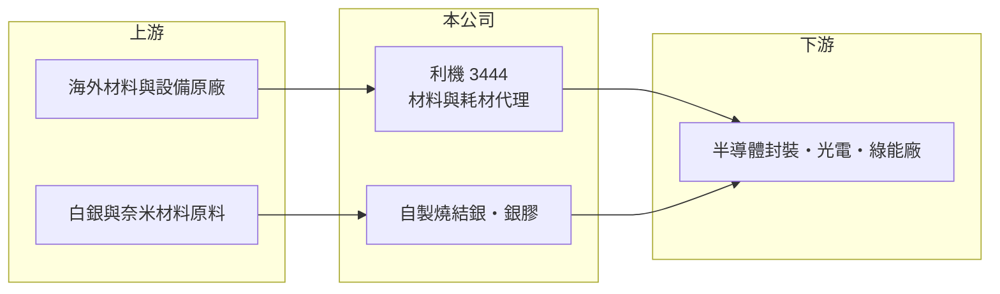

# 3444 利機

> 上櫃｜[[產業索引-電子通路業|電子通路業]]｜上市（櫃）日期 2008/09/26

# 第一章：企業模式與商業藍圖

> [!info] 撰寫說明
> 精簡版，由 Claude 依公開資料整理，架構比照 [[2330台積電]]，資料截至 2026-10-08。來源：櫃買中心開放資料（基本資料、2026 年第二季財報、本益比殖利率、月營收）、Goodinfo 經營績效與基本資料頁、科技新報 2026 年 7 月營收新聞。代理品牌與營收比重未查得。#待校對

利機是總部位於台中的材料與耗材通路商，同時自行生產燒結銀與銀膠等先進材料。和一般電子零組件通路商相比，它更靠近製造業的「耗材」端，毛利率也因此高出許多。

- **核心業務：** 利機成立於 1993 年，2008 年上櫃，主要代理半導體、光電與綠色能源產業所需的原材料、零組件與設備，並自行製造銷售先進奈米材料、[[燒結銀]]與客製化銀膠。科技新報將其定位為「耗材廠商」。
- **營收結構：** 產品比重未查得。依營業項目，收入來源可分為代理的製程材料與耗材，以及自製的導電與散熱材料兩大類（推估）。耗材隨客戶產線稼動持續消耗，收入比一次性設備銷售更穩定。
- **營運據點：** 總部在台中西屯，客戶以中部的半導體封裝、光電與面板產業聚落為主（推估）。
- **長期方向：** 燒結銀是功率半導體（例如碳化矽模組）與高功率封裝的關鍵接合材料，電動車與 AI 伺服器電源的功率密度提高，帶動這類高導熱材料的需求。利機若能把自製材料比重拉高，有機會從通路商逐步轉型為材料商。

# 第二章：護城河深度與競爭優勢

利機的護城河來自材料認證與製程綁定，這是耗材型通路商與一般零組件通路商最大的不同。

- **競爭優勢：** 製程材料一旦通過客戶產線認證，更換供應商需要重新驗證良率，因此客戶黏著度高。利機毛利率長期維持在 21% 至 29%，遠高於電子零組件通路商的 4% 至 6%，反映材料與耗材的技術附加價值。
- **主要對手：** 國際材料大廠如日本的燒結銀與銀膠供應商，以及台灣的半導體材料通路商 [[5434崇越]]、[[3010華立]]、[[8070長華]]。在中小型利基通路中，[[3224三顧]]、[[3232昱捷]] 規模相近但產品屬性不同。
- **觀察重點：** 毛利率從 2022 年的 29.3% 逐年降到 2025 年的 21%，代表產品組合或價格競爭出現變化。觀察重點在於自製燒結銀能否在功率半導體客戶放量，並把毛利率拉回上升軌道。

# 第三章：財務體質與盈利規模

資料日期：2026-10-08，表格是撰寫當時的快照；最新月營收、毛利率、累計 EPS 由自動排程寫在本筆記的屬性欄位（月營收、毛利率、累計EPS 等）。#待校對

利機的財務結構保守、毛利率高，但營收規模小，獲利能力在 2022 年高點後有所下滑。

| 年度 | 營收（億元） | [[毛利率]] | [[營業利益率]] | EPS（元） | [[ROE]] |
|---|---|---|---|---|---|
| 2020 | 9.64 | 27.9% | 12.3% | 2.72 | 14.9% |
| 2021 | 12.2 | 25.5% | 12.4% | 3.44 | 17.4% |
| 2022 | 10.6 | 29.3% | 11.7% | 5.01 | 22.7% |
| 2023 | 9.76 | 26.2% | 7.71% | 2.16 | 9.32% |
| 2024 | 11.5 | 24.7% | 6.79% | 2.39 | 9.95% |
| 2025 | 12.8 | 21.0% | 5.85% | 2.15 | 8.97% |
| 2026 上半年 | 6.53 | 19.71% | 3.88% | 1.05 | 未查得 |

- **營收規模：** 2020 至 2025 年營收年複合成長率約 5.8%（推算）。2026 年 6 月單月營收 1.175 億元，為近 14 年單月次高；前 8 個月營收約 9.2 億元，年增約 11%（櫃買中心月營收）。
- **獲利：** 近 5 年平均 ROE 約 13.7%（推算），但 2023 年後降到 9% 至 10%。營業利益率從 12% 降到 2026 年上半年的 3.9%，費用增加速度高於毛利成長；同期業外收益 3,072 萬元高於營業利益 2,536 萬元，獲利品質需要留意。
- **財務特色：** 2026 年第二季總資產 16.6 億元、負債 6.2 億元、權益 10.5 億元，負債比約 37%，財務保守。最近一次現金股利為每股 1.8 元，相對 2025 年 EPS 2.15 元，配發率約 84%，股利政策偏向高配發。

**[[ROIC]] 與 [[WACC]]：** 2025 年營業利益約 7,500 萬元，稅後約 6,000 萬元；以權益 10.5 億元加有息負債（以負債總額 40% 估約 2.5 億元）計算，ROIC 約 4.6%，2026 年上半年年化約 3.1%（推算）。WACC 以 CAPM 推估：無風險利率 1.75%、市場風險溢酬 6%、β 取 0.8（小型股常見值），股權成本 6.55%；稅後負債成本 2%，股權占比約 81%，WACC 約 5.7%（推算）。2020 至 2022 年 ROIC 明顯高於 WACC，近年則降到資金成本以下，代表價值創造能力需要靠新材料放量才能恢復。

# 第四章：總體風險與地緣政治

利機的風險主要來自客戶產業集中、原物料價格與新材料的推廣速度。

- **產業週期：** 耗材需求跟隨客戶產線稼動率，半導體封裝與光電產業景氣下滑時，耗材用量會同步減少，但波動通常小於設備與零組件。
- **營運風險：** 燒結銀與銀膠以白銀為主要原料，銀價上漲若無法轉嫁，會直接壓縮毛利率；費用持續增加而營收成長有限，也會讓營業利益率繼續下滑。
- **其他風險：** 代理材料多來自海外原廠，匯率變動影響進貨成本；功率半導體市場的技術路線（例如接合材料改用其他方案）若改變，自製材料的成長空間會受到影響。

# 專有名詞解析

## 半導體

- **[[燒結銀]]**：以奈米或微米銀粉在加熱下燒結成形的接合材料，導熱與耐高溫性佳，用於碳化矽等功率模組。
- **[[功率半導體]]**：負責電力轉換與控制的元件，如 MOSFET、IGBT、碳化矽元件，用於電動車、電源與工業設備。

## 產業

- **[[電子通路]]**：替半導體原廠向系統廠銷售零組件、備庫存並提供技術支援的中間商，賺取買賣價差與服務價值。
- **[[耗材]]**：隨生產過程持續消耗、需要定期補充的材料，營收與客戶產線稼動率連動，比設備銷售穩定。

# 核心供應鏈

- 上游：海外材料與設備原廠（品牌未查得）；白銀等貴金屬原料。
- 下游／客戶：半導體封裝、光電與綠色能源產業（推估以中部產業聚落為主）。
- 同業：[[5434崇越]]、[[3010華立]]、[[8070長華]]。

## 最新新聞
<!-- news:start -->
<!-- news:end -->

## 相關連結
- [公開資訊觀測站](https://mopsov.twse.com.tw/mops/web/t05st03?step=1&firstin=1&co_id=3444)
- [Goodinfo](https://goodinfo.tw/tw/StockDetail.asp?STOCK_ID=3444)
- [Yahoo 股市](https://tw.stock.yahoo.com/quote/3444)
- [鉅亨網新聞](https://www.cnyes.com/twstock/3444/news)
