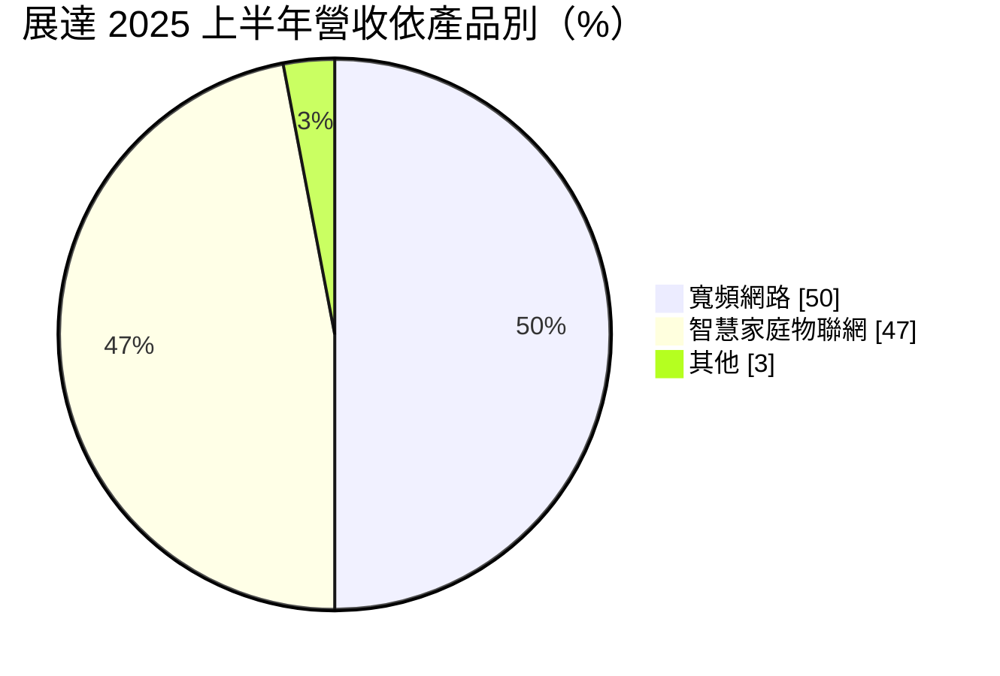
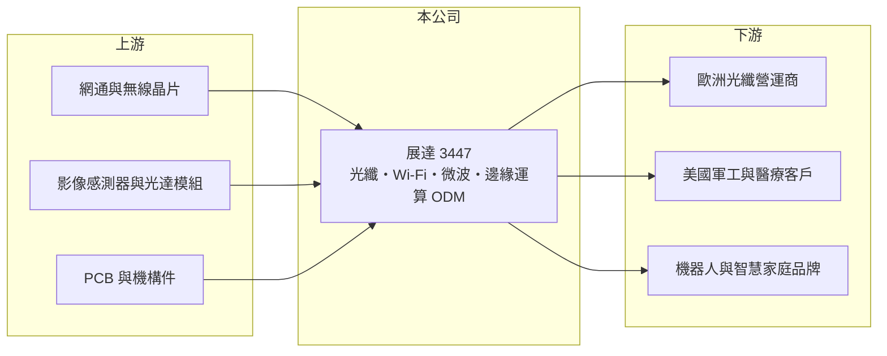

# 3447 展達

> 上市｜[[產業索引-通信網路業|通信網路業]]｜上市（櫃）日期 2022/12/15

# 第一章：企業模式與商業藍圖

> [!info] 撰寫說明
> 精簡版，由 Claude 依公開資料整理，架構比照 [[2330台積電]] 的四章研究，資料截至 2026-10-08。來源：證交所開放資料（基本資料、2026 年第二季資產負債與損益、股利）、Goodinfo 台灣股市資訊網年度經營績效（2020 至 2025 年）、富果研究 2025 年 9 月法說會整理。#待校對

本章拆解展達通訊（股票代號：3447，以下簡稱展達）的商業模式：它是一家中小型網通 [[ODM]]，近年刻意放棄低價量產訂單，把資源集中在光纖資安設備、軍規通訊與邊緣運算等利基市場。

- **核心業務：** 展達成立於 1997 年，2022 年 12 月上市，採代工模式，不做自有品牌。產品分成兩大類：寬頻網路（光纖 [[PON]] 設備、Wi-Fi AP 與點對點私有微波通訊）與智慧家庭物聯網（機器人視覺模組、醫療邊緣運算裝置等）。展達規模比大型網通廠小，因此選擇規格特殊、數量中等的案子，以設計能力而非價格取勝。
- **營收結構：** 依法說會整理，2025 年上半年寬頻網路約占 50%（前一年同期 54%），智慧家庭物聯網約占 47%（前一年同期 40%）。寬頻網路中，符合歐洲資安法規的次世代光纖產品已大量出貨；物聯網則包括結合光達與攝影機的輪型機器人視覺模組，以及出貨美國客戶的醫療邊緣運算裝置。

- **營運據點：** 總部在新北三重。泰國廠是生產主力，第三座廠區即將落成；蘇州廠正在縮減規模，部分幹部轉往泰國。把產能移到泰國，讓展達能承接要求「非中國製造」的歐美客戶與軍工訂單。
- **長期方向：** 管理層列出四大成長動能：次世代資安光通訊、[[Physical AI]] 與邊緣運算、軍規網路、影像級邊緣運算。經營重心放在獲利而非營收規模，曾拒絕低價搶量的訂單；資本支出主要投入工程人才，而非模具與機台。這種策略能降低財務風險，但成長速度取決於少數新專案能否放量。

# 第二章：護城河深度與競爭優勢

展達沒有大廠的規模，護城河來自利基市場的設計能力與法規認證，屬於窄而淺的護城河。

- **競爭優勢：** 第一是法規與資安認證：歐洲對家用光纖設備的資安要求提高，能通過認證的供應商有限，一旦導入可服務百萬級用戶。第二是特殊頻段微波通訊與軍規產品，訂單來自美國上市公司，這類產品驗證期長、價格敏感度較低。第三是泰國產能，符合供應鏈去中國化的趨勢。
- **主要對手：** 在寬頻網路領域與 [[3596智易]]、[[6285啟碁]]、[[5388中磊]]、[[3380明泰]]、[[4906正文]] 等台灣網通廠競爭，這些對手規模都比展達大得多；在機器人視覺與邊緣運算領域，則面對眾多工業電腦與 AIoT 廠商。展達只能在大廠看不上或規格特殊的案子中找空間。
- **觀察重點：** 一是歐洲資安光纖產品的出貨能否延伸到更多國家；二是機器人視覺與醫療邊緣運算能否從驗證走到量產；三是毛利率能否穩定在 10% 以上，因為以展達的費用結構，毛利率低於約 10% 就會出現營業虧損。

# 第三章：財務體質與盈利規模

資料日期：2026-10-08，表格是撰寫當時的快照；最新月營收、毛利率、累計 EPS 由自動排程寫在本筆記的屬性欄位（月營收、毛利率、累計EPS 等）。#待校對

展達的財務特徵是營收波動大、毛利率偏低，獲利對單一大客戶訂單的變化非常敏感。

| 年度 | 營收（億元） | [[毛利率]] | [[營業利益率]] | EPS（元） | [[ROE]] |
|---|---|---|---|---|---|
| 2020 | 28.2 | 15.5% | 4.41% | 1.57 | 16.4% |
| 2021 | 35.2 | 13.6% | 4.50% | 2.12 | 17.1% |
| 2022 | 60.1 | 11.8% | 4.78% | 3.73 | 23.5% |
| 2023 | 28.7 | 8.01% | -3.15% | -0.86 | -5.47% |
| 2024 | 25.6 | 11.7% | 0.96% | 1.20 | 8.00% |
| 2025 | 36.5 | 10.7% | 2.41% | 1.60 | 9.80% |
| 2026 上半年 | 16.78 | 9.30% | -0.57% | 0.40 | 未查得 |

註：2020 至 2025 年取自 Goodinfo，2026 年上半年取自證交所開放資料。

- **營收規模：** 2022 年營收衝到 60.1 億元，隔年腰斬到 28.7 億元，振幅極大，推估與當時大客戶的集中拉貨與後續庫存調整有關。2020 至 2025 年年複合成長率約 5.3%（推算），但中間的大起大落比平均值更值得注意。
- **獲利：** 毛利率從 2020 年的 15.5% 降到 2023 年的 8.0%，之後回到 10% 至 12%；營業利益率最高不到 5%，2023 年轉為虧損。2026 年上半年本業小幅虧損，但業外收益使 EPS 仍為 0.40 元，顯示本業獲利能力仍薄。
- **財務特色：** 2021 至 2025 年平均 ROE 約 10.6%（推算）。2025 年度配發現金股利 1.1 元，配發率約 69%。2026 年第二季母公司股東權益約 12.4 億元、每股淨值 16.02 元。公司採接單後備料策略，降低庫存風險，但追料成本可能增加。

## [[ROIC]] 與 [[WACC]]

**ROIC 推算：** 2025 年營業利益約 0.88 億元（36.5 億元 × 2.41%），以稅率 20% 計算，稅後營業利益約 0.70 億元。投入資本以 2026 年第二季股東權益約 12.4 億元近似（有息負債未查得），ROIC 約 5.7%（推算）。2022 年高峰期以同樣方法推算約在 15% 以上，2023 年則為負值。

**WACC 推算：** 台灣 10 年期公債約 1.75%、市場風險溢酬約 6%、β 取網通中小型股常見的 1.0（假設），股東要求報酬率約 7.75%；負債以應付帳款等營業負債為主，WACC 約 7.5%（推算）。

**解讀：** 2025 年 ROIC 約 5.7%，低於約 7.5% 的 WACC，代表本業尚未穩定賺回資金成本；2020 至 2022 年 ROIC 高於 WACC，2023 至 2025 年則低於。展達要長期創造價值，需要讓營業利益率穩定回到 4% 以上，這取決於高毛利利基產品的比重。

# 第四章：總體風險與地緣政治

本章說明展達長期面對的客戶集中、產業週期與營運風險。

- **產業週期：** 網通設備的需求跟著營運商換機與企業 IT 支出走，2023 年營收腰斬就是典型的庫存調整。展達規模小，客戶拉貨或去化庫存的影響會直接反映在營收上，[[長鞭效應]]比大廠更明顯。
- **營運風險：** 客戶集中是最大風險，歐洲光纖、美國軍工與醫療客戶都是單一或少數客戶，任何一家訂單變動都會影響全年營運。新事業（機器人視覺、邊緣運算）仍在驗證期，研發人力投入先發生、營收後到，短期會壓抑獲利。
- **其他風險：** 美國關稅政策不確定、匯兌損失（2025 年第二季約 1,700 萬元）與物料短缺都曾直接造成虧損；泰國廠擴產初期的稼動率與良率也需要時間爬升。

# 專有名詞解析

## 應用

- **[[PON]]**：被動光纖網路，以光纖把寬頻送到家戶的主流架構，依速度分為 GPON、XGS-PON 等世代。
- **[[Physical AI]]**：實體 AI，讓機器人、無人車等實體裝置能感知環境並自主行動的 AI 應用。
- **[[邊緣運算]]**：在靠近資料產生端的裝置上直接運算，不必全部傳回雲端，可降低延遲與頻寬成本。

## 金融

- **[[長鞭效應]]**：終端需求的小幅變動，沿供應鏈往上游傳遞時被逐級放大，造成上游庫存與訂單劇烈波動。

## 產業

- **[[ODM]]**：原廠委託設計製造，代工廠負責產品設計與生產，品牌或營運商只提出規格並負責銷售。

# 核心供應鏈

- 上游：網通與無線晶片、影像感測器與光達模組、PCB 與機構件供應商。
- 下游／客戶：歐洲光纖營運商、美國上市軍工公司、美國醫療客戶與機器人新創，公司未揭露具名客戶。
- 同業：[[3596智易]]、[[6285啟碁]]、[[5388中磊]]、[[3380明泰]]、[[4906正文]]。

## 最新新聞
<!-- news:start -->
<!-- news:end -->

## 相關連結
- [公開資訊觀測站](https://mopsov.twse.com.tw/mops/web/t05st03?step=1&firstin=1&co_id=3447)
- [Goodinfo](https://goodinfo.tw/tw/StockDetail.asp?STOCK_ID=3447)
- [Yahoo 股市](https://tw.stock.yahoo.com/quote/3447)
- [鉅亨網新聞](https://www.cnyes.com/twstock/3447/news)
