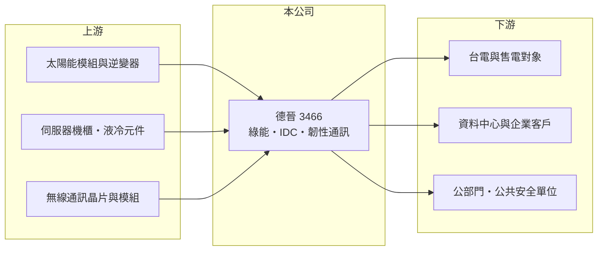

# 3466 德晉

> 上櫃｜[[產業索引-通信網路業|通信網路業]]｜上市（櫃）日期 2006/05/17

# 第一章：企業模式與商業藍圖

> [!info] 撰寫說明
> 精簡版，由 Claude 依公開資料整理，架構比照 [[2330台積電]] 的四章研究，資料截至 2026-10-08。來源：櫃買中心開放資料（基本資料、2026 年第二季資產負債與損益）、Goodinfo 台灣股市資訊網年度經營績效（2020 至 2025 年）、富果研究 2025 年 12 月法說會整理。公司正處轉型期，既有產品與新事業的營收比重均未揭露，公開資料有限。#待校對

本章拆解德晉科技（股票代號：3466，以下簡稱德晉）的商業模式。德晉是一家正在[[轉型]]、也就是「換引擎」的公司：既有電子製造業務快速萎縮，管理層把資金轉向綠能、資料中心與韌性通訊，因此評估它時，重點不在過去的本業，而在新事業能否成形。

- **核心業務：** 德晉成立於 1982 年，2006 年上櫃，原本以電子產品製造為主。依法說會整理，既有電子製造業務持續縮減，製造端稼動率不足，毛利率甚至轉為負值。營收從 2022 年的 11.7 億元降到 2025 年的不到 1 億元，代表原有商業模式已難以為繼。
- **營收結構：** 公司未揭露各業務比重。目前的業務可分成四塊：縮減中的電子製造、綠能（[[太陽光電]]，已完成新竹海山漁港與嘉義布袋港太陽能案場，總裝置容量 2.1MW，預估年發電約 270 萬度）、IDC 數據中心方案（支援[[液冷]]的高密度機櫃與模組化架構），以及韌性通訊（自有品牌 SKARDINMesh 的 [[MANET]] 行動隨意網路模組）。各項新事業規模都還很小。
- **營運據點：** 總部位於台灣，MANET 模組強調台灣在地生產，太陽能案場在新竹與嘉義；規劃中的 AI 事業部廠址仍在評估中。由於製造業務縮減，德晉的資產正從工廠設備轉向發電案場與現金。
- **長期方向：** 管理層規劃三大方向：綠能、IDC 與韌性通訊，並計畫成立 AI 事業部、擬定三年藍圖。韌性通訊方面，法說會提到正洽談國際公共安全通訊品牌的台灣代理，用於公共安全與企業市場，但截至法說時尚未實際認列營收。轉型需要資金，2025 年第一季完成現金增資約 8.21 億元，為新事業提供彈藥。

# 第二章：護城河深度與競爭優勢

德晉目前談不上護城河，比較適合用「轉型選擇權」來理解：公司手上有現金與幾個新方向，價值取決於哪一個能長成可持續的事業。

- **競爭優勢：** 第一是現金：2025 年 9 月底帳上現金約 12 億元，已償還約 2 億元銀行借款，財務體質足以支撐一段時間的轉型虧損。第二是韌性通訊題材：台灣近年重視災難與戰時通訊備援，MANET 這類不依賴基地台的自組網路有政策需求，在地生產是爭取公部門訂單的條件。第三是太陽能案場能帶來穩定、可預期的售電收入，但規模很小。
- **主要對手：** 太陽能領域有 [[6806森崴能源]]、[[6869雲豹能源]] 等規模大得多的綠能開發商；IDC 領域則面對大型系統整合商與機櫃廠；韌性通訊領域有國際軍規與公共安全通訊大廠。德晉在每個領域都是新進者，規模與經驗都不占優勢。
- **觀察重點：** 一是新事業的營收能否在 2026 至 2027 年明顯放大；二是電子製造業務收斂後，費用結構能否同步下降；三是轉型期間現金的消耗速度。若三年內新事業仍無法覆蓋營業費用，增資取得的現金將持續被侵蝕。

# 第三章：財務體質與盈利規模

資料日期：2026-10-08，表格是撰寫當時的快照；最新月營收、毛利率、累計 EPS 由自動排程寫在本筆記的屬性欄位（月營收、毛利率、累計EPS 等）。#待校對

德晉的財務數字反映一家本業萎縮、仍在虧損的轉型公司，閱讀時重點在現金與淨值，而不是獲利率。

| 年度 | 營收（億元） | [[毛利率]] | [[營業利益率]] | EPS（元） | [[ROE]] |
|---|---|---|---|---|---|
| 2020 | 10.1 | 22.4% | -6.02% | -2.49 | -12.6% |
| 2021 | 10.4 | 20.1% | -7.77% | -1.31 | -7.50% |
| 2022 | 11.7 | 21.2% | -3.92% | 0.07 | 0.41% |
| 2023 | 7.82 | 25.5% | -28.9% | -3.01 | -19.5% |
| 2024 | 2.79 | 10.9% | -74.3% | -2.56 | -20.2% |
| 2025 | 0.77 | -38% | 約 -100% 以下 | -1.11 | -7.57% |
| 2026 上半年 | 1.37 | 9.19% | -51.6% | -0.59 | 未查得 |

註：2020 至 2025 年取自 Goodinfo，2025 年營業利益率頁面顯示為 -100%；2026 年上半年取自櫃買中心開放資料推算。

- **營收規模：** 營收從 2022 年的 11.7 億元一路降到 2025 年的 0.77 億元，四年內萎縮超過九成，反映既有電子製造業務幾乎退場。2026 年上半年營收 1.37 億元，已超過 2025 年全年，但仍遠低於過去水準。
- **獲利：** 六年中只有 2022 年小賺，其餘年度都是虧損。2025 年毛利率為負，代表產品售價低於生產成本，營業虧損與營收規模相當。2025 年虧損比 2024 年縮小，部分原因是阿根廷客戶呆帳回收（2025 年第二季約 8,500 萬元、第三季約 3,400 萬元）沖回費用，屬一次性因素而非本業改善。
- **財務特色：** 2021 至 2025 年平均 ROE 約 -10.9%（推算），近年未配發股利。2026 年第二季股東權益約 14.1 億元、每股淨值 18.12 元，總負債約 3.85 億元，負債比約 21%，財務結構保守，主要風險在於持續虧損對淨值的侵蝕。

## [[ROIC]] 與 [[WACC]]

**ROIC 推算：** 2025 年營業虧損至少約 0.77 億元（營收 0.77 億元 × 約 -100%），2026 年上半年營業虧損約 0.71 億元。以 2026 年第二季股東權益約 14.1 億元近似投入資本（有息負債未查得），2025 年 ROIC 約 -5% 至 -10%（推算）。分母中有相當比例是現金，若只計算營運資產，報酬率會更負。

**WACC 推算：** 台灣 10 年期公債約 1.75%、市場風險溢酬約 6%、β 取轉型中小型股的 1.1（假設），股東要求報酬率約 8.35%；負債比低，WACC 約 8%（推算）。

**解讀：** ROIC 為負、遠低於約 8% 的 WACC，代表德晉目前處於價值毀損期。投資判斷的關鍵不在現在的報酬率，而在新事業能否在現金耗盡前建立可獲利的規模。

# 第四章：總體風險與地緣政治

本章說明德晉在轉型期間的主要風險。

- **產業週期：** 綠能售電收入穩定但規模小；IDC 與 AI 相關需求跟著資料中心投資週期起伏，若 AI 投資放緩，新事業的接單會受影響。韌性通訊則與政府國防與公共安全預算相關，預算編列與標案時程不確定。
- **營運風險：** 最大風險是轉型執行：新事業同時開展多個方向，每個方向規模都小，管理資源分散，可能無一能達到經濟規模。代理業務若未能談成或代理權條件不佳，預期中的營收就無法實現。過去的海外呆帳事件也顯示授信管理需要加強。
- **其他風險：** 太陽能案場受天候、躉購費率與土地租約影響；AI 廠房若投入大額資本支出，需要評估是否會再增資稀釋股權。轉型期股價常受題材驅動，與基本面落差可能很大，投資人應以實際營收與現金流驗證。

# 專有名詞解析

## 應用

- **[[MANET]]**：行動隨意網路，裝置之間可自動組成網路並互相轉傳資料，不依賴基地台，適合救災與軍事通訊。

## 產業

- **[[液冷]]**：以液體帶走伺服器熱量的散熱方式，散熱效率高於風冷，是高密度 AI 機櫃的主流方案。
- **[[太陽光電]]**：利用太陽能電池把陽光轉換成電力的發電方式，案場收入主要來自售電。
- **[[轉型]]**：企業把主要營收來源從原有業務移到新業務的過程，期間常伴隨虧損與資產重組。

# 核心供應鏈

- 上游：太陽能模組與逆變器、伺服器機櫃與液冷元件、無線通訊晶片與模組供應商。
- 下游／客戶：售電對象、資料中心與企業客戶、公共安全與公部門單位，公司未揭露具名客戶。
- 同業：綠能開發商 [[6806森崴能源]]、[[6869雲豹能源]]，以及資料中心機櫃與系統整合商、公共安全通訊設備商（公司未揭露具體對手）。

## 最新新聞
<!-- news:start（自動產生，請勿手動編輯此範圍） -->
- 2026-10-16 🏛️ 重訊 15:55｜公告本公司法人董事指派代表人｜[觀測站](https://mops.twse.com.tw/mops/#/web/t05st01)
- 2026-10-08 📰 媒體 19:51｜營收速報 - 德晉(3466)9月營收3,209萬元年增率高達223.84％｜[鉅亨網](https://news.cnyes.com/news/id/6625875)

完整紀錄：[[3466德晉 新聞]]
<!-- news:end -->

## 相關連結
- [公開資訊觀測站](https://mopsov.twse.com.tw/mops/web/t05st03?step=1&firstin=1&co_id=3466)
- [Goodinfo](https://goodinfo.tw/tw/StockDetail.asp?STOCK_ID=3466)
- [Yahoo 股市](https://tw.stock.yahoo.com/quote/3466)
- [鉅亨網新聞](https://www.cnyes.com/twstock/3466/news)
