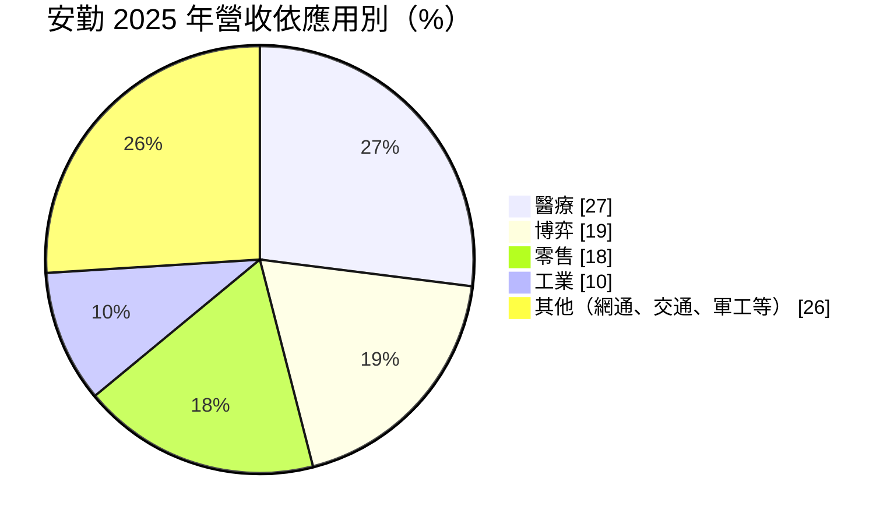
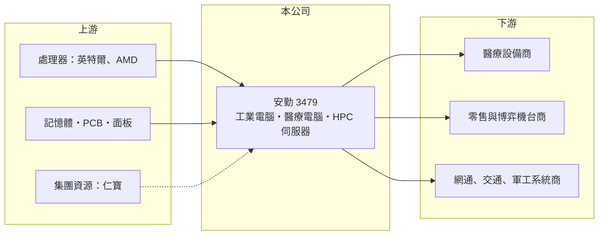

# 3479 安勤

> 上櫃｜[[產業索引-電腦及週邊設備業|電腦及週邊設備業]]｜上市（櫃）日期 2010/06/08

# 第一章：企業模式與商業藍圖

> [!info] 撰寫說明
> 精簡版，由 Claude 依公開資料整理，架構比照 [[2330台積電]]，資料截至 2026-10-08。來源：櫃買中心開放資料（基本資料、2026 年第二季資產負債與綜合損益、2026 年 8 月營收）、Goodinfo 經營績效頁、經濟日報 2026 年安勤法說會報導。集團持股關係與工廠位置未逐一查證。#待校對

安勤是一家以專案為主的 [[工業電腦]] 公司，強項是替醫療、零售、博弈等特定產業客製化設計整機，靠「多產業、多地區、長生命週期」的組合維持穩定獲利。

- **核心業務：** 安勤成立於 2000 年，2010 年在櫃買中心掛牌，產品包括嵌入式主機板、平板電腦與觸控一體機、醫療用電腦、HPC 醫療伺服器與電信伺服器。它的商業模式偏向 [[ODM]] 式的專案設計：客戶提出規格，安勤負責設計、驗證與量產，產品一旦導入，往往在客戶設備的整個生命週期中持續出貨。這種模式讓單一專案的營收可以延續多年，也是工業電腦廠普遍比消費性電子廠毛利率高的原因。
- **營收結構：** 依 2026 年法說會，2025 年營收中醫療占 27%、博弈 19%、零售 18%、工業 10%，其餘 26% 為網通、交通、軍工等。地區上美洲占 48%、亞洲 23%、歐洲 20%、台灣僅 5%，屬於典型的外銷型公司。醫療是近年成長最快的板塊，2025 年歐洲營收年增約四成，主要來自醫療大客戶的訂單。
- **營運據點與集團：** 法說會報導稱仁寶集團為其母公司，電信伺服器即與 [[2324仁寶]] 集團合作開發。背靠大型代工集團的好處是採購議價與量產資源，缺點是策略方向可能受集團安排影響。工廠位置本次未查得。
- **長期方向：** 公司正在把產品從單機電腦往高階運算延伸，包括醫療影像用的 HPC 伺服器（概念上接近 [[AI 伺服器]] 的高階運算機種）、超音波設備主機、半導體設備用電腦與美國軍工專案。這些領域的認證期長、客戶黏著度高，若能放量，可提升營收規模並穩定毛利率。管理層 2026 年的毛利率目標為 25% 至 26%，代表公司優先維持既有獲利水準而非以低價搶單。

# 第二章：護城河深度與競爭優勢

安勤的護城河來自醫療與博弈等專業領域的認證門檻，以及專案導入後的轉換成本，但它在工業電腦產業中屬於中型廠，規模優勢有限。

- **競爭優勢：** 醫療電腦須通過醫療安規認證，搭配的往往是受法規管理的 [[醫療器材]]，博弈機台也要符合各地監管規範，客戶換供應商就得重新驗證，因此一旦導入就很少更換。安勤在醫療客戶累積了多年的設計經驗，2025 年拿下超音波設備新客戶、HPC 醫療伺服器持續出貨，顯示這個利基仍在擴大。多產業分散也讓單一產業景氣下滑時，營收不至於大幅縮水。
- **主要對手：** 工業電腦龍頭 [[2395研華]] 規模與產品線遠大於安勤；同屬中型專案型廠商的有 [[6166凌華]]、[[8050廣積]]、3088艾訊、[[6579研揚]]、[[2397友通]]，醫療電腦領域還有 [[3594磐儀]]、[[4916事欣科]] 等。安勤和這些公司的差異主要在客戶與應用領域的分布，而非技術。
- **觀察重點：** 第一是醫療與 HPC 伺服器能否持續成長，抵銷零售與博弈的景氣起伏。第二是記憶體、CPU 與 PCB 漲價時，公司能否把成本轉嫁給客戶，守住 25% 以上毛利率。第三是軍工與半導體設備專案能否從送樣走到量產。

# 第三章：財務體質與盈利規模

資料日期：2026-10-08，表格是撰寫當時的快照；最新月營收、毛利率、累計 EPS 由自動排程寫在本筆記的屬性欄位（月營收、毛利率、累計EPS 等）。#待校對

安勤的財務特色是毛利率長期穩定在 23% 至 27%，營收在 2022 年跳升一個台階後維持在 75 億至 85 億元，ROE 由一成左右提升到 14% 至 22%。

| 年度 | 營收（億元） | [[毛利率]] | [[營業利益率]] | EPS（元） | [[ROE]] |
|---|---|---|---|---|---|
| 2020 | 46.9 | 25.1% | 5.72% | 3.23 | 9.84% |
| 2021 | 49.3 | 23.5% | 5.23% | 2.94 | 9.43% |
| 2022 | 78.8 | 23.9% | 9.80% | 7.90 | 21.8% |
| 2023 | 82.3 | 26.5% | 11.5% | 8.38 | 20.9% |
| 2024 | 76.0 | 26.0% | 9.30% | 6.85 | 15.7% |
| 2025 | 84.8 | 25.8% | 8.35% | 6.45 | 13.8% |
| 2026 上半年 | 45.7 | 26.0% | 8.2% | 3.95 | 半年，不年化 |

（2020 至 2025 年取自 Goodinfo；2026 上半年依櫃買中心第二季綜合損益計算。2025 年 EPS 法說會報導為 6.08 元，與 Goodinfo 的 6.45 元不同，待校對。）

- **營收規模：** 2020 至 2025 年營收由 46.9 億元成長到 84.8 億元，年複合成長率約 12.6%。2026 年 1 至 8 月累計營收 64.9 億元、年增約 17%，延續成長。
- **獲利：** 近五年（2021 至 2025）平均 ROE 約 16.3%。營業利益率在 2023 年達 11.5% 高峰後回落到 8% 左右，主因是費用增加與產品組合變化，毛利率本身仍相當穩定。
- **財務結構：** 2026 年第二季底總資產 91.8 億元、負債 52.7 億元，負債比約 57%，其中流動負債 40.6 億元占多數，與專案型備料、應付帳款較多有關。歸屬母公司權益 33.2 億元，每股淨值 45.96 元，另有非控制權益 5.9 億元，代表旗下有非全資子公司。逐年現金股利本次未查得（Goodinfo 顯示歷年平均約 2.84 元）。
- **[[ROIC]] 與 [[WACC]]：** 2025 年營業利益約 84.8 億 × 8.35% ≈ 7.1 億元，稅後約 5.7 億元；有息負債金額未查得，以權益總計 39.1 億元計算 ROIC 上限約 14.5%，若計入有息負債實際約在 10% 至 14%（推算）。WACC 以 CAPM 推估：無風險利率 1.75%、市場風險溢酬 6%、β 取工業電腦同業常見值 1.0，股權成本約 7.75%；負債成本假設 2.5%、稅後 2%，負債約占資本兩成，WACC 約 6.5% 至 7%（推算）。ROIC 高於 WACC 約 3 至 7 個百分點，代表公司長期在創造價值，但利差隨營業利益率下滑而縮小。

# 第四章：總體風險與地緣政治

安勤的風險主要來自客戶產業的景氣、零組件成本，以及外銷帶來的匯率與關稅影響。

- **產業週期：** 零售與博弈占營收近四成，這兩個產業的設備更新跟消費景氣與賭場投資密切相關，景氣不佳時客戶會延後換機。工業電腦產業也有明顯的庫存週期，2023 至 2024 年全產業都經歷過客戶去化庫存造成的營收下滑。
- **營運風險：** 專案型營收的認列時點不穩定，大客戶的訂單提前或延後會讓季度營收波動。記憶體、CPU 與 PCB 缺貨漲價時，公司需要重新議價，轉嫁不及就會壓縮毛利。醫療業務若集中在少數大客戶，客戶策略改變的影響也會放大。
- **其他風險：** 美洲營收接近一半，美國關稅政策與新台幣匯率都會直接影響獲利。軍工專案涉及出口管制與認證，進度較難預估。

# 專有名詞解析

## 應用

- **[[醫療器材]]**：用於診斷、治療或監測人體健康的器具，須取得各國主管機關許可，認證門檻高於一般消費品。
- **[[AI 伺服器]]**：搭載 GPU 等加速晶片、用於訓練與推論 AI 模型的伺服器，對散熱與電源規格要求很高。

## 產業

- **[[工業電腦]]**：用於工廠自動化、交通、醫療等場域的電腦，強調長期供貨、耐用與穩定。
- **[[ODM]]**：原廠委託設計製造，代工廠負責設計與生產，再以客戶的品牌出貨。

# 核心供應鏈

- 上游：[[INTC英特爾]]、[[AMD超微]] 等處理器廠，記憶體、PCB 與面板供應商；集團關係企業 [[2324仁寶]]。
- 下游／客戶：歐美醫療設備商、零售與博弈機台商、網通與軍工系統商（未具名）。
- 同業：[[2395研華]]、[[6166凌華]]、[[8050廣積]]、3088艾訊、[[6579研揚]]、[[2397友通]]、[[3594磐儀]]、[[4916事欣科]]。

## 最新新聞
<!-- news:start（自動產生，請勿手動編輯此範圍） -->
- 2026-10-20 📰 媒體 11:42｜安勤攜手Exein導入韌體漏洞分析 強化嵌入式資安與CRA合規準備｜[鉅亨網](https://news.cnyes.com/news/id/6634046)

完整紀錄：[[3479安勤 新聞]]
<!-- news:end -->

## 相關連結
- [公開資訊觀測站](https://mopsov.twse.com.tw/mops/web/t05st03?step=1&firstin=1&co_id=3479)
- [Goodinfo](https://goodinfo.tw/tw/StockDetail.asp?STOCK_ID=3479)
- [Yahoo 股市](https://tw.stock.yahoo.com/quote/3479)
- [鉅亨網新聞](https://www.cnyes.com/twstock/3479/news)
