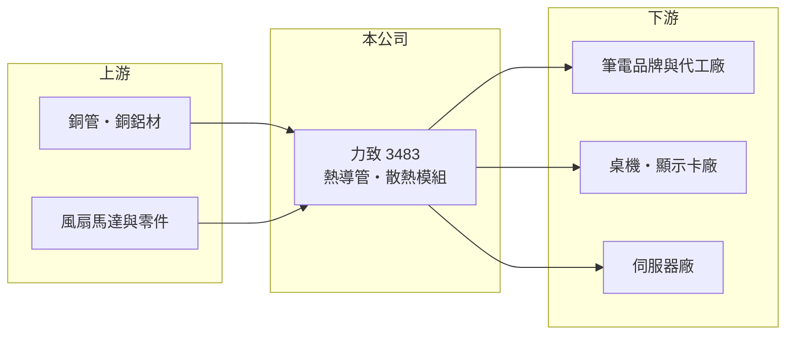

# 3483 力致

> 上櫃｜[[產業索引-電腦及週邊設備業|電腦及週邊設備業]]｜上市（櫃）日期 2006/12/18

# 第一章：企業模式與商業藍圖

> [!info] 撰寫說明
> 精簡版，由 Claude 依公開資料整理，架構比照 [[2330台積電]]，資料截至 2026-10-08。來源：櫃買中心開放資料（基本資料、2026 年第二季資產負債與綜合損益、2026 年 8 月營收）、Goodinfo 經營績效頁、nStock 公司頁。公開資料有限，產品營收比重、客戶與工廠位置未查得，相關描述依整理性知識撰寫。#待校對

力致是專做電子產品 [[散熱模組]] 的中型零組件廠，營收規模約 90 億元，主要靠筆電散熱累積量產經驗，再往伺服器與高功耗產品延伸。

- **核心業務：** 力致成立於 1997 年，2006 年在櫃買中心掛牌，主要設計與製造 [[熱導管]]、均溫板、散熱鰭片與風扇組成的散熱模組。散熱模組的工作是把處理器與顯示晶片產生的熱帶離機體，晶片功耗越高，散熱的設計難度與單價就越高。力致的客戶以筆電與電腦品牌、代工廠為主（待校對），屬於電子供應鏈中「依客戶機種客製」的零組件廠。
- **營收結構：** 公開資料未揭露產品比重。依產業整理，力致營收大部分來自筆電散熱模組，其餘為桌機、顯示卡與伺服器等產品（推估，待校對）。這種結構讓公司營收高度跟隨 PC 出貨週期，而毛利則取決於高階機種與伺服器產品的比重。
- **營運據點：** 公司總部在台灣，量產工廠位於中國大陸（待校對）。散熱模組屬勞力與加工並重的產業，產地與客戶的組裝廠距離相近才有成本優勢，因此客戶的組裝地點轉移時，散熱廠也必須跟著移動。
- **長期方向：** [[AI 伺服器]] 與高效能筆電讓晶片功耗快速上升，散熱產業正由傳統氣冷轉向 [[液冷散熱]]。力致若要擺脫筆電市場的價格競爭，必須在伺服器氣冷與液冷產品取得設計導入，這是公司長期定位能否升級的關鍵（公司對液冷的具體進度本次未查得）。

# 第二章：護城河深度與競爭優勢

力致的護城河主要是筆電散熱長期累積的設計與量產經驗，以及與客戶共同開發機種的配合度，但在伺服器與液冷領域規模不及一線大廠。

- **競爭優勢：** 散熱模組要配合每一款機種重新設計，供應商須在產品開發初期就參與，因此與品牌、代工廠有多年合作關係的廠商較容易持續接單。力致在筆電散熱耕耘近三十年，具備從熱導管到整組模組的自製能力，這是中型廠能留在主流供應鏈的基礎。
- **主要對手：** 散熱產業龍頭 [[3017奇鋐]]、[[3324雙鴻]] 已在 AI 伺服器液冷取得領先，[[6230尼得科超眾]]、[[2421建準]]、[[3338泰碩]]、8996高力 則分別在熱導管、風扇或液冷零件上各有專長。筆電散熱市場另有中國大陸廠商以價格競爭。與這些公司相比，力致規模較小，伺服器產品的能見度也較低。
- **觀察重點：** 第一是毛利率能否回到 20% 以上，這代表高階產品比重是否提升。第二是營業利益率能否擺脫 2024 年以來 3% 至 4% 甚至接近零的水準。第三是伺服器與液冷產品能否成為可被辨識的營收來源。

# 第三章：財務體質與盈利規模

資料日期：2026-10-08，表格是撰寫當時的快照；最新月營收、毛利率、累計 EPS 由自動排程寫在本筆記的屬性欄位（月營收、毛利率、累計EPS 等）。#待校對

力致的財務特色是營收持續成長到 90 億元，但毛利率由 23% 降到 20% 以下，本業獲利率偏薄，EPS 波動有相當部分來自業外。

| 年度 | 營收（億元） | [[毛利率]] | [[營業利益率]] | EPS（元） | [[ROE]] |
|---|---|---|---|---|---|
| 2020 | 58.6 | 23.3% | 8.37% | 4.36 | 12.4% |
| 2021 | 78.2 | 18.7% | 5.23% | 5.34 | 13.5% |
| 2022 | 74.2 | 19.8% | 4.54% | 6.40 | 14.8% |
| 2023 | 83.4 | 22.1% | 6.37% | 8.03 | 16.8% |
| 2024 | 90.0 | 20.1% | 3.76% | 8.27 | 15.5% |
| 2025 | 90.0 | 19.5% | 3.35% | 3.74 | 7.51% |
| 2026 上半年 | 42.4 | 16.5% | 0.4% | 0.69 | 半年，不年化 |

（2020 至 2025 年取自 Goodinfo；2026 上半年依櫃買中心第二季綜合損益計算。）

- **營收規模：** 2020 至 2025 年營收由 58.6 億元成長到 90.0 億元，年複合成長率約 9.0%，但 2024 與 2025 年已持平。2026 年 1 至 8 月累計營收 55.1 億元、年減約 8%。
- **獲利：** 近五年平均 ROE 約 13.6%。2024 年營業利益率只有 3.76%，EPS 卻達 8.27 元，代表業外收益貢獻很大；2025 年業外貢獻減少後 EPS 降到 3.74 元。2026 年上半年營業利益僅 0.19 億元，稅後淨利 0.67 億元主要仍靠業外 0.82 億元支撐，本業接近損益兩平。
- **財務結構：** 2026 年第二季底總資產 95.2 億元、負債 46.4 億元，負債比約 49%，權益 48.7 億元，每股淨值 49.70 元。依 nStock，2024 年度配發現金股利 3.5 元與股票股利 1.5 元，2025 年度現金股利 3 元，配息率約八成，股利政策偏向大方發放。
- **[[ROIC]] 與 [[WACC]]：** 2025 年營業利益約 90.0 億 × 3.35% ≈ 3.0 億元，稅後約 2.4 億元；有息負債未查得，僅以權益 48.7 億元計算 ROIC 約 4.9%，計入負債後更低（推算）。2023 年營業利益約 5.3 億元，當年 ROIC 約 9% 至 10%（推算）。WACC 以 CAPM 推估：無風險利率 1.75%、市場風險溢酬 6%、β 取零組件同業常見值 1.0，股權成本約 7.75%，負債成本假設 2.5%（稅後 2%）、負債占資本約兩成，WACC 約 6.5% 至 7%（推算）。2025 年起本業 ROIC 已低於 WACC，代表單看散熱本業並未創造價值，能否靠產品升級把營業利益率拉回 6% 以上是關鍵。

# 第四章：總體風險與地緣政治

力致的風險集中在 PC 週期、散熱技術世代交替，以及產業競爭導致的毛利壓力。

- **產業週期：** 筆電需求跟著換機潮、作業系統更新與企業採購週期起伏，散熱模組作為依機種出貨的零件，營收會跟著放大波動。2022 至 2023 年 PC 庫存調整、2026 年記憶體漲價壓抑整機出貨，都是週期影響的例子。
- **營運風險：** 散熱技術正由熱導管、氣冷走向均溫板與液冷，若力致在新技術的投資或客戶導入落後，產品組合會停在價格競爭最激烈的區段。銅、鋁等原物料價格上漲時，若無法即時轉嫁，毛利率也會受壓。
- **其他風險：** 工廠若集中在中國大陸，客戶要求產地多元化時需要新增產能，前期成本會壓縮獲利。美國關稅政策與新台幣匯率也會影響報價與獲利。

# 專有名詞解析

## 應用

- **[[AI 伺服器]]**：搭載 GPU 等加速晶片、用於訓練與推論 AI 模型的伺服器，對散熱與電源規格要求很高。

## 產業

- **[[散熱模組]]**：由熱管、鰭片、風扇或冷板組成的散熱組件，裝在筆電、伺服器與遊戲機中帶走晶片熱量。
- **[[熱導管]]**：內部填充工作液體的密封銅管，利用液體蒸發與凝結快速把熱量從晶片傳到散熱鰭片。
- **[[液冷散熱]]**：以液體流經冷板帶走晶片熱量的散熱方式，散熱效率高於氣冷，是高功耗 AI 伺服器的主流方向。

# 核心供應鏈

- 上游：銅材、鋁材、風扇馬達與零件供應商（未查得具名廠商）。
- 下游／客戶：筆電品牌與代工廠、桌機與顯示卡廠、伺服器廠（未具名，待校對）。
- 同業：[[3017奇鋐]]、[[3324雙鴻]]、[[6230尼得科超眾]]、[[2421建準]]、[[3338泰碩]]、8996高力。

## 最新新聞
<!-- news:start -->
<!-- news:end -->

## 相關連結
- [公開資訊觀測站](https://mopsov.twse.com.tw/mops/web/t05st03?step=1&firstin=1&co_id=3483)
- [Goodinfo](https://goodinfo.tw/tw/StockDetail.asp?STOCK_ID=3483)
- [Yahoo 股市](https://tw.stock.yahoo.com/quote/3483)
- [鉅亨網新聞](https://www.cnyes.com/twstock/3483/news)
