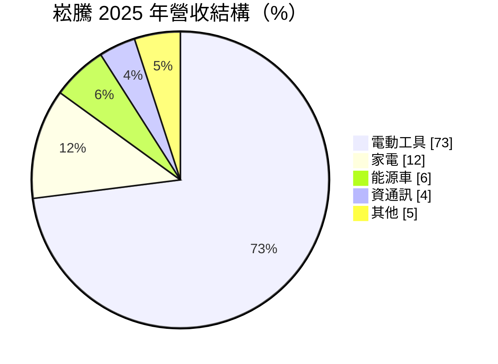
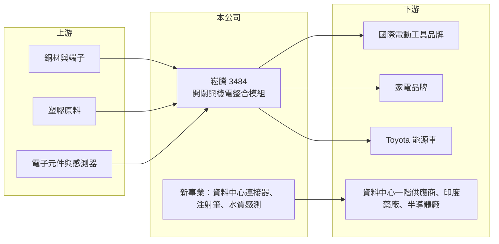

# 3484 崧騰

> 上櫃｜[[產業索引-電子零組件業|電子零組件業]]｜上市（櫃）日期 2007/11/09

# 第一章：企業模式與商業藍圖

> [!info] 撰寫說明
> 精簡版，由 Claude 依公開資料整理，架構比照 [[2330台積電]] 的四章研究，資料截至 2026-10-08。來源：Goodinfo 經營績效頁、富果研究 2026 年 4 月法說會摘要、櫃買中心開放資料快照（基本資料、2026 年第二季損益與資產負債、本益比殖利率）。主要電動工具客戶與工廠所在地未查得。#待校對

崧騰以電動工具用的開關起家，逐步發展成電子、機構與光學整合的模組供應商。本章說明它的業務組成與轉型方向。

- **核心業務：** 崧騰成立於 1992 年，2007 年上櫃，核心產品是電動工具的開關，並從單純開關延伸到含回饋機制的機電整合模組。電動工具的開關要承受大電流、頻繁啟閉與粉塵震動，可靠度要求高，客戶導入後不輕易更換。這項業務是公司長期的現金來源。
- **營收結構：** 依 2025 年資料，電動工具約占營收 73%、家電約 12%、能源車約 6%、資通訊約 4%、其他約 5%。家電業務包括洗碗機的影像辨識與感測控制，能源車業務供應 Toyota bZ 系列。電動工具比重高，代表公司營收與歐美住宅修繕、DIY 景氣高度相關。
- **營運據點：** 工廠所在地在本次資料中未查得。公司定位為在台灣提供快速技術支援的在地供應商，研發整合機構、電子與光學能力。
- **長期方向：** 公司把研發與資本集中在三條新事業：資料中心的交流與直流輸入[[連接器]]（部分產品取得 OCP 認證）、醫療用重複使用注射筆（2026 年第一季在印度上市），以及半導體廠用的水質光學感測器（已打入台灣封測與 DRAM 供應鏈）。管理層的目標是在電動工具之外建立毛利較高的第二成長曲線。

# 第二章：護城河深度與競爭優勢

崧騰的護城河來自電動工具開關的可靠度與長期客戶關係，新事業則還在驗證階段。本章分析它的競爭條件。

- **競爭優勢：** 電動工具開關屬於安全關鍵零件，要通過客戶長時間的壽命與安全測試，成為合格供應商後通常可隨產品平台供貨多年，形成[[設計導入]]的黏著度。公司能把開關升級為含電子控制的模組，提高單機價值。跨機構、電子與光學的整合能力，也讓它能切入醫療注射筆與水質感測這類看似無關的新領域。
- **主要對手：** 電動工具開關的國際對手包括德國 Marquardt、香港德豐（Defond）等專業開關廠；資料中心連接器則面對 [[3533嘉澤]]、[[3526凡甲]] 等連接器廠的競爭。崧騰在資料中心領域屬於第二層供應商，透過第一層夥伴出貨。
- **觀察重點：** 第一，電動工具占比能否逐步下降、降低單一產業依賴。第二，醫療注射筆出貨量能否達到管理層預估的 2026 年約 70 萬支、2027 年 100 萬支。第三，半導體水質感測營收能否從 2026 年約 5,000 萬元逐年成長。

# 第三章：財務體質與盈利規模

資料日期：2026-10-08，表格是撰寫當時的快照；最新月營收、毛利率、累計 EPS 由自動排程寫在本筆記的屬性欄位（月營收、毛利率、累計EPS 等）。#待校對

崧騰的財報清楚呈現電動工具產業的庫存週期：疫情期間大好、2023 年大幅修正、之後逐步回升。本章用多年度數據說明。

| 年度 | 營收（億元） | [[毛利率]] | [[營業利益率]] | EPS（元） | [[ROE]] |
|---|---|---|---|---|---|
| 2021 | 69.1 | 22.2% | 9.50% | 8.16 | 26.1% |
| 2022 | 59.8 | 19.6% | 6.85% | 5.07 | 14.1% |
| 2023 | 34.1 | 21.1% | 3.37% | 1.55 | 4.39% |
| 2024 | 43.5 | 25.8% | 7.67% | 4.17 | 10.7% |
| 2025 | 46.3 | 25.0% | 9.00% | 4.27 | 10.3% |
| 2026 上半年 | 22.9 | 21.4% | 6.6% | 1.30 | 未查得 |

- **營收規模：** 2021 年營收 69.1 億元，2023 年腰斬到 34.1 億元，反映疫情後電動工具品牌的去庫存。2021 至 2025 年營收年複合成長率約 -9.5%（推算），但 2024 與 2025 年已連續回升。2026 年上半年營收約 22.9 億元，與 2025 年水準相近。
- **獲利：** 毛利率從約 20% 提升到 2024 至 2025 年的 25% 左右，顯示產品組合往高附加價值模組移動。2023 年營收大減時營業利益率掉到 3.37%，是[[營業槓桿]]的典型表現。近 5 年平均 ROE 約 13.1%（推算），但 2026 年上半年 EPS 1.30 元、毛利率 21.4%，較 2025 年下滑。
- **財務特色：** 2026 年第二季末股東權益約 32.5 億元、負債約 20.4 億元，負債比約 38%。2025 年度配發現金股利 2.5 元，以 EPS 4.27 元計，配息率約 59%（推算）。

**[[ROIC]] 與 [[WACC]]：** 有息負債明細未查得，假設約 6 億元（推估）。2025 年營業利益約 4.17 億元，稅後約 3.33 億元，投入資本以母公司權益 32.5 億元加有息負債 6 億元，約 38.5 億元，ROIC 約 8.7%（推算）；2021 年景氣高點時 ROIC 推估約 15%。WACC 用 CAPM 推估：無風險利率 1.75%、市場風險溢酬 6%、β 取 0.9（電子零組件股常見值，假設），股東權益成本約 7.2%；負債成本 2.5%、稅率 20%，以權益 84%、負債 16% 加權，WACC 約 6.4%（推算）。結論是崧騰在正常年度 ROIC 高於 WACC，約有 2 個百分點的正利差，屬於溫和創造價值；但 2023 年這類低谷年 ROIC 會低於 WACC。

# 第四章：總體風險與地緣政治

崧騰的風險主要來自單一產業集中與新事業的執行。本章整理主要風險。

- **產業週期：** 電動工具需求跟著歐美房市、住宅修繕與 DIY 熱度走，疫情期間需求透支後，2023 年營收腰斬就是[[長鞭效應]]的結果。電動工具占營收七成以上，這個週期會持續主導崧騰的獲利。
- **營運風險：** 主要客戶集中於少數國際電動工具品牌（推估），客戶的庫存政策或供應商分散策略都會直接影響訂單。新事業如醫療注射筆、水質感測與資料中心連接器規模仍小，管理層的出貨預估不代表保證。
- **其他風險：** 能源車業務依賴特定車款，成長已低於預期。醫療器材涉及各國法規審查，上市時程可能延後。美國關稅、匯率與銅、塑膠原料價格也會影響成本。

# 專有名詞解析

## 金融

- **[[營業槓桿]]**：固定成本占比高時，營收小幅變動會讓營業利益大幅變動的現象。
- **[[長鞭效應]]**：終端需求的小幅變動，沿供應鏈往上游傳遞時被逐級放大，造成上游庫存與訂單劇烈波動。
- **[[ROIC]]**：投入資本報酬率，稅後營業利益除以股東權益加有息負債，衡量本業運用資本的效率。
- **[[WACC]]**：加權平均資金成本，股東權益成本與負債成本依資本結構加權，是 ROIC 必須超越的門檻。

## 產業

- **[[連接器]]**：讓電子零件、模組或設備之間可插拔連接的元件，負責傳遞電力或訊號。
- **[[設計導入]]**：零件被客戶選入產品設計並完成驗證，之後該產品量產期間都會持續採購，是零組件廠長期營收的來源。

# 核心供應鏈

- 上游：銅材、端子、塑膠原料與電子元件供應商（推估）。
- 下游／客戶：國際電動工具品牌（名單未查得）、家電品牌、Toyota、資料中心一階供應商、印度藥廠、台灣封測與 DRAM 廠。
- 同業：德國 Marquardt、德豐（Defond）；資料中心連接器 [[3533嘉澤]]、[[3526凡甲]]。

## 最新新聞
<!-- news:start -->
<!-- news:end -->

## 相關連結
- [公開資訊觀測站](https://mopsov.twse.com.tw/mops/web/t05st03?step=1&firstin=1&co_id=3484)
- [Goodinfo](https://goodinfo.tw/tw/StockDetail.asp?STOCK_ID=3484)
- [Yahoo 股市](https://tw.stock.yahoo.com/quote/3484)
- [鉅亨網新聞](https://www.cnyes.com/twstock/3484/news)
