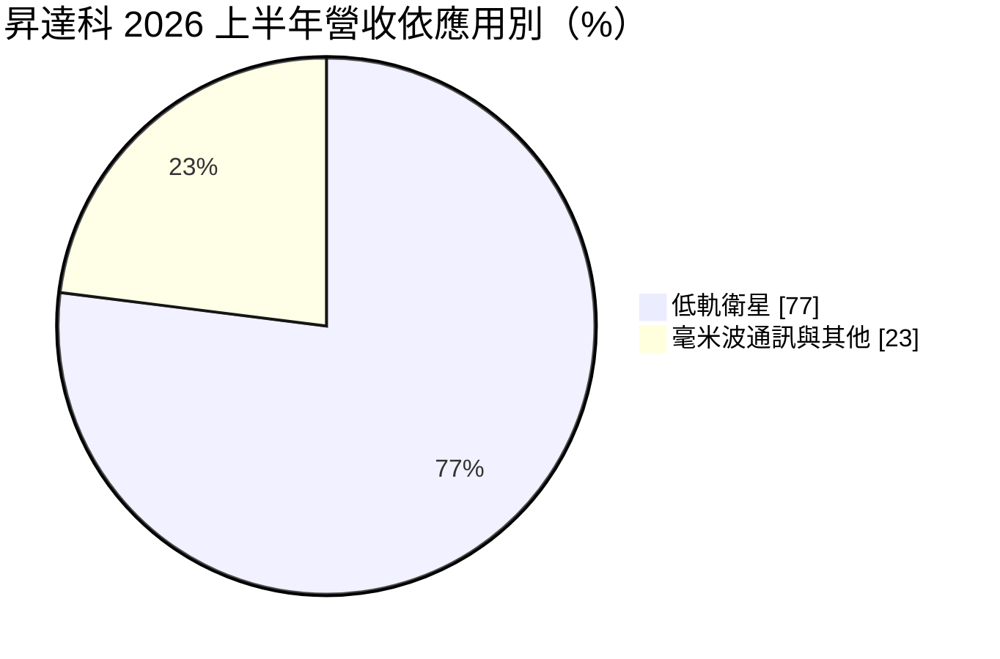
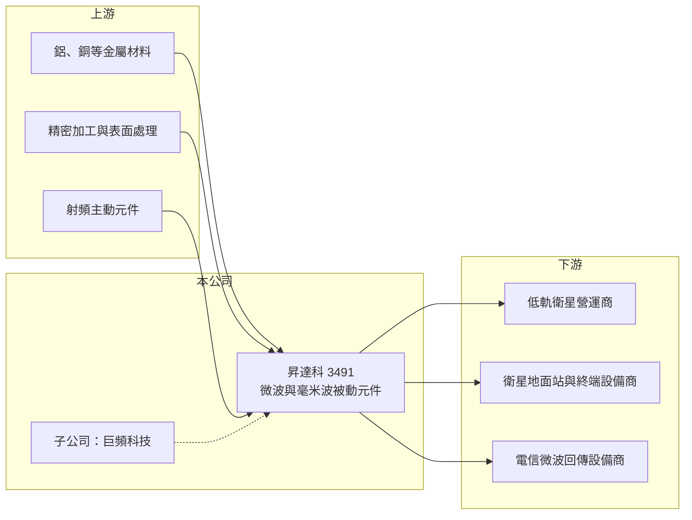

# 3491 昇達科

> 上櫃｜[[產業索引-通信網路業|通信網路業]]｜上市（櫃）日期 2008/01/03

# 第一章：企業模式與商業藍圖

> [!info] 撰寫說明
> 精簡版，由 Claude 依公開資料整理，架構比照 [[2330台積電]] 的四章研究，資料截至 2026-10-08。來源：櫃買中心開放資料（基本資料、2026 年第二季資產負債與損益、本益比殖利率）、Goodinfo 台灣股市資訊網年度經營績效（2020 至 2025 年）、中央社 2026 年 8 月法說會報導；產品技術與主要客戶身分依記憶整理，已標「待校對」。#待校對

本章拆解昇達科技（股票代號：3491，以下簡稱昇達科）的商業模式：它是一家專做微波與毫米波被動射頻元件的公司，因為打進[[低軌衛星]]供應鏈，從一家中型通訊元件廠轉變為高毛利、高成長的衛星零組件供應商。

- **核心業務：** 昇達科成立於 1999 年，2008 年上櫃，主要產品是微波與[[毫米波]]頻段的被動元件，例如波導管、濾波器、雙工器、天線與射頻組件（產品細項待校對）。早期主要用於電信業者的微波回傳設備，也就是基地台之間以無線電波傳遞訊號的鏈路；近年產品延伸到低軌衛星的衛星端與地面站元件。高頻元件對精密加工與電磁設計要求很高，尺寸誤差直接影響訊號損耗，這是昇達科的技術門檻。
- **營收結構：** 依中央社報導，2026 年上半年低軌衛星相關產品占營收 77%，其餘主要是毫米波通訊元件。衛星業務已經從「新題材」變成「主業」，昇達科的營運節奏也因此跟著主要衛星客戶的發射與設計時程走。

- **營運據點：** 生產基地在台灣與越南，管理層表示現有產能可支應約三年需求，並規劃泰國廠，以及收購一家美國加州小公司，必要時可在美國生產。2026 年收購巨頻科技，自 8 月起併入財報，但巨頻需要等 2028 年橋頭新廠完工後才會明顯貢獻營收。多國布局的目的，是滿足衛星與國防客戶對生產地的要求。
- **長期方向：** 管理層預期 2027 年營收高於 2026 年，真正的爆發性成長則在 2028 至 2029 年。這個判斷建立在全球低軌衛星星系持續擴建，以及衛星直連手機、國防通訊等新應用上。長期來看，昇達科的成長高度取決於低軌衛星產業的發射數量與客戶分散程度。

# 第二章：護城河深度與競爭優勢

昇達科的護城河來自高頻精密製造的技術門檻與衛星客戶的長期驗證，但客戶集中度高，使護城河的寬度受到限制。

- **競爭優勢：** 第一是高頻元件的製程能力：毫米波與 Ka／Ku 頻段元件對加工精度、表面處理與組裝一致性要求極高，良率與交期是客戶最在意的指標，新進者很難在短時間內達到量產水準。第二是衛星客戶的驗證門檻：太空等級元件要通過嚴格的可靠度測試，一旦導入，同一世代衛星多半沿用，[[轉換成本]]高。第三是與主要衛星客戶多年合作，管理層強調「沒掉客戶、沒掉單」。
- **主要對手：** 台灣低軌衛星供應鏈同業包括 [[2314台揚]]、[[3025星通]]、[[6285啟碁]]、[[2313華通]]、[[3138耀登]]，國際上則有歐美與以色列的射頻元件廠，以及衛星營運商自建的供應體系。昇達科的專長在被動射頻元件，與做 PCB 或終端設備的同業分工不同，但都在爭取同一批衛星客戶的訂單。
- **觀察重點：** 一是客戶分散：目前營收高度依賴一家長期衛星客戶（市場普遍認為是 SpaceX，待校對），若能打進其他低軌星系（例如亞馬遜的 Kuiper 計畫）或國防客戶，風險將大幅下降。二是巨頻科技與海外新廠的整合效益。三是毛利率能否維持在 50% 以上，這反映技術門檻是否仍在。

# 第三章：財務體質與盈利規模

資料日期：2026-10-08，表格是撰寫當時的快照；最新月營收、毛利率、累計 EPS 由自動排程寫在本筆記的屬性欄位（月營收、毛利率、累計EPS 等）。#待校對

財務數字清楚呈現了昇達科打進低軌衛星後的結構性轉變：毛利率從 40% 左右跳升到 50% 以上。

| 年度 | 營收（億元） | [[毛利率]] | [[營業利益率]] | EPS（元） | [[ROE]] |
|---|---|---|---|---|---|
| 2020 | 14.8 | 37.5% | 12.0% | 2.03 | 6.69% |
| 2021 | 17.6 | 37.3% | 12.6% | 3.81 | 12.0% |
| 2022 | 18.4 | 40.9% | 15.9% | 4.36 | 13.6% |
| 2023 | 15.9 | 40.4% | 12.8% | 3.20 | 9.95% |
| 2024 | 23.3 | 51.3% | 26.6% | 8.59 | 23.6% |
| 2025 | 24.5 | 51.1% | 23.4% | 7.83 | 16.9% |
| 2026 上半年 | 19.22 | 56.86% | 28.88% | 8.15 | 未查得 |

註：2020 至 2025 年取自 Goodinfo，2026 年上半年取自櫃買中心開放資料推算。

- **營收規模：** 2020 至 2025 年營收由 14.8 億元成長到 24.5 億元，年複合成長率約 10.6%（推算）；2026 年上半年已達 19.2 億元，接近 2025 年全年的八成。成長主要來自低軌衛星訂單。
- **獲利：** 毛利率從 2023 年的 40.4% 跳到 2024 年的 51.3%，營業利益率從 12.8% 升到 26.6%，2026 年上半年毛利率進一步升到約 57%。衛星元件的單價與技術門檻都高於傳統微波元件，產品組合轉變直接推升了獲利率，加上固定成本被攤薄，[[營運槓桿]]效果明顯。
- **財務特色：** 2021 至 2025 年平均 ROE 約 15.2%（推算）。2026 年第二季母公司股東權益約 45.4 億元、每股淨值 66 元，非流動負債約 11.7 億元。最近一期現金股利 6.8 元，以 2025 年 EPS 7.83 元計算配發率約 87%（推算）。市場給予的本益比遠高於一般通訊元件廠，反映的是對 2028 年以後成長的預期。

## [[ROIC]] 與 [[WACC]]

**ROIC 推算：** 2025 年營業利益約 5.73 億元（24.5 億元 × 23.4%），以稅率 20% 計算，稅後營業利益約 4.6 億元。2025 年平均股東權益以淨利約 5.4 億元 ÷ ROE 16.9% 推算約 32 億元，有息負債未查得，ROIC 約 14%（推算）。2026 年上半年營業利益 5.55 億元，年化後稅後約 8.9 億元，對照第二季股東權益 45.4 億元，ROIC 約 19%（推算）。

**WACC 推算：** 台灣 10 年期公債約 1.75%、市場風險溢酬約 6%、β 取高成長通訊元件股常見的 1.3（假設），股東要求報酬率約 9.55%；負債比重不高，WACC 約 9% 至 9.5%（推算）。

**解讀：** 2024 年以來 ROIC 約 14% 至 19%，高於約 9.5% 的 WACC，代表打進低軌衛星後，昇達科開始穩定創造經濟價值；2020 至 2023 年 ROIC 大約與 WACC 相當或略高。未來新廠與併購會擴大投入資本，能否維持利差，取決於新產能的利用率。

# 第四章：總體風險與地緣政治

本章說明昇達科長期面對的客戶集中、產業與擴張風險。

- **產業週期：** 低軌衛星的需求取決於衛星營運商的發射計畫與設計更新，並不像消費電子有固定季節性。2026 年第二季就因主要客戶衛星改版而營收下滑，顯示單一客戶的設計時程能直接改變季度營收。長期而言，低軌衛星星系是否持續擴建，以及衛星直連手機等應用能否商業化，是需求的根本來源。
- **營運風險：** 客戶集中是最大風險，營收近八成來自衛星應用，且主要集中於一家客戶；若該客戶把元件改為自製或轉向其他供應商，影響將非常大。另一方面，泰國、美國與巨頻橋頭新廠同時推進，擴張速度快，管理與資本支出壓力隨之上升。
- **其他風險：** 衛星與國防產品受美國出口管制與原產地規定影響，生產地的選擇需配合客戶要求；營收以美元計價為主，新台幣升值會壓縮毛利。高本益比也意味著，若成長不如預期，評價修正的幅度可能很大。

# 專有名詞解析

## 應用

- **[[低軌衛星]]**：在距地表約 500 至 2,000 公里軌道運行的衛星，延遲低於傳統同步衛星，可組成星系提供全球寬頻。
- **[[毫米波]]**：頻率約 30 至 300 GHz 的電磁波，頻寬大、傳輸量高，但傳輸距離短，用於 5G、衛星與雷達。

## 金融

- **[[營運槓桿]]**：固定成本比重高的企業，營收小幅成長就能帶動營業利益大幅成長；反之營收下滑時獲利也衰退更快。

## 產業

- **[[轉換成本]]**：客戶更換供應商時要付出的時間、金錢與風險，轉換成本越高，供應商的客戶黏著度越高。

# 核心供應鏈

- 上游：鋁、銅等金屬材料、精密加工與表面處理、射頻主動元件供應商。
- 下游／客戶：低軌衛星營運商與其衛星、地面站及終端設備供應鏈，電信微波回傳設備商，公司未揭露具名客戶。
- 同業：[[2314台揚]]、[[3025星通]]、[[6285啟碁]]、[[2313華通]]、[[3138耀登]]。

## 最新新聞
<!-- news:start（自動產生，請勿手動編輯此範圍） -->
- 2026-10-09 📰 媒體 00:10｜LEO概念股昇達科前9月營收大增71% 重點客戶新一代產品獲順利認證｜[鉅亨網](https://news.cnyes.com/news/id/6625970)
- 2026-10-08 📰 媒體 15:30｜低軌衛星概念股迎新商機！貝佐斯砸300億美元布局5萬顆AI衛星，昇達科、華通領軍，6檔台股供應鏈受關注｜[鉅亨網](https://news.cnyes.com/news/id/6624834)

完整紀錄：[[3491昇達科 新聞]]
<!-- news:end -->

## 相關連結
- [公開資訊觀測站](https://mopsov.twse.com.tw/mops/web/t05st03?step=1&firstin=1&co_id=3491)
- [Goodinfo](https://goodinfo.tw/tw/StockDetail.asp?STOCK_ID=3491)
- [Yahoo 股市](https://tw.stock.yahoo.com/quote/3491)
- [鉅亨網新聞](https://www.cnyes.com/twstock/3491/news)
