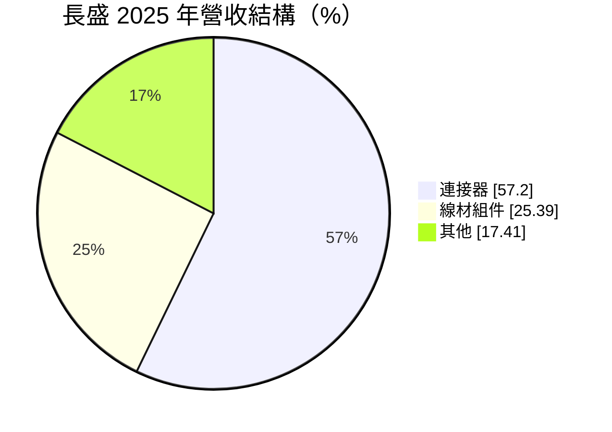
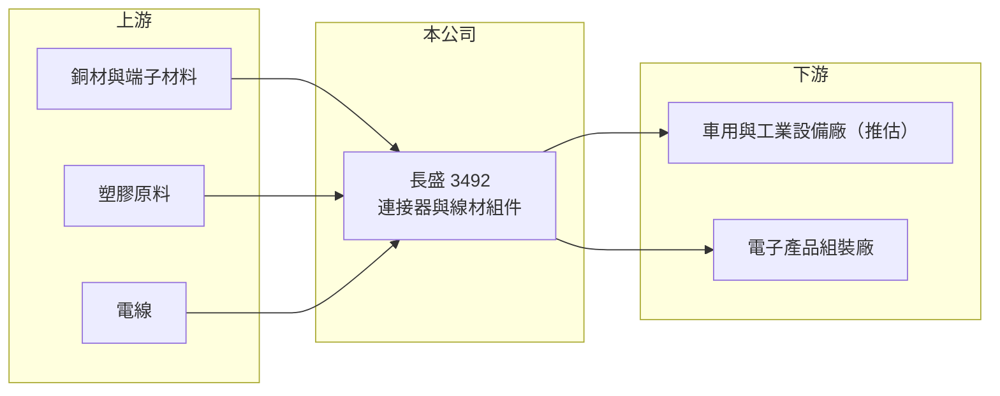

# 3492 長盛

> 上櫃｜[[產業索引-電子零組件業|電子零組件業]]｜上市（櫃）日期 2015/05/18

# 第一章：企業模式與商業藍圖

> [!info] 撰寫說明
> 精簡版，由 Claude 依公開資料整理，架構比照 [[2330台積電]] 的四章研究，資料截至 2026-10-08。來源：Goodinfo 經營績效頁、MoneyDJ（富邦 e 點通）公司基本資料頁、櫃買中心開放資料快照（基本資料、2026 年第二季損益與資產負債、本益比殖利率）。公開資料有限，應用領域、工廠與客戶名單未查得，相關描述為推估。#待校對

長盛是規模不大的[[連接器]]與線材組件廠，營收多年穩定在 7 至 9 億元。本章說明它的產品結構與經營特色。

- **核心業務：** 長盛成立於 1994 年，2015 年上櫃，總公司位於新北市淡水區，生產連接器與[[線束]]等線材組件。連接器是電子設備中負責傳遞電力或訊號的可插拔元件，規格繁多，中小型廠商通常以客製化與少量多樣的訂單為主。
- **營收結構：** 依 MoneyDJ 的 2025 年資料，連接器約占營收 57.2%、線材組件約 25.4%、其他約 17.4%。連接器與線材組件可以一起銷售，讓客戶一次取得完整的連接方案，提高單一客戶的採購金額。
- **營運據點：** 工廠所在地在本次資料中未查得。依 2016 年的新聞標題，長盛當時被市場歸類為車用連接器概念股，推估車用與工業應用是主要市場之一（推估，待校對）。
- **長期方向：** 2021 至 2025 年毛利率從 26% 提升到 31%，代表產品組合逐漸移向較高附加價值的規格。對小型連接器廠而言，長期成長的關鍵是打入車用、工業與醫療這類驗證期長、價格較穩定的應用。

# 第二章：護城河深度與競爭優勢

連接器產業高度分散，國際大廠與台灣大型廠掌握標準品，小廠靠利基規格生存。本章分析長盛的競爭位置。

- **競爭優勢：** 長盛的優勢在於可同時提供連接器與線材組件，並承接客製化訂單。若主要應用為車用與工業（推估），產品需經客戶長期驗證，一旦導入就能隨產品平台供貨多年，形成[[設計導入]]的黏著度。毛利率連續兩年維持在 31% 左右，顯示產品有一定的定價能力。
- **主要對手：** 台灣連接器與線材同業包括 [[3023信邦]]、[[6290良維]]、[[3605宏致]]、[[8103瀚荃]]、[[6197佳必琪]]，國際大廠有安費諾（Amphenol）與泰科電子（TE Connectivity）。長盛的營收規模遠小於這些對手，難以在標準品上以價格競爭。
- **觀察重點：** 第一，營業利益率能否維持在 2025 年的 7.7% 以上，而不是回到 2022 至 2023 年不到 1% 的水準。第二，營收能否突破 9 億元的天花板。第三，配息政策是否維持穩定。

# 第三章：財務體質與盈利規模

資料日期：2026-10-08，表格是撰寫當時的快照；最新月營收、毛利率、累計 EPS 由自動排程寫在本筆記的屬性欄位（月營收、毛利率、累計EPS 等）。#待校對

長盛的營收穩定但規模小，本業獲利率近兩年明顯改善。本章用多年度數據說明。

| 年度 | 營收（億元） | [[毛利率]] | [[營業利益率]] | EPS（元） | [[ROE]] |
|---|---|---|---|---|---|
| 2021 | 7.49 | 26.0% | 3.75% | 0.50 | 3.34% |
| 2022 | 7.51 | 25.0% | 0.48% | 1.45 | 9.13% |
| 2023 | 7.23 | 27.2% | 0.81% | 0.63 | 3.87% |
| 2024 | 8.14 | 31.3% | 6.14% | 1.62 | 9.66% |
| 2025 | 8.52 | 31.0% | 7.68% | 1.77 | 9.85% |
| 2026 上半年 | 4.33 | 27.2% | 5.2% | 0.51 | 未查得 |

- **營收規模：** 2021 至 2025 年營收從 7.49 億元成長到 8.52 億元，年複合成長率約 3.3%（推算），成長溫和但穩定。2026 年上半年營收約 4.33 億元，與 2025 年水準相當。
- **獲利：** 2022 年營業利益率只有 0.48%，EPS 卻有 1.45 元，代表當年獲利主要來自匯兌等業外收益。2024 至 2025 年營業利益率回到 6% 至 8%，獲利改由本業支撐，品質較好。2026 年上半年毛利率降到 27.2%、EPS 0.51 元，較 2025 年轉弱。近 5 年平均 ROE 約 7.2%（推算）。
- **財務特色：** 2026 年第二季末股東權益約 6.43 億元、負債約 3.58 億元，其中九成是流動負債，長期負債很少。2025 年度配發現金股利 1.1 元，以 EPS 1.77 元計，配息率約 62%（推算）。

**[[ROIC]] 與 [[WACC]]：** 有息負債明細未查得，假設約 1 億元（推估）。2025 年營業利益約 0.65 億元，稅後約 0.52 億元，投入資本以母公司權益 6.4 億元加有息負債 1 億元，約 7.4 億元，ROIC 約 7.0%（推算）；2022 至 2023 年營業利益率不到 1% 時，ROIC 接近零。WACC 用 CAPM 推估：無風險利率 1.75%、市場風險溢酬 6%、β 取 0.9（連接器小型股常見值，假設），股東權益成本約 7.2%；負債成本 3%、稅率 20%，以權益 86%、負債 14% 加權，WACC 約 6.5%（推算）。結論是長盛直到 2024 至 2025 年 ROIC 才略高於 WACC，長期平均仍低於資金成本，能否穩定維持 7% 以上的營業利益率是創造價值的關鍵。

# 第四章：總體風險與地緣政治

小型連接器廠的風險在於規模、客戶集中與原料價格。本章整理主要風險。

- **產業週期：** 連接器需求跟著終端產品景氣走，車用、工業與消費性電子的庫存調整都會影響訂單。小廠議價能力弱，景氣下行時常被要求降價。
- **營運風險：** 營收規模不到 10 億元，研發與自動化投資能力有限，難以跟上高速傳輸、大電流等新規格。若少數大客戶轉單，營收會明顯下滑。
- **其他風險：** 銅、金與塑膠是連接器主要原料，價格上漲會壓縮毛利率。外銷比重與生產據點未查得，匯率與地緣政治影響的程度無法確認。

# 專有名詞解析

## 金融

- **[[ROIC]]**：投入資本報酬率，稅後營業利益除以股東權益加有息負債，衡量本業運用資本的效率。
- **[[WACC]]**：加權平均資金成本，股東權益成本與負債成本依資本結構加權，是 ROIC 必須超越的門檻。

## 產業

- **[[連接器]]**：讓電子零件、模組或設備之間可插拔連接的元件，負責傳遞電力或訊號。
- **[[線束]]**：把多條電線、端子與連接器組合成一組的配線系統，汽車與家電大量使用。
- **[[設計導入]]**：零件被客戶選入產品設計並完成驗證，之後該產品量產期間都會持續採購，是零組件廠長期營收的來源。

# 核心供應鏈

- 上游：銅材、端子材料、塑膠原料與電線供應商（推估）。
- 下游／客戶：車用、工業與電子產品客戶（推估，名單未查得）。
- 同業：[[3023信邦]]、[[6290良維]]、[[3605宏致]]、[[8103瀚荃]]、[[6197佳必琪]]、安費諾、泰科電子。

## 最新新聞
<!-- news:start -->
<!-- news:end -->

## 相關連結
- [公開資訊觀測站](https://mopsov.twse.com.tw/mops/web/t05st03?step=1&firstin=1&co_id=3492)
- [Goodinfo](https://goodinfo.tw/tw/StockDetail.asp?STOCK_ID=3492)
- [Yahoo 股市](https://tw.stock.yahoo.com/quote/3492)
- [鉅亨網新聞](https://www.cnyes.com/twstock/3492/news)
