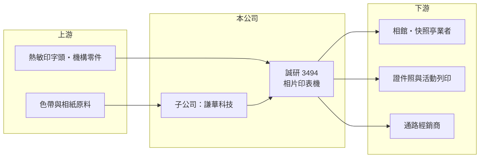

# 3494 誠研

> 上市｜[[產業索引-電腦及週邊設備業|電腦及週邊設備業]]｜上市（櫃）日期 2007/12/13

# 第一章：企業模式與商業藍圖

> [!info] 撰寫說明
> 精簡版，由 Claude 依公開資料整理，架構比照 [[2330台積電]]，資料截至 2026-10-08。來源：證交所開放資料（基本資料、2026 年第二季資產負債與綜合損益、股利、2026 年 8 月營收）、Goodinfo 經營績效頁、MoneyLink 基本資料頁。公開資料有限，公司自 2013 年起改為自願申報業務比重，產品比重與客戶未查得。#待校對

誠研是以相片印表機與列印耗材為主的小型公司，近年營收雖回升，但本業連年虧損，靠多次減資與增資維持營運，屬於轉型與重整中的個股。

- **核心業務：** 誠研成立於 2001 年，2007 年在證交所上市，登記業務為相片印表機及週邊耗材的研發與批發零售，以及事務性機器設備買賣。依整理性知識，誠研的品牌為 HiTi，主要產品是 [[熱昇華印表機]]，用於相館、快照亭、證件照與活動現場列印（待校對）。這類印表機的商業模式類似「印表機加耗材」：機台售出後，客戶要持續購買色帶與相紙，耗材是長期穩定的收入來源。
- **營收結構：** 公司未申報業務比重。公開資料顯示有重要子公司謙華科技，推測與色帶等列印耗材相關（待校對）。年營收規模在 2025 年僅 9.4 億元，2026 年 1 至 8 月累計 7.0 億元、年增約 8%。
- **營運據點與股權：** 公司位於新北市新店區。依 MoneyLink，2026 年 9 月主要股東為成達國際投資 21.12%、國錢租賃 7.13%、光風投資 6.09%，董事長由光風投資代表人擔任。股權集中在投資公司手中，代表經營權可能經歷過更替，未來策略也較受主要股東主導。
- **長期方向：** 股本在 2021 年至 2024 年間經歷「減資、增資、再減資、再增資」，2026 年 6 月股東會又通過私募現金增資。這顯示公司長期以減資彌補虧損、再引進新資金的方式延續營運，能否找到穩定獲利的產品組合，是比營收成長更重要的觀察點。

# 第二章：護城河深度與競爭優勢

誠研的護城河相當薄，相片列印屬於成熟且規模不大的利基市場，日本大廠在技術與品牌上占優勢。

- **競爭優勢：** 熱昇華相片列印的機台與耗材需要配套，客戶一旦採用某品牌機台，後續會持續購買同品牌耗材，形成一定的鎖定效果。誠研在這個利基市場經營多年，具有機台與耗材的整合能力（待校對）。但從毛利率長期在 -24% 到 16% 之間來看，這個優勢並未轉化為定價能力。
- **主要對手：** 相片列印與熱昇華耗材的主要對手為大日本印刷（DNP）、三菱電機、柯達等日系與美系大廠，這些公司在全球相館與快照亭市場有較大的裝機量。台灣上市櫃公司中，直接同業不多，[[3611鼎翰]] 雖同為印表機廠，但專注條碼標籤列印，市場不同。
- **觀察重點：** 第一是毛利率能否穩定在 15% 以上，否則營業費用無法被覆蓋。第二是私募與增資後的資金用途，是否帶來新的產品或事業。第三是累積虧損能否停止擴大，避免再度減資。

# 第三章：財務體質與盈利規模

資料日期：2026-10-08，表格是撰寫當時的快照；最新月營收、毛利率、累計 EPS 由自動排程寫在本筆記的屬性欄位（月營收、毛利率、累計EPS 等）。#待校對

誠研的財務特色是營收小、毛利率不足以支撐費用，六年來每年虧損，股東權益依賴增資補充。

| 年度 | 營收（億元） | [[毛利率]] | [[營業利益率]] | EPS（元） | [[ROE]] |
|---|---|---|---|---|---|
| 2020 | 4.89 | -23.5% | -104% | -2.44 | -47.6% |
| 2021 | 4.56 | 12.0% | -53.7% | -1.57 | -21.0% |
| 2022 | 5.40 | -2.2% | -62.0% | -1.94 | -37.2% |
| 2023 | 6.76 | 5.74% | -31.9% | -1.52 | -38.2% |
| 2024 | 9.05 | 15.6% | -12.2% | -1.08 | -21.5% |
| 2025 | 9.39 | 11.6% | -12.4% | -1.84 | -24.5% |
| 2026 上半年 | 5.00 | 13.8% | -4.8% | -0.55 | 半年，不年化 |

（2020 至 2025 年取自 Goodinfo；2026 上半年依證交所第二季綜合損益計算。）

- **營收規模：** 2020 至 2025 年營收由 4.89 億元成長到 9.39 億元，年複合成長率約 13.9%，主要成長發生在 2023 至 2024 年。營收成長使虧損率收斂，營業利益率由 -100% 左右改善到 -12%，2026 年上半年進一步收斂到 -4.8%。
- **獲利：** 近五年平均 ROE 約 -28.5%。毛利率最高僅 15.6%，低於一般電腦週邊廠的水準，代表產品缺乏定價能力或產能利用率偏低（推估）。2026 年上半年營業外支出 0.32 億元，使稅後淨損擴大到 0.52 億元。
- **財務結構：** 2026 年第二季底總資產 18.3 億元、負債 12.2 億元，負債比約 67%；流動資產 4.3 億元低於流動負債 5.2 億元，短期償債壓力偏高。保留盈餘為 -5.3 億元的 [[累積虧損]]，歸屬母公司權益 5.3 億元，每股淨值 5.54 元，低於面額 10 元。2025 年度未配發股利。
- **[[ROIC]] 與 [[WACC]]：** 2025 年營業損失約 9.39 億 × -12.4% ≈ -1.2 億元，ROIC 為負；以權益 6.2 億元加非流動負債 6.9 億元作為投入資本概估，ROIC 約 -9%（推算，有息負債實際金額未查得）。WACC 以 CAPM 推估：無風險利率 1.75%、市場風險溢酬 6%，因虧損與高負債 β 假設 1.2，股權成本約 9%；負債成本假設 3%（稅後 2.4%），負債約占一半，WACC 約 5.5% 至 6.5%（推算，高負債使加權數字偏低，實際風險更高）。ROIC 長期遠低於 WACC，代表公司持續消耗股東資本。

# 第四章：總體風險與地緣政治

誠研的主要風險是持續虧損下的資本與流動性壓力，以及利基市場本身的萎縮。

- **產業週期：** 相片列印需求和觀光、婚慶、活動與相館市場有關，景氣與消費習慣都會影響耗材用量。手機與社群媒體讓實體相片需求長期下降，只剩紀念性與即時列印場景，市場成長空間有限。
- **營運風險：** 營收規模小，固定費用難以攤提，營收稍有下滑就會擴大虧損。產品與耗材若集中在少數通路或客戶，訂單變動的影響很大。
- **財務風險：** 每股淨值已低於面額，流動比率不到 1，若虧損持續，可能需要再度減資或增資，對既有股東造成稀釋。主要股東為投資公司，經營方向與資產處分的變動也較難預測。
- **其他風險：** 色帶與相紙的原料價格、日圓與美元匯率會影響成本與競爭力。

# 專有名詞解析

## 金融

- **[[累積虧損]]**：公司歷年虧損累積超過盈餘後，在資產負債表保留盈餘欄出現的負數。
- **[[減資彌補虧損]]**：公司以減少股本的方式沖銷帳上累積虧損，股東持股數會等比例減少。

## 產業

- **[[熱昇華印表機]]**：以加熱讓色帶染料昇華滲入相紙的印表機，色彩連續、乾燥快，常用於相館與快照亭。

# 核心供應鏈

- 上游：熱敏印字頭與機構零件、色帶與相紙原料供應商（未查得具名廠商）。
- 下游／客戶：相館、快照亭業者、證件照與活動列印業者、海外經銷商（未具名，待校對）。
- 同業：大日本印刷（DNP）、三菱電機、柯達。

## 最新新聞
<!-- news:start（自動產生，請勿手動編輯此範圍） -->
- 2026-10-12 🏛️ 重訊 15:14｜更正本公司115年9月營收公告數｜[觀測站](https://mops.twse.com.tw/mops/#/web/t05st01)
- 2026-10-06 🏛️ 重訊 18:26｜代重要子公司謙華科技(股)公司公告 法人董事長異動｜[觀測站](https://mops.twse.com.tw/mops/#/web/t05st01)
- 2026-10-06 🏛️ 重訊 17:57｜代重要子公司HiTi Digital America, Inc. 公告董事長異動｜[觀測站](https://mops.twse.com.tw/mops/#/web/t05st01)

完整紀錄：[[3494誠研 新聞]]
<!-- news:end -->

## 相關連結
- [公開資訊觀測站](https://mopsov.twse.com.tw/mops/web/t05st03?step=1&firstin=1&co_id=3494)
- [Goodinfo](https://goodinfo.tw/tw/StockDetail.asp?STOCK_ID=3494)
- [Yahoo 股市](https://tw.stock.yahoo.com/quote/3494)
- [鉅亨網新聞](https://www.cnyes.com/twstock/3494/news)
