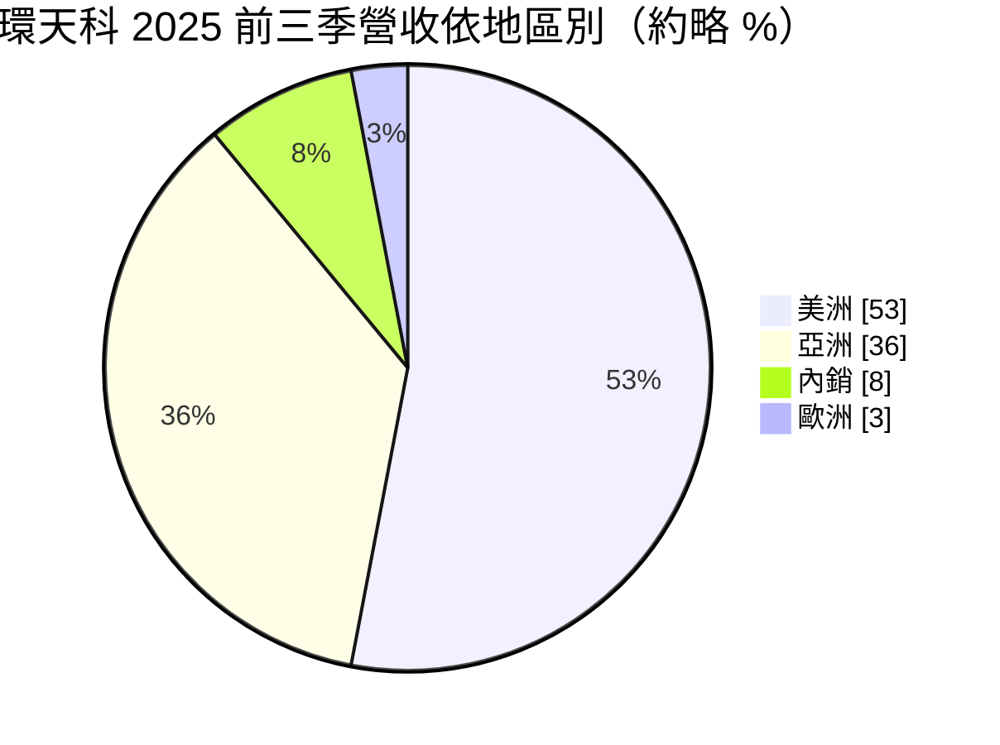
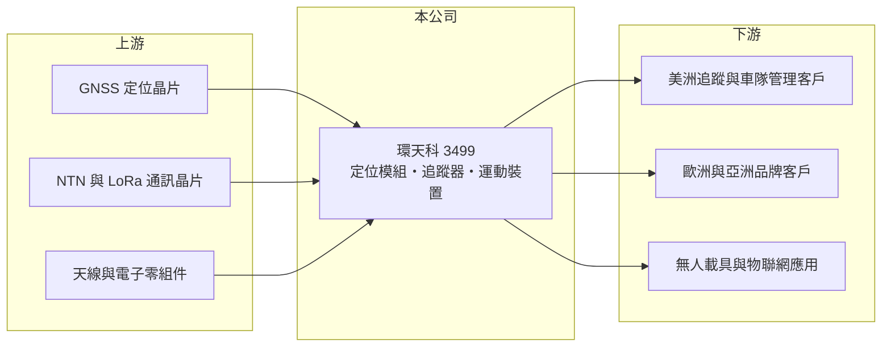

# 3499 環天科

> 上櫃｜[[產業索引-通信網路業|通信網路業]]｜上市（櫃）日期 2006/10/19

# 第一章：企業模式與商業藍圖

> [!info] 撰寫說明
> 精簡版，由 Claude 依公開資料整理，架構比照 [[2330台積電]] 的四章研究，資料截至 2026-10-08。來源：櫃買中心開放資料（基本資料、2026 年第二季資產負債與損益）、Goodinfo 台灣股市資訊網年度經營績效（2020 至 2025 年）、富果研究 2025 年 12 月法說會整理。公司未揭露產品線營收比重，公開資料有限。#待校對

本章拆解環天世通（股票代號：3499，以下簡稱環天科）的商業模式：它是一家以 GPS 衛星定位技術起家的中小型公司，產品從定位模組延伸到追蹤器與運動裝置，目前正嘗試以衛星物聯網與高精度定位開啟下一階段。

- **核心業務：** 環天科成立於 2000 年，2006 年上櫃，核心技術是 [[GNSS]] 衛星定位接收與應用。產品線包括運動與戶外產品（運動手錶、行車記錄器）、追蹤應用產品（汽車、個人與動物定位）、物聯網產品（衛星非地面網路 [[NTN]]、[[LoRaWAN]]、毫米波感測），以及無人載具用的 GPS 模組與接收器。定位晶片本身由國際晶片廠提供，環天科的價值在於天線、模組設計、韌體與應用整合。
- **營收結構：** 公司未揭露產品別比重。依法說會整理，2025 年前三季營收 2.51 億元中，美洲約 1.33 億元（約 53%）、亞洲約 9,100 萬元（約 36%）、內銷約 1,900 萬元（約 8%）、歐洲約 650 萬元（約 3%）。歐洲比重偏低，是因為一家歐洲主要客戶公司重整而暫停出貨，該客戶已於 2025 年第四季恢復拉貨。

- **營運據點：** 總部在新北中和，另有中國廣東增城與美國南加州據點。美洲是最大市場，美國關稅變化會直接影響訂單與毛利。
- **長期方向：** 管理層把下一階段的成長押在三個方向：低軌衛星 NTN 追蹤器（手錶式、手持式與資產管理型，自 2026 年起陸續推出）、[[RTK]] 高精度定位模組，以及無人載具相關模組（NTN、無線與影像傳輸）。這些方向符合衛星物聯網與無人機的長期趨勢，但都需要時間完成客戶驗證與市場推廣。

# 第二章：護城河深度與競爭優勢

環天科的護城河很窄：GPS 定位已是成熟技術，晶片廠與大型品牌不斷把功能整合進單一晶片或手機，留給模組廠的空間越來越小。

- **競爭優勢：** 第一是二十多年的衛星定位應用經驗，在天線調校、低功耗韌體與特殊應用（動物追蹤、潛水裝置等）上有累積。第二是少量多樣的客製化能力，能服務大廠看不上的利基客戶，例如國內智慧潛水產品客戶在 2025 年帶動內銷成長約三倍。第三是在 NTN 與 RTK 這些新規格上較早投入。
- **主要對手：** 國際上有 Garmin 等品牌大廠與多家定位模組廠，台灣同業有做定位天線與導航產品的 [[3306鼎天]]（待校對），但更多競爭來自中國低價追蹤器與模組廠。手機與智慧手錶本身內建定位功能，也取代了部分單機定位產品的需求。
- **觀察重點：** 一是 NTN 追蹤器與無人載具模組能否從展示走到穩定出貨；二是歐洲主要客戶恢復拉貨的持續性；三是毛利率能否回到 25% 以上，因為以環天科的費用規模，毛利率低於這個水準就難以獲利。

# 第三章：財務體質與盈利規模

資料日期：2026-10-08，表格是撰寫當時的快照；最新月營收、毛利率、累計 EPS 由自動排程寫在本筆記的屬性欄位（月營收、毛利率、累計EPS 等）。#待校對

環天科的財務數字顯示，營收規模長期停留在 3 億至 4.5 億元，費用無法被攤平，六年中只有一年小幅獲利。

| 年度 | 營收（億元） | [[毛利率]] | [[營業利益率]] | EPS（元） | [[ROE]] |
|---|---|---|---|---|---|
| 2020 | 4.16 | 21.4% | -13.8% | -0.49 | -4.48% |
| 2021 | 4.38 | 22.5% | -10.9% | -0.18 | -1.76% |
| 2022 | 3.28 | 25.1% | -18.0% | -0.07 | -0.71% |
| 2023 | 3.60 | 23.4% | -14.4% | -0.61 | -6.08% |
| 2024 | 4.38 | 26.9% | -5.42% | 0.02 | 0.24% |
| 2025 | 3.58 | 22.3% | -16.7% | -1.30 | -14.2% |
| 2026 上半年 | 1.47 | 18.52% | -33.0% | -0.83 | 未查得 |

註：2020 至 2025 年取自 Goodinfo，2026 年上半年取自櫃買中心開放資料推算。

- **營收規模：** 營收在 3.3 億至 4.4 億元之間徘徊，2020 至 2025 年幾乎沒有成長（年複合成長率約 -3%，推算）。規模太小是環天科最根本的問題：研發與營運費用相對固定，營收不夠大就無法產生營業利益。
- **獲利：** 毛利率在 21% 至 27% 之間，但營業利益率六年都是負值，最好的 2024 年也有 -5.4%。2022 年營業虧損 18% 但 EPS 只有 -0.07 元，推估當年有業外收益挹注。2026 年上半年毛利率降到 18.5%，營業虧損擴大到營收的三分之一，與法說會提到的高毛利產品比重下降、歐洲客戶暫停出貨與美元貶值一致。
- **財務特色：** 2021 至 2025 年平均 ROE 約 -4.5%（推算），近年未配發股利。2026 年第二季股東權益約 4.28 億元、每股淨值 7.79 元，已低於面額；總負債約 2.44 億元，負債比約 36%，與法說會提到的約 37% 相近。

## [[ROIC]] 與 [[WACC]]

**ROIC 推算：** 2025 年營業虧損約 0.60 億元（3.58 億元 × -16.7%），虧損年度不計稅負。投入資本以 2026 年第二季股東權益約 4.28 億元近似（有息負債未查得），ROIC 約 -14%（推算）；2026 年上半年營業虧損 0.48 億元，年化後 ROIC 約 -22%（推算）。

**WACC 推算：** 台灣 10 年期公債約 1.75%、市場風險溢酬約 6%、β 取中小型電子股常見的 1.0（假設），股東要求報酬率約 7.75%，WACC 約 7.5%（推算）。

**解讀：** ROIC 長期為負、遠低於 WACC，代表環天科多年來無法賺回資金成本，股東權益持續被虧損侵蝕。要扭轉價值毀損，必須讓新產品把營收規模推升到能覆蓋固定費用的水準。

# 第四章：總體風險與地緣政治

本章說明環天科長期面對的技術替代、客戶與財務風險。

- **產業週期：** 追蹤器與運動裝置屬於消費與商用利基市場，需求受景氣與客戶庫存影響；定位技術本身則持續被整合進手機與通用物聯網模組，單機定位產品的市場長期萎縮。
- **營運風險：** 客戶集中且規模小，一家歐洲客戶重整就讓歐洲營收大幅下滑；新產品（NTN、RTK、無人載具）仍處推廣期，若市場接受度不如預期，虧損將持續。長期虧損使淨值低於面額，未來可能需要增資或減資彌補虧損。
- **其他風險：** 美洲營收過半，美國關稅與匯率變動直接影響獲利；衛星通訊相關產品須取得各國電信認證，無人載具模組則涉及出口管制，都會延長產品上市時間。

# 專有名詞解析

## 應用

- **[[GNSS]]**：全球導航衛星系統，泛指 GPS、伽利略、北斗、格洛納斯等衛星定位系統。
- **[[NTN]]**：非地面網路，讓裝置透過衛星直接連網的通訊標準，可在沒有基地台的地區傳送資料。
- **[[LoRaWAN]]**：低功耗廣域網路協定，傳輸距離長、耗電低，適合智慧電表、資產追蹤等物聯網應用。
- **[[RTK]]**：即時動態定位，利用基準站修正衛星訊號誤差，可把定位精度提高到公分等級。

# 核心供應鏈

- 上游：GNSS 定位晶片、NTN 與 LoRa 通訊晶片、天線與電子零組件供應商。
- 下游／客戶：美洲追蹤應用客戶、歐洲品牌客戶、國內智慧潛水產品客戶、無人載具廠商，公司未揭露具名客戶。
- 同業：Garmin 等國際定位品牌、[[3306鼎天]]（待校對），以及中國追蹤器與模組廠。

## 最新新聞
<!-- news:start -->
<!-- news:end -->

## 相關連結
- [公開資訊觀測站](https://mopsov.twse.com.tw/mops/web/t05st03?step=1&firstin=1&co_id=3499)
- [Goodinfo](https://goodinfo.tw/tw/StockDetail.asp?STOCK_ID=3499)
- [Yahoo 股市](https://tw.stock.yahoo.com/quote/3499)
- [鉅亨網新聞](https://www.cnyes.com/twstock/3499/news)
