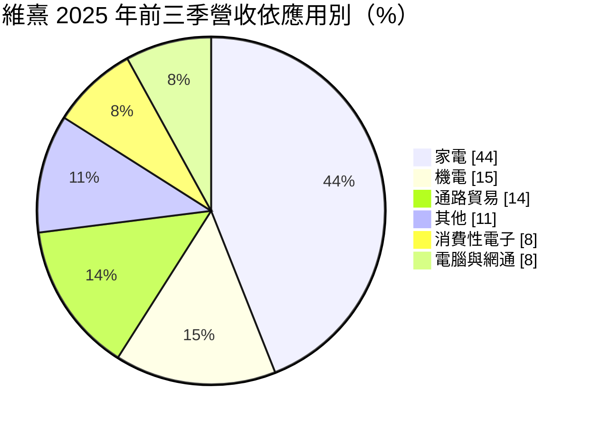
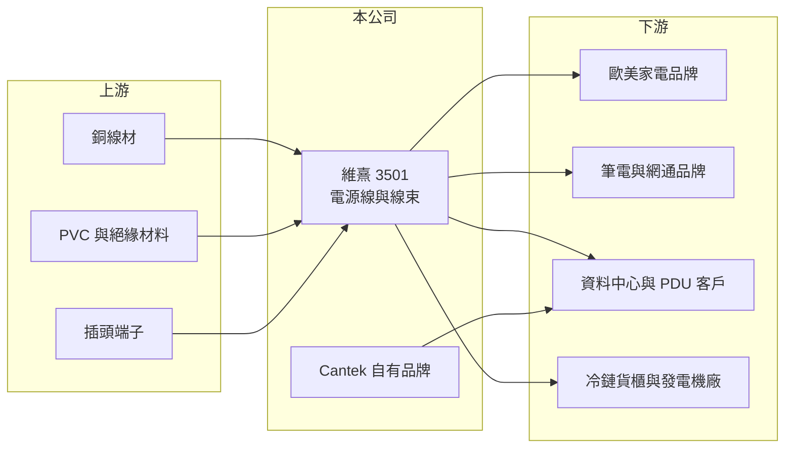

# 3501 維熹

> 上市｜[[產業索引-電子零組件業|電子零組件業]]｜上市（櫃）日期 2007/09/20

# 第一章：企業模式與商業藍圖

> [!info] 撰寫說明
> 精簡版，由 Claude 依公開資料整理，架構比照 [[2330台積電]] 的四章研究，資料截至 2026-10-08。來源：Goodinfo 經營績效頁、富果研究 2025 年 12 月法說會摘要、證交所開放資料快照（基本資料、2026 年第二季營益分析、損益與資產負債、股利）。產品別（電源線與線束）的營收拆分未查得。#待校對

維熹是台灣主要的[[電源線]]與[[線束]]製造商之一，產品進入家電、電腦、資料中心與冷鏈貨櫃等多種設備。本章說明它的業務組成與產能布局。

- **核心業務：** 維熹成立於 2002 年，2007 年上市，董事長與總經理由吳瑞雄兼任。主要產品是交流電源線與線束，另透過美國子公司 Cantek 經營自有品牌，銷售休旅車、居家修繕與醫療級電源線。電源線屬於安全規範零件，必須取得各國安規認證（例如 [[UL 認證]]）才能銷售，認證與品質紀錄是進入門檻。
- **營收結構：** 依 2025 年前三季的應用別，家電約占 44%、機電（發電機、冷鏈貨櫃、綠能）約 15%、通路貿易（資料中心、醫療、休旅車）約 14%、其他（電動車、低軌衛星、戶外照明）約 11%、消費性電子約 8%、電腦與網通約 8%。家電占比最高，代表營收與歐美家電品牌的景氣高度相關。
- **營運據點：** 2025 年前三季產量中，東莞約占 48%、昆山約 40%、彰化約 12%，彰化的比重從 2024 年的 8% 逐步提高。2024 年成立越南子公司並購置廠房，但投產仍待當地政府核准；2025 年購入美國德州達拉斯廠房，服務北美客戶。
- **長期方向：** 公司承認產能移出中國的速度比同業慢，曾因此流失部分訂單，因此正以台灣、越南與美國分散生產。產品方面，往資料中心與 [[AI 伺服器]]電源線、風電儲能、冷鏈貨櫃與機器人內部線束發展，目標是降低對家電的依賴。

# 第二章：護城河深度與競爭優勢

電源線是標準化程度高的產品，競爭主要比認證、品質、交期與產能地點。本章分析維熹的競爭條件。

- **競爭優勢：** 維熹長期供應歐美家電品牌，累積了各國安規認證與穩定的品質紀錄，客戶更換供應商需重新認證，具一定的轉換成本。產品應用分散在六大領域，單一產業衰退的衝擊相對有限。自有品牌 Cantek 讓公司在北美有直接面對通路的管道。
- **主要對手：** 台灣電源線與線束同業包括 [[6290良維]]、[[2462良得電]]、[[3665貿聯-KY]]，另有大量中國與東南亞廠商。在資料中心與 AI 伺服器領域，維熹自評落後同業，目前透過經銷商間接供應美國資料中心。
- **觀察重點：** 第一，越南廠能否取得核准並投產，以及美國德州廠的營運狀況。第二，資料中心與 AI 伺服器電源線能否成為新的成長來源。第三，毛利率能否從 2025 年第三季的 17% 回到 20% 以上。

# 第三章：財務體質與盈利規模

資料日期：2026-10-08，表格是撰寫當時的快照；最新月營收、毛利率、累計 EPS 由自動排程寫在本筆記的屬性欄位（月營收、毛利率、累計EPS 等）。#待校對

維熹的營收規模穩定在 53 至 62 億元，獲利則隨銅價、匯率與產能轉移明顯起伏。本章用多年度數據說明。

| 年度 | 營收（億元） | [[毛利率]] | [[營業利益率]] | EPS（元） | [[ROE]] |
|---|---|---|---|---|---|
| 2021 | 55.8 | 19.1% | 7.95% | 2.92 | 5.81% |
| 2022 | 61.6 | 22.9% | 11.9% | 6.42 | 12.1% |
| 2023 | 53.3 | 23.9% | 11.5% | 4.29 | 7.73% |
| 2024 | 59.2 | 24.2% | 11.9% | 6.12 | 10.6% |
| 2025 | 55.4 | 20.0% | 7.66% | 3.00 | 5.04% |
| 2026 上半年 | 26.2 | 17.5% | 5.2% | 0.72 | 未查得 |

- **營收規模：** 2021 至 2025 年營收在 53 至 62 億元之間，年複合成長率約 -0.2%（推算），屬於成熟型業務。2026 年上半年營收約 26.2 億元，略低於 2025 年同期的步調（推估）。
- **獲利：** 2022 至 2024 年營業利益率維持在 11% 以上，是較好的時期；2025 年起毛利率下滑到 20%，2026 年上半年再降到 17.5%，營業利益率只剩 5.2%，EPS 0.72 元。下滑原因包括美國家電客戶需求轉弱、產能轉移延遲與匯率。近 5 年平均 ROE 約 8.3%（推算）。
- **財務特色：** 2026 年第二季末股東權益約 70.3 億元，每股淨值約 59.5 元，負債約 29 億元，負債比約 29%，財務保守。公司配息率約六至七成，2024 年 EPS 6.12 元配 4 元，2025 年 EPS 3.00 元配 2 元。

**[[ROIC]] 與 [[WACC]]：** 有息負債明細未查得，假設約 8 億元（推估）。2025 年營業利益約 4.24 億元，稅後約 3.39 億元，投入資本以母公司權益 70.3 億元加有息負債 8 億元，約 78 億元，ROIC 約 4.3%（推算）；2024 年營業利益率 11.9% 時，ROIC 約 7.2%（推算）。WACC 用 CAPM 推估：無風險利率 1.75%、市場風險溢酬 6%、β 取 0.8（傳統零組件股常見值，假設），股東權益成本約 6.6%；負債成本 2.5%、稅率 20%，以權益 90%、負債 10% 加權，WACC 約 6.1%（推算）。結論是維熹在 2022 至 2024 年 ROIC 略高於 WACC，2025 年起轉為低於資金成本；龐大的股東權益壓低了資本報酬率，獲利回升或更積極的資本配置才能重新創造價值。

# 第四章：總體風險與地緣政治

電源線廠的風險集中在原料價格、終端景氣與生產地點。本章整理主要風險。

- **產業週期：** 家電占營收四成以上，歐美房市與家電換機需求轉弱時，訂單會明顯減少。2025 年家電營收衰退約 11%，就是美國家電品牌與歐洲吹風機客戶需求下滑的結果。
- **營運風險：** 產能仍有近九成在中國，越南廠投產延遲，若美國關稅或客戶要求加速移出中國，可能再流失訂單。新事業如 AI 伺服器電源線仍處起步，公司自評落後同業。
- **其他風險：** 銅是電源線最主要的成本，銅價大漲時若無法即時轉嫁，毛利率會下滑。外銷以美元計價，新台幣與人民幣匯率變動也會影響獲利。

# 專有名詞解析

## 應用

- **[[UL 認證]]**：美國 UL 機構的產品安全認證，電源線與電器產品進入北美市場通常必須取得。
- **[[AI 伺服器]]**：搭載 GPU 等加速晶片、用於訓練與推論 AI 模型的伺服器，對散熱與電源規格要求很高。

## 金融

- **[[ROIC]]**：投入資本報酬率，稅後營業利益除以股東權益加有息負債，衡量本業運用資本的效率。
- **[[WACC]]**：加權平均資金成本，股東權益成本與負債成本依資本結構加權，是 ROIC 必須超越的門檻。

## 產業

- **[[電源線]]**：連接電器與插座的交流電線組，需依各國電壓、插頭規格與安規認證製造。
- **[[線束]]**：把多條電線、端子與連接器組合成一組的配線系統，汽車與家電大量使用。

# 核心供應鏈

- 上游：銅線材、PVC 與絕緣材料、插頭端子供應商（推估）。
- 下游／客戶：歐美家電品牌、中國大型筆電品牌、美國資料中心與 PDU 客戶、航運業冷鏈貨櫃、發電機與綠能設備廠。
- 同業：[[6290良維]]、[[2462良得電]]、[[3665貿聯-KY]]。

## 最新新聞
<!-- news:start -->
<!-- news:end -->

## 相關連結
- [公開資訊觀測站](https://mopsov.twse.com.tw/mops/web/t05st03?step=1&firstin=1&co_id=3501)
- [Goodinfo](https://goodinfo.tw/tw/StockDetail.asp?STOCK_ID=3501)
- [Yahoo 股市](https://tw.stock.yahoo.com/quote/3501)
- [鉅亨網新聞](https://www.cnyes.com/twstock/3501/news)
