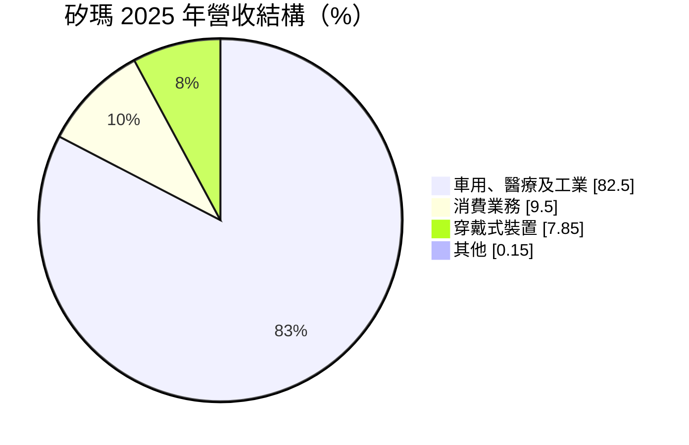
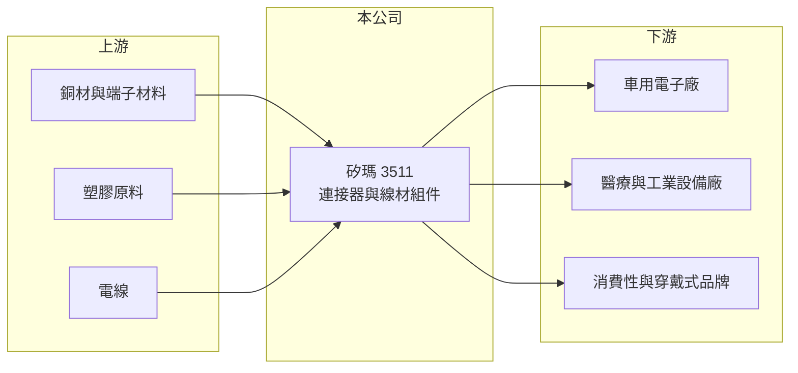

# 3511 矽瑪

> 上櫃｜[[產業索引-電子零組件業|電子零組件業]]｜上市（櫃）日期 2009/02/16

# 第一章：企業模式與商業藍圖

> [!info] 撰寫說明
> 精簡版，由 Claude 依公開資料整理，架構比照 [[2330台積電]] 的四章研究，資料截至 2026-10-08。來源：Goodinfo 經營績效頁、MoneyDJ（富邦 e 點通）公司基本資料頁、櫃買中心開放資料快照（基本資料、2026 年第二季損益與資產負債、本益比殖利率）。公開資料有限，具體產品、工廠與客戶名單未查得，相關描述為推估。#待校對

矽瑪是以[[連接器]]與線材組件為主的公司，近年把重心從消費性電子轉向車用、醫療與工業。本章說明它的業務組成與轉型背景。

- **核心業務：** 矽瑪成立於 2003 年，2009 年上櫃，總公司位於桃園。依 2016 年的英文媒體報導，公司以新一代連接器與配件為主要業務（待校對）。目前的營收分類為車用、醫療及工業、消費業務、穿戴式裝置與其他，顯示產品橫跨多個終端市場。
- **營收結構：** 依 MoneyDJ 的 2025 年資料，車用、醫療及工業約占 82.5%、消費業務約 9.5%、穿戴式裝置約 7.85%、其他約 0.15%。車用與工業產品驗證期長、價格穩定，理論上比消費性產品更有利於長期經營，但目前的營收規模仍小。
- **營運據點：** 總公司位於桃園市桃園區，工廠所在地未查得。2026 年上半年合併稅前虧損約 4,268 萬元、歸屬母公司虧損約 3,312 萬元，兩者有差距，推估部分子公司有外部股東（推估）。
- **長期方向：** 2022 年營收曾達 42.3 億元的高峰，2023 年後腰斬到 20 億元以下，推估與消費性或穿戴式大客戶訂單減少有關（推估，待校對）。公司轉向車用、醫療與工業，長期目標是以高門檻應用取代波動大的消費性訂單，但轉型期間連續三年營業虧損。

# 第二章：護城河深度與競爭優勢

連接器產業高度分散，矽瑪在營收萎縮後規模偏小，必須靠利基應用重建競爭力。本章分析它的條件。

- **競爭優勢：** 車用與醫療連接器需要通過 [[IATF 16949]] 等品質認證，客戶導入後通常可供貨多年，這是矽瑪轉型的方向。公司曾在 2022 年做到 42 億元營收，代表具備承接大客戶量產訂單的製造能力。不過目前尚未看到這些優勢轉化為獲利。
- **主要對手：** 台灣連接器與線材同業包括 [[3023信邦]]、[[6290良維]]、[[3605宏致]]、[[6197佳必琪]]、[[3533嘉澤]]，國際大廠有安費諾與泰科電子。在車用領域，信邦等同業的規模與客戶基礎都大於矽瑪。
- **觀察重點：** 第一，營業利益何時轉正。第二，車用、醫療與工業營收能否持續成長，讓營收重回 20 億元以上。第三，是否需要處分資產或增資來支應虧損。

# 第三章：財務體質與盈利規模

資料日期：2026-10-08，表格是撰寫當時的快照；最新月營收、毛利率、累計 EPS 由自動排程寫在本筆記的屬性欄位（月營收、毛利率、累計EPS 等）。#待校對

矽瑪的財報經歷了大起大落：2022 年高峰後營收腰斬，之後連年虧損。本章用多年度數據說明。

| 年度 | 營收（億元） | [[毛利率]] | [[營業利益率]] | EPS（元） | [[ROE]] |
|---|---|---|---|---|---|
| 2021 | 30.7 | 21.0% | 6.10% | 1.39 | 6.73% |
| 2022 | 42.3 | 21.6% | 10.2% | 3.12 | 15.3% |
| 2023 | 20.4 | 13.9% | -4.25% | -1.04 | -4.41% |
| 2024 | 17.7 | 11.7% | -8.79% | -1.26 | -7.44% |
| 2025 | 17.5 | 12.5% | -8.29% | -1.18 | -6.92% |
| 2026 上半年 | 9.31 | 14.6% | -4.4% | -0.41 | 未查得 |

- **營收規模：** 2021 至 2025 年營收從 30.7 億元降到 17.5 億元，年複合成長率約 -13.1%（推算）。2026 年上半年營收約 9.31 億元，略高於 2025 年全年的一半，下滑已趨緩。
- **獲利：** 毛利率從 21% 掉到 12% 左右，營收減少後固定成本無法攤提，形成[[營業槓桿]]的反向效果，2023 至 2025 年連續營業虧損。2026 年上半年營業利益率回升到 -4.4%，虧損收斂但仍未轉正。近 5 年平均 ROE 約 0.7%（推算）。
- **財務特色：** 2026 年第二季末母公司權益約 12.7 億元、負債約 7.6 億元，負債比約 30%，財務尚未出現壓力，每股淨值約 15.9 元。虧損期間未發放現金股利。

**[[ROIC]] 與 [[WACC]]：** 有息負債明細未查得，假設約 2 億元（推估）。2025 年營業損失約 1.45 億元，稅後約 -1.16 億元，投入資本以母公司權益 12.7 億元加有息負債 2 億元，約 14.7 億元，ROIC 約 -7.9%（推算），為負值；2022 年高峰時 ROIC 推估約 15%。WACC 用 CAPM 推估：無風險利率 1.75%、市場風險溢酬 6%、β 取 1.0（連接器小型股常見值，假設），股東權益成本約 7.8%；負債成本 3%、稅率 20%，以權益 86%、負債 14% 加權，WACC 約 7.0%（推算）。結論是矽瑪近三年 ROIC 遠低於 WACC，持續侵蝕股東價值，轉型能否讓營業利益率回到 5% 以上是關鍵。

# 第四章：總體風險與地緣政治

矽瑪的風險集中在轉型執行與客戶集中。本章整理主要風險。

- **產業週期：** 車用與工業需求跟著汽車銷量與製造業資本支出波動，消費與穿戴式產品則有明顯的產品週期。2022 至 2023 年營收腰斬，顯示公司對少數產品或客戶的依賴度高（推估）。
- **營運風險：** 連續虧損若延續，股東權益會持續減少，可能需要縮減產能或處分資產。營收規模下降後，研發與自動化投資能力受限，與大型同業的差距可能擴大。
- **其他風險：** 銅、金與塑膠原料價格上漲會壓縮已經很薄的毛利率。醫療產品涉及法規認證，時程可能延後。匯率變動也會影響外銷獲利。

# 專有名詞解析

## 應用

- **[[IATF 16949]]**：汽車產業的品質管理系統標準，車用零件供應商通常必須取得此認證才能進入車廠供應鏈。

## 金融

- **[[營業槓桿]]**：固定成本占比高時，營收小幅變動會讓營業利益大幅變動的現象。
- **[[ROIC]]**：投入資本報酬率，稅後營業利益除以股東權益加有息負債，衡量本業運用資本的效率。
- **[[WACC]]**：加權平均資金成本，股東權益成本與負債成本依資本結構加權，是 ROIC 必須超越的門檻。

## 產業

- **[[連接器]]**：讓電子零件、模組或設備之間可插拔連接的元件，負責傳遞電力或訊號。

# 核心供應鏈

- 上游：銅材、端子材料、塑膠原料與電線供應商（推估）。
- 下游／客戶：車用、醫療、工業設備與消費性、穿戴式產品客戶（名單未查得）。
- 同業：[[3023信邦]]、[[6290良維]]、[[3605宏致]]、[[6197佳必琪]]、[[3533嘉澤]]、安費諾、泰科電子。

## 最新新聞
<!-- news:start -->
<!-- news:end -->

## 相關連結
- [公開資訊觀測站](https://mopsov.twse.com.tw/mops/web/t05st03?step=1&firstin=1&co_id=3511)
- [Goodinfo](https://goodinfo.tw/tw/StockDetail.asp?STOCK_ID=3511)
- [Yahoo 股市](https://tw.stock.yahoo.com/quote/3511)
- [鉅亨網新聞](https://www.cnyes.com/twstock/3511/news)
