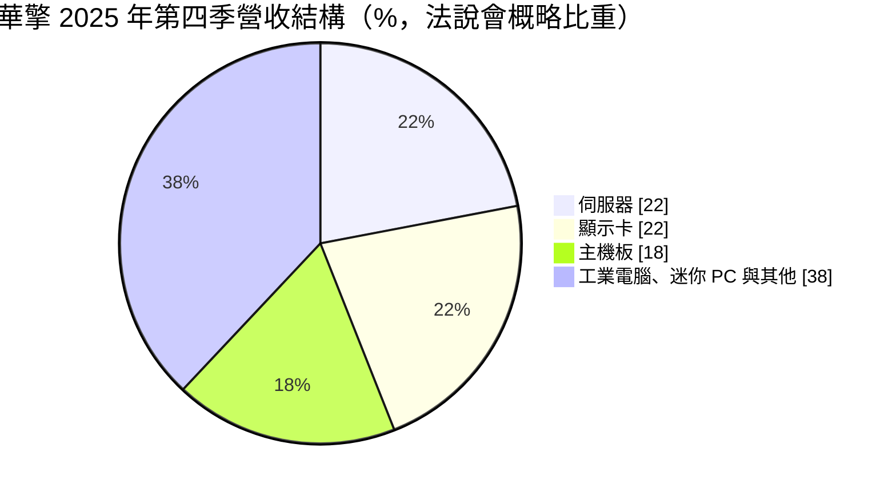
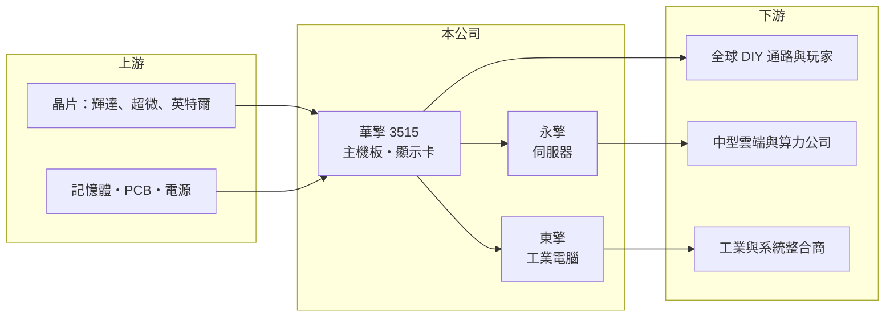

# 3515 華擎

> 上市｜[[產業索引-電腦及週邊設備業|電腦及週邊設備業]]｜上市（櫃）日期 2007/11/08

# 第一章：企業模式與商業藍圖

> [!info] 撰寫說明
> 精簡版，由 Claude 依公開資料整理，架構比照 [[2330台積電]]，資料截至 2026-10-08。來源：證交所開放資料（基本資料、2026 年第二季資產負債與綜合損益、股利、2026 年 8 月營收）、Goodinfo 經營績效頁、富果研究 2026 年 3 月 6 日法說會摘要。集團持股關係與工廠位置依整理性知識撰寫。#待校對

華擎原本是以高性價比著稱的 [[主機板]] 品牌，近年透過子公司把業務延伸到 [[AI 伺服器]] 與 [[工業電腦]]，2025 年營收接近倍增，是 PC 品牌廠轉型的代表案例。

（圓餅圖依法說會「伺服器與顯示卡各兩成以上、主機板低於兩成」的描述概估，其他類別為推算。）

- **核心業務：** 華擎成立於 2002 年，2007 年上市，以自有品牌 ASRock 銷售主機板、[[顯示卡]]、迷你 PC 與電競周邊，主要通路是全球 DIY 組裝市場。集團另有兩家子公司：永擎（ASRock Rack）負責伺服器與工作站，東擎（ASRock Industrial）負責工業電腦。華擎與 [[4938和碩]] 有集團淵源，最早由華碩體系分出（待校對）。
- **營收結構：** 依 2026 年 3 月法說會，2025 年第四季伺服器與顯示卡各占營收兩成以上，主機板已降到兩成以下，不再是最大產品。2025 年伺服器營收中有八成以上是 AI 伺服器，公司預估 2026 年降到七至八成，因一般伺服器也在成長。這代表華擎的營收重心已由消費性 DIY 轉向資料中心。
- **營運據點：** 總部在台灣，AI 伺服器客戶以美國、日本、歐洲的中型與新創算力公司為主。公司要求 AI 伺服器客戶出貨前全額付款，作為對新創客戶信用風險的控管。工廠位置本次未查得。
- **長期方向：** 公司策略是降低對主機板的依賴，擴大伺服器與工業電腦。伺服器端以 NVIDIA B300 為 2026 年主力，並自 2026 年 3 月起小量出貨 ASIC 伺服器；工業電腦端預期 2026 年大幅成長。消費端則推出一體式水冷散熱器等電競周邊，延伸品牌價值。

# 第二章：護城河深度與競爭優勢

華擎的護城河是品牌與通路、主機板設計能力，以及面對中型雲端客戶時的彈性，但在伺服器市場的規模遠小於一線代工廠。

- **競爭優勢：** 主機板與伺服器主板的電路設計能力是共通的，華擎可以把消費性主機板的研發快速轉用到伺服器與工業電腦，這是 PC 品牌廠跨入伺服器的基礎。在 AI 伺服器市場，大型雲端業者多由大型 [[ODM]] 服務，華擎則服務需要彈性客製、量不大的中型算力公司，這個利基讓它在 2025 年快速放量。
- **主要對手：** 主機板與顯示卡市場的對手為 [[2357華碩]]、[[2376技嘉]]、[[2377微星]]、[[2399映泰]]；伺服器品牌與準系統方面有 [[2376技嘉]]、美超微（Supermicro）與 [[2382廣達]]、[[6669緯穎]] 等代工廠；工業電腦則面對 [[2395研華]]、[[6166凌華]] 等。
- **觀察重點：** 第一是 AI 伺服器客戶群是否持續分散，降低單一客戶資金時點造成的出貨波動。第二是毛利率能否從 2025 年第四季的 13% 回升，代表伺服器規模化後的定價能力。第三是工業電腦子公司能否成為穩定的第三支柱。

# 第三章：財務體質與盈利規模

資料日期：2026-10-08，表格是撰寫當時的快照；最新月營收、毛利率、累計 EPS 由自動排程寫在本筆記的屬性欄位（月營收、毛利率、累計EPS 等）。#待校對

華擎的財務特色是營收規模在 AI 伺服器帶動下躍升，但毛利率因伺服器零組件成本高而下降，屬於「以量換利」的轉型。

| 年度 | 營收（億元） | [[毛利率]] | [[營業利益率]] | EPS（元） | [[ROE]] |
|---|---|---|---|---|---|
| 2020 | 179 | 21.5% | 10.4% | 11.30 | 21.9% |
| 2021 | 198 | 28.2% | 15.5% | 19.67 | 30.6% |
| 2022 | 171 | 21.6% | 6.92% | 8.69 | 13.9% |
| 2023 | 190 | 20.2% | 6.04% | 7.54 | 11.0% |
| 2024 | 257 | 19.0% | 6.52% | 10.54 | 16.4% |
| 2025 | 478 | 13.5% | 5.74% | 15.28 | 18.6% |
| 2026 上半年 | 234.8 | 17.1% | 8.0% | 7.10 | 半年，不年化 |

（2020 至 2025 年取自 Goodinfo；2026 上半年依證交所第二季綜合損益計算。）

- **營收規模：** 2020 至 2025 年營收由 179 億元成長到 478 億元，年複合成長率約 21.7%，其中 2025 年年增 86%。2026 年 1 至 8 月累計營收 339 億元、年增約 17%。
- **獲利：** 近五年平均 ROE 約 18.1%。2021 年疫情與挖礦需求帶來 28% 毛利率高峰，之後逐年下滑到 2025 年的 13.5%，主因是伺服器外購零組件比重高。2026 年上半年毛利率回升到 17.1%、營業利益率 8.0%，但營業利益 18.9 億元中有相當部分歸屬非控制權益，歸屬母公司淨利為 8.8 億元。
- **財務結構：** 2026 年第二季底總資產 316.8 億元、負債 166.0 億元，負債幾乎全為流動負債，與伺服器備料、應付帳款及客戶預收款有關。歸屬母公司權益 116.2 億元，非控制權益約 34.5 億元，反映永擎辦理現金增資引進外部股東。2025 年底存貨約 132 億元。2025 年度現金股利 11 元，配息率約 72%。
- **[[ROIC]] 與 [[WACC]]：** 2025 年營業利益 27.45 億元，稅後約 22.0 億元；有息負債未查得，以權益總計 150.7 億元計算 ROIC 上限約 14.6%，若計入短期借款實際可能落在 11% 至 14%（推算）。WACC 以 CAPM 推估：無風險利率 1.75%、市場風險溢酬 6%，AI 伺服器營收波動大，β 假設 1.2，股權成本約 8.95%；負債成本假設 2.5%（稅後 2%）、有息負債占比約一成，WACC 約 8% 至 8.5%（推算）。ROIC 高於 WACC 約 3 至 6 個百分點，代表轉型後仍在創造價值，但存貨規模大，資本效率對出貨節奏很敏感。

# 第四章：總體風險與地緣政治

華擎的主要風險來自 AI 伺服器出貨波動、客戶信用與零組件供應，以及 PC 本業的長期萎縮。

- **產業週期：** 主機板與顯示卡屬消費性電子，需求隨 PC 換機潮、新平台推出與加密貨幣挖礦等因素起伏，2022 至 2023 年就經歷明顯衰退。AI 伺服器則受雲端與算力公司的資本支出影響，景氣反轉時訂單可能快速縮減。
- **營運風險：** AI 伺服器客戶以中型與新創公司為主，資金到位時點會影響出貨，公司雖要求全額預付以降低呆帳，但季度營收仍可能大幅波動。GPU 與記憶體供應吃緊或漲價時，備料與存貨跌價風險也會升高。
- **其他風險：** 記憶體漲價已讓公司預期 2026 年主機板營收雙位數下滑。美國對 AI 晶片的出口管制、關稅政策與新台幣匯率，都會影響伺服器的出貨地區與獲利。

# 專有名詞解析

## 應用

- **[[AI 伺服器]]**：搭載 GPU 等加速晶片、用於訓練與推論 AI 模型的伺服器，對散熱與電源規格要求很高。

## 產業

- **[[主機板]]**：電腦中連接處理器、記憶體與各種介面的主要電路板，決定一台電腦能支援的規格。
- **[[顯示卡]]**：搭載繪圖晶片、負責影像運算與輸出的擴充卡，也用於 AI 與加密貨幣運算。
- **[[工業電腦]]**：用於工廠自動化、交通、醫療等場域的電腦，強調長期供貨、耐用與穩定。
- **[[ODM]]**：原廠委託設計製造，代工廠負責設計與生產，再以客戶的品牌出貨。

# 核心供應鏈

- 上游：[[NVDA輝達]]、[[AMD超微]]、[[INTC英特爾]] 等晶片廠，記憶體、PCB 與電源供應商；集團關係企業 [[4938和碩]]（待校對）。
- 下游／客戶：全球 DIY 通路與玩家、美日歐中型雲端與算力公司、工業系統整合商（未具名）。
- 同業：[[2357華碩]]、[[2376技嘉]]、[[2377微星]]、[[2399映泰]]、[[6150撼訊]]、[[2395研華]]、美超微。

## 最新新聞
<!-- news:start -->
<!-- news:end -->

## 相關連結
- [公開資訊觀測站](https://mopsov.twse.com.tw/mops/web/t05st03?step=1&firstin=1&co_id=3515)
- [Goodinfo](https://goodinfo.tw/tw/StockDetail.asp?STOCK_ID=3515)
- [Yahoo 股市](https://tw.stock.yahoo.com/quote/3515)
- [鉅亨網新聞](https://www.cnyes.com/twstock/3515/news)
