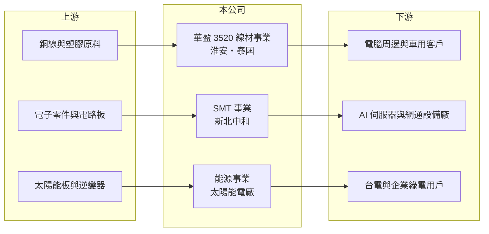

# 3520 華盈

> 上櫃｜[[產業索引-電子零組件業|電子零組件業]]｜上市（櫃）日期 2007/10/12

# 第一章：企業模式與商業藍圖

> [!info] 撰寫說明
> 精簡版，由 Claude 依公開資料整理，架構比照 [[2330台積電]] 的四章研究，資料截至 2026-10-08。來源：Goodinfo 經營績效頁、富果研究 2025 年 11 月法說會摘要、櫃買中心開放資料快照（基本資料、2026 年第二季損益與資產負債、本益比殖利率）。公開資料有限，三大事業的營收比重與客戶名單未查得。開放資料的實收資本額（約 8.38 億元）與資產負債表股本（約 6.88 億元）不一致，原因未查得。#待校對

華盈電子是一家同時經營線材、電子組裝代工與太陽能電廠的小型公司，三項業務的性質差異很大。本章說明它的業務組成。

- **核心業務：** 華盈成立於 1986 年，2007 年上櫃，原本以線材為主業。線材事業生產通訊線、訊號線、SATA、Type-C、USB 線與電源線、車用線，主要用於電腦周邊。2021 年後成立電子零件 [[SMT]] 事業，在新北市中和替客戶做表面黏著與插件加工，取得 IATF 16949、ISO 13485 等車用與醫療認證。
- **營收結構：** 三大事業的營收比重未查得。依法說會說法，SMT 事業的成長動能來自 AI 相關伺服器與高階網通設備，能源事業則來自企業節能減碳需求。公司表示三個事業過去八季都呈現正成長。
- **營運據點：** 線材工廠位於中國江蘇淮安與泰國春武里府，SMT 位於新北市中和，能源事業以新北市三重為基地，從事[[太陽能電廠]]的建置、維運與自營。泰國廠讓公司在美中貿易衝突下可以提供中國以外的產地。
- **長期方向：** 公司的策略是全球布局、自動化生產與發展淨零能源業務。2026 年營收目標為年增 10% 至 15%，電子事業以 AI 高階網通需求為主要動能，能源事業則靠新電廠建置與自營電廠的穩定售電收入。

# 第二章：護城河深度與競爭優勢

華盈的三項業務各自面對不同的競爭者，規模都不大。本章分析它的競爭條件。

- **競爭優勢：** 線材事業擁有中國與泰國雙產地，能配合客戶的供應鏈分散需求。SMT 事業取得車用與醫療認證，可承接品質要求高、價格敏感度較低的訂單。太陽能電廠的自營售電收入屬於長期合約型收入，可在電子景氣低迷時提供穩定現金流。
- **主要對手：** 線材領域的同業有 [[6290良維]]、[[3501維熹]]、[[3665貿聯-KY]] 等；SMT 代工面對大量中小型電子組裝廠；太陽能電廠建置與維運則有 [[6443元晶]] 等能源業者。華盈在每個領域都不是規模領先者。
- **觀察重點：** 第一，SMT 事業能否持續取得 AI 網通相關訂單、提高整體毛利率。第二，自營太陽能電廠的裝置容量與售電收入規模。第三，營業利益率能否穩定在 2% 以上。

# 第三章：財務體質與盈利規模

資料日期：2026-10-08，表格是撰寫當時的快照；最新月營收、毛利率、累計 EPS 由自動排程寫在本筆記的屬性欄位（月營收、毛利率、累計EPS 等）。#待校對

華盈的營收成長明顯，但毛利率低、本業獲利接近損益兩平。本章用多年度數據說明。

| 年度 | 營收（億元） | [[毛利率]] | [[營業利益率]] | EPS（元） | [[ROE]] |
|---|---|---|---|---|---|
| 2021 | 6.20 | 11.3% | 0.17% | 0.13 | 2.49% |
| 2022 | 10.0 | 15.7% | 2.11% | 1.49 | 13.4% |
| 2023 | 8.36 | 15.4% | -0.76% | 0.06 | 0.48% |
| 2024 | 11.0 | 14.5% | 1.62% | 0.29 | 2.44% |
| 2025 | 12.1 | 13.3% | 0.22% | -0.10 | -0.95% |
| 2026 上半年 | 6.27 | 11.1% | -0.8% | -0.18 | 未查得 |

- **營收規模：** 2021 至 2025 年營收從 6.2 億元成長到 12.1 億元，年複合成長率約 18.2%（推算），是本批公司中成長較快的一家，來自 SMT 與能源事業的擴張。2026 年上半年營收約 6.27 億元，維持成長。
- **獲利：** 毛利率長期在 11% 至 16%，營業利益率多在 0% 至 2% 之間，本業幾乎只能打平。2025 年前三季因美元貶值、新台幣升值產生約 1,700 萬元匯損，每股約減少 0.26 元。2022 年 EPS 1.49 元明顯高於本業水準，推估來自匯兌或業外收益（推估）。近 5 年平均 ROE 約 3.6%（推算）。
- **財務特色：** 2026 年第二季末母公司權益約 7.95 億元、負債約 7.56 億元，負債比約 49%，高於一般電子零組件廠。非流動負債約 3.07 億元，推估與太陽能電廠的長期融資有關（推估）。近年未發放現金股利。

**[[ROIC]] 與 [[WACC]]：** 有息負債明細未查得，假設約 4 億元（推估）。2025 年營業利益僅約 0.03 億元，稅後約 0.02 億元，投入資本以母公司權益 8.0 億元加有息負債 4 億元，約 12 億元，ROIC 約 0.2%（推算）；2022 年較好的年度也只有約 1.4%（推算）。WACC 用 CAPM 推估：無風險利率 1.75%、市場風險溢酬 6%、β 取 0.9（電子零組件小型股常見值，假設），股東權益成本約 7.2%；負債成本 3%、稅率 20%，以權益 67%、負債 33% 加權，WACC 約 5.6%（推算）。結論是華盈的 ROIC 長期遠低於 WACC，營收成長並未帶來價值創造，必須大幅提升毛利率才能改善。

# 第四章：總體風險與地緣政治

華盈的風險在於低毛利、匯率與能源事業的資本密集。本章整理主要風險。

- **產業週期：** 線材需求跟著電腦周邊景氣走，SMT 訂單則受 AI 網通設備的拉貨節奏影響，兩者都有明顯的庫存週期。毛利率低，景氣轉弱時很容易轉為虧損。
- **營運風險：** 太陽能電廠需要大量前期資本與長期融資，負債比已接近五成，若利率上升或電廠收益不如預期，財務壓力會增加。三項業務性質不同，管理資源分散。
- **其他風險：** 外銷以美元計價，新台幣升值會造成匯損並壓低毛利率；銅價上漲也會壓縮線材毛利。綠電躉售費率與法規變動會影響能源事業的報酬。

# 專有名詞解析

## 金融

- **[[ROIC]]**：投入資本報酬率，稅後營業利益除以股東權益加有息負債，衡量本業運用資本的效率。
- **[[WACC]]**：加權平均資金成本，股東權益成本與負債成本依資本結構加權，是 ROIC 必須超越的門檻。

## 產業

- **[[SMT]]**：表面黏著技術，把電子零件直接焊在電路板表面的組裝製程，是電子產品組裝的主要方式。
- **[[太陽能電廠]]**：以太陽能板發電並售電的電廠，可躉售給台電或以綠電轉供給企業，收入隨日照與合約電價而定。

# 核心供應鏈

- 上游：銅線與塑膠原料、電子零件與電路板、太陽能板與逆變器供應商（推估）。
- 下游／客戶：電腦周邊與車用客戶、AI 伺服器與高階網通設備廠、台電與企業綠電用戶（客戶名單未查得）。
- 同業：[[6290良維]]、[[3501維熹]]、[[3665貿聯-KY]]、[[6443元晶]]。

## 最新新聞
<!-- news:start（自動產生，請勿手動編輯此範圍） -->
- 2026-10-12 🏛️ 重訊 18:30｜代子公司Pors Wiring Co., Ltd公告- 依公開發行公司資金貸與及背書保證處理準則 第二十二條第一項第三款公告｜[觀測站](https://mops.twse.com.tw/mops/#/web/t05st01)
- 2026-10-12 🏛️ 重訊 18:30｜代子公司Pors Wiring Co., Ltd.公告- 依公開發行公司資金貸與及背書保證處理準則 第二十二條第一項第一款公告｜[觀測站](https://mops.twse.com.tw/mops/#/web/t05st01)

完整紀錄：[[3520華盈 新聞]]
<!-- news:end -->

## 相關連結
- [公開資訊觀測站](https://mopsov.twse.com.tw/mops/web/t05st03?step=1&firstin=1&co_id=3520)
- [Goodinfo](https://goodinfo.tw/tw/StockDetail.asp?STOCK_ID=3520)
- [Yahoo 股市](https://tw.stock.yahoo.com/quote/3520)
- [鉅亨網新聞](https://www.cnyes.com/twstock/3520/news)
