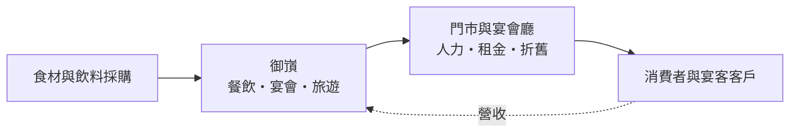
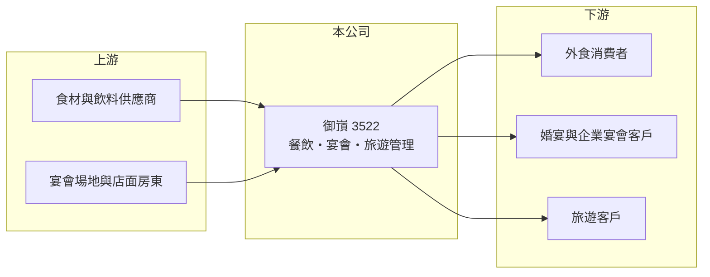

# 3522 御嵿

> 上櫃｜[[產業索引-觀光餐旅|觀光餐旅]]｜上市（櫃）日期 2007/10/15

# 第一章：企業模式與商業藍圖

> [!info] 撰寫說明
> 本文由 Claude 依公開資料整理，架構比照 [[2330台積電]] 的四章研究，資料截至 2026-10-08。財務數字來源：櫃買中心開放資料（基本資料、2026 年第二季資產負債表與綜合損益表）、Goodinfo 年度經營績效頁、nStock 公司簡介；公開資料有限，查不到各事業的營收比重與門市數，產業描述為整理性內容，尚未逐條比對原始文件。#待校對

在評估單一個股的長期投資價值時，首要步驟是拆解企業的底層獲利邏輯。本章說明御嵿國際（股票代號：3522，以下簡稱御嵿）如何從光電公司轉型為餐飲與宴會服務業者，以及這個轉型目前走到哪一步。

## 一、核心定位：由光電殼轉型的餐飲服務公司

御嵿於 2001 年 9 月設立，原名宏森光電科技，2007 年 10 月在櫃買中心上櫃。2018 年 6 月股東會決議更名為御頂國際，2024 年 6 月再更名為御嵿國際，產業別歸入觀光餐旅。名稱更迭反映的是一段完整的[[轉型]]：原本的光電本業逐步退出，公司改以餐飲為主要營收來源。

依 nStock 整理的營業項目，御嵿目前經營四類業務：餐飲服務經營與管理、旅遊及飯店管理、喜慶綜合服務（宴會與婚宴），以及食品什貨批發。實收資本額約 10.4 億元，其中約 3,537 萬股為[[私募]]股，代表公司在轉型過程中多次引進特定投資人增資。

## 二、資本轉化邏輯：餐飲毛利高，但費用吃掉獲利

餐飲業的商業邏輯是用食材加上人力、場地，換取高於原料成本的售價。御嵿的[[毛利率]]長期維持在 41% 至 49%，說明菜色定價本身足以覆蓋食材成本；問題出在營業費用，也就是人事、租金與行銷支出。2026 年上半年營收 6.84 億元、毛利 3.40 億元，但營業費用達 3.82 億元，營業虧損 0.42 億元。這說明公司目前的規模還不足以攤平總部與門市的固定開銷；反過來說，餐飲業有明顯的[[營運槓桿]]，一旦營收跨過損益平衡點，增加的毛利大多能直接轉為利潤。

## 三、長期方向

御嵿的營收從 2021 年的 6.13 億元成長到 2025 年的 11.50 億元，四年間接近翻倍，顯示營運規模確實在擴大。長期來看，公司要證明的是兩件事：第一，營收成長能否帶來規模經濟，讓費用率下降到可以轉虧為盈的水準；第二，宴會、餐飲與旅遊等多角化業務之間能否產生客源與採購上的綜效，而不是各自分散資源。

# 第二章：護城河深度與競爭優勢

「護城河」指企業抵禦競爭、維持超額利潤的保護機制。餐飲業進入門檻低、競爭極度分散，本章說明御嵿的相對優勢與目前的限制。

## 一、相對優勢

御嵿的優勢主要在於「宴會加餐飲」的組合。喜宴與企業宴會單筆金額高、需要提前預訂，可以提供較可預期的現金流入；一般餐飲則可以利用同一套廚房與採購系統，攤提固定成本。公司營收在四年內接近翻倍，代表品牌與據點有一定的市場接受度。不過以目前持續虧損的狀況來看，這些優勢尚未轉化為定價權或成本優勢，只能算是窄幅、尚待驗證的競爭力。

## 二、主要競爭對手

| 對手 | 定位 | 對御嵿的威脅 |
|---|---|---|
| [[2727王品]] | 多品牌連鎖餐飲龍頭 | 品牌與展店資源遠大於御嵿，爭奪同一批外食客群 |
| [[1268漢來美食]] | 飯店級餐飲與宴會 | 在中高價宴會與自助餐市場直接競爭 |
| [[2748雲品]] | 飯店經營與宴會 | 婚宴與企業宴會場地競爭 |
| 地方型宴會餐廳 | 深耕在地、價格彈性大 | 以低價搶婚宴與尾牙訂單 |

## 三、守得住／守不住／觀察重點

守得住的是宴會業務的預訂特性，以及已經累積的營收規模。守不住的是費用結構：只要人力與租金成本持續上升，而營收成長放緩，虧損就難以收斂。長期觀察重點是營業費用率能否逐年下降、宴會廳與門市的坪效是否提升，以及公司是否停止依靠增資填補虧損。

# 第三章：財務體質與盈利規模

資料日期：2026-10-08，表格是撰寫當時的快照；最新月營收、毛利率、累計 EPS 由自動排程寫在本筆記的屬性欄位（月營收、毛利率、累計EPS 等）。#待校對

財務報表是檢驗護城河是否真實存在的最終標準。本章用六年的三率、ROE 與資本報酬檢視御嵿的獲利品質。

## 一、多年度經營績效

| 年度 | 營收（新台幣） | [[毛利率]] | [[營業利益率]] | EPS（元） | [[ROE]] |
|---|---|---|---|---|---|
| 2020 | 9.69 億 | 49.1% | -27.0% | -6.19 | -40.9% |
| 2021 | 6.13 億 | 41.3% | -52.8% | -6.64 | -77.7% |
| 2022 | 6.54 億 | 42.6% | -29.3% | -2.46 | -33.0% |
| 2023 | 7.34 億 | 48.5% | -14.9% | -2.06 | -21.9% |
| 2024 | 9.00 億 | 47.3% | -22.0% | -2.28 | -28.7% |
| 2025 | 11.50 億 | 44.2% | -18.8% | -2.66 | -44.9% |
| 2026 上半年 | 6.84 億 | 49.6% | -6.2% | -0.49 | 未查得 |

資料來源：2020 至 2025 年為 Goodinfo，2026 上半年為櫃買中心開放資料。

六年來御嵿每年都是營業虧損，但虧損幅度有收斂的跡象：營業利益率從 2021 年疫情期間的 -52.8% 改善到 2025 年的 -18.8%，2026 年上半年進一步縮小到約 -6%。不過 ROE 仍在 -20% 到 -78% 之間，2021 至 2025 年平均約 -41%（推算），代表股東權益持續被虧損侵蝕。2021 至 2025 年營收年複合成長率約 17%（推算），成長性不錯，但仍是「有營收、沒獲利」的階段。近五年沒有配發現金股利。

## 二、財務結構

2026 年第二季底，御嵿總資產 23.7 億元、負債 16.5 億元，負債比約 70%；流動資產 6.8 億元低於流動負債 9.8 億元，短期資金調度偏緊。保留盈餘為 -4.6 億元，累積虧損已達股本的四成以上，每股淨值 6.85 元，低於面額 10 元。

## 三、[[ROIC]] 與 [[WACC]]：價值創造利差

**ROIC 推算：** 2025 年營業虧損約 2.16 億元（11.50 億 × -18.8%），虧損年度不計稅盾。2026 年第二季底權益總計約 7.19 億元，負債 16.5 億元中假設一半為有息負債約 8.25 億元（推估），投入資本約 15.4 億元，ROIC 約 -14%（推算）。

**WACC 推算：** 台灣 10 年期公債取 1.75%、市場風險溢酬 6%、β 取虧損型餐飲股常見值 1.0，股東權益成本約 7.75%；負債成本假設 3.5%，因為虧損無法抵稅，以稅前計；權益占投入資本約 47%、負債約 53%，WACC 約 5.5%（推算）。

**結論：** ROIC 為負，與 WACC 之間有約 20 個百分點的落差，代表公司目前每投入一元資本都在消耗價值。只有在營業費用率明顯下降、營業利益轉正之後，才談得上創造價值。

# 第四章：總體風險與地緣政治

任何企業都無法脫離宏觀環境獨立存在。本章分析御嵿長期必須面對的風險。

## 一、持續虧損與財務風險

御嵿連續多年營業虧損，累積虧損已侵蝕大量股本，流動比率低於 100%。若虧損無法收斂，公司可能需要再次增資或[[減資彌補虧損]]，對既有股東造成稀釋或持股數減少。

## 二、人力與成本風險

餐飲與宴會業高度依賴第一線人力，台灣基本工資逐年調升與服務業缺工，會直接推高營業費用。食材價格與租金同樣是難以轉嫁的成本，在消費力轉弱時更難調漲售價。

## 三、需求與景氣風險

宴會業務受結婚對數、企業尾牙預算與景氣影響。台灣結婚對數長期呈下降趨勢，喜宴市場的總量成長有限，業者只能靠搶市占或提高客單價成長。疫情期間 2021 年營收大減 37% 的經驗也顯示，突發公共衛生事件對餐飲業的衝擊極大。

# 專有名詞解析

## 金融

- **[[營運槓桿]]**：固定成本占比高時，營收小幅變動就會讓獲利大幅增減；營收萎縮時虧損也會被放大。
- **[[減資彌補虧損]]**：公司以減少股本的方式沖銷累積虧損，股東持股數減少但持股比例不變，常見於長期虧損的公司。
- **[[私募]]**：公司向特定投資人發行新股籌資，通常有轉讓限制，常被用來引進策略股東。
- **[[ROIC]]**：投入資本報酬率，稅後營業利益除以股東權益加有息負債，衡量本業運用資本的效率。
- **[[WACC]]**：加權平均資金成本，股東與債權人要求報酬率的加權平均，是 ROIC 要超越的門檻。

## 產業

- **[[轉型]]**：企業把主要業務從原產業移往新產業，過程中營收與獲利常出現斷層。

# 核心供應鏈

## 1. 上游：食材與場地
- 肉品、海鮮、蔬果與飲料供應商；宴會廳與門市的店面租賃

## 2. 中游：御嵿本身
- 餐飲經營、喜慶宴會、旅遊及飯店管理、食品批發

## 3. 下游與同業
- 客戶：外食消費者、婚宴與企業宴會客戶
- 同業：[[2727王品]]、[[1268漢來美食]]、[[2748雲品]]、[[2729瓦城]]

## 最新新聞
<!-- news:start（自動產生，請勿手動編輯此範圍） -->
- 2026-10-07 🏛️ 重訊 10:40｜澄清媒體報導｜[觀測站](https://mops.twse.com.tw/mops/#/web/t05st01)

完整紀錄：[[3522御嵿 新聞]]
<!-- news:end -->

## 相關連結
- [公開資訊觀測站](https://mopsov.twse.com.tw/mops/web/t05st03?step=1&firstin=1&co_id=3522)
- [Goodinfo](https://goodinfo.tw/tw/StockDetail.asp?STOCK_ID=3522)
- [Yahoo 股市](https://tw.stock.yahoo.com/quote/3522)
- [鉅亨網新聞](https://www.cnyes.com/twstock/3522/news)
