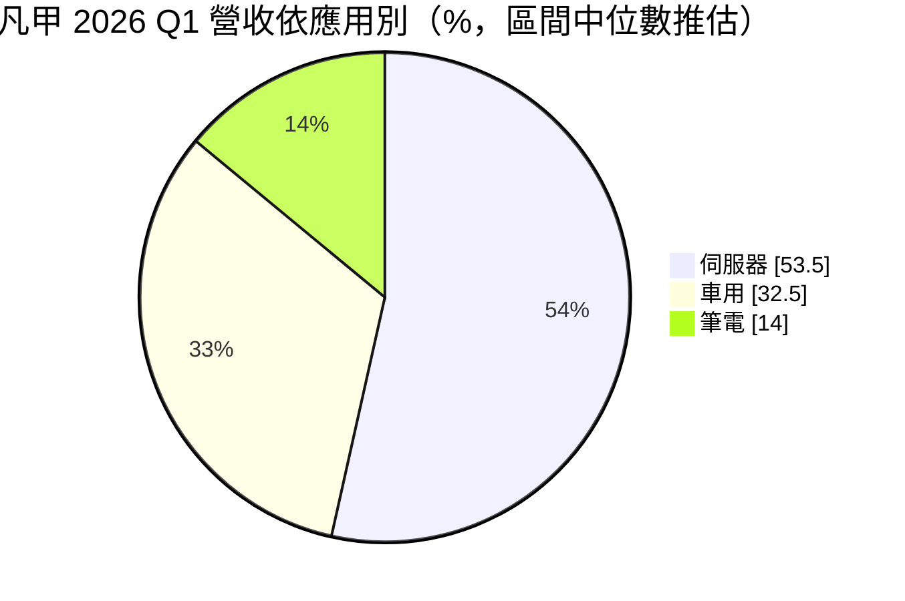
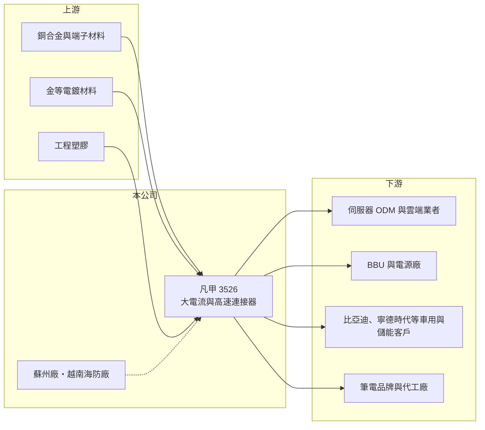

# 3526 凡甲

> 上櫃｜[[產業索引-電子零組件業|電子零組件業]]｜上市（櫃）日期 2007/11/02

# 第一章：企業模式與商業藍圖

> [!info] 撰寫說明
> 精簡版，由 Claude 依公開資料整理，架構比照 [[2330台積電]] 的四章研究，資料截至 2026-10-08。來源：Goodinfo 經營績效頁、vocus 2026 年 7 月法說會整理文、櫃買中心開放資料快照（基本資料、2026 年第二季損益與資產負債、本益比殖利率）。法說會僅提供應用別區間，圓餅圖取區間中位數。#待校對

凡甲是高毛利的[[連接器]]廠，產品集中在伺服器與車用，近年因 [[AI 伺服器]]的大電流需求而快速成長。本章說明它的產品與布局。

- **核心業務：** 凡甲成立於 1998 年，2007 年上櫃，生產高電流與高速傳輸連接器。代表產品包括 AI 伺服器用的盲插大功率連接器（1,200W 至 4,200W，單模組最高 140A）、資料中心 [[BBU]] 連接器（125A 至 140A），以及 PCIe Gen 6 高速內部連接，Gen 7 與單通道 200G/400G 傳輸正在開發。車用與儲能則有免焊防水連接器等產品。
- **營收結構：** 依 2026 年第一季法說，伺服器約占 50% 至 57%、車用約 30% 至 35%，其餘為筆電，管理層預期筆電持平或略減。儲能沒有單獨揭露，毛利率與車用相近、略低於伺服器。AI 伺服器功耗大增，電源連接器的電流規格與單價同步提高，是凡甲成長的核心動力。
- **營運據點：** 中國蘇州是主要生產基地，越南北部海防廠主要服務美國客戶、產能接近滿載，2026 年 6 月取得 [[IATF 16949]] 車用認證，並準備承接客戶從中國移出的車用、儲能與筆電訂單。
- **長期方向：** 公司 2026 年的重點是 AI 伺服器產品，同時發展銅纜與光通訊兩種高速互連方案，暫不投入人形機器人以集中研發資源。車用方面，客戶包括比亞迪與寧德時代，中國 2026 年 7 月起實施的電動車電池安全新規被視為成長動能。

# 第二章：護城河深度與競爭優勢

凡甲的毛利率長期接近五成，在台灣連接器廠中屬於頂尖水準，顯示它有明顯的技術與規格優勢。本章分析它的護城河。

- **競爭優勢：** 第一，大電流連接器要在極小空間內承受上百安培電流而不過熱，涉及材料、鍍層與結構設計，技術門檻高於一般訊號連接器。第二，伺服器與車用連接器都需經客戶長期驗證，一旦[[設計導入]]就能隨平台出貨多年。第三，公司以選擇性電鍍與噴鍍降低金的用量，在原料成本上漲時仍能維持高毛利。
- **主要對手：** 台灣同業有 [[3533嘉澤]]、[[3023信邦]]、[[6197佳必琪]]、[[3605宏致]]、[[2392正崴]]，國際大廠有安費諾與泰科電子。凡甲的規模小於這些大廠，但在 AI 伺服器電源連接器這個利基上具有領先地位。
- **觀察重點：** 第一，AI 伺服器世代交替時，新平台的大電流連接器能否持續設計導入。第二，越南廠擴充能否承接中國以外的訂單。第三，毛利率能否維持在 50% 左右。

# 第三章：財務體質與盈利規模

資料日期：2026-10-08，表格是撰寫當時的快照；最新月營收、毛利率、累計 EPS 由自動排程寫在本筆記的屬性欄位（月營收、毛利率、累計EPS 等）。#待校對

凡甲的財報同時具備高毛利、高 ROE 與高配息，是連接器產業中獲利品質最好的公司之一。本章用多年度數據說明。

| 年度 | 營收（億元） | [[毛利率]] | [[營業利益率]] | EPS（元） | [[ROE]] |
|---|---|---|---|---|---|
| 2021 | 26.2 | 46.7% | 27.2% | 11.19 | 27.0% |
| 2022 | 23.1 | 46.4% | 25.0% | 9.41 | 22.1% |
| 2023 | 23.9 | 51.3% | 30.7% | 11.68 | 26.9% |
| 2024 | 32.1 | 52.6% | 32.9% | 16.80 | 31.8% |
| 2025 | 39.3 | 49.9% | 32.5% | 16.97 | 27.6% |
| 2026 上半年 | 23.1 | 48.9% | 31.3% | 9.08 | 未查得 |

- **營收規模：** 2021 至 2025 年營收從 26.2 億元成長到 39.3 億元，年複合成長率約 10.7%（推算），2024 年起的加速主要來自 AI 伺服器。2026 年上半年營收約 23.1 億元，延續成長。
- **獲利：** 毛利率長期在 46% 至 53%，營業利益率維持在 25% 至 33%，即使在 2022 年景氣較弱時也沒有明顯下滑，代表產品定價能力強。近 5 年平均 ROE 約 27.1%（推算），在電子零組件業中非常突出。2026 年上半年 EPS 9.08 元。
- **財務特色：** 2025 年度配息率約 99.6%，以盈餘配發 13.58 元加資本公積 3.32 元，合計約 16.9 元，幾乎把獲利全數發還股東。2026 年第二季末母公司權益約 41.4 億元、負債約 35.1 億元，負債比約 46%，其中非流動負債約 13.5 億元，可能與擴產融資有關（推估）。

**[[ROIC]] 與 [[WACC]]：** 有息負債明細未查得，假設約 10 億元（推估）。2025 年營業利益約 12.8 億元，稅後約 10.2 億元，投入資本以母公司權益 41.4 億元加有息負債 10 億元，約 51.4 億元，ROIC 約 20%（推算）。WACC 用 CAPM 推估：無風險利率 1.75%、市場風險溢酬 6%、β 取 1.1（AI 伺服器零組件股常見值，假設），股東權益成本約 8.4%；負債成本 2.5%、稅率 20%，以權益 80%、負債 20% 加權，WACC 約 7.1%（推算）。結論是凡甲的 ROIC 長期遠高於 WACC，利差超過 10 個百分點，是持續創造價值的公司；高配息率也說明它不需要大量保留盈餘就能成長。

# 第四章：總體風險與地緣政治

凡甲的風險集中在產能地點、客戶集中與原料價格。本章整理主要風險。

- **產業週期：** 伺服器占營收一半以上，雲端業者資本支出放緩或 AI 伺服器世代交替時拉貨中斷，都會造成營收波動。車用業務則受電動車銷量與中國市場價格競爭影響。
- **營運風險：** 主要產能仍集中在中國蘇州，美中貿易衝突若升高，美國客戶可能要求更多非中國產能，越南廠的擴充速度是關鍵。AI 伺服器連接器規格演進很快，若新世代平台未能導入，市占可能被大廠取代。
- **其他風險：** 銅與金價格高漲會壓縮毛利率，公司以減少用金的電鍍技術因應。月營收容易受假期與客戶提前拉貨影響，短期波動不代表長期趨勢。匯率變動也會影響外銷獲利。

# 專有名詞解析

## 應用

- **[[AI 伺服器]]**：搭載 GPU 等加速晶片、用於訓練與推論 AI 模型的伺服器，對散熱與電源規格要求很高。
- **[[IATF 16949]]**：汽車產業的品質管理系統標準，車用零件供應商通常必須取得此認證才能進入車廠供應鏈。

## 金融

- **[[ROIC]]**：投入資本報酬率，稅後營業利益除以股東權益加有息負債，衡量本業運用資本的效率。

## 產業

- **[[連接器]]**：讓電子零件、模組或設備之間可插拔連接的元件，負責傳遞電力或訊號。
- **[[BBU]]**：備援電池單元，AI 伺服器機櫃在市電中斷時的短時供電裝置，可避免運算中斷。
- **[[設計導入]]**：零件被客戶選入產品設計並完成驗證，之後該產品量產期間都會持續採購，是零組件廠長期營收的來源。

# 核心供應鏈

- 上游：銅合金、端子材料、金等電鍍材料與工程塑膠供應商（推估）。
- 下游／客戶：中美雲端業者與伺服器 ODM、BBU 客戶、比亞迪、寧德時代、筆電客戶。
- 同業：[[3533嘉澤]]、[[3023信邦]]、[[6197佳必琪]]、[[3605宏致]]、[[2392正崴]]、安費諾、泰科電子。

## 最新新聞
<!-- news:start -->
<!-- news:end -->

## 相關連結
- [公開資訊觀測站](https://mopsov.twse.com.tw/mops/web/t05st03?step=1&firstin=1&co_id=3526)
- [Goodinfo](https://goodinfo.tw/tw/StockDetail.asp?STOCK_ID=3526)
- [Yahoo 股市](https://tw.stock.yahoo.com/quote/3526)
- [鉅亨網新聞](https://www.cnyes.com/twstock/3526/news)
