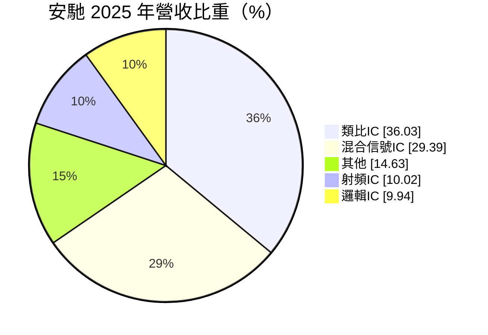
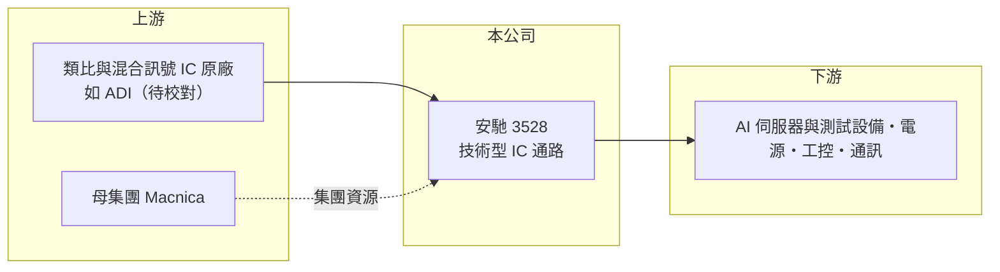

# 3528 安馳

> 上市｜[[產業索引-電子通路業|電子通路業]]｜上市（櫃）日期 2016/05/18

# 第一章：企業模式與商業藍圖

> [!info] 撰寫說明
> 精簡版，由 Claude 依公開資料整理，架構比照 [[2330台積電]]，資料截至 2026-10-08。來源：證交所開放資料（基本資料、2026 年第二季財報、股利、月營收備註）、Goodinfo 經營績效頁、MoneyDJ 基本資料（2025 年營收比重）、新電子（MEM）關於與 ADI 合作展示的報導標題。#待校對

安馳科技是日本半導體通路集團 Macnica 旗下的台灣子公司，專注於類比與混合訊號 IC 的代理。它的商業模式是「技術型通路」：靠工程師協助客戶設計導入，而非單純比價出貨，因此毛利率明顯高於一般通路商。

- **核心業務：** 安馳成立於 2000 年，2016 年上市，總部在新北市汐止。公司官網位於 Macnica 集團網域之下，發言人信箱也使用 Macnica 網域，顯示其為 Macnica 集團成員。主力是代理[[類比IC]]、[[混合訊號IC]]、射頻與邏輯 IC，媒體報導顯示 ADI 為重要合作原廠（待校對）。
- **營收結構：** 2025 年類比 IC 占 36.03%、混合訊號 IC 占 29.39%、射頻 IC（RFIC）占 10.02%、邏輯 IC 占 9.94%、其他占 14.63%。

- **應用市場：** 依 2026 年 8 月月營收備註，成長動能來自 AI 伺服器帶動的測試相關需求，以及週邊電源與工控應用。類比與混合訊號 IC 用於電源管理、感測、訊號轉換與精密量測，應用橫跨工業、通訊、車用與資料中心。
- **長期方向：** 類比 IC 產品生命週期長、客戶導入後多年持續採購，是通路業中最穩定的產品類別之一。AI 伺服器的電源與測試設備規格持續提升，對高精度類比元件的需求是安馳的長期成長來源。

# 第二章：護城河深度與競爭優勢

技術型通路商的護城河，來自原廠授權、工程師的設計導入能力，以及集團的全球資源。

- **競爭優勢：** 類比 IC 的導入需要 [[FAE]] 協助客戶完成電路設計，一旦設計定案，產品量產期間都會持續採購同一顆元件，形成[[設計導入]]的黏著度。背後的 Macnica 集團在日本與亞洲有完整的原廠關係，讓安馳在爭取代理權時有集團背書。
- **主要對手：** 大型通路商 [[3702大聯大]]、[[3036文曄]] 也代理類比 IC；技術型同業如 3048益登、3028增你強、8112至上 在特定原廠線上與安馳競爭。原廠直接服務大客戶，也會壓縮通路的空間。
- **觀察重點：** 2025 年營收從 52.9 億元跳升到 89.6 億元，但毛利率從 13% 降到 11.1%、EPS 從 4.16 元降到 2.30 元，顯示新增營收的利潤率較低。觀察重點在於高成長的 AI 相關訂單能否維持合理毛利。

# 第三章：財務體質與盈利規模

資料日期：2026-10-08，表格是撰寫當時的快照；最新月營收、毛利率、累計 EPS 由自動排程寫在本筆記的屬性欄位（月營收、毛利率、累計EPS 等）。#待校對

安馳的毛利率約 11% 至 16%，是一般電子通路商的兩到三倍，這是技術型通路商的財務特徵。

| 年度 | 營收（億元） | [[毛利率]] | [[營業利益率]] | EPS（元） | [[ROE]] |
|---|---|---|---|---|---|
| 2020 | 49.7 | 11.0% | 4.21% | 3.18 | 14.0% |
| 2021 | 62.8 | 12.1% | 5.45% | 4.57 | 17.9% |
| 2022 | 64.1 | 15.8% | 9.12% | 5.65 | 19.6% |
| 2023 | 63.0 | 11.1% | 6.05% | 1.70 | 5.74% |
| 2024 | 52.9 | 13.0% | 6.21% | 4.16 | 14.1% |
| 2025 | 89.6 | 11.1% | 6.84% | 2.30 | 7.85% |
| 2026 上半年 | 67.0 | 12.50% | 8.53% | 5.48 | 未查得 |

- **營收規模：** 2020 至 2025 年營收年複合成長率約 12.5%（推算）。2026 年前 8 個月營收約 91 億元，年增約 75%，已超過 2025 年全年（證交所月營收）。
- **獲利：** 近 5 年平均 ROE 約 13.0%（推算）。2023 年與 2025 年 EPS 明顯低於營業利益所示水準，與業外損失有關；2026 年上半年營業利益 5.72 億元，但業外損失 1.18 億元，可能來自匯兌或利息支出（推估）。
- **財務特色：** 2026 年第二季總資產 146.5 億元、負債 123.8 億元、權益僅 22.8 億元，負債比約 84%，營收快速成長使應付帳款與借款同步擴大。2025 年度配發現金股利 1.38 元，配發率約 60%。

**[[ROIC]] 與 [[WACC]]：** 有息負債未查得，以負債總額 40% 估約 49.5 億元（推算假設，實際上負債中可能有相當比例是對原廠與集團的應付帳款）。2025 年營業利益約 6.1 億元，稅後約 4.9 億元，除以權益 22.8 億元加有息負債 49.5 億元，ROIC 約 6.8%；2026 年上半年年化約 12.7%（推算）。WACC 以 CAPM 推估：無風險利率 1.75%、市場風險溢酬 6%、β 取 1.0（同業常見值），股權成本 7.75%；稅後負債成本 2%，股權占比約 31%，WACC 約 3.8%（推算）。ROIC 高於 WACC，代表公司在創造價值；但高槓桿讓帳面 WACC 偏低，若以股權成本 7.75% 衡量，價值創造幅度則取決於營業利益率能否維持在 7% 以上。

# 第四章：總體風險與地緣政治

安馳的風險集中在高槓桿下的成長、原廠集中度，以及 AI 需求的持續性。

- **產業週期：** 類比 IC 的週期相對溫和，但工控與車用在 2023 至 2024 年經歷明顯的庫存調整，安馳 2024 年營收從 63 億元降到 52.9 億元即為反映。AI 伺服器相關需求若放緩，2025 至 2026 年的高成長可能回落。
- **營運風險：** 營收集中在少數類比 IC 原廠，若原廠調整通路策略或集團內部重新分配代理權，對營收的影響會很大。負債比超過八成，營收快速擴張時的[[營運資金]]壓力也需留意。
- **其他風險：** 進貨以美元計價，匯率波動是業外損益的主要變數；美中科技管制可能影響中國客戶的出貨與部分原廠產品的銷售範圍。

# 專有名詞解析

## 半導體

- **[[類比IC]]**：處理電壓、電流、溫度等連續訊號的晶片，如電源管理、放大器，產品生命週期長、價格較穩定。
- **[[混合訊號IC]]**：同時處理類比與數位訊號的晶片，例如類比數位轉換器（ADC），常用於量測與通訊設備。

## 金融

- **[[營運資金]]**：存貨加應收帳款減應付帳款，是企業營運需要先墊付的資金，通路商營收成長時需求會同步增加。

## 產業

- **[[FAE]]**：現場應用工程師，協助客戶把原廠晶片設計進產品，是通路商技術附加價值的核心。
- **[[設計導入]]**：晶片被客戶選入產品設計並完成驗證，之後該產品量產期間都會持續採購，是通路商長期營收的來源。

# 核心供應鏈

- 上游：類比與混合訊號 IC 原廠（ADI 等，待校對）；母集團為日本 Macnica。
- 下游／客戶：AI 伺服器與測試設備、電源、工控與通訊設備廠。
- 同業：[[3702大聯大]]、[[3036文曄]]、3048益登、3028增你強、8112至上。

## 最新新聞
<!-- news:start -->
<!-- news:end -->

## 相關連結
- [公開資訊觀測站](https://mopsov.twse.com.tw/mops/web/t05st03?step=1&firstin=1&co_id=3528)
- [Goodinfo](https://goodinfo.tw/tw/StockDetail.asp?STOCK_ID=3528)
- [Yahoo 股市](https://tw.stock.yahoo.com/quote/3528)
- [鉅亨網新聞](https://www.cnyes.com/twstock/3528/news)
