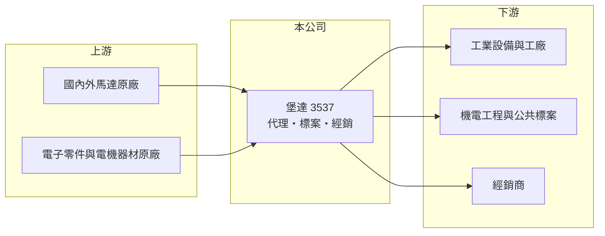

# 3537 堡達

> 上櫃｜[[產業索引-電子零組件業|電子零組件業]]｜上市（櫃）日期 2010/01/25

# 第一章：企業模式與商業藍圖

> [!info] 撰寫說明
> 精簡版，由 Claude 依公開資料整理，架構比照 [[2330台積電]] 的四章研究，資料截至 2026-10-08。來源：Goodinfo 經營績效頁、nStock 公司簡介、櫃買中心開放資料快照（基本資料、2026 年第二季損益與資產負債、本益比殖利率）。公開資料有限，代理品牌、產品別營收比重與客戶名單未查得。#待校對

堡達是以馬達、電子零件與電機器材進出口買賣為主的貿易商，營收規模多年穩定在 28 至 32 億元。本章說明它的業務型態。

- **核心業務：** 堡達成立於 1987 年，2010 年上櫃，總公司位於台北市中山區。依公司登記的營業項目，主要從事各種馬達、電子零件與電機器材的進出口買賣，業務包括替國內外廠商代理、參與標案與經銷。這種模式不需要自建大型工廠，主要價值在於原廠關係、備貨能力與客戶服務。
- **營收結構：** 產品別營收比重在本次查到的資料中沒有揭露。從營業項目推估，客戶涵蓋工業設備、機電工程與公共工程標案（推估）。毛利率長期在 14% 至 17%，符合貿易代理的利潤結構。
- **營運據點：** 以台灣為主（推估），合併報表包含子公司，但子公司名稱與業務未查得。2026 年第二季末總資產約 21.2 億元，其中負債約 8.3 億元，幾乎全為流動負債，代表資產負債表以應收帳款、存貨與應付帳款等營運項目為主。
- **長期方向：** 馬達與電機設備是工廠自動化、空調、水處理與能源設施的基本元件。長期成長取決於公司能否取得更多原廠代理、跟著台灣製造業與公共建設的投資擴大銷售，以及標案業務的得標率。

# 第二章：護城河深度與競爭優勢

貿易代理商的護城河來自原廠授權、客戶關係與交貨服務。本章分析堡達的競爭條件。

- **競爭優勢：** 堡達經營超過三十年，長期累積的原廠[[代理權]]與客戶關係是主要資產。機電設備客戶重視規格相容、交期與維修支援，一旦採用某一品牌，後續汰換與擴充通常沿用相同供應來源，帶來重複訂單。ROE 長期維持在 11% 至 21%，顯示輕資產的代理模式有不錯的資本效率。
- **主要對手：** 國內其他馬達與電機設備代理商、外商原廠在台分公司，以及馬達製造商 [[1504東元]] 等本土品牌的直銷體系。標案業務則面對其他機電工程與設備商的價格競爭。
- **觀察重點：** 第一，毛利率能否維持在 14% 以上。第二，2026 年營收與獲利的成長能否延續，讓營收突破 2021 年 31.6 億元的高點。第三，配息政策是否維持穩定。

# 第三章：財務體質與盈利規模

資料日期：2026-10-08，表格是撰寫當時的快照；最新月營收、毛利率、累計 EPS 由自動排程寫在本筆記的屬性欄位（月營收、毛利率、累計EPS 等）。#待校對

堡達的財報特色是營收穩定、毛利率低但資本效率高、配息率高。本章用多年度數據說明。

| 年度 | 營收（億元） | [[毛利率]] | [[營業利益率]] | EPS（元） | [[ROE]] |
|---|---|---|---|---|---|
| 2021 | 31.6 | 16.5% | 9.30% | 3.97 | 20.5% |
| 2022 | 28.1 | 14.3% | 7.57% | 4.42 | 21.4% |
| 2023 | 28.4 | 14.3% | 6.68% | 2.78 | 13.0% |
| 2024 | 28.2 | 14.6% | 6.89% | 3.67 | 17.1% |
| 2025 | 29.2 | 14.2% | 7.26% | 2.51 | 11.1% |
| 2026 上半年 | 15.3 | 15.3% | 8.6% | 2.13 | 未查得 |

- **營收規模：** 2021 至 2025 年營收在 28 至 32 億元之間，年複合成長率約 -2.0%（推算），屬於穩定的成熟業務。2026 年上半年營收約 15.3 億元，高於 2025 年全年的一半，成長回溫。
- **獲利：** 營業利益率穩定在 6.7% 至 9.3%，從未虧損，近 5 年平均 ROE 約 16.6%（推算）。2022 與 2024 年 EPS 高於本業水準，推估包含匯兌或業外收益（推估）。2026 年上半年 EPS 2.13 元，已接近 2025 年全年的 2.51 元。
- **財務特色：** 2026 年第二季末母公司權益約 12.9 億元、負債約 8.3 億元，負債比約 39%，以營運性的流動負債為主。2024 年配發現金股利 2.3 元、2025 年度配發 2 元，以 2025 年 EPS 2.51 元計，配息率約八成（推算）。

**[[ROIC]] 與 [[WACC]]：** 有息負債明細未查得，假設約 2 億元（推估）。2025 年營業利益約 2.12 億元，稅後約 1.70 億元，投入資本以母公司權益 12.9 億元加有息負債 2 億元，約 14.9 億元，ROIC 約 11.4%（推算）。WACC 用 CAPM 推估：無風險利率 1.75%、市場風險溢酬 6%、β 取 0.8（通路股常見值，假設），股東權益成本約 6.6%；負債成本 2.5%、稅率 20%，以權益 87%、負債 13% 加權，WACC 約 6.0%（推算）。結論是堡達的 ROIC 長期高於 WACC，利差約 5 個百分點，輕資產代理模式持續創造價值；但成長性有限，價值主要透過高配息回饋股東。

# 第四章：總體風險與地緣政治

代理通路商的風險集中在原廠關係、景氣與資訊透明度。本章整理主要風險。

- **產業週期：** 馬達與電機設備需求跟著製造業資本支出與公共建設預算走，景氣轉弱時工廠延後擴產，訂單會減少。標案業務則受政府預算與工程進度影響，營收可能在年度間起伏。
- **營運風險：** 代理商最大的風險是[[代理權]]被收回或原廠改為直營。由於代理品牌與客戶集中度未公開，外部投資人難以評估單一原廠的依賴程度。
- **其他風險：** 進口設備多以外幣計價，匯率變動影響進貨成本與毛利；銅、鋼等原料漲價會推升馬達售價，可能影響客戶採購意願。公開資訊有限，也是投資人需要注意的風險。

# 專有名詞解析

## 金融

- **[[ROIC]]**：投入資本報酬率，稅後營業利益除以股東權益加有息負債，衡量本業運用資本的效率。
- **[[WACC]]**：加權平均資金成本，股東權益成本與負債成本依資本結構加權，是 ROIC 必須超越的門檻。

## 產業

- **[[代理權]]**：原廠授權通路商在特定地區或客戶銷售其產品的權利，是通路商最核心的資產，但可被收回。
- **[[馬達]]**：把電能轉為機械動能的裝置，用於工廠自動化、空調、水泵與交通工具，是工業設備的基本元件。

# 核心供應鏈

- 上游：國內外馬達、電子零件與電機器材原廠（名單未查得）。
- 下游／客戶：工業設備與工廠、機電工程與公共標案、經銷商（推估）。
- 同業：其他馬達與電機設備代理商；本土馬達品牌 [[1504東元]]。

## 最新新聞
<!-- news:start -->
<!-- news:end -->

## 相關連結
- [公開資訊觀測站](https://mopsov.twse.com.tw/mops/web/t05st03?step=1&firstin=1&co_id=3537)
- [Goodinfo](https://goodinfo.tw/tw/StockDetail.asp?STOCK_ID=3537)
- [Yahoo 股市](https://tw.stock.yahoo.com/quote/3537)
- [鉅亨網新聞](https://www.cnyes.com/twstock/3537/news)
