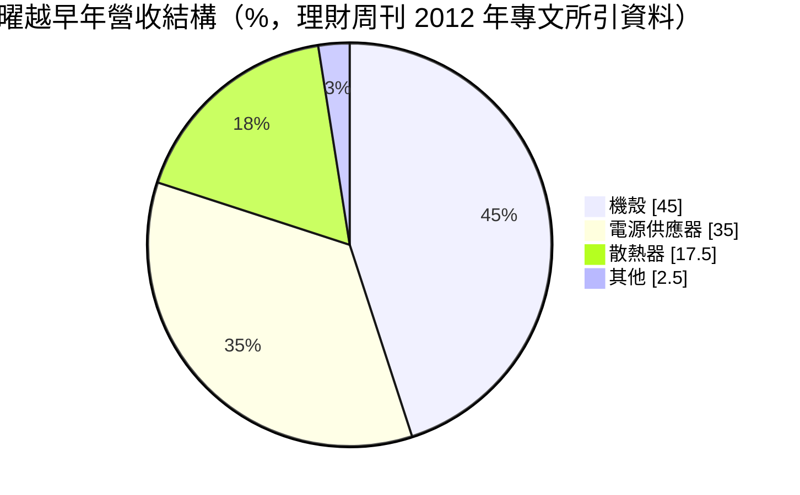
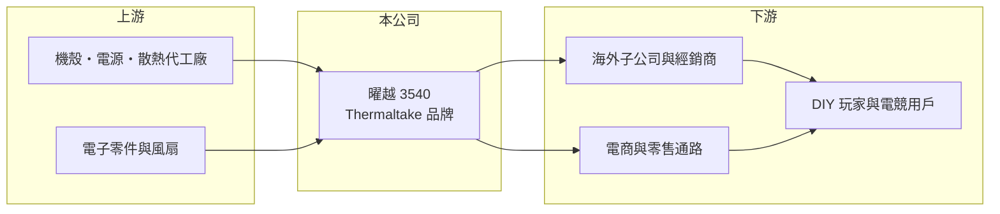

# 3540 曜越

> 上櫃｜[[產業索引-電腦及週邊設備業|電腦及週邊設備業]]｜上市（櫃）日期 2007/12/12

# 第一章：企業模式與商業藍圖

> [!info] 撰寫說明
> 精簡版，由 Claude 依公開資料整理，架構比照 [[2330台積電]]，資料截至 2026-10-08。來源：櫃買中心開放資料（基本資料、2026 年第二季資產負債與綜合損益、2026 年 8 月營收）、Goodinfo 經營績效頁、理財周刊 2012 年專文（產品比重為早年資料）。近年產品比重與據點未查得。#待校對

曜越是以 Thermaltake 品牌銷售電腦機殼、電源供應器與散熱產品的電競品牌商，賺的是品牌與設計溢價，毛利率高，但營收與獲利隨電競與 DIY 市場景氣大起大落。

- **核心業務：** 曜越成立於 1999 年，2007 年在櫃買中心掛牌，以 [[自有品牌]] Thermaltake 銷售 [[電腦機殼]]、電源供應器、氣冷與 [[液冷散熱]] 產品，後來延伸到電競鍵盤、滑鼠、耳機與電競椅等周邊。它的客群是自行組裝電腦的玩家，產品強調外觀設計、燈效與水冷系統的整合，而不是最低價格。
- **營收結構：** 依理財周刊 2012 年專文所引的早年資料，機殼約占 45%、電源 35%、散熱器 17.5%。近年產品比重本次未查得；從產品線看，電競周邊與水冷產品的比重應已提高（推估）。同一篇文章提到公司很早就投入水冷產品開發，並在德國、美國、澳洲等地設立子公司經營通路。
- **營運據點：** 總部在台灣，透過海外子公司與經銷商銷售到歐美與亞洲市場，生產以委外代工為主（待校對）。品牌商模式的好處是資本支出輕，缺點是需要長期投入行銷與通路庫存。
- **長期方向：** 曜越的成長取決於電競 PC 與高階顯示卡的換代需求，高功耗顯示卡與處理器推升對大瓦數電源與水冷散熱的需求，是公司長期的產品機會。另一個方向是把品牌從零組件延伸到鍵盤、耳機、電競椅等周邊，擴大每位玩家的消費金額，降低對單一產品週期的依賴。

# 第二章：護城河深度與競爭優勢

曜越的護城河是品牌與產品設計，毛利率長期維持在 30% 上下，明顯高於代工廠，但費用負擔重，營業利益率很薄。

- **競爭優勢：** Thermaltake 在全球 DIY 玩家社群中有一定知名度，水冷與燈效整合是它的特色，品牌溢價反映在 30% 左右的毛利率。品牌商不需要自建大型工廠，產品可以快速依市場潮流調整。不過這種優勢需要持續的行銷與新品投入來維持，營業費用率長期偏高。
- **主要對手：** 機殼與電源方面有 [[6276安鈦克]]、3002歐格、[[6117迎廣]]、海盜船（Corsair）、酷碼（Cooler Master）、NZXT、Lian Li；電源代工有 [[3015全漢]]、[[2308台達電]] 等；電競周邊則面對羅技、雷蛇與 [[2357華碩]]、[[2377微星]] 的電競品牌。競爭者眾多，品牌之間的轉換成本很低。
- **觀察重點：** 第一是營業利益率能否穩定在 5% 以上，這代表費用與通路效率是否改善。第二是新世代顯示卡帶動的換機潮能否反映在營收。第三是存貨控管，因為品牌商在需求轉弱時最容易出現庫存跌價。

# 第三章：財務體質與盈利規模

資料日期：2026-10-08，表格是撰寫當時的快照；最新月營收、毛利率、累計 EPS 由自動排程寫在本筆記的屬性欄位（月營收、毛利率、累計EPS 等）。#待校對

曜越的財務特色是毛利率高而穩定、營業利益率波動極大，2020 年疫情宅經濟是獲利高峰，之後多數年份接近損益兩平。

| 年度 | 營收（億元） | [[毛利率]] | [[營業利益率]] | EPS（元） | [[ROE]] |
|---|---|---|---|---|---|
| 2020 | 52.5 | 37.1% | 11.9% | 7.06 | 30.4% |
| 2021 | 42.4 | 34.1% | 7.89% | 3.05 | 12.2% |
| 2022 | 31.9 | 30.5% | -2.24% | 0.43 | 0.83% |
| 2023 | 43.8 | 31.0% | 2.29% | 2.10 | 5.17% |
| 2024 | 39.8 | 29.9% | -4.01% | -1.35 | -7.33% |
| 2025 | 51.4 | 31.4% | 1.91% | 0.74 | 2.66% |
| 2026 上半年 | 22.9 | 29.3% | 0.2% | 0.16 | 半年，不年化 |

（2020 至 2025 年取自 Goodinfo；2026 上半年依櫃買中心第二季綜合損益計算。）

- **營收規模：** 2020 至 2025 年營收在 32 億至 53 億元之間起伏，2025 年 51.4 億元與 2020 年相當，年複合成長率約 -0.4%。2026 年 1 至 8 月累計營收 30.5 億元、年減約 11%。
- **獲利：** 近五年平均 ROE 僅約 2.7%。毛利率由 37% 降到 30% 左右，營業費用則相對固定，因此營收只要下滑一成多，營業利益就會轉為虧損，這是品牌商典型的經營槓桿。
- **財務結構：** 2026 年第二季底總資產 56.3 億元、負債 37.1 億元，負債比約 66%，以流動負債 29.1 億元為主。歸屬母公司權益 19.8 億元、每股淨值 24.65 元，權益總計 19.1 億元略低於母公司權益，代表部分子公司有虧損。基本資料的實收資本額 8.45 億元低於第二季報表股本 8.86 億元，可能有註銷或減資（待校對）。逐年股利本次未查得。
- **[[ROIC]] 與 [[WACC]]：** 2025 年營業利益約 51.4 億 × 1.91% ≈ 1.0 億元，稅後約 0.8 億元；以權益 19.1 億元加非流動負債 8.0 億元作為投入資本概估，ROIC 約 3%（推算，有息負債實際金額未查得）。WACC 以 CAPM 推估：無風險利率 1.75%、市場風險溢酬 6%、消費性電子品牌 β 假設 1.1，股權成本約 8.35%；負債成本假設 2.5%（稅後 2%）、負債約占三成，WACC 約 6.5%（推算）。除 2020 至 2021 年外，ROIC 長期低於 WACC，代表品牌溢價大多被費用吃掉，尚未持續創造價值。

# 第四章：總體風險與地緣政治

曜越的風險主要是電競與 DIY 市場的需求波動、通路庫存，以及競爭激烈下的費用壓力。

- **產業週期：** DIY 組裝市場跟著新顯示卡、新處理器平台推出而起伏，疫情期間的宅經濟帶來高峰，2022 年後需求回落就造成虧損。這種週期性很難由公司自己控制。
- **營運風險：** 品牌商需要在通路備貨，需求轉弱時容易產生庫存跌價與促銷費用。產品線多、市場分散，管理與行銷成本高，營收規模不夠大時難以攤提。
- **其他風險：** 主要市場在歐美，匯率變動、美國關稅與運費都會影響毛利。產品多委外生產於中國大陸（待校對），產地政策變化也會增加成本。

# 專有名詞解析

## 產業

- **[[電腦機殼]]**：容納主機板、電源、儲存與散熱元件的外殼，伺服器機殼另需考量散熱與維修設計。
- **[[液冷散熱]]**：以液體帶走晶片熱量的散熱方式，散熱效率高於風冷，適用高功耗 AI 伺服器。
- **[[自有品牌]]**：公司以自己的品牌名稱設計、行銷並銷售產品，承擔通路與庫存風險，也享有品牌溢價。

# 核心供應鏈

- 上游：機殼、電源與散熱產品代工廠，電子零件與風扇供應商（未查得具名廠商）。
- 下游／客戶：海外子公司與經銷商、電商與零售通路，最終為 DIY 玩家與電競用戶。
- 同業：[[6276安鈦克]]、3002歐格、[[6117迎廣]]、[[3015全漢]]、海盜船、酷碼、NZXT、羅技、雷蛇。

## 最新新聞
<!-- news:start（自動產生，請勿手動編輯此範圍） -->
- 2026-10-12 🏛️ 重訊 16:46｜本公司受邀參加台新綜合證券舉辦之法人說明｜[觀測站](https://mops.twse.com.tw/mops/#/web/t05st01)

完整紀錄：[[3540曜越 新聞]]
<!-- news:end -->

## 相關連結
- [公開資訊觀測站](https://mopsov.twse.com.tw/mops/web/t05st03?step=1&firstin=1&co_id=3540)
- [Goodinfo](https://goodinfo.tw/tw/StockDetail.asp?STOCK_ID=3540)
- [Yahoo 股市](https://tw.stock.yahoo.com/quote/3540)
- [鉅亨網新聞](https://www.cnyes.com/twstock/3540/news)
