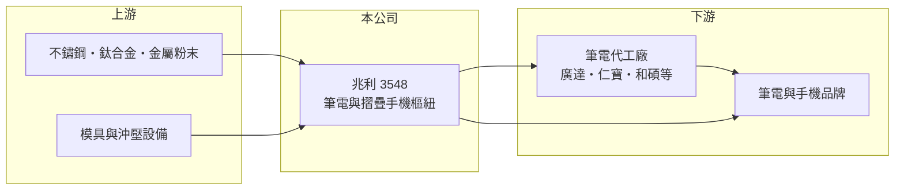

# 3548 兆利

> 上櫃｜[[產業索引-電子零組件業|電子零組件業]]｜上市（櫃）日期 2008/03/27

# 第一章：企業模式與商業藍圖

> [!info] 撰寫說明
> 精簡版，由 Claude 依公開資料整理，架構比照 [[2330台積電]]，資料截至 2026-10-08。來源：櫃買中心開放資料（基本資料、2026 年第二季財報）、Goodinfo 經營績效頁、nStock 公司簡介；摺疊手機相關描述參考工商時報、Yahoo 股市新聞標題，客戶與產地細節未逐條核對。#待校對

兆利科技是台灣筆記型電腦[[樞紐]]（轉軸）的主要供應商之一，近年把同一套精密機構能力延伸到摺疊手機。它的商業模式是「為品牌與代工廠客製設計、量產精密轉動機構」，每一代新機種都要重新設計並驗證，因此研發與量產良率是獲利的關鍵。

- **核心業務：** 兆利成立於 2004 年，2008 年於櫃買中心掛牌，總部在新北市新莊。公司登記的營業項目是[[沖壓]]件、樞紐組件與[[MIM]]（金屬粉末射出成型）的研發、設計、生產與組裝，主力是筆電、液晶螢幕與其他消費電子的樞紐。樞紐看似簡單，但要在數萬次開合後仍維持相同扭力與手感，屬於高度客製化的精密機構件。
- **營收結構：** 公開資料未查得產品別營收比重。依產業報導，筆電樞紐仍是營收主體，摺疊手機樞紐是近年的新增來源（推估）。筆電樞紐的單價低、出貨量大，摺疊手機樞紐則結構複雜、單價高出許多，產品組合的變化會直接影響毛利率。
- **營運據點：** 總部與研發在台灣，量產主要在海外工廠（具體廠區未查得，待校對）。筆電組裝集中在中國與東南亞，樞紐廠必須貼近代工廠設廠，才能配合新機種的試產與交期。
- **長期方向：** 摺疊手機是兆利最重要的長期題材。2026 年第一季報導指出中國品牌摺疊機訂單帶動營運（工商時報 2026 年 1 月），市場也普遍將兆利視為美系品牌摺疊手機樞紐的潛在供應商（待校對）。若摺疊手機滲透率持續提升，兆利有機會從「筆電零件廠」轉型為「高階精密機構廠」。

# 第二章：護城河深度與競爭優勢

樞紐廠的競爭力來自機構設計能力、材料與製程整合，以及和客戶共同開發新機種的經驗。

- **競爭優勢：** 樞紐必須在客戶設計機身的早期就介入，等機種量產後很少中途更換供應商，因此有[[設計導入]]的黏著度。兆利同時具備沖壓、MIM 與組裝能力，能自行製作摺疊手機樞紐中體積小、形狀複雜的金屬零件，這是跨入摺疊手機的技術基礎。
- **主要對手：** 筆電樞紐的主要同業是 [[3376新日興]]、[[1582信錦]] 與中國廠商；摺疊手機樞紐則與 [[6805富世達]]（[[2059川湖]] 子公司）及中國、韓國廠商競爭。筆電樞紐市場成熟、價格競爭激烈，摺疊樞紐的參與者較少但客戶集中。
- **觀察重點：** 2025 年毛利率降到 12.0%、2026 年上半年再降到 7.4% 並出現營業虧損，顯示新產品放量初期的成本與良率壓力很大。長期要觀察的是摺疊樞紐能否在量產後把毛利率拉回過去 16% 至 20% 的水準，否則營收成長不等於價值創造。

# 第三章：財務體質與盈利規模

資料日期：2026-10-08，表格是撰寫當時的快照；最新月營收、毛利率、累計 EPS 由自動排程寫在本筆記的屬性欄位（月營收、毛利率、累計EPS 等）。#待校對

兆利的營收在 2020 至 2024 年穩定成長，但毛利率長期只有一成多，獲利能力屬於典型的消費電子零組件水準。

| 年度 | 營收（億元） | [[毛利率]] | [[營業利益率]] | EPS（元） | [[ROE]] |
|---|---|---|---|---|---|
| 2020 | 55.5 | 20.3% | 5.57% | 5.03 | 7.55% |
| 2021 | 74.5 | 16.5% | 3.09% | 4.12 | 6.01% |
| 2022 | 70.2 | 20.0% | 6.45% | 7.88 | 10.9% |
| 2023 | 82.2 | 18.0% | 7.18% | 8.69 | 10.9% |
| 2024 | 95.8 | 16.6% | 5.74% | 8.73 | 10.3% |
| 2025 | 94.1 | 12.0% | 2.67% | 2.23 | 2.5% |
| 2026 上半年 | 40.7 | 7.37% | -2.92% | -1.80 | 未查得 |

- **營收規模：** 2020 至 2025 年營收年複合成長率約 11.1%（推算），營收規模已接近百億元。成長主要來自筆電樞紐市占與新產品，但 2025 年起營收持平、獲利大幅下滑。
- **獲利：** 2021 至 2025 年平均 ROE 約 8.1%（推算），不算高。2022 至 2024 年 EPS 明顯高於營業利益所對應的水準，代表業外收入（利息、匯兌等）占獲利相當比重，評估本業時應以營業利益為準。
- **財務特色：** 2026 年第二季總資產 120.3 億元、負債 58.4 億元、權益 61.9 億元，每股淨值 91.31 元，股本約 6.8 億元，資本相對厚實。高每股淨值代表過去累積的資本較多，但也拉低了 ROE。

**[[ROIC]] 與 [[WACC]]：** 開放資料未拆出有息負債，以負債總額 40% 估約 23.4 億元（推算假設）。2025 年營業利益約 2.5 億元，以稅率 20% 計稅後約 2.0 億元，除以權益 61.9 億元加有息負債 23.4 億元，ROIC 約 2.4%；2023 至 2024 年約 5% 至 5.5%（推算）。WACC 以 CAPM 推估：無風險利率 1.75%、市場風險溢酬 6%、β 取 1.1（消費電子零組件同業常見值），股權成本約 8.35%；稅後負債成本 2%，股權占比約 73%，WACC 約 6.6%（推算）。近幾年 ROIC 都低於 WACC，表示本業報酬還不足以支付資金成本，摺疊樞紐能否帶來更高毛利是扭轉的關鍵。

# 第四章：總體風險與地緣政治

兆利的風險集中在消費電子週期、少數大客戶，以及新產品放量時的良率與成本控制。

- **產業週期：** 筆電出貨在疫情期間暴增後回落，零組件廠會受到[[長鞭效應]]放大的庫存調整影響。摺疊手機雖然成長，但整體出貨量仍小，任何一款旗艦機的銷售成敗都會影響訂單。
- **營運風險：** 樞紐廠的客戶集中在少數品牌與代工廠，議價能力偏弱。新機種導入期需要投入大量模具與設備，良率爬坡不順時就會出現 2026 年上半年那樣的毛利率下滑與虧損。
- **其他風險：** 生產基地在海外，面臨美中關稅、供應鏈移轉的成本；營收以美元計價，新台幣升值會壓低毛利率。不鏽鋼、鈦合金等原材料價格波動也會影響成本。

# 專有名詞解析

## 金融

- **[[長鞭效應]]**：終端需求的小幅變動，沿供應鏈往上游傳遞時被逐級放大，造成上游庫存與訂單劇烈波動。

## 產業

- **[[樞紐]]**：讓螢幕或筆電上蓋能開合、旋轉並固定在任意角度的轉軸機構，需兼顧扭力、手感與耐用度。
- **[[沖壓]]**：以模具與沖床把金屬板材壓成特定形狀的加工方式，適合大量生產金屬零件。
- **[[MIM]]**：金屬粉末射出成型，把金屬粉末與黏結劑混合後射出成形再燒結，適合體積小、形狀複雜的金屬零件。
- **[[設計導入]]**：零件被客戶選入產品設計並完成驗證，之後該產品量產期間都會持續採購，是零組件廠長期營收的來源。

# 核心供應鏈

- 上游：不鏽鋼、鈦合金、金屬粉末等原材料，以及模具與沖壓設備。
- 下游／客戶：筆電代工廠（如 [[2382廣達]]、[[2324仁寶]]、[[4938和碩]]，推估）與筆電、手機品牌；具名客戶未查得。
- 同業：[[3376新日興]]、[[1582信錦]]、[[6805富世達]]、[[3679新至陞]]（待校對）。

## 最新新聞
<!-- news:start -->
<!-- news:end -->

## 相關連結
- [公開資訊觀測站](https://mopsov.twse.com.tw/mops/web/t05st03?step=1&firstin=1&co_id=3548)
- [Goodinfo](https://goodinfo.tw/tw/StockDetail.asp?STOCK_ID=3548)
- [Yahoo 股市](https://tw.stock.yahoo.com/quote/3548)
- [鉅亨網新聞](https://www.cnyes.com/twstock/3548/news)
