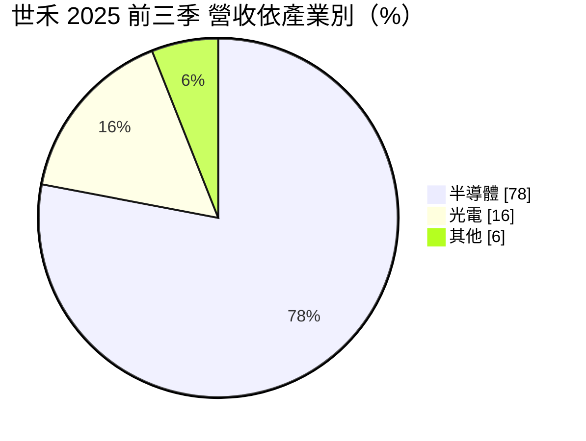
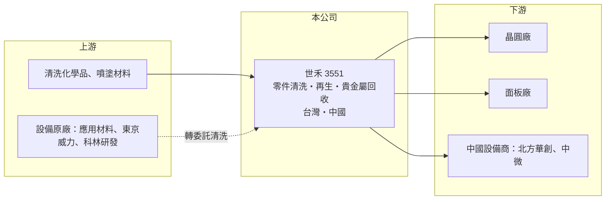

# 3551 世禾

> 上櫃｜[[產業索引-綠能環保|綠能環保]]｜上市（櫃）日期 2008/04/15

# 第一章：企業模式與商業藍圖

> [!info] 撰寫說明
> 精簡版，由 Claude 依公開資料整理，架構比照 [[2330台積電]]，資料截至 2026-10-08。來源：Goodinfo 經營績效年表（2019 至 2025 年）；富果 2025 年 12 月 11 日法說會摘要（業務、營收組成、客戶、廠區、技術方向）；櫃買中心開放資料快照（基本資料、2026 年第二季資產負債與上半年損益）。業務別營收比重未查得。#待校對

世禾科技（以下簡稱世禾）成立於 1997 年 6 月、2008 年 4 月上櫃，總部在新竹縣湖口鄉，董事長為陳學聖，總經理為陳學哲。它替半導體與面板設備的關鍵零件做精密清洗與再生，屬於晶圓廠「耗材型服務」的供應鏈，營收隨晶圓廠的產能利用率而非新建廠的資本支出起伏，因此比設備股穩定得多。

- **核心業務：** 晶圓製程設備（例如 [[PVD]]、[[CVD]]、蝕刻機台）的腔體零件會在使用中沾附薄膜與微粒，必須定期拆下送洗，否則會影響良率。世禾提供微米級的[[零件清洗]]、以鍍膜與表面處理把舊零件修復到接近新品的[[零件再生]]、陽極處理、備品買賣與庫存管理，以及 PVD 製程產生的貴金屬回收。
- **營收結構：** 依法說資料，2025 年前三季半導體占營收 78%、光電（面板）占 16%；地區別以台灣為主，占 86%。中國市場中半導體的比重從 2021 年的 34% 提高到 66%。業務別中零件再生毛利率最高，清洗次之，備品買賣毛利較低，各業務比重未查得。
- **營運據點：** 台灣以新竹為主，2024 年第三季啟用一座先進製程新廠，計畫 2026 年再增設一廠、資本支出約 7 至 8 億元（待校對）。中國有成都廠與世平廠，已由光電轉型為半導體業務，另有南京弘潔。依法說資料，設備利用率約 85% 至 90%，人力是主要瓶頸。
- **長期方向：** 先進製程中 PVD 的重要性下降，公司把主力轉向 CVD 與 [[ALD]] 相關零件的清洗與再生，並計畫加強與設備原廠的直接合作。製程越先進，零件材質與潔淨度要求越高、清洗頻率越密，單價也越高，這是世禾長期成長的主要邏輯。

# 第二章：護城河深度與競爭優勢

世禾的護城河來自晶圓廠與設備原廠的認證、潔淨與表面處理技術，以及靠近客戶的服務網絡，屬於中等寬度、相當穩固的護城河。

- **競爭優勢：** 晶圓廠更換清洗供應商要重新驗證零件對良率的影響，認證時間長、風險高，因此一旦通過認證，客戶黏著度很高。清洗與再生是按次收費的經常性收入，只要晶圓廠在生產就有需求，這使世禾的毛利率長期穩定在 33% 至 37%，營業利益率維持在 14% 至 20%。
- **主要客戶與合作：** 依法說資料，合作對象包括設備大廠 [[AMAT應用材料]]、[[8035東京威力科創]]、[[LRCX科林研發]]，以及中國設備商北方華創、中微半導體；高階製程的清洗有部分由設備原廠承接後轉交世禾。終端客戶為台灣與中國的晶圓廠與面板廠，具體名單與比重未查得。
- **主要對手：** 台灣同業有 [[8091翔名]] 等零件清洗與再生業者，國際上有美國 Ultra Clean（UCT）、日韓的清洗服務商，以及設備原廠自己的服務部門。原廠服務是長期最大的競爭與合作對象。
- **觀察重點：** CVD 與 ALD 零件業務的放量速度、新廠的產能爬坡，以及是否跟隨客戶赴美國或日本設廠。人力不足若持續，可能限制成長速度。

# 第三章：財務體質與盈利規模

資料日期：2026-10-08，表格是撰寫當時的快照；最新月營收、毛利率、累計 EPS 由自動排程寫在本筆記的屬性欄位（月營收、毛利率、累計EPS 等）。#待校對

世禾的財務特色是「穩」：七年來毛利率幾乎都在 33% 至 37% 之間，每年獲利、穩定配息，負債很低。

| 年度 | 營收（億元） | [[毛利率]] | [[營業利益率]] | EPS（元） | [[ROE]] |
|---|---|---|---|---|---|
| 2019 | 21.5 | 33.4% | 13.9% | 3.74 | 7.74% |
| 2020 | 20.6 | 37.4% | 16.2% | 4.44 | 8.79% |
| 2021 | 21.4 | 35.7% | 19.5% | 7.16 | 13.2% |
| 2022 | 23.9 | 37.2% | 18.6% | 6.40 | 10.9% |
| 2023 | 22.9 | 37.4% | 16.6% | 5.58 | 9.09% |
| 2024 | 25.8 | 36.4% | 16.6% | 6.63 | 10.2% |
| 2025 | 29.9 | 36.0% | 17.4% | 8.36 | 11.0% |
| 2026 上半年 | 16.72 | 38.5% | 21.6% | 5.40 | 未查得 |

註：2019 至 2025 年取自 Goodinfo，2026 年上半年取自櫃買中心開放資料推算（毛利 6.43 億、營業利益 3.61 億）。

- **長期指標：** 2020 至 2025 年營收年複合成長率約 7.7%（推算），2021 至 2025 年平均 ROE 約 10.9%（推算）。2025 年前三季發放現金股利約 1.91 億元，以股本 6.23 億元計約每股 3.07 元（推算），約為 2024 年 EPS 的 46%；Goodinfo 統計歷年現金股利平均約 2.43 元，配息穩定。
- **[[ROIC]] 與 [[WACC]]：** 2025 年營業利益約 5.2 億元（29.9 億 × 17.4%），稅後約 4.2 億元。2026 年第二季權益 50.0 億元，總負債 15.3 億元中有息負債未查得，假設約 6 億元，投入資本約 56 億元，ROIC 約 7.4%（推算）；以 2026 年上半年營業利益 3.61 億元年化計算約 10.3%（推算）。WACC 以無風險利率 1.75%、市場風險溢酬 6%、β 1.1（半導體服務同業常見值）、稅前負債成本 2.2%、稅率 20%、權益比重約 89% 計算約 7.6%（推算）。2025 年 ROIC 大致等於 WACC，2026 年上半年高於 WACC；ROE 長期約 10% 是因為帳上權益與現金偏多，本業的資本效率其實不差。
- **財務特色：** 2026 年第二季資產 65.3 億元、負債比率約 23%，每股淨值 81.05 元。清洗服務屬於中度資本密集，新廠與設備投資需要持續投入，但營業現金流足以支應並維持配息（推估）。

# 第四章：總體風險與地緣政治

世禾的風險主要來自半導體景氣、中國市場與先進製程技術轉換，財務風險低。

- **產業週期：** 清洗需求跟著晶圓廠產能利用率走，2023 年半導體庫存調整時營收小幅下滑、EPS 從 6.40 元降到 5.58 元，但毛利率幾乎不變，抗週期能力明顯優於設備與材料股。
- **營運風險：** 先進製程的零件清洗多由設備原廠主導，若原廠擴大自有服務，世禾可能只拿到成熟製程的訂單。人力利用率超過 100%、招募困難，也可能限制產能擴充；光電業務隨面板產業轉移而萎縮。
- **其他風險：** 中國子公司面臨美國出口管制與中國本土化的雙重影響；若客戶要求赴美設廠，資本支出與人力成本將大幅提高；化學品使用與廢水處理受環保法規約束。

# 專有名詞解析

## 半導體

- **[[PVD]]**：物理氣相沉積，以濺鍍等物理方式在晶圓表面鍍上金屬薄膜，腔體零件會沾附金屬、需要定期清洗。
- **[[CVD]]**：化學氣相沉積，利用氣體化學反應在晶圓上長出薄膜，是先進製程中用量持續增加的製程。
- **[[ALD]]**：原子層沉積，一次只長一層原子厚度的薄膜，精度最高，用於 3 奈米以下與先進記憶體製程。
- **[[零件清洗]]**：把設備腔體零件上的沉積物與微粒去除，確保晶圓良率，是晶圓廠的經常性支出。
- **[[零件再生]]**：以清洗、噴塗、鍍膜與表面處理把使用過的設備零件修復到接近新品，可降低晶圓廠零件成本。

## 金融

- **[[ROIC]]**：投入資本報酬率，稅後營業利益除以股東權益加有息負債，衡量本業運用資本的效率。
- **[[WACC]]**：加權平均資金成本，股東與債權人要求報酬率的加權平均，是 ROIC 要超越的門檻。

# 核心供應鏈

- 上游與合作：[[AMAT應用材料]]、[[8035東京威力科創]]、[[LRCX科林研發]]；化學品與材料供應商未查得。
- 下游／客戶：台灣與中國的晶圓廠、面板廠（名單未查得），以及中國設備商北方華創、中微半導體。
- 同業：[[8091翔名]]、美國 Ultra Clean。

## 最新新聞
<!-- news:start -->
<!-- news:end -->

## 相關連結
- [公開資訊觀測站](https://mopsov.twse.com.tw/mops/web/t05st03?step=1&firstin=1&co_id=3551)
- [Goodinfo](https://goodinfo.tw/tw/StockDetail.asp?STOCK_ID=3551)
- [Yahoo 股市](https://tw.stock.yahoo.com/quote/3551)
- [鉅亨網新聞](https://www.cnyes.com/twstock/3551/news)
