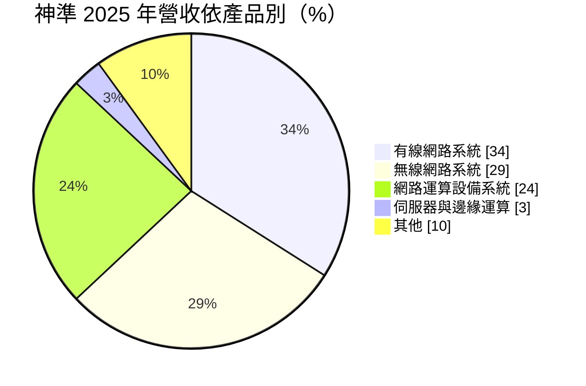
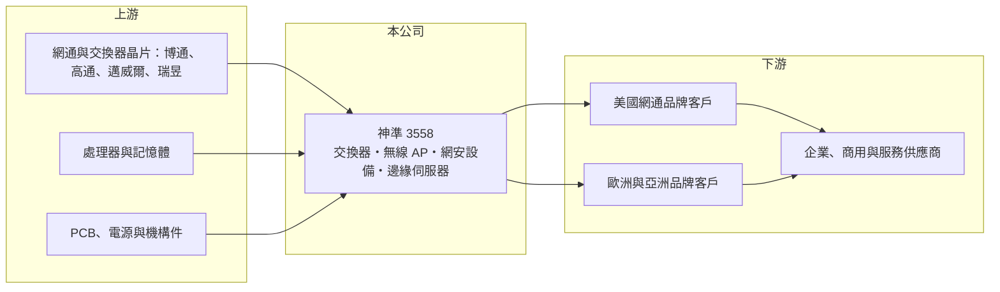

# 3558 神準

> 上櫃｜[[產業索引-通信網路業|通信網路業]]｜上市（櫃）日期 2013/12/30

# 第一章：企業模式與商業藍圖

> [!info] 撰寫說明
> 精簡版，由 Claude 依公開資料整理，架構比照 [[2330台積電]] 的四章研究，資料截至 2026-10-08。來源：櫃買中心開放資料（基本資料、2026 年第二季資產負債與損益、本益比殖利率）、Goodinfo 台灣股市資訊網年度經營績效（2020 至 2025 年）、poorstock 法說會簡報整理（2025 年度）；主要客戶身分依記憶整理，已標「待校對」。#待校對

本章拆解神準科技（股票代號：3558，以下簡稱神準）的商業模式：它是一家以企業與商用網通設備為主的 [[ODM]]，營收高度集中於美洲，正嘗試從傳統網通延伸到網路運算與 AI 邊緣伺服器。

- **核心業務：** 神準成立於 2006 年，2013 年上櫃，替品牌客戶設計與製造有線網路（[[乙太網路]]交換器、資料中心交換器）、無線網路（企業與戶外無線基地台）、網路運算設備（防火牆等網路安全硬體），以及伺服器與邊緣運算設備。神準的客戶多是以軟體與管理平台為核心的網通品牌，硬體交給神準設計生產；市場普遍認為最大客戶是美國網通品牌 Ubiquiti（待校對）。
- **營收結構：** 依法說會簡報，2025 年有線網路系統占 34%、無線網路系統 29%、網路運算設備系統 24%、伺服器與邊緣運算 3%、其他 10%。有線與網路運算成長最快，伺服器雖然比重小，但較前一年成長四十多倍，是公司刻意培養的新業務。地區上，美洲占 85%，歐洲 5%，亞洲與印度各約 4%，台灣約 1%。

- **營運據點：** 生產在台灣（華亞一廠、華亞二廠、桃園廠）、越南（主要生產基地）與印度清奈代工廠；研發在台北南港、桃園華亞與印度海德拉巴，研發人員超過 575 人，研發費用約占營收 6.5%。2025 年資本支出 11.05 億元創新高，多地布局是為了因應美國關稅與客戶的供應鏈分散要求。
- **長期方向：** 公司定位從傳統網通設備供應商轉為「AI 基礎架構整合」業者，重點包括 AI 伺服器、邊緣運算、高速乙太網路交換器與 [[AIoT]]，同時開拓日本、印度與東南亞，降低對美國市場的依賴。

# 第二章：護城河深度與競爭優勢

神準的護城河來自與核心客戶的深度合作與多地製造能力，但客戶集中使它的議價力有限。

- **競爭優勢：** 第一是與品牌客戶的共同開發關係：品牌客戶負責軟體與通路，神準負責硬體設計、驗證與量產，雙方合作多年，新產品從設計初期就由神準參與，[[轉換成本]]高。第二是產品廣度，從無線基地台、交換器到防火牆與伺服器都能做，可以承接客戶整條產品線。第三是台灣、越南、印度三地產能，能彈性配置以因應關稅。
- **主要對手：** 企業網通 ODM 同業包括 [[2345智邦]]、[[3380明泰]]、[[6285啟碁]]、[[5388中磊]]、[[6142友勁]]；網路安全硬體與邊緣伺服器領域則有 [[3564其陽]]、[[6245立端]] 等。在資料中心交換器領域，智邦的規模與技術遠超過神準，神準較適合中小型企業與商用市場。
- **觀察重點：** 一是最大客戶的拉貨與庫存狀況，這幾乎決定神準每年的成長方向；二是伺服器與邊緣運算業務能否放大並帶動毛利率；三是 2025 年大幅資本支出後的產能利用率。

# 第三章：財務體質與盈利規模

資料日期：2026-10-08，表格是撰寫當時的快照；最新月營收、毛利率、累計 EPS 由自動排程寫在本筆記的屬性欄位（月營收、毛利率、累計EPS 等）。#待校對

神準的財務走勢與主要客戶的庫存週期高度連動：2022 至 2023 年獲利高峰，之後毛利率與營業利益率明顯下滑。

| 年度 | 營收（億元） | [[毛利率]] | [[營業利益率]] | EPS（元） | [[ROE]] |
|---|---|---|---|---|---|
| 2020 | 77.7 | 21.5% | 7.11% | 7.67 | 14.7% |
| 2021 | 91.8 | 18.7% | 5.71% | 9.16 | 16.4% |
| 2022 | 163 | 18.5% | 8.30% | 21.70 | 31.9% |
| 2023 | 166 | 16.3% | 5.69% | 16.88 | 20.0% |
| 2024 | 120 | 17.4% | 3.92% | 4.71 | 7.23% |
| 2025 | 150 | 15.8% | 2.67% | 5.20 | 6.61% |
| 2026 上半年 | 66.28 | 16.45% | 1.15% | 0.81 | 未查得 |

註：2020 至 2025 年取自 Goodinfo，2026 年上半年取自櫃買中心開放資料推算。

- **營收規模：** 2020 至 2025 年營收由 77.7 億元成長到 150 億元，年複合成長率約 14%（推算），但過程起伏很大：2022 年營收幾乎翻倍，2024 年又下滑約 28%，反映主要客戶先補庫存、再去化庫存的週期。
- **獲利：** 毛利率從 2020 年的 21.5% 逐步降到 2025 年的 15.8%，營業利益率從 8.3% 的高點降到 2.7%，2026 年上半年只剩約 1.2%。毛利率下滑的原因包括產品組合變化、價格競爭，以及多地擴產帶來的折舊與費用增加。
- **財務特色：** 2021 至 2025 年平均 ROE 約 16.4%（推算），但主要來自 2022 至 2023 年高峰；近兩年 ROE 只有 7% 左右。最近一期現金股利 3 元，以 2025 年 EPS 5.2 元計算配發率約 58%（推算）。2026 年第二季母公司股東權益約 59.8 億元、每股淨值 101 元，另有非控制權益約 3 億元。

## [[ROIC]] 與 [[WACC]]

**ROIC 推算：** 2025 年營業利益約 4.0 億元（150 億元 × 2.67%），以稅率 20% 計算，稅後營業利益約 3.2 億元。投入資本以 2026 年第二季股東權益約 62.8 億元（含非控制權益）近似（有息負債未查得），ROIC 約 5%（推算）。以同樣方法推算 2022 年，稅後營業利益約 10.8 億元，股東權益約 40 億元，ROIC 約 27%（推算）。

**WACC 推算：** 台灣 10 年期公債約 1.75%、市場風險溢酬約 6%、β 取網通代工股常見的 1.0（假設），股東要求報酬率約 7.75%；考量部分借款，WACC 約 7.5%（推算）。

**解讀：** 2020 至 2023 年 ROIC 明顯高於 WACC，2024 年以後降到約 5%，低於約 7.5% 的資金成本，代表近兩年本業並未創造經濟價值。新增的產能與伺服器業務若能把營業利益率拉回 5% 以上，利差才會重新轉正。

# 第四章：總體風險與地緣政治

本章說明神準長期面對的客戶集中、產業週期與擴張風險。

- **產業週期：** 企業網通設備的需求受企業 IT 支出與通路庫存影響，客戶在缺料期會超額下單，之後再去化庫存，[[長鞭效應]]讓神準的營收波動遠大於終端市場。2022 年營收翻倍、2024 年下滑近三成，就是這個週期的結果。
- **營運風險：** 美洲營收占 85%，且集中於少數品牌客戶，一旦主要客戶改變下單策略、調整庫存或轉單，神準幾乎沒有緩衝。2025 年資本支出創新高，若新產能利用率不足，折舊將持續壓縮利潤。記憶體等零組件的供貨與漲價，也會影響出貨與毛利率。
- **其他風險：** 美國關稅與原產地規則可能改變，台灣、越南、印度的產能配置需隨之調整；印度市場 2025 年營收衰退 44%，新興市場開拓並不順利；營收以美元計價，新台幣升值會影響獲利。

# 專有名詞解析

## 應用

- **[[AIoT]]**：人工智慧結合物聯網，讓連網裝置能在本地分析資料並做出判斷。

## 金融

- **[[長鞭效應]]**：終端需求的小幅變動，沿供應鏈往上游傳遞時被逐級放大，造成上游庫存與訂單劇烈波動。

## 產業

- **[[ODM]]**：原廠委託設計製造，代工廠負責產品設計與生產，品牌或營運商只提出規格並負責銷售。
- **[[乙太網路]]**：以網路線或光纖連接電腦與網路設備的有線區域網路標準，交換器是其核心設備。
- **[[轉換成本]]**：客戶更換供應商時要付出的時間、金錢與風險，轉換成本越高，供應商的客戶黏著度越高。

# 核心供應鏈

- 上游：網通與交換器晶片 [[AVGO博通]]、[[QCOM高通]]、[[MRVL邁威爾]]、[[2379瑞昱]]，處理器與記憶體，PCB、電源與機構件供應商。
- 下游／客戶：以美國網通品牌為主（市場普遍認為最大客戶是 Ubiquiti，待校對），另有歐洲、亞洲與印度客戶。
- 同業：[[2345智邦]]、[[3380明泰]]、[[6285啟碁]]、[[5388中磊]]、[[6142友勁]]、[[3564其陽]]、[[6245立端]]。

## 最新新聞
<!-- news:start -->
<!-- news:end -->

## 相關連結
- [公開資訊觀測站](https://mopsov.twse.com.tw/mops/web/t05st03?step=1&firstin=1&co_id=3558)
- [Goodinfo](https://goodinfo.tw/tw/StockDetail.asp?STOCK_ID=3558)
- [Yahoo 股市](https://tw.stock.yahoo.com/quote/3558)
- [鉅亨網新聞](https://www.cnyes.com/twstock/3558/news)
