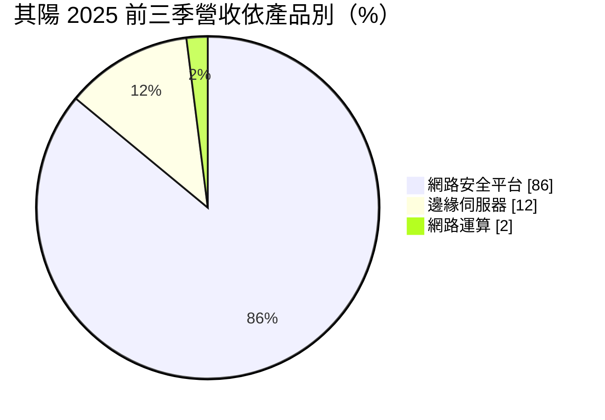
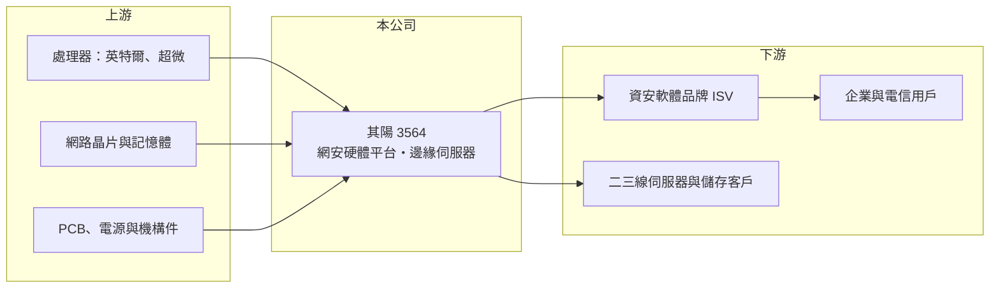

# 3564 其陽

> 上櫃｜[[產業索引-通信網路業|通信網路業]]｜上市（櫃）日期 2013/12/03

# 第一章：企業模式與商業藍圖

> [!info] 撰寫說明
> 精簡版，由 Claude 依公開資料整理，架構比照 [[2330台積電]] 的四章研究，資料截至 2026-10-08。來源：櫃買中心開放資料（基本資料、2026 年第二季資產負債與損益、本益比殖利率）、Goodinfo 台灣股市資訊網年度經營績效（2020 至 2025 年）、富果研究 2025 年 11 月法說會整理。#待校對

本章拆解其陽科技（股票代號：3564，以下簡稱其陽）的商業模式：它是替網路[[資安]]軟體公司製造專用硬體平台的廠商，客戶把防火牆軟體裝在其陽的硬體上，再以自有品牌賣給企業。

- **核心業務：** 其陽成立於 2000 年，2013 年上櫃，主力是網路安全硬體平台，以 Intel 與 AMD 的 x86 處理器為基礎，用於整合式威脅管理（[[UTM]]）與[[次世代防火牆]]。資安公司的價值主要在軟體與威脅情資，硬體多交給像其陽這樣的專業平台廠設計生產；其陽的價值在於高可靠度、客製化設計與長期供貨。
- **營收結構：** 依法說會整理，2025 年前三季網路安全平台占 86%、邊緣伺服器占 12%、網路運算占 2%。地區上，美洲 48%、中國 32%、亞太 11%、歐洲 9%，美洲是近期成長最明顯的市場。主要客戶是[[獨立軟體供應商]]（ISV），也就是資安軟體品牌。

- **營運據點：** 公司未揭露自有工廠位置；法說會表示目前沒有在美國設廠計畫，但會整合集團在美國的產線與倉庫資源因應關稅。中國營收占約三成，代表其陽同時服務中國與歐美資安客戶，地緣政治的影響是雙向的。
- **長期方向：** 公司策略分三層：鞏固中高階網安平台；開發新一代 [[AI伺服器]]，搭配自研的雙向直接液冷與浸沒式[[液冷]]技術，鎖定小型語言模型推論與高可用儲存；以及提供少量多樣的白牌伺服器方案，目標客群是需要高度客製化的二、三線客戶，而非大型雲端業者。

# 第二章：護城河深度與競爭優勢

其陽的護城河來自資安客戶的長期驗證與客製化能力，屬於窄護城河，近年的低營業利益率顯示議價力有限。

- **競爭優勢：** 第一是資安客戶的[[轉換成本]]：防火牆軟體與硬體平台需要長時間整合與認證，一款平台通常會沿用數年，客戶不會輕易更換供應商。第二是少量多樣的設計能力，能針對不同效能等級與介面需求快速推出平台。第三是 x86 平台與網路介面的長期經驗，延伸到邊緣伺服器與液冷 AI 伺服器時有技術基礎。
- **主要對手：** 台灣網安硬體平台同業包括 [[6245立端]]、[[3594磐儀]]、[[3088艾訊]]、[[6166凌華]]、[[2395研華]]，以及網通 ODM [[3558神準]]；邊緣與 AI 伺服器領域則面對 [[8050廣積]]、[[6922宸曜]] 與眾多伺服器廠。立端是定位最接近的直接對手。
- **觀察重點：** 一是營業利益能否轉正並穩定，這是判斷本業競爭力的核心；二是 AI 伺服器與液冷產品能否取得實際訂單；三是中國營收比重的變化，以及美國關稅豁免是否延續。

# 第三章：財務體質與盈利規模

資料日期：2026-10-08，表格是撰寫當時的快照；最新月營收、毛利率、累計 EPS 由自動排程寫在本筆記的屬性欄位（月營收、毛利率、累計EPS 等）。#待校對

其陽的財務特徵很特殊：毛利率約 23% 至 27%，但營業利益率六年都在零附近或略為負值，EPS 主要依靠業外收益支撐。

| 年度 | 營收（億元） | [[毛利率]] | [[營業利益率]] | EPS（元） | [[ROE]] |
|---|---|---|---|---|---|
| 2020 | 17.6 | 26.3% | -0.80% | 0.90 | 4.67% |
| 2021 | 20.2 | 23.3% | -0.49% | 0.75 | 3.87% |
| 2022 | 24.6 | 27.2% | -0.91% | 2.60 | 13.3% |
| 2023 | 19.7 | 26.5% | -1.70% | 0.45 | 2.20% |
| 2024 | 22.9 | 25.9% | -1.26% | 0.89 | 3.98% |
| 2025 | 25.0 | 22.9% | -0.52% | 0.65 | 2.75% |
| 2026 上半年 | 13.68 | 24.45% | 0.88% | 0.04 | 未查得 |

註：2020 至 2025 年取自 Goodinfo，2026 年上半年取自櫃買中心開放資料推算。

- **營收規模：** 2020 至 2025 年營收由 17.6 億元成長到 25 億元，年複合成長率約 7.3%（推算），2023 年因客戶庫存調整下滑後逐步回升。
- **獲利：** 毛利率在中型 ODM 中不算低，但研發、業務與管理費用幾乎吃掉全部毛利，營業利益率長年略為負值。2022 年 EPS 2.6 元、ROE 13.3%，推估主要來自業外收益（例如匯兌或投資收益），而非本業。2026 年上半年本業轉為小賺，但業外為負，EPS 只有 0.04 元。
- **財務特色：** 2021 至 2025 年平均 ROE 約 5.2%（推算）。最近一期現金股利 0.27 元。2026 年第二季股東權益約 13.8 億元、每股淨值 23.39 元；法說會提到流動比率約 239%、金融負債比率降至 25%，財務結構穩健，但獲利能力偏弱。

## [[ROIC]] 與 [[WACC]]

**ROIC 推算：** 2025 年營業虧損約 0.13 億元（25 億元 × -0.52%），虧損年度不計稅負。投入資本以 2026 年第二季股東權益約 13.8 億元近似（有息負債未查得），ROIC 約 -1%（推算）；2020 至 2025 年本業 ROIC 都在 0% 附近或略為負值。

**WACC 推算：** 台灣 10 年期公債約 1.75%、市場風險溢酬約 6%、β 取工業電腦與網安硬體股常見的 1.0（假設），股東要求報酬率約 7.75%；考量部分借款，WACC 約 7%（推算）。

**解讀：** 本業 ROIC 長期接近零、低於約 7% 的 WACC，代表其陽的本業多年未能賺回資金成本，帳面 ROE 主要靠業外收益。要長期創造價值，關鍵是讓高毛利的 AI 伺服器與客製化方案放量，同時控制費用，使營業利益率轉為穩定正值。

# 第四章：總體風險與地緣政治

本章說明其陽長期面對的客戶、技術與地緣政治風險。

- **產業週期：** 資安支出長期穩定成長，但硬體平台訂單受客戶庫存與新平台導入時程影響，2023 年營收下滑即與客戶庫存調整有關。處理器世代更替時，客戶常會集中換平台，造成訂單起伏。
- **營運風險：** 營收高度集中於資安平台，客戶以少數資安軟體品牌為主，單一客戶改用自有設計或轉單影響很大。費用率偏高，使營收小幅下滑就會造成虧損。AI 伺服器與液冷屬於新業務，需要投入研發與驗證，短期可能進一步壓縮獲利。
- **其他風險：** 中國營收約三成，面臨中國本土化政策與美中科技管制；美國關稅豁免若取消，銷美產品成本會上升。長期而言，部分資安功能轉向雲端交付，也可能減少對實體防火牆硬體的需求。

# 專有名詞解析

## 應用

- **[[資安]]**：資訊安全，保護網路、系統與資料免於入侵、竊取或破壞的技術與服務。
- **[[UTM]]**：整合式威脅管理，把防火牆、防毒、入侵偵測等多種資安功能整合在一台設備上。
- **[[次世代防火牆]]**：能辨識應用程式與使用者、並結合入侵防禦與威脅情資的防火牆，是企業資安的核心設備。
- **[[AI伺服器]]**：搭載 GPU 或 AI 加速器、專門執行 AI 訓練或推論的伺服器。

## 產業

- **[[獨立軟體供應商]]**：自行開發並銷售軟體的公司，常把軟體搭配委外製造的硬體一起出貨。
- **[[液冷]]**：以液體帶走伺服器熱量的散熱方式，散熱效率高於風冷，是高密度 AI 機櫃的主流方案。

# 核心供應鏈

- 上游：處理器 [[INTC英特爾]]、[[AMD超微]]，網路晶片與記憶體，PCB、電源與機構件供應商。
- 下游／客戶：美洲、中國、亞太與歐洲的資安軟體品牌，以及需要客製化的二三線伺服器客戶，公司未揭露具名客戶。
- 同業：[[6245立端]]、[[3594磐儀]]、[[3088艾訊]]、[[6166凌華]]、[[2395研華]]、[[3558神準]]、[[8050廣積]]、[[6922宸曜]]。

## 最新新聞
<!-- news:start -->
<!-- news:end -->

## 相關連結
- [公開資訊觀測站](https://mopsov.twse.com.tw/mops/web/t05st03?step=1&firstin=1&co_id=3564)
- [Goodinfo](https://goodinfo.tw/tw/StockDetail.asp?STOCK_ID=3564)
- [Yahoo 股市](https://tw.stock.yahoo.com/quote/3564)
- [鉅亨網新聞](https://www.cnyes.com/twstock/3564/news)
