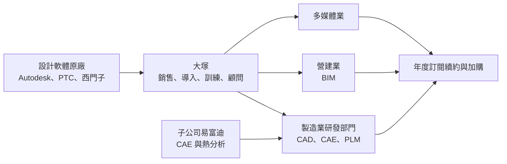
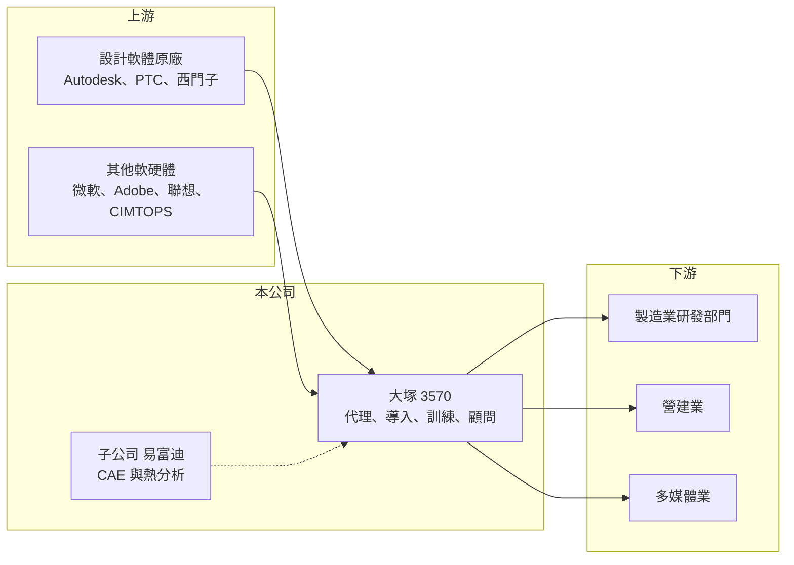

# 3570 大塚

> 上櫃｜[[產業索引-資訊服務業|資訊服務業]]｜上市（櫃）日期 2008/10/23

# 第一章：企業模式與商業藍圖

> [!info] 撰寫說明
> 精簡版，由 Claude 依公開資料整理，架構比照 [[2330台積電]] 的四章研究，資料截至 2026-10-08。來源：富果研究 2026 年 3 月法說會備忘錄（業務、代理品牌、子公司易富迪、據點與人力）、Goodinfo 年度經營績效頁、櫃買中心開放資料（基本資料、2026 年第二季資產負債與綜合損益、每月營收、本益比殖利率）。與日本大塚商會的關係依記憶整理；產品別與客戶產業的營收比重未查得。#待校對

台灣大塚資訊是製造業與營建業研發設計軟體的代理與導入服務商，本章說明它如何以代理國際設計軟體為基礎，靠顧問、教育訓練與訂閱續約建立穩定且高報酬的商業模式。

## 一、核心定位：研發設計軟體的專業服務商

- **核心業務：** 大塚以 [[CAD]]、CAM、[[CAE]]、PLM 等製造業研發設計軟體，以及營建業的 [[BIM]] 建築資訊軟體為核心，提供軟體銷售、導入建置、教育訓練、顧問與客製化開發（富果研究）。代理品牌包括 Autodesk、PTC、西門子三大設計軟體，以及微軟、Adobe、聯想、CIMTOPS（富果研究）。公司自我定位為「最懂研發設計的資訊專家」。
- **公司背景：** 大塚成立於 1997 年、2008 年上櫃，實收資本額約 1.71 億元，董事長為鶴見裕信（櫃買中心開放資料）。公司名稱與日籍董事長顯示它屬於日本大塚商會（Otsuka Corporation）體系（依記憶整理，待校對）。子公司易富迪科技專注於工程模擬與熱特性分析，提供高階分析軟體、顧問服務及暫態熱阻量測與功率循環測試（富果研究）。
- **營運據點：** 在台灣與中國共有九個營業據點與九間實體教育訓練中心，並經營 CAD-POWER 線上學習平台；2025 年培育超過 5,350 位專業人才（富果研究）。
- **收入結構：** 服務的三大產業為製造業、營建業與多媒體業，各自比重未查得。公司表示營收以穩定的軟體訂閱為主，單月波動多來自大型客戶新購訂單集中認列（富果研究），代表[[經常性收入]]是營收主體。

## 二、資本轉化邏輯：代理軟體、賣服務、收續約

設計軟體轉為訂閱制後，客戶每年都要續約，大塚每年都能從既有客戶基礎取得收入，並在客戶擴編研發團隊時加購授權。技術顧問團隊約 90 人、占公司總人數近四成（富果研究），以此推算總人數約 230 人，2025 年[[人均產值]]約 1,000 萬元以上（推算）。對一家以服務為主的公司來說，這是相當高的效率，原因在於軟體授權帶來的營收規模。

## 三、長期方向

公司看好 2026 年 CAE 與 EDA 市場的成長，並希望透過增加服務與勞務類型的銷售，維持毛利率與獲利率穩定（富果研究）。製造業的研發數位化、模擬取代實體試作，以及營建業導入 BIM，是長期的需求來源。

# 第二章：護城河深度與競爭優勢

本章分析大塚的護城河構成，以及代理型軟體服務商面對的競爭。

## 一、競爭優勢

- **多品牌代理與專業顧問：** 同時代理 Autodesk、PTC、西門子三大設計軟體，加上 90 人的技術顧問團隊，讓大塚能依客戶的產業與規模推薦適合的方案，並負責導入與訓練。原廠選擇代理商時重視技術服務能力，這是大塚維持代理權的基礎。
- **教育訓練網路：** 九間實體訓練中心與線上平台，每年培育數千位設計人才。熟悉某套軟體的工程師進入企業後，會傾向使用同一套工具，這在長期上為大塚代理的品牌培養用戶基礎。
- **高轉換成本：** 企業的設計圖檔、模型與流程都建立在特定軟體上，更換軟體需要重新訓練工程師並轉換大量資料，因此續約率高（推估）。
- **限制：** 代理權掌握在原廠手中，原廠若調整通路政策或改為直營，代理商的角色可能被削弱。

## 二、主要對手

| 對手 | 定位 | 與大塚的比較 |
|---|---|---|
| [[8416實威]] | SolidWorks 等 Dassault 系統軟體代理 | 製造業 3D CAD 市場的主要對手 |
| 其他 Autodesk、PTC、西門子經銷商 | 同品牌多家代理 | 同一品牌下以服務與價格競爭 |
| 原廠直營與線上銷售 | 直接向客戶銷售訂閱 | 小型客戶可能直接線上購買 |
| [[6214精誠]] | 大型資訊服務集團 | 在企業軟體與雲端案件上部分重疊 |

## 三、觀察重點

- **毛利率趨勢：** 毛利率由 2020 年的 38.8% 降到 2025 年的 28.6%（Goodinfo），推估與原廠訂閱制改變利潤分配、硬體比重提高有關（推估）。公司把提高服務收入列為對策，成效值得追蹤。
- **CAE 與 EDA 的新成長：** 子公司易富迪的模擬與熱分析能力，若能隨 AI 伺服器、電動車的散熱需求擴大，可成為高毛利的第二成長曲線。
- **原廠政策：** 主要原廠的通路與定價政策，是影響長期獲利的最大外部變數。

# 第三章：財務體質與盈利規模

資料日期：2026-10-08，表格是撰寫當時的快照；最新月營收、毛利率、累計 EPS 由自動排程寫在本筆記的屬性欄位（月營收、毛利率、累計EPS 等）。#待校對

本章用多年度數據檢視大塚的成長、利潤率變化與資本報酬。

## 一、多年度三率與 ROE

| 年度 | 營收（新台幣） | [[毛利率]] | [[營業利益率]] | EPS（元） | [[ROE]] |
|---|---|---|---|---|---|
| 2020 | 11.3 億 | 38.8% | 14.4% | 8.00 | 20.0% |
| 2021 | 13.0 億 | 37.0% | 13.6% | 8.50 | 19.8% |
| 2022 | 15.6 億 | 33.5% | 14.2% | 10.65 | 22.7% |
| 2023 | 16.9 億 | 33.0% | 14.0% | 11.62 | 22.7% |
| 2024 | 21.0 億 | 29.7% | 12.9% | 12.98 | 23.2% |
| 2025 | 24.3 億 | 28.6% | 12.3% | 13.95 | 22.8% |
| 2026 上半年 | 14.3 億 | 27.25% | 12.19% | 8.05 | 未查得 |

註：2020 至 2025 年取自 Goodinfo；2026 上半年取自櫃買中心綜合損益。

- **營收成長：** 2020 至 2025 年營收年複合成長率約 16.5%（推算），2026 年 1 至 8 月累計營收約 19.6 億元、年增約 14.8%（櫃買中心每月營收）。
- **利潤率：** 毛利率逐年下滑約 10 個百分點，但營業利益率只由 14.4% 降到 12.3%，代表公司以規模效益與費用控制抵銷了毛利率壓力。
- **EPS 與 ROE：** EPS 連續六年成長，由 8.00 元增到 13.95 元；2021 至 2025 年平均 ROE 約 22.2%（推算）。

## 二、股利與財務結構

最近一次現金股利為 9.7 元（櫃買中心本益比殖利率資料），以 2025 年 EPS 13.95 元計算配發率約 70%（推算）。2026 年第二季底權益約 10.7 億元、總負債約 7.2 億元，其中流動負債約 6.1 億元、非流動負債約 1.1 億元；流動資產約 15.3 億元（櫃買中心資產負債）。股本只有 1.71 億元，屬於小股本、高每股盈餘的公司；負債推估以預收訂閱款與應付原廠帳款為主（推估）。

## 三、[[ROIC]] 與 [[WACC]]

**ROIC 推算：** 2025 年營業利益約 24.3 億元 × 12.3% ≈ 2.99 億元，扣除 20% 稅後約 2.39 億元。投入資本以權益 10.7 億元加上非流動負債 1.1 億元計算，約 11.8 億元，ROIC 約 20.3%（推算）。

**WACC 推算：** 公債殖利率 1.75%、市場風險溢酬 6%、β 取資服股常見值 0.7，權益成本約 5.95%；幾乎沒有有息負債，WACC 約 5.9%（推算）。

**結論：** ROIC 約 20%，比約 6% 的 WACC 高出約 14 個百分點，代表大塚長期大幅創造價值。輕資產的代理服務模式加上訂閱續約，讓公司能在毛利率下滑的情況下仍維持高資本報酬。

# 第四章：總體風險與地緣政治

本章整理大塚長期面對的產業、營運與其他風險。

## 一、產業週期

- **製造業研發支出：** 客戶以製造業為主，景氣下滑時企業會凍結研發人力擴編與新軟體採購，但既有訂閱多半照常續約，營收波動相對溫和。
- **營建景氣：** BIM 相關業務受營建業景氣與公共工程推動 BIM 的政策影響。

## 二、營運風險

- **原廠依賴：** 營收高度依賴少數國際原廠，原廠調整代理制度、價格或直接線上銷售，都會影響大塚的利潤空間。
- **毛利率下滑：** 訂閱制讓原廠掌握更多定價權，代理商的價差可能持續被壓縮，需要靠顧問與客製化服務補足。
- **人才：** 技術顧問是公司的核心資產，資深顧問流失會影響服務品質與大客戶關係。

## 三、其他風險

- **中國業務：** 在中國設有據點，當地景氣與美中科技管制（例如設計與模擬軟體的出口限制）可能影響業務。
- **匯率：** 向原廠採購多以外幣計價，匯率波動會影響成本。

# 專有名詞解析

## 應用

- **[[CAD]]**：電腦輔助設計軟體，工程師用來繪製 2D 圖面與 3D 模型，是製造業與建築業的基本工具。
- **[[CAE]]**：電腦輔助工程軟體，以電腦模擬結構強度、流體與散熱，減少實體試作的次數與成本。

## 金融

- **[[經常性收入]]**：按月或按年持續收取的收入，例如維護合約與訂閱費，可預測性高於一次性的專案收入。
- **[[人均產值]]**：營收除以員工人數，用來衡量人力密集型服務業的經營效率。
- **[[ROIC]]**：投入資本報酬率，衡量企業用股東與債權人投入的資本，每年能產生多少稅後營業利益。

## 產業

- **[[BIM]]**：建築資訊模型，以 3D 模型整合建築、結構與機電資料，可在施工前找出管線衝突。

# 核心供應鏈

- 上游：Autodesk、PTC、西門子等設計軟體原廠；[[MSFT微軟]]、Adobe、聯想、CIMTOPS。
- 下游／客戶：製造業研發部門（電子、機械、模具等，推估）、營建業與多媒體業。
- 同業：[[8416實威]]、[[6214精誠]]，以及其他設計軟體經銷商。

## 最新新聞
<!-- news:start -->
<!-- news:end -->

## 相關連結
- [公開資訊觀測站](https://mopsov.twse.com.tw/mops/web/t05st03?step=1&firstin=1&co_id=3570)
- [Goodinfo](https://goodinfo.tw/tw/StockDetail.asp?STOCK_ID=3570)
- [Yahoo 股市](https://tw.stock.yahoo.com/quote/3570)
- [鉅亨網新聞](https://www.cnyes.com/twstock/3570/news)
