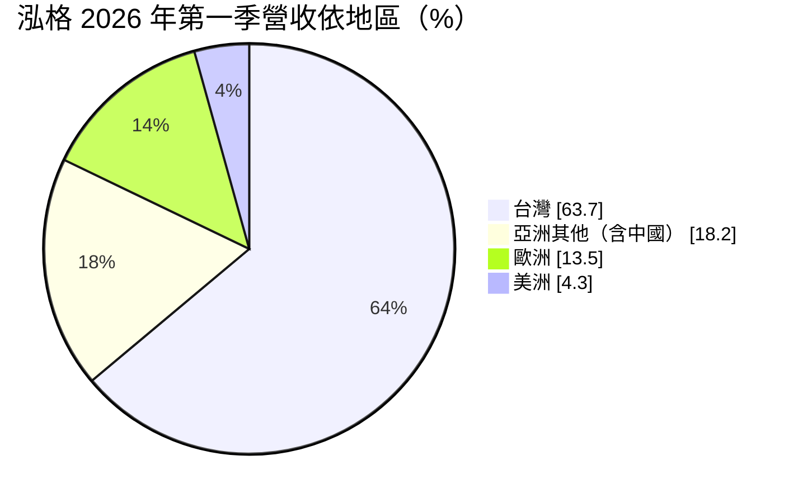
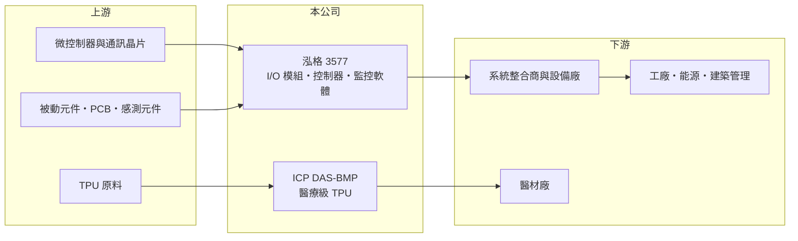

# 3577 泓格

> 上櫃｜[[產業索引-電腦及週邊設備業|電腦及週邊設備業]]｜上市（櫃）日期 2009/01/06

# 第一章：企業模式與商業藍圖

> [!info] 撰寫說明
> 精簡版，由 Claude 依公開資料整理，架構比照 [[2330台積電]]，資料截至 2026-10-08。來源：櫃買中心開放資料（基本資料、2026 年第二季資產負債與綜合損益、2026 年 8 月營收）、Goodinfo 經營績效頁、富果研究 2026 年 5 月 26 日法說會摘要。產品別營收比重與工廠位置未查得。#待校對

泓格是自有品牌的工業自動化元件商，以 ICP DAS 品牌銷售 I/O 模組、控制器與通訊設備，毛利率長期超過五成，是台灣電腦週邊類股中少見的高毛利、低負債公司。

- **核心業務：** 泓格成立於 1993 年，2009 年在櫃買中心掛牌，產品涵蓋前端感測器、[[資料擷取]] 與 I/O 模組、通訊轉換設備、可程式控制器，以及上層監控管理軟體，可以提供工廠一站式的自動化方案。這類產品單價不高但品項極多，客戶依需求挑選組合，泓格的價值在於產品完整度與相容性。
- **營收結構：** 依 2026 年 5 月法說會，第一季營收 3.87 億元，台灣占 63.7%、亞洲其他地區 18.2%、歐洲 13.5%、美洲 4.3%。產品別比重未揭露。應用領域涵蓋 [[工業物聯網]]、智慧工廠、能源管理、建築自動化、智慧交通與智慧農漁業。
- **新事業：** 公司另以 ICP DAS-BMP 經營醫療級 TPU 材料，產品用於中心靜脈導管、泌尿導管、牙齒矯正器與導線等 [[醫療器材]]，部分產品已通過 ISO 10993-6 的 90 天植入測試。公司計畫從原料往半成品與成品（如導管）延伸，但醫療材料的開發與認證期長，成長較慢。
- **長期方向：** 管理層的方向是從「元件供應商」轉為「解決方案提供者」，從資料擷取延伸到數據分析與 ESG 能源管理（空氣品質感測、智慧電表），並強化半導體設備用的運動控制產品。市場上則加強歐洲、日本與東南亞布局。

# 第二章：護城河深度與競爭優勢

泓格的護城河是長年累積的龐大產品線、自有品牌與高研發比重，讓它在小量多樣的工控市場維持高毛利。

- **競爭優勢：** 研發人員約占員工三成，2026 年第一季研發費用約占營收 15%，這種高研發投入支撐了上百種相容產品。工控客戶重視穩定與長期供貨，一旦系統採用某品牌的 I/O 與通訊協定，擴充或維修時通常沿用同品牌，形成轉換成本。毛利率長期 52% 至 60%，是定價能力的直接證據。
- **主要對手：** 主要對手包括 [[2395研華]] 的工業 I/O 產品線、德國倍福（Beckhoff）、美國國家儀器（NI）與四零四科技（Moxa）等；台灣同業還有 [[6166凌華]]、[[2464盟立]] 等自動化廠。泓格規模遠小於國際大廠，以價格與產品廣度競爭。
- **觀察重點：** 第一是半導體設備與 AI 相關需求能否延續，讓營業利益率維持在 20% 以上。第二是海外營收比重能否提高，降低對台灣市場的依賴。第三是醫療 TPU 能否在數年內成為有意義的營收來源。

# 第三章：財務體質與盈利規模

資料日期：2026-10-08，表格是撰寫當時的快照；最新月營收、毛利率、累計 EPS 由自動排程寫在本筆記的屬性欄位（月營收、毛利率、累計EPS 等）。#待校對

泓格的財務特色是毛利率極高、幾乎沒有負債，但營收規模約 10 億元，營業利益率隨景氣在 6% 到 30% 之間大幅變動。

| 年度 | 營收（億元） | [[毛利率]] | [[營業利益率]] | EPS（元） | [[ROE]] |
|---|---|---|---|---|---|
| 2020 | 7.58 | 54.4% | 6.22% | 0.76 | 4.05% |
| 2021 | 10.4 | 60.0% | 19.8% | 3.23 | 16.2% |
| 2022 | 12.2 | 58.9% | 22.9% | 3.98 | 19.4% |
| 2023 | 10.2 | 52.3% | 9.76% | 1.28 | 6.45% |
| 2024 | 10.7 | 52.8% | 11.0% | 1.62 | 7.98% |
| 2025 | 11.7 | 53.7% | 15.8% | 2.37 | 11.2% |
| 2026 上半年 | 8.39 | 59.1% | 30.3% | 3.28 | 半年，不年化 |

（2020 至 2025 年取自 Goodinfo；2026 上半年依櫃買中心第二季綜合損益計算。）

- **營收規模：** 2020 至 2025 年營收由 7.58 億元成長到 11.7 億元，年複合成長率約 9.1%。2026 年 1 至 8 月累計營收 11.0 億元、年增約 39%，已接近 2025 年全年。
- **獲利：** 近五年平均 ROE 約 12.2%。研發與管理費用相對固定，營收增加時營業利益率會大幅擴張，2026 年上半年營業利益率達 30%，EPS 3.28 元已超過 2025 年全年。法說會提到 2026 年第一季毛利率 60% 部分來自存貨跌價回升，屬一次性因素。
- **財務結構：** 2026 年第二季底總資產 20.4 億元、負債僅 5.7 億元，負債比約 28%，非流動負債只有 0.2 億元，幾乎無長期借款。權益 14.7 億元，每股淨值 23.04 元。2025 年度擬配發現金股利 2 元，配息率約 84%，屬高配息政策。
- **[[ROIC]] 與 [[WACC]]：** 2025 年營業利益約 11.7 億 × 15.8% ≈ 1.85 億元，稅後約 1.48 億元，以權益 14.7 億元作為投入資本（有息負債接近零），ROIC 約 10%；若扣除帳上現金，實際營運資產報酬更高（推算）。WACC 以 CAPM 推估：無風險利率 1.75%、市場風險溢酬 6%、β 取工控同業常見值 0.9，股權成本約 7.15%，因幾乎無負債，WACC 約 7%（推算）。ROIC 在景氣好時明顯高於 WACC、景氣差時接近持平，長期而言屬於溫和創造價值，2026 年獲利跳升則讓利差擴大。

# 第四章：總體風險與地緣政治

泓格的風險主要來自工業景氣、台灣市場集中，以及小型公司規模不足帶來的波動。

- **產業週期：** 工業自動化設備投資跟著製造業景氣與資本支出起伏，2023 至 2024 年製造業去庫存時營業利益率就由兩成以上降到一成左右。半導體設備相關需求成長快，但也有明顯的擴產週期。
- **營運風險：** 台灣營收占六成以上，國內半導體與電子業的投資節奏影響很大。產品品項多、量小，存貨管理不當會造成跌價損失，2026 年第一季的毛利率就受存貨跌價回升影響。醫療 TPU 新事業需要長期投入，短期可能拉高費用。
- **其他風險：** 中國大陸市場競爭者多、價格壓力大；歐洲營收受匯率影響。關鍵晶片與元件缺貨時，小型公司的議價力較弱。

# 專有名詞解析

## 應用

- **[[工業物聯網]]**：讓工廠設備與感測器連網，即時回傳運轉資料以便監控、預測保養與節能，簡稱 IIoT。
- **[[醫療器材]]**：用於診斷、治療或監測人體健康的器具，須取得各國主管機關許可，認證門檻高於一般消費品。

## 產業

- **[[資料擷取]]**：把感測器量到的溫度、電壓、壓力等類比訊號轉成數位資料，供控制器或電腦分析，簡稱 DAQ。

# 核心供應鏈

- 上游：微控制器與通訊晶片、被動元件、PCB、感測元件與 TPU 原料供應商（未查得具名廠商）。
- 下游／客戶：系統整合商、半導體與自動化設備廠、能源與建築管理業者、醫材廠（未具名）。
- 同業：[[2395研華]]、[[6166凌華]]、[[2464盟立]]、倍福、國家儀器、四零四科技（Moxa）。

## 最新新聞
<!-- news:start -->
<!-- news:end -->

## 相關連結
- [公開資訊觀測站](https://mopsov.twse.com.tw/mops/web/t05st03?step=1&firstin=1&co_id=3577)
- [Goodinfo](https://goodinfo.tw/tw/StockDetail.asp?STOCK_ID=3577)
- [Yahoo 股市](https://tw.stock.yahoo.com/quote/3577)
- [鉅亨網新聞](https://www.cnyes.com/twstock/3577/news)
