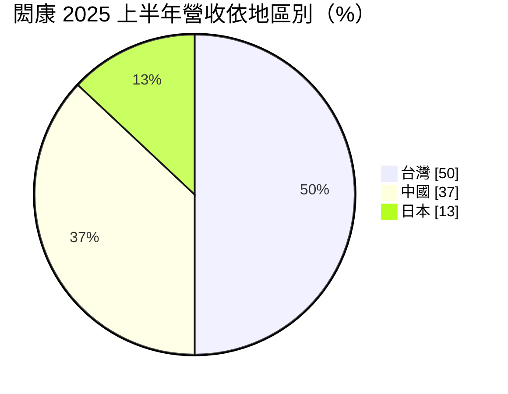
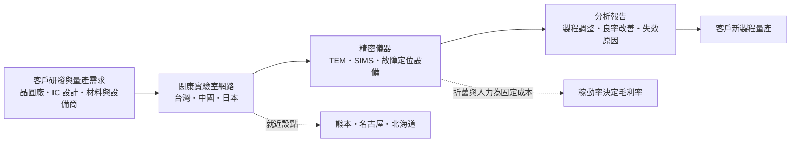
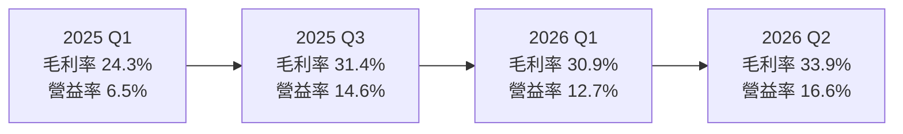
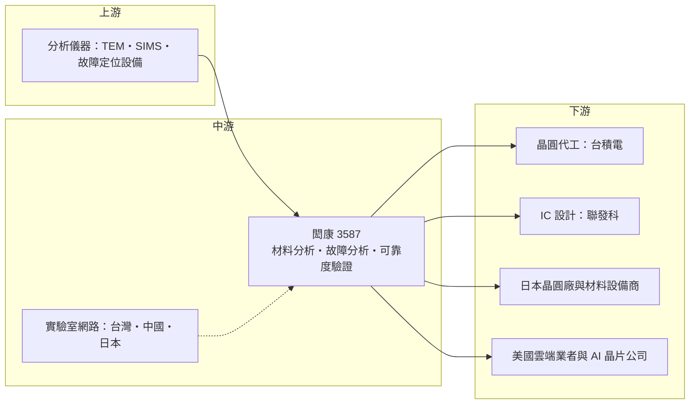

# 3587 閎康

> 上櫃｜[[產業索引-其他電子業|其他電子業]]｜上市（櫃）日期 2009/08/18

# 第一章：企業模式與商業藍圖

> [!info] 撰寫說明
> 本文由 Claude 依公開資料整理，架構比照 [[2330台積電]] 的四章研究，資料截至 2026-10-08。財務數字來源：證交所／櫃買中心開放資料（2026 年第二季財報、基本資料、本益比殖利率）、Goodinfo 年度經營績效、MoneyDJ 季度財務比率、方格子 2025 年法說會摘要、工商時報、nStock、富果（汎銓法說摘要）；產業描述為整理性內容，尚未逐條比對原始文件。#待校對

在評估單一個股的長期投資價值時，首要步驟是拆解企業的底層獲利邏輯。本章針對閎康科技（股票代號：3587，以下簡稱閎康）的商業模式進行定性分析，說明它如何從材料分析起家，建立橫跨台灣、中國與日本的實驗室網路，並在先進製程與日本半導體復興的趨勢中找到成長空間。

## 一、核心定位：以材料分析為核心的跨國檢測實驗室

閎康成立於 2002 年，2009 年在櫃買中心掛牌，董事長為創辦人謝詠芬。公司是一家半導體第三方檢測分析實驗室，提供[[材料分析]]（MA）、[[故障分析]]（FA）與[[可靠度驗證]]（RA）三大服務，客戶涵蓋晶圓代工、IC 設計、封裝測試、材料與設備商。

閎康和同業最大的差異在於起家的業務是材料分析。材料分析使用穿透式電子顯微鏡（[[TEM]]）、二次離子質譜儀（[[SIMS]]）等昂貴儀器，觀察奈米等級的薄膜結構、摻雜濃度與成分，是晶圓廠開發新製程時不可或缺的工具。依同業汎銓 2025 年法說會的描述，閎康在 SIMS 技術的市占約九成，這個說法來自競爭對手的整理，宜視為產業內的定性看法（待校對）。

這個定位帶來兩個商業意義：

* **貼近研發前端：** 材料分析主要服務晶圓廠與材料商的新製程開發，需求與製程世代推進高度相關。每當產業從 3 奈米走到 2 奈米、從 [[FinFET]] 換成 [[GAA]] 架構，分析難度與件數都會增加。
* **儀器密集、資本密集：** 材料分析的儀器單價高，投資回收依賴高稼動率，這讓閎康的獲利對產能利用與折舊時程相當敏感。

## 二、終端應用板塊：台灣為主，日本快速成長

閎康揭露的營收以地區別為主，2025 年上半年的結構如下：

* **台灣（約五成）：** 新竹實驗室提供完整的 MA、FA、RA 服務，台南據點提供 MA 與 FA，主要服務晶圓代工與先進封裝客戶。依使用者整理的供應鏈關係，閎康出現在 [[台積電供應鏈]] 的「高階檢測與分析服務」與 [[聯發科供應鏈]] 的「測試介面與高階檢測分析」環節，提供晶圓材料分析與故障排除。
* **中國（約三成多）：** 上海提供 MA、FA、RA，另有蘇州、廈門、深圳據點。2025 年上半年中國營收年減約 7%，公司表示對中國市場採取擇優合作。
* **日本（一成多但成長最快）：** 2019 年在名古屋設點，2023 年進入熊本，2025 年第一季在北海道開設材料分析實驗室，北海道的故障分析實驗室預計 2026 年第三季完成。日本營收 2025 年年增 68%、2026 年第一季年增 47%。
* **美國：** 透過跨區服務模式承接雲端業者、IC 設計、晶圓廠與設備商的案件，美國營收 2025 年年增 45%、2026 年第一季年增 41%。

依應用來看，[[矽光子]]是近年新增的需求。閎康前十大矽光子客戶 2025 年貢獻約 1.91 億元營收，2026 年第一季年增 51%。

## 三、資本轉化邏輯：跟著晶圓廠蓋實驗室

閎康的擴張邏輯是「跟著晶圓廠走」。晶圓廠在某個地區開始建廠與試產時，最需要大量的材料與故障分析；當地如果沒有足夠的第三方實驗室，樣品就得跨國送件，耗時又有保密顧慮。閎康在日本熊本與北海道設點，正好對應台積電在熊本的合資廠與 Rapidus 在北海道的 2 奈米計畫。

這種模式的代價是前期投入大。依 2025 年法說會資訊，當年資本支出約 14 億元，地區上台灣占 59%、日本 30%、中國 11%；服務類別上材料分析占 67%、可靠度驗證 19%（含超高功率燒機平台）、故障分析 11%。同期工程師人數增加 192 人至 1,305 人，人力成本年增約 31%、折舊年增約 22%。這些投入在 2025 年壓低了毛利率，需要之後的案件量逐步消化。

## 四、企業長期藍圖：去中國化的地區組合與高階分析

* **日本與美國成為第二支柱：** 閎康正把營收重心從中國移往非中國市場。日本有台積電熊本廠、Rapidus 與多家設備材料商，美國有雲端業者與 AI 晶片公司，這兩個市場的單價與成長性都高於中國。
* **從材料分析延伸到故障分析：** 日本據點原本以材料分析為主，北海道故障分析實驗室完成後，可以在同一客戶身上承接更多階段的案件，提高單一客戶的貢獻。
* **矽光子與先進封裝：** 矽光子檢測需要 TEM、SIMS 與光學檢測能力，閎康認為這是自身優勢所在；先進封裝產能擴張則帶動可靠度驗證需求。

# 第二章：護城河深度與競爭優勢

在長期價值投資中，「護城河」指企業抵禦競爭、維持超額利潤的保護機制。本章分析閎康在第三方材料與故障分析市場的護城河構成、主要競爭對手，以及這些優勢能否轉化為長期穩定的利潤。

## 一、閎康護城河的核心組成要素

閎康的護城河屬於「窄護城河」，但在材料分析這個利基市場有相對清楚的優勢：

* **1. 材料分析的技術累積：** 材料分析的關鍵不只是買到儀器，還要有能做出合格超薄試片、正確判讀數據的工程師團隊。閎康從 2002 年起專注這個領域，累積的分析方法與資料庫是新進者短期難以複製的。
* **2. 跨國實驗室網路：** 閎康在台灣、中國、日本都有實驗室，客戶可以在不同國家就近送樣。對在多地設廠的晶圓廠與材料商來說，同一家實驗室在各地提供一致的分析標準是重要的便利性。這也是閎康在日本先於同業布局的成果。
* **3. 保密與信任：** 晶圓廠把未公開的製程樣品交給第三方分析，對保密要求極高。長期合作建立的信任關係構成實質的轉換成本。

## 二、全球主要競爭對手格局

| 對手 | 定位 | 對閎康的威脅 |
|---|---|---|
| [[6830汎銓]] | 專注先進製程材料分析，在光阻、低介電材料等敏感材料具優勢 | 在最高階的材料分析直接競爭，單價最高 |
| [[3289宜特]] | 可靠度驗證與故障分析為主，折舊較低 | 在故障分析與可靠度驗證以價格競爭 |
| Eurofins EAG 等國際實驗室 | 歐美大型檢測集團 | 在美國與歐洲市場的主要對手 |
| 晶圓廠內部分析部門 | 大型晶圓廠自建分析能力 | 核心分析自行處理，只外包溢出需求 |

## 三、優勢轉化：哪些市場守得住、哪些守不住

* **守得住：** 跟隨晶圓廠在日本設廠的分析需求，以及需要 SIMS、TEM 等高階儀器的材料分析案件。閎康在日本的多據點布局已建立先行者優勢，日本營收連續高速成長即為證明。
* **守不住：** 中國市場的價格與份額。中國本土檢測業者在政策支持下擴張，閎康中國營收 2025 年上半年已年減約 7%。可靠度驗證則門檻較低，價格競爭激烈。
* **觀察重點：** 第一，2025 年大舉投資後，毛利率能否從 2025 年的 28.5% 回到 2021 至 2023 年 35% 上下的水準；2026 年第二季已回升到 33.9%。第二，日本與美國合計占營收的比重能否持續提高。第三，2 奈米以下製程與矽光子能否成為穩定的高單價案源。

# 第三章：財務體質與盈利規模

資料日期：2026-10-08。數字取自證交所／櫃買中心開放資料、Goodinfo 年度經營績效、MoneyDJ 季度財務比率與法說會摘要，表格是撰寫當時的快照；最新月營收、毛利率、累計 EPS 由自動排程寫在本筆記的屬性欄位（月營收、毛利率、累計EPS 等）。#待校對

財務報表是檢驗護城河是否真實存在的最終標準。本章用多年度的三率、ROE、現金流與資本報酬，檢視閎康在擴張期與收割期之間的獲利品質。

## 一、獲利能力的基石：三率

| 年度 | 營收（億元） | [[毛利率]] | [[營業利益率]] | EPS（元） | [[ROE]] |
|---|---|---|---|---|---|
| 2019 | 25.4 | 27.0% | 12.8% | 3.95 | 9.1% |
| 2020 | 30.6 | 29.6% | 14.5% | 6.18 | 13.6% |
| 2021 | 33.6 | 35.9% | 19.9% | 9.48 | 18.8% |
| 2022 | 39.7 | 36.9% | 18.5% | 10.12 | 18.4% |
| 2023 | 48.1 | 35.3% | 16.4% | 10.81 | 17.0% |
| 2024 | 51.1 | 32.9% | 13.8% | 10.39 | 14.7% |
| 2025 | 55.5 | 28.5% | 10.0% | 6.10 | 8.4% |
| 2026 上半年 | 30.7 | 32.5% | 14.8% | 2.99 | 未查得 |

註：2019 至 2025 年取自 Goodinfo；2026 上半年取自櫃買中心開放資料。

* **[[毛利率]]：** 2021 至 2023 年維持 35% 上下，2024 至 2025 年因折舊與人力成本先行增加而降到 28.5%，2026 年起隨案件量增加回升。這是實驗室業「先投資、後回收」的典型走勢。
* **[[營業利益率]]：** 高峰約 20%（2021 年），2025 年降到 10%，2026 年第二季回到 16.6%。營收成長時營業利益率擴張很快，顯示[[營運槓桿]]明顯。
* **稅負的一次性影響：** 2026 年上半年稅前淨利約 4.90 億元，所得稅費用卻高達約 2.83 億元，使稅後 EPS 只有 2.99 元。稅負偏高的具體原因本次未查得，推估與一次性稅務事項有關，評估本業時應以營業利益為準。

## 二、[[ROE]]：資本效率

閎康近 5 年（2021 至 2025 年）平均 ROE 約 15.5%（推算），高峰 2021 年 18.8%，2025 年降到 8.4%。ROE 下滑主要來自營業利益率下降，而不是財務槓桿變化，負債比率大致維持在 40% 至 48% 之間。營收方面，2019 至 2025 年年複合成長率約 13.9%（推算），六年內營收翻倍，成長性在台灣檢測同業中屬於前段。

## 三、資本支出與自由現金流

* **[[CapEx]]：** 2025 年約 14 億元，占當年營收約四分之一，屬於資本密集的擴張年。工商時報引述法人看法，認為之後折舊增幅將趨緩。
* **[[自由現金流]]：** 實驗室業的折舊很高，營業現金流通常明顯高於淨利；但在擴張年，資本支出可能吃掉大部分營業現金流（推估，具體年度數字未查得）。
* **股利：** 依 nStock 整理，近五年平均現金股利約 6.63 元，2024 年度配發 6.94 元、配發率約 67%；最近一次配發 4.21 元。閎康維持約六成到七成的配發率，股利隨獲利波動但沒有中斷。

## 四、[[ROIC]] 與 [[WACC]]：價值創造利差

* **ROIC（推算）：** 以 2025 年營收 55.5 億元乘營業利益率 10%，營業利益約 5.55 億元，扣除 20% 稅率後稅後營業利益約 4.44 億元。投入資本以 2026 年第二季股東權益 59.4 億元，加上有息負債約 19.2 億元（官方資料未拆分，以負債總額 38.5 億元的一半推估，含租賃負債）計算，合計約 78.6 億元，ROIC 約 5.6%。若以 2022 年營業利益率 18.5% 的水準推算，ROIC 可達 10% 以上。
* **WACC（推算）：** 以 [[CAPM]] 估算：無風險利率 1.75%、市場風險溢酬 6%、β 取 1.0（同業常見值，未查得公司實際數字），股權成本約 7.75%；稅前負債成本 2.5%、稅後 2.0%；帳面權益占約 76%，WACC 約 6.3%。
* **結論：** 2025 年 ROIC 約 5.6% 略低於 WACC 約 6.3%，屬於擴張投資期的暫時落差；2021 至 2023 年營業利益率 16% 以上時，ROIC 明顯高於 WACC。閎康能否長期創造價值，取決於日本與美國新據點能否在幾年內把營業利益率帶回 15% 以上。

# 第四章：總體風險與地緣政治

任何企業都無法脫離宏觀環境獨立存在。本章分析閎康未來必須面對的地緣政治、產業週期、營運與技術風險。

## 一、地緣政治風險

* **中國業務的雙面刃：** 中國曾是閎康第二大市場，2025 年上半年仍占約 37%。美中科技管制可能限制高階分析儀器進入中國，中國客戶也可能被要求使用本土實驗室，這會讓中國營收持續承壓。
* **日本布局的機會與風險：** 日本政府大力補助半導體復興，對閎康是長期機會；但 Rapidus 等新廠的量產時程若延後，北海道據點的稼動率就會偏低。

## 二、產業週期與市場結構風險

* **研發預算的景氣循環：** 材料分析主要來自晶圓廠與材料商的研發預算，雖然比量產需求穩定，但半導體大幅衰退時，客戶仍可能延後新製程開發或縮減外包。
* **大客戶集中：** 先進製程的研發集中在少數大型晶圓廠，客戶的外包策略改變（例如擴大內部分析能力）會直接影響閎康的案件量。

## 三、營運環境的隱性風險

* **折舊與人力的固定成本：** 2025 年工程師人數增加近兩百人、折舊年增約兩成，景氣一旦轉弱，毛利率下滑幅度會大於營收下滑幅度。
* **匯率：** 日本與中國據點的收入以當地貨幣計價，日圓或人民幣的波動會影響換算後的營收與獲利。
* **稅務與海外資金調度：** 2026 年上半年的高稅負顯示跨國經營在稅務上的複雜度，未來海外盈餘匯回或各地稅制變化仍可能造成獲利波動。

## 四、科技演進風險

2 奈米以下的 GAA 電晶體、[[Hybrid Bonding]]、[[CPO]] 等新技術讓分析需求持續增加，這是閎康長期最大的順風。但每一代新技術都需要新的儀器與方法，例如更高解析度的 TEM、原子探針與光學量測，投資金額越來越大。若閎康無法持續投資最先進的儀器，最高階的案件可能流向汎銓或國際大型實驗室。

# 專有名詞解析

## 半導體

- **[[材料分析]]**：用電子顯微鏡、質譜等儀器分析奈米等級的材料結構與成分，英文縮寫 MA，主要服務先進製程研發。
- **[[故障分析]]**：晶片失效時找出損壞位置與原因的分析服務，英文縮寫 FA，常用於新產品除錯與量產異常處理。
- **[[TEM]]**：穿透式電子顯微鏡，以電子束穿透極薄的樣品觀察原子等級結構，是先進製程材料分析的核心儀器。
- **[[SIMS]]**：二次離子質譜儀，以離子束轟擊樣品表面並分析濺出的離子，用來量測極微量的摻雜元素濃度與分布。
- **[[FinFET]]**：鰭式場效電晶體，把電晶體通道做成立體鰭片以降低漏電，是 16/14 奈米到 3 奈米的主流架構。
- **[[GAA]]**：環繞式閘極電晶體，閘極從四面包住通道以降低漏電，是 2 奈米世代接替 FinFET 的電晶體架構。
- **[[Hybrid Bonding]]**：混合鍵合，以銅對銅直接接合兩片晶圓或晶片，不需凸塊，可大幅提高連接密度。
- **[[CPO]]**：共同封裝光學，把光收發元件與交換器或運算晶片封裝在一起，以縮短電訊號距離並降低耗電。
- **[[矽光子]]**：在矽晶片上製作光學元件，以光取代電傳輸資料，可降低 AI 資料中心的傳輸耗電。

## 金融

- **[[營運槓桿]]**：固定成本占比高的企業，營收增加時利潤以更快速度成長，營收減少時利潤也下滑更快。
- **[[CAPM]]**：資本資產定價模型，以無風險利率加上 β 乘市場風險溢酬估算股東要求的報酬率。

## 產業

- **[[可靠度驗證]]**：把產品放在高溫、高濕、溫度循環等嚴苛條件下長時間測試，確認多年使用後不會失效，英文縮寫 RA。

# 核心供應鏈

## 1. 上游：分析儀器
- 穿透式電子顯微鏡（TEM）：Thermo Fisher、日本電子 JEOL 等（待校對）
- 二次離子質譜儀（SIMS）：CAMECA 等（待校對）

## 2. 中游：閎康本身與實驗室據點
- 台灣：新竹提供完整的 MA、FA、RA，台南提供 MA 與 FA，約占營收五成
- 中國：上海、蘇州、廈門、深圳，約占營收三成多，公司採擇優合作
- 日本：名古屋、熊本、北海道，營收成長最快

## 3. 下游：委託分析的客戶
- 晶圓代工：[[2330台積電]]（晶圓材料分析與故障排除）
- IC 設計：[[2454聯發科]]（晶圓材料分析與故障排除）
- 日本熊本的台積電合資廠與北海道 Rapidus：閎康在當地設點正是為了就近服務這類晶圓廠（推估，公司未公開客戶名單）
- 美國雲端業者、IC 設計、晶圓廠與設備商：以跨區服務模式承接
- 矽光子客戶：前十大客戶 2025 年貢獻約 1.91 億元，個別名單未公開

## 4. 同業競爭
- 台灣第三方實驗室：[[6830汎銓]]、[[3289宜特]]
- 國際檢測集團：Eurofins EAG 等
- 中國本土檢測業者，以及晶圓廠內部分析部門

延伸閱讀：[[台積電供應鏈]]、[[聯發科供應鏈]]

## 供應鏈關係
- 供應給 [[2330台積電]]：晶圓材料分析與故障排除（台積電供應鏈 › 下游：高階檢測與分析服務）
- 供應給 [[2454聯發科]]：晶圓材料分析與故障排除（聯發科供應鏈 › 中游：測試介面與高階檢測分析）

## 最新新聞
<!-- news:start（自動產生，請勿手動編輯此範圍） -->
- 2026-10-19 📰 媒體 02:06｜營收連七個月創高！閎康Q3也寫同期高 高階檢測迎新商機｜[三立新聞](https://news.google.com/rss/articles/CBMiS0FVX3lxTE9HbjBkTjM1Ui1FVFFMeTNRRlF2MDlBbG5XQlUwRHY4Wk9LUjRiLVpzSmxYaHRid1BCMGZ5Z01XNjRnX3lWNm9VY1ZhYw?oc=5)
- 2026-10-19 📰 媒體 02:01｜閎康Q3營收也寫同期高 高階檢測迎新商機｜[鏡週刊Mirror Media](https://news.google.com/rss/articles/CBMiYkFVX3lxTE43WWxDTmNYSm0zYVh6bWphZjJnblF3UWRvTWFJNmRaT1JvdG1GYXdGTmt1czk0cGc4VGMxa2l1Ynh4RDU1eFA1U1N6ZHFqWTZnV1hjYW5ReDdNZHNrc2Z2Ykpn0gFiQVVfeXFMTjdZbENOY1hKbTNhWHptamFmMmduUXdRZG9NYUk2ZFpPUm90bUZhd0ZOa3VzOTRwZzhUYzFraXVieHhENTV4UDVTU3pkcWpZNmdXWGNhblF4N01kc2tzZnZiSmc?oc=5)
- 2026-10-13 📰 媒體 16:57｜《熱門族群》CPO量產推進測試升級 汎銓、閎康、宜特迎新商機｜[富聯網](https://news.google.com/rss/articles/CBMiiAFBVV95cUxPMGpLdmtoYmlBdmVpanRDT20tbDhsak9YdW4tU3Z5V1lSSGRfaVg5NHFONGp3YmlxY2Q0VmJHRjBvdVdsQ0JlR3lmTEFzN3ExeHVNSGJvbnQ1c0tsSFRWSm9uZk5oLWNTX0JScUtoRURjMzJPaGI3cV9zTWlGOTJfX2pDZTZXTklO?oc=5)
- 2026-10-09 📰 媒體 02:51｜討論牆 ／ 閎康(3587)、宜特(3289)、汎銓(6830) 誰的成長動能最強？為何業績還沒爆發？｜[LINE TODAY](https://news.google.com/rss/articles/CBMiZEFVX3lxTE1NLVJQTVBLYlFUUVVYcWsxNTZENERqalRzaUV1c1ZFcmh2U3Y3YmFBcUI1eWVZSVFVVmprNUtKLWhiUjJyU0YwaXFtWUxOSkJXMDhqRDl5TTE1YWxISWZXOWRWODg?oc=5)
- 2026-10-08 📰 媒體 13:30｜閎康(3587)、宜特(3289)、汎銓(6830) 誰的成長動能最強？為何業績還沒爆發？｜[鉅亨網](https://news.cnyes.com/news/id/6624745)

完整紀錄：[[3587閎康 新聞]]
<!-- news:end -->

## 相關連結
- [公開資訊觀測站](https://mopsov.twse.com.tw/mops/web/t05st03?step=1&firstin=1&co_id=3587)
- [Goodinfo](https://goodinfo.tw/tw/StockDetail.asp?STOCK_ID=3587)
- [Yahoo 股市](https://tw.stock.yahoo.com/quote/3587)
- [鉅亨網新聞](https://www.cnyes.com/twstock/3587/news)
