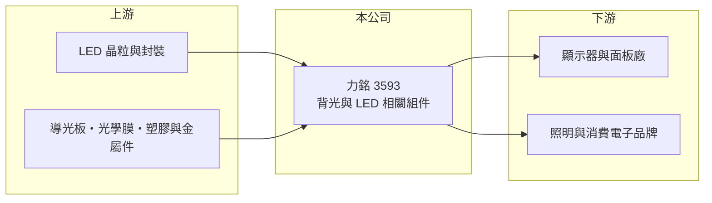

# 3593 力銘

> 上市｜[[產業索引-電子零組件業|電子零組件業]]｜上市（櫃）日期 2009/03/16

# 第一章：企業模式與商業藍圖

> [!info] 撰寫說明
> 精簡版，由 Claude 依公開資料整理，架構比照 [[2330台積電]]，資料截至 2026-10-08。來源：證交所開放資料（基本資料、2026 年第二季財報、營益分析、股利）、Goodinfo 經營績效頁、nStock 公司簡介。公開資料有限，產品與客戶描述多依產業常識整理。#待校對

力銘科技是一家位於高雄、規模很小的電子零組件公司，近年連續虧損，股東權益大幅縮水。對長期研究者來說，它是「產品同質化、規模不足的顯示零組件廠如何陷入困境」的案例。

- **核心業務：** 力銘成立於 2003 年，2009 年在證交所上市，總部在高雄前鎮。登記的營業項目是電子材料買賣與電子產品製造銷售，市場一般將其歸類為顯示器[[背光模組]]與 LED 相關組件廠（待校對）。產品細項與營收比重在這次查得的資料中未揭露。
- **營收結構：** 產品別、地區別營收比重未查得。2025 年營收約 11 億元，2026 年上半年約 3.3 億元，月營收約 5 千萬元，規模在上市電子零組件公司中屬於偏小。
- **營運據點：** 總部在高雄，生產據點未查得（待校對）。2023 年公告重要子公司樂陽投資辦理減資，顯示集團持續調整轉投資架構。
- **長期方向：** 公司目前的重心是止血與重整。基本資料顯示有 2,300 萬股私募股份，代表公司曾以私募引進資金，股權結構可能因此改變；後續能否找到有競爭力的新產品，決定公司能否延續。

# 第二章：護城河深度與競爭優勢

顯示零組件產業的特點是技術擴散快、價格競爭激烈，沒有規模或專利的中小廠很難守住利潤。

- **競爭優勢：** 從財務數字看，力銘近五年毛利率由 13.5% 一路降到負值，代表產品缺乏定價能力，目前難以辨認出明確的護城河。小型廠的可能優勢在於彈性與客製化，但需要找到大廠不願投入的利基市場才能發揮。
- **主要對手：** 背光模組與 LED 組件的大型同業包括 [[6176瑞儀]]、[[5371中光電]]、[[2393億光]]，以及大量中國廠商。這些對手在採購、產能與客戶關係上都有規模優勢，使小廠很難在主流產品上競爭。
- **觀察重點：** 2026 年上半年毛利率為 -8.12%、營業利益率 -25.71%，代表連變動成本都無法回收。觀察重點是毛利率能否回到正值、虧損能否縮小，以及私募資金與重整計畫是否帶來新的產品線。

# 第三章：財務體質與盈利規模

資料日期：2026-10-08，表格是撰寫當時的快照；最新月營收、毛利率、累計 EPS 由自動排程寫在本筆記的屬性欄位（月營收、毛利率、累計EPS 等）。#待校對

力銘從 2021 年起連續五年虧損，財務體質是這家公司最需要關注的部分。

| 年度 | 營收（億元） | [[毛利率]] | [[營業利益率]] | EPS（元） | [[ROE]] |
|---|---|---|---|---|---|
| 2020 | 11.2 | 13.5% | 2.42% | 0.90 | 9.15% |
| 2021 | 12.1 | 8.41% | -1.64% | 0.02 | -5.67% |
| 2022 | 9.24 | 4.86% | -7.53% | -1.00 | -16.1% |
| 2023 | 8.80 | 8.47% | -4.84% | -0.75 | -14.0% |
| 2024 | 8.77 | -5.83% | -22.9% | -2.19 | -54.0% |
| 2025 | 11.0 | 1.03% | -11.7% | -1.40 | -26.8% |
| 2026 上半年 | 3.29 | -8.12% | -25.71% | -1.45 | 未查得 |

- **營收規模：** 2020 至 2025 年營收大致在 9 億至 12 億元之間，年複合成長率約 -0.4%（推算），沒有成長。2026 年上半年營收明顯低於前一年同期水準。
- **獲利：** 2021 至 2025 年平均 ROE 約 -23%（推算）。ROE 的負值在 2024 年擴大到 -54%，是因為虧損持續侵蝕權益，分母變小使比率放大。
- **財務特色：** 2026 年第二季總資產 11.4 億元、負債 9.3 億元、權益僅 2.08 億元，負債比約 82%，每股淨值 3.42 元，已低於面額 10 元。2025 年度未配發現金股利，[[累積虧損]]存在時也不能配息。

**[[ROIC]] 與 [[WACC]]：** 開放資料未拆出有息負債，以負債總額 60% 估約 5.6 億元（推算假設）。2025 年營業虧損約 1.29 億元（虧損不計稅盾），除以權益 2.08 億元加有息負債 5.6 億元，ROIC 約 -17%（推算）。WACC 以 CAPM 推估：無風險利率 1.75%、市場風險溢酬 6%、β 取 1.2（小型虧損股常見值），股權成本約 8.95%；稅後負債成本 2%，股權占比約 27%，WACC 約 3.9%（推算，因高負債而偏低，實際風險遠高於此）。ROIC 為負且遠低於 WACC，表示公司正在消耗資本而非創造價值。

# 第四章：總體風險與地緣政治

力銘的首要風險是財務持續性，其次才是產業競爭。

- **產業週期：** 顯示器與 LED 需求隨電視、監視器與照明市場起伏，景氣下行時小廠的訂單往往最先被砍。長期而言，LED 照明與背光已高度成熟，價格持續下滑。
- **營運風險：** 權益只剩約 2 億元，若虧損持續，可能需要再次增資、減資或處分資產。每股淨值低於面額，也可能面臨主管機關的財務警示或變更交易方式的規定（待校對）。
- **其他風險：** 中國廠商的低價競爭、原材料價格與匯率變動都會壓縮已經很薄的毛利。私募股東的動向與經營權變化，也會影響公司的策略方向。

# 專有名詞解析

## 金融

- **[[累積虧損]]**：歷年虧損累計後使保留盈餘為負，公司須先彌補虧損才能發放股利。
- **[[私募]]**：公司向特定人募集股票或債券，不需公開發行，常用於引進策略投資人或在財務困難時籌資，私募股票有轉讓限制。

## 產業

- **[[背光模組]]**：液晶面板本身不發光，背光模組以 LED 與導光板提供均勻光源，是液晶顯示器的關鍵組件。

# 核心供應鏈

- 上游：LED 晶粒與封裝、導光板與光學膜、塑膠與金屬件（推估）。
- 下游／客戶：顯示器、面板與照明產品廠商；具名客戶未查得。
- 同業：[[6176瑞儀]]、[[5371中光電]]、[[2393億光]]。

## 最新新聞
<!-- news:start -->
<!-- news:end -->

## 相關連結
- [公開資訊觀測站](https://mopsov.twse.com.tw/mops/web/t05st03?step=1&firstin=1&co_id=3593)
- [Goodinfo](https://goodinfo.tw/tw/StockDetail.asp?STOCK_ID=3593)
- [Yahoo 股市](https://tw.stock.yahoo.com/quote/3593)
- [鉅亨網新聞](https://www.cnyes.com/twstock/3593/news)
