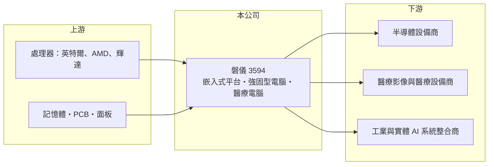

# 3594 磐儀

> 上櫃｜[[產業索引-電腦及週邊設備業|電腦及週邊設備業]]｜上市（櫃）日期 2013/05/07

# 第一章：企業模式與商業藍圖

> [!info] 撰寫說明
> 精簡版，由 Claude 依公開資料整理，架構比照 [[2330台積電]]，資料截至 2026-10-08。來源：櫃買中心開放資料（基本資料、2026 年第二季資產負債與綜合損益、2026 年 8 月營收）、Goodinfo 經營績效頁、優分析 2026 年 10 月 11 日營收報導。公開資料有限，產品與地區營收比重、子公司與工廠未查得。#待校對

磐儀是中型 [[工業電腦]] 廠，以嵌入式平台、強固型電腦與醫療電腦為主，近年把重心放在半導體設備、醫療影像與實體 AI 應用，2026 年營收明顯放大，但獲利率仍偏低。

- **核心業務：** 磐儀成立於 1993 年，2013 年在櫃買中心掛牌，英文品牌為 ARBOR（待校對）。產品包括嵌入式主機板與系統、[[強固型電腦]] 與平板、醫療用電腦等，客戶多為設備商與系統整合商，把磐儀的電腦裝進自己的機台或解決方案中。這種模式和多數工業電腦廠相同，靠「少量多樣、長期供貨」累積穩定客戶。
- **營收結構：** 公司未公開完整產品比重。依 2026 年 10 月報導，近期成長動能來自半導體設備與醫療影像、智慧醫療專案，2026 年 9 月營收 3.1 億元創單月新高，前三季累計營收 20.59 億元、年增約 47.5%，已超過 2025 年全年。
- **營運據點：** 總部在台灣，工廠與海外據點本次未查得。2026 年第二季底權益中約 3.7 億元屬非控制權益，代表旗下有非全資持有的子公司。
- **長期方向：** 公司聚焦實體 AI（[[邊緣 AI]] 運算設備）、智慧醫療、智慧製造與半導體四個方向，並發展高階運算平台與醫療影像產品。2026 年 10 月公司與台灣物聯網產業協會合辦實體 AI 論壇，顯示它想在機器人與自主載具的運算平台卡位。這些方向的成長空間大，但能否轉化為穩定獲利仍待觀察。

# 第二章：護城河深度與競爭優勢

磐儀的護城河主要是醫療與半導體設備客戶的認證與長期合作，但規模小於一線工業電腦廠，獲利率尚未證明具有定價能力。

- **競爭優勢：** 醫療電腦須符合醫療安規、半導體設備電腦要符合設備商的規格與長期供貨要求，供應商一旦通過驗證，在機台生命週期中很少被更換。磐儀累積了這類客戶，因此在半導體擴產與醫療影像需求增加時能跟著成長。毛利率在 2025 年提高到近 40%，顯示產品組合已往高附加價值移動。
- **主要對手：** 工業電腦龍頭 [[2395研華]]，以及 [[6166凌華]]、[[3479安勤]]、[[8050廣積]]、3088艾訊、[[6579研揚]]、[[2397友通]]、[[6922宸曜]]、3022威強電、8234新漢 等中型廠，各家在不同垂直市場有專長。磐儀在醫療與半導體設備的定位和 [[3479安勤]]、[[6166凌華]] 部分重疊。
- **觀察重點：** 第一是營收放大後營業利益率能否回到 7% 以上，這比營收成長本身更重要。第二是半導體設備客戶的需求能否延續到下一個擴產週期。第三是實體 AI 與醫療影像能否從專案變成量產訂單。

# 第三章：財務體質與盈利規模

資料日期：2026-10-08，表格是撰寫當時的快照；最新月營收、毛利率、累計 EPS 由自動排程寫在本筆記的屬性欄位（月營收、毛利率、累計EPS 等）。#待校對

磐儀的財務特色是毛利率逐步提高，但費用率高，營業利益率長期在 2% 至 9% 之間，ROE 偏低。

| 年度 | 營收（億元） | [[毛利率]] | [[營業利益率]] | EPS（元） | [[ROE]] |
|---|---|---|---|---|---|
| 2020 | 15.1 | 28.1% | 2.39% | 0.16 | 0.60% |
| 2021 | 15.1 | 27.3% | 2.10% | 0.30 | 1.42% |
| 2022 | 18.0 | 29.9% | 7.21% | 1.51 | 7.06% |
| 2023 | 16.7 | 32.7% | 9.08% | 1.30 | 5.87% |
| 2024 | 15.7 | 31.6% | 6.70% | 1.36 | 6.38% |
| 2025 | 20.3 | 39.9% | 4.28% | 0.49 | 2.22% |
| 2026 上半年 | 12.3 | 34.9% | 0.2% | 0.37 | 半年，不年化 |

（2020 至 2025 年取自 Goodinfo；2026 上半年依櫃買中心第二季綜合損益計算。）

- **營收規模：** 2020 至 2025 年營收由 15.1 億元成長到 20.3 億元，年複合成長率約 6.1%，2026 年前三季已達 20.6 億元，成長明顯加速。
- **獲利：** 近五年平均 ROE 僅約 4.6%。2025 年毛利率升到 39.9%，營業利益率卻降到 4.28%，代表營業費用增加更快，可能與新事業投入或併入子公司有關（推估）。2026 年上半年營業利益僅 0.02 億元，淨利 0.36 億元主要來自業外。
- **財務結構：** 2026 年第二季底總資產 55.4 億元、負債 29.0 億元，負債比約 52%；歸屬母公司權益 22.8 億元，每股淨值 23.92 元。總資產約為年營收的 2.7 倍，資產周轉率偏低，可能持有較多長期投資或不動產（推估，待校對）。逐年股利本次未查得。
- **[[ROIC]] 與 [[WACC]]：** 2025 年營業利益約 20.3 億 × 4.28% ≈ 0.87 億元，稅後約 0.70 億元；以權益總計 26.5 億元加非流動負債 3.7 億元作為投入資本概估，ROIC 約 2.3%（推算，有息負債實際金額未查得）。WACC 以 CAPM 推估：無風險利率 1.75%、市場風險溢酬 6%、β 取工業電腦同業常見值 1.0，股權成本約 7.75%；負債成本假設 2.5%（稅後 2%）、負債約占兩成，WACC 約 6.5%（推算）。ROIC 長期低於 WACC，代表過去資本運用效率不足，營收放大後能否把營業利益率拉高，是價值創造的關鍵。

# 第四章：總體風險與地緣政治

磐儀的風險主要是本業獲利率偏低、垂直市場集中於半導體與醫療，以及新事業投入的不確定性。

- **產業週期：** 工業電腦有庫存週期，客戶在景氣下滑時會延後拉貨；半導體設備需求更隨晶圓廠擴產起伏。磐儀近期成長高度依賴半導體設備，擴產週期反轉時營收可能快速回落。
- **營運風險：** 營收成長但營業利益率下降，顯示費用控管或產品定價仍有問題。實體 AI、醫療影像等新方向需要研發與業務投入，若訂單無法放量，會持續壓抑獲利。記憶體與處理器漲價時，中型廠的議價力也較弱。
- **其他風險：** 外銷客戶的匯率與美國關稅、醫療產品的法規認證進度，都會影響出貨與毛利。

# 專有名詞解析

## 應用

- **[[邊緣 AI]]**：在終端設備或現場電腦上直接執行 AI 推論，不必把資料傳回雲端，延遲低、隱私性高。

## 產業

- **[[工業電腦]]**：用於工廠自動化、交通、醫療等場域的電腦，強調長期供貨、耐用與穩定。
- **[[強固型電腦]]**：為軍事、戶外、交通等嚴苛環境設計的電腦，需耐震、耐溫、防水防塵並長期供貨。

# 核心供應鏈

- 上游：[[INTC英特爾]]、[[AMD超微]]、[[NVDA輝達]] 等處理器廠，記憶體、PCB 與面板供應商。
- 下游／客戶：半導體設備商、醫療影像與醫療設備商、工業與實體 AI 系統整合商（未具名）。
- 同業：[[2395研華]]、[[6166凌華]]、[[3479安勤]]、[[8050廣積]]、3088艾訊、[[6579研揚]]、[[2397友通]]、[[6922宸曜]]、3022威強電、8234新漢。

## 最新新聞
<!-- news:start -->
<!-- news:end -->

## 相關連結
- [公開資訊觀測站](https://mopsov.twse.com.tw/mops/web/t05st03?step=1&firstin=1&co_id=3594)
- [Goodinfo](https://goodinfo.tw/tw/StockDetail.asp?STOCK_ID=3594)
- [Yahoo 股市](https://tw.stock.yahoo.com/quote/3594)
- [鉅亨網新聞](https://www.cnyes.com/twstock/3594/news)
