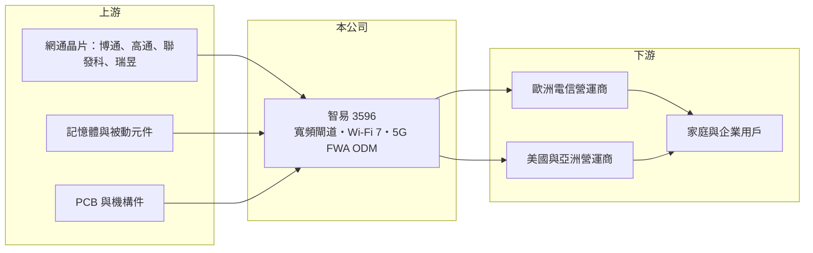

# 3596 智易

> 上市｜[[產業索引-通信網路業|通信網路業]]｜上市（櫃）日期 2009/03/11

# 第一章：企業模式與商業藍圖

> [!info] 撰寫說明
> 精簡版，由 Claude 依公開資料整理，架構比照 [[2330台積電]] 的四章研究，資料截至 2026-10-08。來源：證交所開放資料（基本資料、2026 年第二季資產負債與損益、股利）、Goodinfo 台灣股市資訊網年度經營績效（2020 至 2025 年）、富果研究 2026 年 3 月法說會整理、理財周刊與經濟日報報導；集團關係與產品世代描述部分依記憶整理，已標「待校對」。#待校對

本章拆解智易科技（股票代號：3596，以下簡稱智易）的商業模式：它是一家替全球電信營運商設計與製造家用及企業寬頻設備的網通 [[ODM]]，獲利來自規模、產品世代更替與客戶黏著度，而不是單一爆發性產品。

- **核心業務：** 智易成立於 2003 年，2009 年上市，主要產品是光纖寬頻閘道（[[PON]]）、[[Wi-Fi 7]] 路由器與 Mesh 系統，以及 5G 固定無線接取（[[FWA]]）設備。它不經營自有消費品牌，而是依電信業者規格設計並生產，由電信業者把設備配發給家庭與企業用戶。這種模式讓智易的需求來自營運商的網路升級計畫，而不是零售市場的流行，因此訂單能見度通常比消費性電子穩定。智易屬於 [[2324仁寶]] 集團（待校對），可共享集團的採購與製造管理經驗。
- **營收結構：** 依法說會整理，三大產品線是 Wi-Fi 7 路由器、PON 光纖設備與 5G FWA，主要客戶為全球電信營運商，公司未揭露各產品線比重。理財周刊報導指出，2025 年歐洲客戶與 5G FWA 訂單是營收創新高的主力。客戶集中在大型營運商的好處是單一標案規模大，壞處是議價力偏向客戶端，毛利率長期只能維持在 15% 上下。
- **營運據點：** 研發與管理在台灣，越南是主要生產基地，越南二期擴充後優先導入 AI 智慧化產線以提高效率；其他地區依客戶需求調配，有多個備案評估中。生產移出中國，讓智易銷往美國的產品較能因應關稅與「非中國製造」的要求，法說會也表示主要銷美產品線目前在關稅豁免清單內。
- **長期方向：** 智易的成長邏輯是「跟著網路世代走」：光纖從 GPON 升級到 10G PON、Wi-Fi 從 6 升級到 7、行動網路以 5G FWA 取代部分有線寬頻。每一次規格升級都會帶動營運商大規模換機，而智易作為長期供應商，通常能優先參與新規格的開發。低成本 AI 應用增加家庭與邊緣端的傳輸需求，是公司提到的新動能。

# 第二章：護城河深度與競爭優勢

在長期投資中，護城河指企業抵禦競爭、維持超額利潤的能力。網通 ODM 的護城河並不深，但智易憑規模與營運商認證，連續多年維持穩定獲利。

- **競爭優勢：** 第一是營運商認證的[[轉換成本]]：電信業者導入一款閘道設備，要經過長時間的互通性測試、資安認證與現場試營運，一旦選定供應商，該世代產品多半會用到生命週期結束，換供應商的成本與風險都高。第二是規模：2025 年營收 530 億元，在零組件採購、晶片廠配合與產線自動化上都比中小同業有優勢。第三是產品廣度，同時具備光纖、Wi-Fi 與 5G FWA 能力，可以替營運商提供整套家用網路方案。
- **主要對手：** 台灣同業包括 [[6285啟碁]]、[[5388中磊]]、[[3380明泰]]、[[4906正文]]、[[3062建漢]]，國際上則有中國的華為、中興與多家中國網通代工廠。在歐美營運商市場，資安與地緣政治因素讓中國供應商受限，台灣廠商成為主要受惠者；但同為台灣廠商之間，標案競爭仍以價格與交期為主。
- **觀察重點：** 一是 Wi-Fi 7 與 10G PON 的換機週期能持續多久，這決定 2026 至 2028 年的營收高度；二是越南產能擴充後的效率與毛利率；三是客戶結構是否進一步分散，降低對少數歐洲營運商的依賴。這三點合起來決定智易能否把「穩定成長」延續到下一個網路世代。

# 第三章：財務體質與盈利規模

資料日期：2026-10-08，表格是撰寫當時的快照；最新月營收、毛利率、累計 EPS 由自動排程寫在本筆記的屬性欄位（月營收、毛利率、累計EPS 等）。#待校對

財務報表是檢驗護城河的標準。智易的特色是毛利率低但非常穩定，獲利靠營收規模與費用控制逐年墊高。

| 年度 | 營收（億元） | [[毛利率]] | [[營業利益率]] | EPS（元） | [[ROE]] |
|---|---|---|---|---|---|
| 2020 | 338 | 15.0% | 6.76% | 8.36 | 14.0% |
| 2021 | 382 | 13.9% | 5.75% | 8.60 | 13.7% |
| 2022 | 472 | 14.0% | 4.66% | 9.20 | 14.3% |
| 2023 | 512 | 14.4% | 6.19% | 10.98 | 16.6% |
| 2024 | 490 | 15.1% | 6.20% | 11.28 | 16.0% |
| 2025 | 530 | 15.3% | 6.61% | 12.60 | 16.8% |
| 2026 上半年 | 266.7 | 15.17% | 6.57% | 6.50 | 未查得 |

註：2020 至 2025 年取自 Goodinfo，2026 年上半年取自證交所開放資料。

- **營收規模：** 2020 至 2025 年營收由 338 億元成長到 530 億元，年複合成長率約 9.4%（推算）。2024 年營收小幅下滑，反映營運商庫存調整，但隔年即回升創新高，顯示需求來自網路升級的長期趨勢，而非一次性訂單。
- **獲利：** 毛利率六年都在 13.9% 至 15.3% 之間，營業利益率在 4.7% 至 6.8% 之間，波動很小。EPS 從 8.36 元逐年成長到 12.6 元，公司表示 2025 年是連續第八年創新高。這種「低毛利、高穩定」的組合，是電信營運商 ODM 的典型樣貌。
- **財務特色：** 2021 至 2025 年平均 ROE 約 15.5%（推算）。2025 年底現金及定存約 136 億元，維持淨現金部位；存貨約 145 億元，金額不小，是營運資金管理的重點。2025 年度配發現金股利 9 元（盈餘 8 元、資本公積 1 元），配發率約 71%，公司長期目標配發率 60% 至 80%，股利政策相當穩定。

## [[ROIC]] 與 [[WACC]]

**ROIC 推算：** 2025 年營業利益約 35 億元（530 億元 × 6.61%），以稅率 20% 計算，稅後營業利益約 28 億元。投入資本以 2026 年第二季母公司股東權益約 164.6 億元近似（智易為淨現金，有息負債未查得、推估不多），ROIC 約 17%（推算）。若扣除帳上約 136 億元現金，營運資產的實際報酬率會更高。

**WACC 推算：** 以 CAPM 估算，台灣 10 年期公債約 1.75%、市場風險溢酬約 6%、β 取網通代工股常見的 0.9（未查得公司 β，此為假設），股東要求報酬率約 1.75% + 0.9 × 6% = 7.15%。因負債以應付帳款等營業負債為主，WACC 約等於股東要求報酬率，約 7%（推算）。

**解讀：** ROIC 約 17% 明顯高於約 7% 的 WACC，且六年來營業利益率與 ROE 都很穩定，代表智易在網通 ODM 這個低毛利產業中，仍能長期為股東創造價值。價值來源不是高毛利，而是高資產周轉與穩定的營運商訂單。

# 第四章：總體風險與地緣政治

任何企業都無法脫離宏觀環境。本章說明智易長期要面對的產業週期、客戶與地緣政治風險。

- **產業週期：** 營運商的設備採購跟著網路世代與資本支出計畫走，新規格導入期需求強勁，世代末期則會出現庫存調整，2024 年營收下滑就是例子。營運商端的[[長鞭效應]]也會放大波動：營運商備貨過多時，上游 ODM 的訂單會在短時間內急減。
- **營運風險：** 客戶集中於少數大型電信營運商，單一客戶標案的得失就會影響全年成長；毛利率只有 15% 左右，零組件漲價（例如記憶體、Wi-Fi 晶片）若無法轉嫁，很容易侵蝕獲利。公司 2026 年的因應方式是與客戶協商調價、提前備貨與協助變更規格。
- **其他風險：** 美國關稅政策的變化、越南生產集中帶來的單一據點風險，以及新台幣升值造成的匯損（2025 年匯損約 9,000 萬元）都是長期要留意的變數。好處是歐美營運商排除中國供應商的趨勢，對台灣網通廠在結構上有利。

# 專有名詞解析

## 應用

- **[[PON]]**：被動光纖網路，以光纖把寬頻送到家戶的主流架構，依速度分為 GPON、XGS-PON 等世代。
- **[[FWA]]**：固定無線接取，以 4G 或 5G 行動網路取代光纖或銅線，為家庭與企業提供固定寬頻。

## 金融

- **[[長鞭效應]]**：終端需求的小幅變動，沿供應鏈往上游傳遞時被逐級放大，造成上游庫存與訂單劇烈波動。

## 產業

- **[[ODM]]**：原廠委託設計製造，代工廠負責產品設計與生產，品牌或營運商只提出規格並負責銷售。
- **[[Wi-Fi 7]]**：第七代無線區域網路標準（IEEE 802.11be），支援更寬頻道與多連線同時傳輸，速度與延遲明顯優於 Wi-Fi 6。
- **[[轉換成本]]**：客戶更換供應商時要付出的時間、金錢與風險，轉換成本越高，供應商的客戶黏著度越高。

# 核心供應鏈

- 上游：網通與無線晶片 [[AVGO博通]]、[[QCOM高通]]、[[2454聯發科]]、[[2379瑞昱]]，以及記憶體、被動元件、PCB 與機構件供應商。
- 下游／客戶：全球電信營運商，以歐洲客戶為主力，公司未揭露具名客戶；最終用戶為家庭與中小企業。
- 同業：[[6285啟碁]]、[[5388中磊]]、[[3380明泰]]、[[4906正文]]、[[3062建漢]]；集團母公司 [[2324仁寶]]（待校對）。

## 供應鏈關係
- [[2454聯發科]] 的客戶：台灣網通設備代工廠（聯發科供應鏈 › 下游：網通、智慧顯示與終端設備客戶）

## 最新新聞
<!-- news:start（自動產生，請勿手動編輯此範圍） -->
- 2026-10-08 📰 媒體 12:47｜智易(3596) 個股概覽 ／ 個股 - 股市｜[CMoney](https://news.google.com/rss/articles/CBMiU0FVX3lxTFA2Vy1neGgyZmZzbEtGTElhbnNncXFYeHY1SEZzRkJnMTZneFFPdW9zWmU4bU9XcFozeGg4aUhJZlJMU0pwbW9SQkhIRE5RMFktaFc4?oc=5)
- 2026-10-06 📰 媒體 04:09｜智易9月營收月增7.0%｜[TechNews 科技新報](https://news.google.com/rss/articles/CBMigwFBVV95cUxPcy1TMHZhQW1pZFdWbExEbFNWMjRLUG91OW9PeDhmQTV0U2d5aDFnbTJBYzN5cmE0R0o3Nl92UlFxR2pZVnZyVEc3bU9Cc3NEZ3QyTHFESHljNDFvSTNOTXFXckpPZlUwUUZncmw4aWxObnQ2VVJqempQUE1zbktjMk5JRQ?oc=5)
- 2026-10-05 📰 媒體 17:34｜智易營收／9月站上50億元 單月、單季與前九月創佳績｜[經濟日報](https://news.google.com/rss/articles/CBMiWkFVX3lxTE85ZlJ4cV8wV0c4SEs2ZmZFNlNXSDVBTHJ1ZTZPM2c4M1d5eEZDWWZ4WVJrQnJzZFJOZGYybFRpdGJlWXQ3Nk9CbHFZM0x5cVJrVDRLNWpkd1M3UdIBX0FVX3lxTE9XTTk5NnhhRDRpWk1VSjM1UmJ5bTVhMFBEaVVXejl1SXNNUjFPUVVzcWRsRWVkSjhmbmtseEtHY0lxTVVZcUJiM1dqZV9PaFEwSVhRMlVvc3pVeWEwdWhj?oc=5)
- 2026-10-05 📰 媒體 16:12｜《業績-通網》智易9月營收為50.64億元，年增8.50%｜[富聯網](https://news.google.com/rss/articles/CBMiiAFBVV95cUxNTjVhZTVQRW04YUs4NmVTRXJfWGJZcmVudXZDQnYxNmpQaW9NWEZTTlp4NzJpM3htQzBOaVVMLVZqYWdTY3pXYXdaNV8zZ19QQ1dUaXZRRE02dmpuYVBKUGRlSm9HUFc4dndOS29VcENfNHQ5cjZBal9nbUk1ZjM3aDY3MjhzOTgt?oc=5)

完整紀錄：[[3596智易 新聞]]
<!-- news:end -->

## 相關連結
- [公開資訊觀測站](https://mopsov.twse.com.tw/mops/web/t05st03?step=1&firstin=1&co_id=3596)
- [Goodinfo](https://goodinfo.tw/tw/StockDetail.asp?STOCK_ID=3596)
- [Yahoo 股市](https://tw.stock.yahoo.com/quote/3596)
- [鉅亨網新聞](https://www.cnyes.com/twstock/3596/news)
