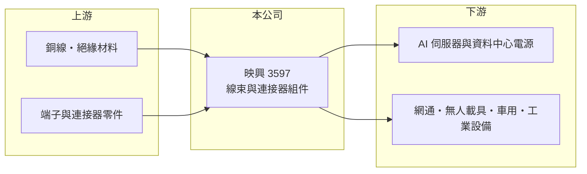

# 3597 映興

> 上櫃｜[[產業索引-電子零組件業|電子零組件業]]｜上市（櫃）日期 2020/03/09

# 第一章：企業模式與商業藍圖

> [!info] 撰寫說明
> 精簡版，由 Claude 依公開資料整理，架構比照 [[2330台積電]]，資料截至 2026-10-08。來源：櫃買中心開放資料（基本資料、2026 年第二季財報）、Goodinfo 經營績效頁、nStock 公司簡介（產品與應用）。營收比重、工廠與客戶未查得。#待校對

映興電子是成立近四十年的線材與連接器廠，2020 年才在櫃買中心掛牌。它的商業模式是替設備廠客製「把電力和訊號接起來」的[[線束]]與[[連接器]]組件，近年把重心從一般電子產品轉向 AI 伺服器、網通與無人載具。

- **核心業務：** 映興成立於 1986 年，2020 年 3 月上櫃。依公司簡介，主力是 [[AI 伺服器]]、網通、無人載具與[[車用電子]]所需的關鍵線組與連接器，產品包括 [[HVDC]]、PDU、CDU、[[BBU]] 等高壓大電流模組，以及防水與控制系統線組。另有電氣保護器、壓力感測器與大電流連接器等經銷代理產品。
- **營收結構：** 產品別與地區別營收比重未查得。從產品清單看，資料中心電源配電相關的高壓大電流線組是公司最想發展的領域，傳統工業與消費性線材則是既有基礎（推估）。
- **營運據點：** 總部在台灣，生產據點在這次查得的資料中未揭露（待校對）。線束屬勞力密集產業，多數同業會在中國或東南亞設置組裝廠。
- **長期方向：** 資料中心朝高壓直流供電發展，機櫃內部的電流越來越大，需要更粗、更耐熱、更安全的線束與連接器。映興若能進入 AI 機櫃電源系統的供應鏈，產品單價與毛利都有機會提升；2023 年發行無擔保轉換公司債，也是為了支應這段轉型的資金需求。

# 第二章：護城河深度與競爭優勢

線束與連接器組件是高度客製化的產業，競爭力來自工程設計、認證與交期，而非單一技術。

- **競爭優勢：** 每一套線束都要依客戶設備的空間、電流與安規重新設計，通過認證後在設備生命週期內很少更換，因此有一定的[[設計導入]]黏著度。映興長年經營工業與網通客戶，累積了少量多樣的客製經驗，這是小型線束廠存活的主要方式。
- **主要對手：** 資料中心電源線束與連接器的同業包括 [[3665貿聯-KY]]、[[2392正崴]]、[[3023信邦]]、[[6197佳必琪]] 等，規模都遠大於映興。國際大廠如 TE、Amphenol 也是 AI 機櫃電源連接器的主要供應者。
- **觀察重點：** 毛利率長期維持在 20% 至 27%，代表產品有一定客製附加價值；但 2023 年與 2025 年的獲利都大幅下滑，說明規模小、訂單波動大。觀察重點是高壓大電流產品能否形成穩定量產訂單。

# 第三章：財務體質與盈利規模

資料日期：2026-10-08，表格是撰寫當時的快照；最新月營收、毛利率、累計 EPS 由自動排程寫在本筆記的屬性欄位（月營收、毛利率、累計EPS 等）。#待校對

映興營收規模約 6 億至 11 億元，毛利率穩定、但營業利益率薄，獲利容易被業外與匯率影響。

| 年度 | 營收（億元） | [[毛利率]] | [[營業利益率]] | EPS（元） | [[ROE]] |
|---|---|---|---|---|---|
| 2020 | 8.30 | 27.2% | 9.06% | 1.28 | 9.90% |
| 2021 | 10.6 | 25.6% | 10.4% | 2.10 | 14.2% |
| 2022 | 10.5 | 23.8% | 8.62% | 2.06 | 13.2% |
| 2023 | 6.11 | 20.5% | -1.12% | 0.25 | 1.67% |
| 2024 | 7.38 | 24.8% | 5.41% | 1.32 | 8.97% |
| 2025 | 8.60 | 23.6% | 6.26% | 0.34 | 2.25% |
| 2026 上半年 | 4.51 | 23.7% | 5.43% | 0.35 | 未查得 |

- **營收規模：** 2020 至 2025 年營收年複合成長率約 0.7%（推算），2023 年曾因庫存調整大減四成，之後逐步回升。
- **獲利：** 2021 至 2025 年平均 ROE 約 8.1%（推算）。2025 年營業利益約 0.54 億元，但 EPS 只有 0.34 元，代表業外損失或稅負吃掉大部分本業獲利（原因未查得）。
- **財務特色：** 2026 年第二季總資產 16.5 億元、負債 10.6 億元、權益 5.93 億元，其中非流動負債 7.2 億元，比重偏高，推估包含長期借款與公司債。資產規模約是年營收的兩倍，顯示公司持有較多廠房或其他資產。

**[[ROIC]] 與 [[WACC]]：** 開放資料未拆出有息負債，以非流動負債為主估約 7 億元（推算假設）。2025 年營業利益約 0.54 億元，稅後約 0.43 億元，除以權益 5.93 億元加有息負債 7 億元，ROIC 約 3.3%（推算）。WACC 以 CAPM 推估：無風險利率 1.75%、市場風險溢酬 6%、β 取 1.0（同業常見值），股權成本 7.75%；稅後負債成本 2%，股權占比約 46%，WACC 約 4.7%（推算）。ROIC 低於 WACC，目前本業報酬不足以支付資金成本；高壓大電流產品若能拉高營業利益率到 10% 以上，才有機會轉為創造價值。

# 第四章：總體風險與地緣政治

映興的風險主要來自規模小、客戶需求波動，以及轉型新產品的執行。

- **產業週期：** 工業與網通設備的訂單有明顯的庫存週期，2023 年營收大減就是[[長鞭效應]]的結果。AI 伺服器需求目前強勁，但資本支出若放緩，新產品的放量也會延後。
- **營運風險：** 規模小代表議價力弱，大客戶訂單的增減就能讓營收大幅波動。新產品需要通過資料中心客戶的安規與可靠度認證，時間長且不保證成功。
- **其他風險：** 銅價是線束的主要成本，價格大漲時若無法轉嫁就會壓縮毛利；負債偏高也讓利率上升的影響放大。美中關稅與供應鏈移轉則可能增加生產成本。

# 專有名詞解析

## 應用

- **[[AI 伺服器]]**：搭載 GPU 等加速晶片、用於訓練與推論 AI 模型的伺服器，對散熱與電源規格要求很高。

## 產業

- **[[線束]]**：把多條電線、端子與連接器組合成一組的配線組件，用於家電、汽車與工業設備內部配線。
- **[[連接器]]**：讓電子零件、模組或設備之間可插拔連接的元件，負責傳遞電力或訊號。
- **[[HVDC]]**：高壓直流供電，資料中心以 ±400V 或 800V 直流取代傳統交流配電，可減少轉換損耗。
- **[[BBU]]**：備援電池單元，AI 伺服器機櫃在市電中斷時的短時供電裝置，可避免運算中斷。
- **[[設計導入]]**：零件被客戶選入產品設計並完成驗證，之後該產品量產期間都會持續採購，是零組件廠長期營收的來源。

# 核心供應鏈

- 上游：銅線與絕緣材料、端子與連接器零件，以及代理的感測與保護元件原廠。
- 下游／客戶：AI 伺服器與資料中心電源、網通、無人載具、車用與工業設備廠；具名客戶未查得。
- 同業：[[3665貿聯-KY]]、[[2392正崴]]、[[3023信邦]]、[[6197佳必琪]]。

## 最新新聞
<!-- news:start（自動產生，請勿手動編輯此範圍） -->
- 2026-10-13 🏛️ 重訊 13:38｜係因本公司有價證券於集中交易市場達公布注意交易資訊標準， 故公布相關財務業務等重大訊息，以利投資人區別瞭解。｜[觀測站](https://mops.twse.com.tw/mops/#/web/t05st01)
- 2026-10-12 🏛️ 重訊 14:36｜公告本公司國內第二次無擔保轉換公司債代收價款及存儲專戶行庫｜[觀測站](https://mops.twse.com.tw/mops/#/web/t05st01)

完整紀錄：[[3597映興 新聞]]
<!-- news:end -->

## 相關連結
- [公開資訊觀測站](https://mopsov.twse.com.tw/mops/web/t05st03?step=1&firstin=1&co_id=3597)
- [Goodinfo](https://goodinfo.tw/tw/StockDetail.asp?STOCK_ID=3597)
- [Yahoo 股市](https://tw.stock.yahoo.com/quote/3597)
- [鉅亨網新聞](https://www.cnyes.com/twstock/3597/news)
