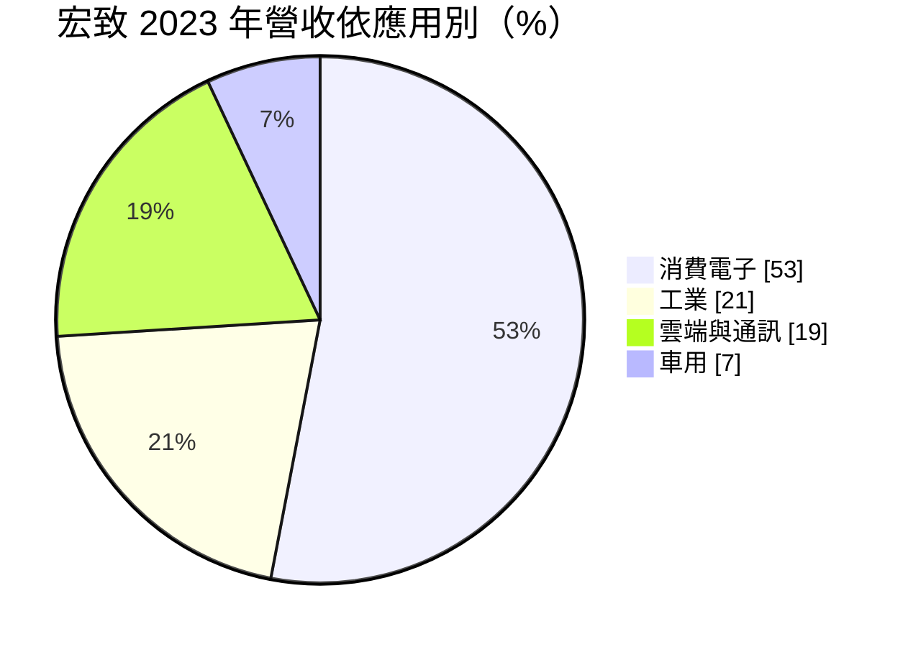
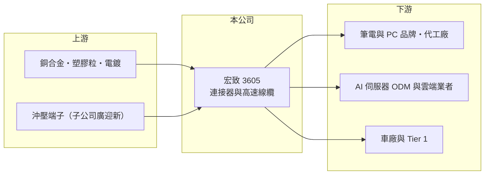

# 3605 宏致

> 上市｜[[產業索引-電子零組件業|電子零組件業]]｜上市（櫃）日期 2009/03/26

# 第一章：企業模式與商業藍圖

> [!info] 撰寫說明
> 精簡版，由 Claude 依公開資料整理，架構比照 [[2330台積電]]，資料截至 2026-10-08。來源：證交所開放資料（基本資料、2026 年第二季財報、營益分析、股利）、Goodinfo 經營績效頁、富果研究宏致個股分析（2023 年營收比重、產能分布、併購沿革）；客戶名單依富果文章轉述。#待校對

宏致電子是台灣第三大的[[連接器]]廠，從筆電連接器起家，透過一連串併購擴展到伺服器高速線、車用與工業連接器。它的長期故事是「從消費電子轉向雲端、車用等高門檻市場」。

- **核心業務：** 宏致成立於 1996 年，2009 年在證交所上市，總部在桃園中壢。產品包括筆電與消費電子的板對板、線對板連接器，USB、PCIe、M.2 等插槽，伺服器用 PCIe Riser 高速線，以及車用高速（FAKRA、HSD、車用乙太網路）、低壓與電動車高壓連接器。
- **營收結構：** 依富果整理，2023 年消費電子占 53%、工業 21%、雲端與通訊 19%、車用 7%；地區別以中國 51%、台灣 17% 為主，其餘為美國與菲律賓。
- **營運據點：** 全球約 9 個據點，產能約 72% 在中國、14% 在台灣、10% 在菲律賓。客戶可依需求要求就近組裝，這在供應鏈分散的趨勢下是加分條件。

- **長期方向：** 宏致以併購補足產品線：2015 年併購龍翰進入白牌伺服器高速線，2017 年併購志展開拓歐洲市場，2019 年併購沖壓廠廣迎新整合上游，2021 年併購美國創世紀切入高速連接器與網通。近年重點是 [[AI 伺服器]]的高速線與電源線，以及 AI PC 電源連接器與車用 ADAS 連接器，目標是降低對消費電子的依賴。

# 第二章：護城河深度與競爭優勢

連接器產業的護城河來自料號廣度、客戶認證與垂直整合，宏致正在把護城河從筆電延伸到伺服器與車用。

- **競爭優勢：** 筆電連接器需配合每一代機種設計，宏致與台系品牌及代工廠合作多年，具備[[設計導入]]的黏著度。併購沖壓廠後掌握端子與金屬件的上游製程，有利於成本與交期控制；多地產能也讓客戶能分散地緣風險。
- **主要對手：** 筆電與消費電子連接器的同業有 [[3526凡甲]]、[[2392正崴]]、[[2317鴻海]]（FIT）；伺服器高速連接器與線纜有 [[3533嘉澤]]、[[3665貿聯-KY]]，以及國際大廠 TE、Amphenol；車用連接器則有 [[6279胡連]] 與日系、歐系大廠。
- **觀察重點：** 毛利率由 2023 年的 20.6% 回升到 2025 年的 26.0%、2026 年上半年 25.2%，反映產品組合往伺服器與車用移動。觀察重點是雲端與車用占比能否持續提高，以及營業利益率能否從 5% 至 6% 拉高到過去高峰之上。

# 第三章：財務體質與盈利規模

資料日期：2026-10-08，表格是撰寫當時的快照；最新月營收、毛利率、累計 EPS 由自動排程寫在本筆記的屬性欄位（月營收、毛利率、累計EPS 等）。#待校對

宏致營收約百億元，但營業利益率長期只有個位數，獲利對產品組合與費用控制非常敏感。

| 年度 | 營收（億元） | [[毛利率]] | [[營業利益率]] | EPS（元） | [[ROE]] |
|---|---|---|---|---|---|
| 2020 | 80.6 | 22.8% | 4.32% | 2.26 | 5.84% |
| 2021 | 106 | 23.0% | 4.86% | 4.16 | 10.1% |
| 2022 | 104 | 21.5% | 0.55% | 1.68 | 3.99% |
| 2023 | 84.9 | 20.6% | -3.90% | -1.98 | -4.92% |
| 2024 | 97.7 | 23.8% | 2.85% | 2.51 | 5.88% |
| 2025 | 109 | 26.0% | 5.49% | 4.35 | 9.19% |
| 2026 上半年 | 61.7 | 25.16% | 6.38% | 1.89 | 未查得 |

- **營收規模：** 2020 至 2025 年營收年複合成長率約 6.2%（推算），2025 年創 109 億元新高，2026 年上半年持續成長。
- **獲利：** 2021 至 2025 年平均 ROE 約 4.8%（推算），偏低。2023 年出現營業虧損，說明消費電子景氣下滑時，龐大的費用結構會迅速吞掉毛利，屬於[[營業槓桿]]高的公司。
- **財務特色：** 2026 年第二季總資產 161.2 億元、負債 71.8 億元、權益 89.3 億元，每股淨值 50.96 元。2025 年度配發現金股利約 1.57 元，配發率約 36%，保留較多盈餘支應擴產與併購。

**[[ROIC]] 與 [[WACC]]：** 開放資料未拆出有息負債，以負債總額 40% 估約 28.7 億元（推算假設）。2025 年營業利益約 6.0 億元，稅後約 4.8 億元，除以權益 89.3 億元加有息負債 28.7 億元，ROIC 約 4.1%；2026 年上半年年化約 6.7%（推算）。WACC 以 CAPM 推估：無風險利率 1.75%、市場風險溢酬 6%、β 取 1.1（連接器同業常見值），股權成本約 8.35%；稅後負債成本 2%，股權占比約 76%，WACC 約 6.8%（推算）。過去多數年度 ROIC 低於 WACC，併購帶來的營收擴張尚未轉化為足夠的資本報酬；伺服器與車用若能把營業利益率推到 8% 以上，ROIC 才會穩定超過資金成本。

# 第四章：總體風險與地緣政治

宏致的風險來自消費電子週期、產能集中在中國，以及轉型新市場的競爭。

- **產業週期：** 消費電子仍占營收一半左右，筆電與手機出貨下滑時，2022 至 2023 年的獲利急降會重演。AI 伺服器需求波動大，雲端客戶的拉貨節奏也會影響高速線出貨。
- **營運風險：** 產能約七成在中國，美國關稅與客戶要求移出中國，可能迫使公司增加東南亞產能並承擔移轉成本。多次併購也帶來整合與商譽風險，子公司表現不如預期時需要提列減損。
- **其他風險：** 銅、金等金屬是連接器主要原料，價格波動影響毛利；營收以美元為主，匯率變動會影響獲利。車用市場驗證期長，切入速度可能比預期慢。

# 專有名詞解析

## 應用

- **[[AI 伺服器]]**：搭載 GPU 等加速晶片、用於訓練與推論 AI 模型的伺服器，對散熱與電源規格要求很高。

## 金融

- **[[營業槓桿]]**：固定成本占比高的公司，營收增加時利潤增幅大於營收增幅，反之亦然。

## 產業

- **[[連接器]]**：讓電子零件、模組或設備之間可插拔連接的元件，負責傳遞電力或訊號。
- **[[沖壓]]**：以模具與沖床把金屬板材壓成特定形狀的加工方式，適合大量生產金屬零件。
- **[[設計導入]]**：零件被客戶選入產品設計並完成驗證，之後該產品量產期間都會持續採購，是零組件廠長期營收的來源。

# 核心供應鏈

- 上游：銅合金、工程塑膠、電鍍，以及集團內的沖壓端子廠。
- 下游／客戶：依富果整理，包括 [[2357華碩]]（AI PC 電源連接器）、技鋼（PCIe Riser 線）、[[AMZN亞馬遜]] 伺服器供應鏈，以及比亞迪、特斯拉等車用客戶（待校對）。
- 同業：[[3526凡甲]]、[[2392正崴]]、[[3533嘉澤]]、[[3665貿聯-KY]]、[[6279胡連]]。

## 最新新聞
<!-- news:start -->
<!-- news:end -->

## 相關連結
- [公開資訊觀測站](https://mopsov.twse.com.tw/mops/web/t05st03?step=1&firstin=1&co_id=3605)
- [Goodinfo](https://goodinfo.tw/tw/StockDetail.asp?STOCK_ID=3605)
- [Yahoo 股市](https://tw.stock.yahoo.com/quote/3605)
- [鉅亨網新聞](https://www.cnyes.com/twstock/3605/news)
